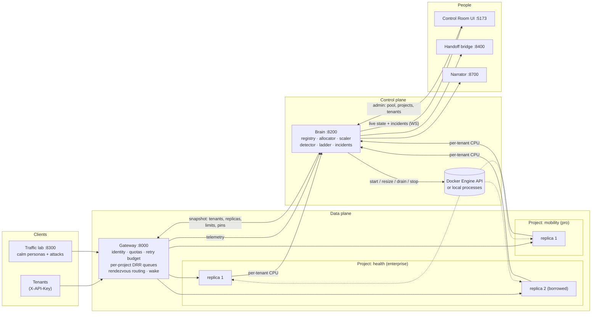
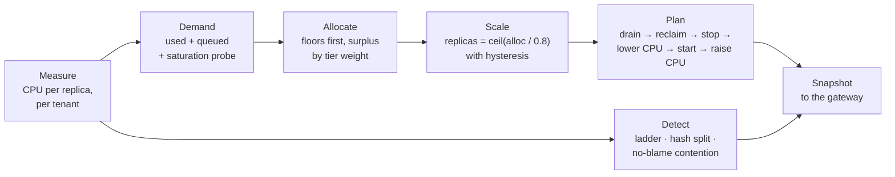

<div align="center">

# TenantGuard

**Fair, isolated, self-defending multi-tenant SaaS: one shared CPU pool, guaranteed floors per project, idle capacity lent out, and noisy neighbours caught and throttled automatically.**


CodeAstra 2.0 · Cloud Computing & Distributed Systems · Problem Statement 3: multi-tenant isolation and noisy-neighbour defence

[Why](#the-problem) · [How it works](#how-it-works) · [Quick start](#quick-start) · [Demo](#a-five-minute-demo) · [Evidence](#evidence) · [Services](#services) · [Docs](#documentation)

</div>

---

## The problem

In a multi-tenant SaaS, every customer shares the same machines. One busy or badly behaved tenant (the **noisy neighbour**) slows everybody else down. The usual answers each fail in their own way:

| Usual answer | What goes wrong |
|---|---|
| Static per-tenant limits | Capacity sits idle while a busy tenant is refused |
| Request rate limits | A few cheap-looking requests can trigger large hidden work that no request counter sees |
| One big shared server | Nothing stops the noisiest tenant |
| Blame whoever is busiest | Honest growth and host faults get punished |

## What TenantGuard does

| | Capability | How |
|---|---|---|
| 🧱 | **Guaranteed floors** | An admin sets a CPU pool; each **project** gets a floor it can always use and a cap it can never exceed |
| 🔁 | **Idle capacity is lent, then reclaimed** | Surplus CPU is water-filled across busy projects by tier weight (enterprise 4 · pro 2 · free 1) and taken back when the owner needs it |
| 📦 | **Containers only when needed** | Replicas start on demand, scale with load, drain and stop when idle; a project can sleep and wake on its next request |
| 🎯 | **Sticky, fair routing** | Rendezvous hashing pins each tenant to its project's replicas; per-tenant fair queueing (DRR) inside each project |
| 🚨 | **Noisy neighbours caught** | A graduated ladder (warn → throttle → deprioritize → quarantine) acts only when neighbours are measurably hurt, and recovers by itself |
| 🔍 | **Hidden work found** | CPU that no request explains triggers a **hash split test**: tenants are pinned to two halves until the hidden work is traced to one tenant |
| ⚖️ | **No false blame** | When every project slows down at once, the cause is outside them: reported, nobody throttled |
| 🖥️ | **Everything explained** | A live Control Room, an admin Pool page, a Case File for every incident, and cases handed to the on-call team |

## How it works



**One control tick (every second):**



**The seeded pool** (`tenantguard.yaml`; an admin can change all of it at runtime from the Pool page):

| Project | Tier (weight) | Floor | Cap | Tenants |
|---|---|---|---|---|
| health | enterprise (4) | 1.25 cores | 3.0 cores | A Aarogya Health, D DhanSetu Payments |
| commerce | enterprise (4) | 1.25 cores | 3.0 cores | B BazaarKart, J JhatpatMart |
| mobility | pro (2) | 0.75 cores | 2.0 cores | E Ekalavya Learn, G GaadiGo, K KaamKaro |
| media | pro (2) | 0.75 cores | 2.0 cores | H HisaabBooks, L LokVani News |
| free | free (1) | 0.5 cores | 1.0 cores | C Chitra Studio, F FitZone, I IdliExpress |

Pool: 5.75 cores, 2688 MB, 10 % headroom never promised to anyone.

## Quick start

### Whole system on one machine, no Docker (Python 3.10+, Node 18+)

```bash
pip install -e common
cd ui && npm install && cd ..
PYTHONPATH=$PWD/common TENANTGUARD_ROOT=$PWD python brain/tools/local_stack.py
```

Open **http://127.0.0.1:5180**. One command starts everything on offset ports, so it never collides with a Docker stack:

| Service | Port |
|---|---|
| UI (Control Room) | 5180 |
| Gateway | 8030 |
| Brain (starts replicas as local processes from port 8130) | 8230 |
| Traffic lab (calm traffic starts automatically) | 8330 |
| Handoff bridge → mock partner app | 8430 → 8530 |
| Narrator | 8730 |

`Ctrl+C` stops everything. `python brain/tools/local_stack.py --stop` stops a stack started in the background.

### Docker

```bash
docker compose --profile image build worker          # the replica image the brain starts
docker compose up -d                                  # gateway + brain
docker compose --profile lab --profile handoff --profile narrator up -d
cd ui && npm install && cp .env.example .env && npm run dev   # http://127.0.0.1:5173
```

The brain starts and stops replica containers itself through the Docker Engine API. The Docker path has not yet been run end to end for this version on the shared host; see [docs/v2/09_AS_BUILT.md](docs/v2/09_AS_BUILT.md).

All `/admin/*` and `/control/*` calls need the header `X-TenantGuard-Control-Token` (env `TENANTGUARD_CONTROL_TOKEN`, default `dev`).

## A five-minute demo

| Step | Where | What to show |
|---|---|---|
| 1 | **Control Room** | Calm traffic: 12 tenants green, one warm replica per project, fairness and pool CPU gauges |
| 2 | **Pool** | Create a project with a floor and a cap, add a tenant: its API key is shown once and handed to the lab, so traffic starts at once |
| 3 | **Control Room → Attack launcher** | Launch *whale* on K. K climbs the ladder (warn → throttle → deprioritize → quarantine) while E and G stay healthy; mobility borrows idle cores and scales out |
| 4 | **Mode toggle** | Switch OFF / Industry / TenantGuard and watch the victims' p95 |
| 5 | **Cases → Case File** | The incident as a story: detection, every level change, the verdict, recovery; the handoff case and the narrator's report |

`python tools/demo.py --step` drives the same story from the command line, one step per Enter.

## Evidence

**Hidden work is real and large.** Measured in a 0.5-CPU worker container, 200 sequential requests per endpoint ([`worker/calibration.json`](worker/calibration.json)):

| Endpoint | CPU the request handler reports | Background job CPU | Black-box indexer CPU | Whole-process CPU per request |
|---|---|---|---|---|
| `GET /api/light` | 0.40 ms | 0 | 0 | 0.95 ms |
| `GET /api/search` | 3.83 ms | 0 | 0 | 4.67 ms |
| `POST /api/write` | 0.19 ms | 1.43 ms | 0 | 3.1 ms |
| **`POST /api/ingest`** | **0.07 ms** | 0 | **20.25 ms** | **23.5 ms** |

An `ingest` call looks cheaper than a `light` call to anything that meters requests, yet makes the worker burn about 300× more CPU in a black-box indexer. That gap is why TenantGuard measures CPU per replica and runs the hash split test instead of trusting request counters.

**Scorecard.** The lab measures OFF vs Industry vs TenantGuard per attack and writes one JSON file per run to `lab/results/`; the Scorecard page reads them. This version has not been measured on the Docker host yet. The measured results of the previous version (whale and flood × 3 modes × 3 runs) are kept under the git tag [`v1-final`](https://github.com/yashodeepchaudhari/tenantguard/tree/v1-final/lab/results).

## Services

| Service | Path | Port | Role |
|---|---|---|---|
| Gateway | [`gateway/`](gateway/README.md) | 8000 | Identity, rate / cost / concurrency quotas, retry budget, per-project DRR, rendezvous routing, wake-on-request, telemetry |
| Worker (replica) | [`worker/`](worker/README.md) | 8100+ | The shared SaaS app: per-tenant SQLite and cache, background jobs, black-box indexer, per-tenant CPU metering |
| Brain | [`brain/`](brain/README.md) | 8200 | Registry and admin API, allocator, scaler, Docker / process backends, detector, ladder, incidents, live state |
| Traffic lab | [`lab/`](lab/README.md) | 8300 | Poisson tenant personas, attacks, measured scenario runs |
| UI | [`ui/`](ui/README.md) | 5173 | Control Room, Pool, Tenants, Cases / Case File, Scorecard |
| Handoff bridge | [`integrations/handoff/`](integrations/handoff/README.md) | 8400 | Incidents become cases in the partner "Digital Handoff" app; decisions flow back |
| Narrator | [`narrator/`](narrator/README.md) | 8700 | Plain-language incident reports |
| Tools | [`tools/`](tools/README.md) | | Demo driver |
| Shared | `common/`, [`tenantguard.yaml`](tenantguard.yaml) | | Message contracts (Pydantic) and every tunable |

## Tests

| Suite | Result |
|---|---|
| Gateway | 91 passed |
| Brain (drives the real control loop against a simulator) | 87 passed |
| Worker | 55 passed, 1 skipped |
| Handoff bridge | 47 passed |
| Traffic lab | 35 passed |
| Tools | 16 passed |
| Narrator | 9 passed |
| UI unit (vitest) | 82 passed |
| UI end-to-end (Playwright, mock stack and real local stack) | 28 passed |

Run a Python suite from its directory with `PYTHONPATH=<repo>/common python -m pytest`; the UI with `npm test` and `npm run e2e` in `ui/`.

## Repository map

```text
common/                 shared contracts + config loader (pip install -e common)
tenantguard.yaml        pool, tiers, projects, tenants, control loop, detector, ladder, ports
gateway/                admission, quotas, per-project scheduler, rendezvous router, telemetry, admin/control API
worker/                 the replica app: tenancy, store, cache, jobs, black box, CPU meter; calibration.json
brain/                  registry, allocator, scaler, backends, detector, ladder, incidents, runtime
  tools/local_stack.py  the whole system on one machine
lab/                    personas, attacks, scenario runner, results
ui/                     React 18 + Vite + Tailwind + Recharts dashboard
integrations/handoff/   partner bridge + mock partner app
narrator/               incident reports
tools/                  demo driver
docs/v2/                design, algorithms, functions, diagrams, risks, as-built notes
docker-compose.yml      gateway, brain, replica image; profiles: lab, handoff, narrator
```

## Documentation

| Document | What it covers |
|---|---|
| [docs/v2/00_INDEX.md](docs/v2/00_INDEX.md) | Start here: the v2 documentation set |
| [docs/v2/02_ARCHITECTURE.md](docs/v2/02_ARCHITECTURE.md) | Components, planes and data flow |
| [docs/v2/03_ALGORITHMS.md](docs/v2/03_ALGORITHMS.md) | Allocation, scaling, routing, detection, the ladder |
| [docs/v2/06_DIAGRAMS.md](docs/v2/06_DIAGRAMS.md) | Sequence and state diagrams |
| [docs/v2/08_RISKS.md](docs/v2/08_RISKS.md) | Risks and mitigations |
| [docs/v2/09_AS_BUILT.md](docs/v2/09_AS_BUILT.md) | What was built, where it differs from the design, test results, what is left |
| [docs/convergence/](docs/convergence/README.md) | Sample data for the partner Digital Handoff app |

`docs/architecture.html`, `docs/SUBMISSION.md`, `docs/SETUP.md` and `prototype-docs/` describe the previous version (git tag `v1-final`).
