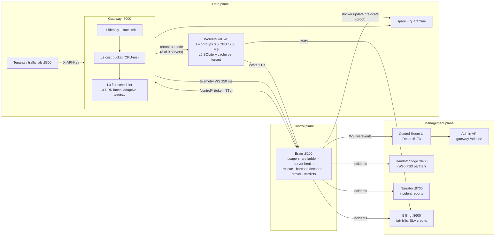

# TenantGuard: Multi-Tenant Isolation & Noisy-Neighbor Defense

CodeAstra 2.0 · Cloud Computing & Distributed Systems · PS 3.

**TenantGuard gives every tenant of a shared service its fair share and names the tenant behind any slowdown, even when the expensive work is invisible to a rate limiter.**

**The problem.** In a multi-tenant SaaS, one tenant's traffic can slow everyone who shares its servers: the noisy neighbour. Rate limiters count requests, but a few cheap-looking requests can trigger huge hidden work (background jobs, a vendor indexer), which a request counter never sees. Operators then see slow servers without knowing who caused them, and punishing the wrong tenant is as bad as doing nothing.

**What TenantGuard does.**
- **Quotas on resources, not just requests:** each tenant has quotas on measured CPU and concurrency as well as request rate.
- **Fair scheduling:** queueing is fair per tenant, so a cheap request never waits behind a whale.
- **Victims first:** they are rescued by routing around slow servers.
- **The culprit is named** with a shuffle-sharded "barcode" layout, then **proven** by moving it to a spare server and checking that the slowdown follows it, and handled by one of five verdicts (only a confirmed culprit is ever penalised; a faulty host blames nobody).
- **Adaptive throttling:** a graduated, self-recovering ladder with TTL auto-undo.
- **Everything is explained** live on a dashboard, in an incident report, and as a case for the on-call engineer; bills stay fair (victims never pay for contention) and come with SLA credits.

## Architecture



**Isolation layers:**
- **L1:** identity (SHA-256 of `X-API-Key`), rate limit and retry budget.
- **L2:** cost bucket debited with the worker-measured CPU of each request.
- **L3:** per-tenant weighted DRR in three lanes (express / interactive / batch), behind a gradient concurrency window per worker.
- **L4:** Docker cgroup limits per worker.
- **L5:** per-tenant data (one SQLite file per tenant, a namespaced cache with a guaranteed share).

On top of these, the **adaptive loop** (the brain) watches, rescues, names and throttles.

| Component | Path | Port | What it does |
|---|---|---|---|
| Gateway | `gateway/` | 8000 | Identity, rate + cost + concurrency quotas, retry budget, 3-lane DRR, adaptive per-worker window, barcode routing, telemetry WS, admin + control API |
| Workers | `worker/` | 8100 (×9, plus `spare`, `quarantine`) | The shared SaaS app: per-tenant SQLite + cache, tenant-tagged background jobs, a black-box "vendor indexer", per-tenant CPU metering, fault injection |
| Brain | `brain/` | 8200 | Noisy score + throttle ladder; server health → rescue (route-around) → barcode decoder → naming → relocation proof → five verdicts; background-CPU charging; operator holds; business-impact meter; live state + incident stream |
| Lab | `lab/` | 8300 | 12 Poisson tenant personas (rates and SLA targets per tier), five attacks, measured scenario runs with marks, the 3-mode scorecard runner (`lab/results/*.json`) |
| UI | `ui/` | 5173 | Control Room, Tenants (quota edit), Cases / Case File, Scorecard |
| Handoff bridge | `integrations/handoff/` | 8400 | Incidents become cases in the Web PS3 "Digital Handoff" app; acknowledge and approve flow back |
| Billing | `billing/` | 8600 | Fair bills at calm reference prices, SLA credits, an "unmetered" true-cost line for a confidently named culprit, and "Why was I slow?" for each tenant |
| Narrator | `narrator/` | 8700 | A deterministic incident report per incident and an anonymised customer message |
| Shared | `common/`, `tenantguard.yaml`, `layouts/ag23.json` | | Contracts (Pydantic), every tunable, the AG(2,3) layout: 12 tenants on 9 servers, any two tenants share at most one server |

Deeper reading: [docs/architecture.html](docs/architecture.html) ([PDF](docs/Architecture.pdf)), [docs/SETUP.md](docs/SETUP.md), [docs/SUBMISSION.md](docs/SUBMISSION.md).

## Quick start

**Docker (one machine with ≥ 8 cores / 12 GB for Docker):**
```
docker compose up -d --build                    # gateway, 9 workers, spare, quarantine, brain
docker compose --profile lab up -d lab          # traffic lab (calm traffic starts automatically)
docker compose --profile handoff --profile narrator --profile billing up -d   # optional services
cd ui && npm install && cp .env.example .env && npm run dev     # http://127.0.0.1:5173
```

**Two laptops** (how we run it): Docker on laptop A; lab, UI and demo driver on laptop B over Tailscale. See [docs/SETUP.md](docs/SETUP.md).

**Local, no Docker** (Python 3.10+, for development):
```
pip install -e common
cd worker  && SERVER_NAME=w0 python -m app --port 8100      # repeat for the workers you need
cd gateway && python -m tenantguard_gateway                  # :8000
cd brain   && python -m tenantguard_brain                    # :8200
cd lab     && python -m tenantguard_lab serve                # :8300
cd lab     && python -m tenantguard_lab scorecard            # OFF / Industry / TenantGuard, 3 runs each
```

Every service has `python -m pytest` in its directory: 468 Python tests on master (gateway 94, worker 53 + 1 Linux-only skip, brain 167, lab 57, billing 25, handoff 47, narrator 9, tools 16). The UI has 76 unit tests (`npm test`) and 27 Playwright end-to-end tests (`ui/e2e/`; 26 run by default, the `@live` one needs `E2E_LIVE=1`). All `/admin/*` and `/control/*` calls need the header `X-TenantGuard-Control-Token` (env `TENANTGUARD_CONTROL_TOKEN`, default `dev`).

## Run the demo
```
python tools/demo.py --dry-run      # the plan and every HTTP call, nothing sent
python tools/demo.py --step         # the 4-minute demo, Enter before each step
```
The steps: calm → OFF + flood → Industry (flood refused, then the black-box bomb) → TenantGuard (same bomb: rescue, name, proof, verdict) → faulty server → honest spike → scorecard. Each step prints one narration line and live numbers from the brain and the lab. Targets come from `TENANTGUARD_{GATEWAY,BRAIN,LAB}_URL`.

The lab runs all ten attacks, including the five the team wrote last (`blackbox_bomb`, `background_bomb`, `cache_flood`, `faulty_server`, `honest_spike`), so the demo uses the black-box bomb, has the lab inject the faulty server, and runs the honest-spike step. Those five are unit-tested; their strengths are sized from `worker/calibration.json` and still to be checked on the Docker host, so rehearse there first, and use `--bomb whale` to keep the measured whale story.

## "Not just a rate limit": the evidence

**Hidden work is real and large.** Measured on the Docker host (`worker/calibration.json`, one worker limited to 0.5 CPU, 200 sequential requests per endpoint):

| Endpoint | CPU the request handler reports | Background job CPU | Black-box indexer CPU | Whole-process CPU per request |
|---|---|---|---|---|
| `GET /api/light` | 0.40 ms | 0 | 0 | 0.95 ms |
| `GET /api/search` | 3.83 ms | 0 | 0 | 4.67 ms |
| `POST /api/write` | 0.19 ms | 1.43 ms | 0 | 3.1 ms |
| **`POST /api/ingest`** | **0.07 ms** | 0 | **20.25 ms** | 23.5 ms |

An `ingest` call looks 6× cheaper than a `light` call to anything that meters the request, but it makes the worker burn about 300× more CPU in the black-box indexer. A rate limiter, and even a per-request CPU quota, lets it through. That gap is why TenantGuard watches *server health* and decodes the culprit from the barcode, instead of trusting request counters.

**3-mode scorecard** (measured on the Docker host): `python -m tenantguard_lab scorecard` runs each scenario in OFF, Industry and TenantGuard mode, 3 runs per cell (attacker K, 20 s calm, 40 s attack), and writes one `RunResult` per run plus a summary. The committed result is `lab/results/summary-scorecard-host.json` with its 18 run files. Median victim p99 in ms:

| Scenario | Mode | Baseline | Attack | After | Attacker 429s (median) |
|---|---|---|---|---|---|
| whale | OFF | 149 | **691** | 254 | 0 |
| whale | Industry | 157 | 176 | 165 | 315 |
| whale | TenantGuard | 158 | 183 | 154 | 321 |
| flood | OFF | 200 | 162 | 186 | 0 |
| flood | Industry | 166 | 164 | 163 | 3,133 |
| flood | TenantGuard | 143 | 144 | 175 | 2,977 |

No innocent tenant was penalised in any run. **How to read it honestly:** the whale and the flood are contained by the gateway limits that both protected modes share (rate, CPU cost, fair queue), so Industry ≈ TenantGuard on these two; the brain had nothing left to name. One OFF flood run (`20261012-222805-flood-off.json`) recorded 1,522 refused requests, which OFF should never do; it is most likely carried over from the previous mode switch. Another OFF flood run (`20261012-222323-flood-off.json`) recorded 6,415 503s for the attacker: the bounded queue wait applies in every mode, OFF included.

**Where the brain earns its place** (host acceptance run, 2026-10-13, inside the lab container on the Docker host):
- idle: 0 events; calm traffic: 0 ladder moves (2 real slowdowns on w7 were routed around, no tenant blamed);
- a big-plan whale (K): named with 99% confidence, **proved by relocation (R = 0.88)**, verdict `honest_growth`, held hosts w1/w8 judged first, victims rerouted;
- a faulty server (w4, injected with `/admin/fault`): verdict `host_fault` at 5.1× its idle latency, **no tenant blamed**;
- 0 overrides left at the end (every action expired by TTL or was released).

## Repository map
```
common/                 shared contracts + config loader (pip install -e common)
tenantguard.yaml        every tunable (tiers, quotas, ladder thresholds, TTLs, ports)
layouts/ag23.json       12 tenants x 9 servers, AG(2,3) barcodes
gateway/                tenantguard_gateway: admission, scheduler, limiter, router, telemetry, admin/control API
worker/                 app: tenancy, store, cache, jobs, blackbox, meter, fault; calibration.json
brain/                  tenantguard_brain: score, ladder, health, rescue, decoder, prover, verdicts, impact, incidents
lab/                    tenantguard_lab: personas, attacks, scenario runner, scorecard runner, results
ui/                     React 18 + Vite + Tailwind + Recharts dashboard
integrations/handoff/   Web PS3 convergence bridge + mock web app
billing/                fair billing, SLA credits, "Why was I slow?"
narrator/               incident reports + anonymised customer messages
tools/demo.py           one-command demo driver
docs/                   architecture (HTML/PDF), SETUP, SUBMISSION, plan, convergence samples
docker-compose.yml      the platform (+ profiles: lab, handoff, narrator, billing)
prototype-docs/         full prototype documentation: design, data models, sequences, every file and function
```
