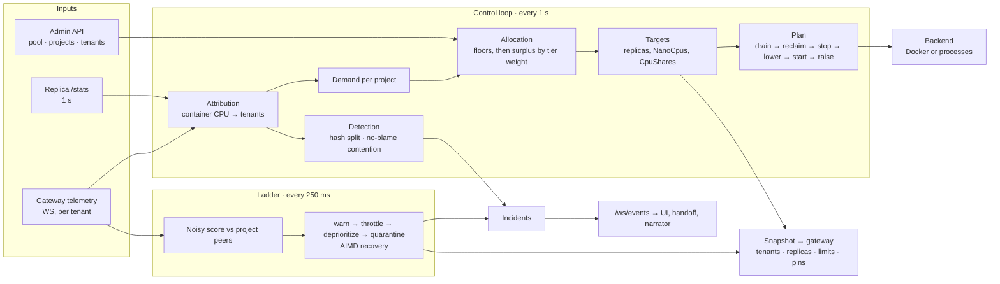

[← TenantGuard](../README.md)

# Brain

**The control plane: it decides who exists, where they run and how they behave, and tells the gateway in one snapshot.**

  

## At a glance

| Role | Port | Entry point | Talks to |
|---|---|---|---|
| Registry (pool → projects → tenants), CPU allocation, replica lifecycle, noisy-neighbour detection, the throttle ladder, incidents | 8200 | `python -m tenantguard_brain` | Gateway (snapshot out, telemetry in), Docker Engine API or local processes (replicas), UI / handoff / narrator (`/ws/events`) |

It owns three things:

| Question | Answer lives in |
|---|---|
| **Who exists?** The admin-set pool → projects (floor, cap, tier, `warm_min`) → tenants | `registry.py`, `registry_store.py` |
| **Where do they run?** Allocation, replica counts, CPU and memory per replica; replicas started and stopped through a backend | `control.py`, `allocator.py`, `scaler.py`, `backends.py` |
| **How do they behave?** Per-tenant scores inside each project, the throttle ladder, incidents | `core.py`, `ladder.py`, `score.py`, `incidents.py` |

## How it works



**Every control tick** (1 s, or at once on a wake or a registry change):
1. **Readiness.** A `starting` replica that answers `/healthz` becomes `ready` and joins routing. One that is not healthy within `start_timeout_s` (30 s) is stopped.
2. **Attribution** (`detector.attribute`, the one source of per-tenant CPU). Each replica's container CPU is split into each tenant's metered CPU (handler + background), black-box CPU split by documents handed over, and framework overhead up to `overhead_ms_per_request` (6.6 ms). What is left is **unattributed**.
3. **Demand** per project = used cores + queued + refused work (EWMA). A project at ≥ 90% of its caps cannot show more than it gets, so its demand is probed at 1.25 × used and grows into idle capacity.
4. **Allocation** (`allocator.allocate`): floors first, then the surplus water-filled by tier weight (enterprise 4, pro 2, free 1). `industry` mode uses the static floors; `off` mode uses the caps.
5. **Targets** (`scaler`): replicas = `ceil(min(demand, max(alloc, floor)) / 0.8)`, at least `warm_min`; at least 2 while busy if each would still get ≥ 0.5 core. Hysteresis: 2 ticks up, 30 down, 300 to sleep (only with `warm_min` 0). Each replica gets `NanoCpus = min(1 core, max(alloc, floor))` and `CpuShares ∝ floor`. Memory is fixed per replica.
6. **Plan**, applied in this order: drain → reclaim → stop → lower CPU → start → raise CPU, never above usable memory. An owner below its own allowance reclaims a borrowed replica first.
7. **Backend** applies the actions. It never raises; a failed action is retried next tick.
8. **Detection** (TenantGuard mode only):
   - **Hash split:** a project whose tenants are hurt while its CPU stays unexplained for `unattributed_hold_s` (10 s). Each round pins half of the suspects to each of two replicas, settles, samples, and keeps the half the hidden CPU followed. After ⌈log₂ k⌉ rounds one tenant is left and is charged the unexplained CPU.
   - **No-blame contention:** every active project is slow while none is above its allocation, so the cause is outside the projects. Nobody is throttled.
9. **Snapshot** to the gateway: tenants (key hashes, quotas), replicas, the ladder's limits and the split pins. Its arrival time is the gateway's fail-static signal.

**The ladder** (every 250 ms) judges a tenant against the other tenants of its own project: warn → throttle (× 0.5, down to 0.25) → deprioritize → quarantine, then AIMD recovery and close. A tenant that is itself slowed has a queue share of 0 (its queue is a symptom). Operators can release, extend or resume through `POST /api/operator`.

**Incidents.** Each case tells one story and closes:

| Case | Id | Stages |
|---|---|---|
| A tenant on the ladder | `inc-…` | detected → level changes → resolved / closed |
| A hash split of one project | `srv-…` | detected (hidden CPU, who is pinned) → proving (one per round) → verdict (culprit or nobody) → closed |
| A host-wide slowdown | `srv-…` | detected → verdict `host_fault` (nobody blamed) → closed when it clears |

## API

| Method | Path | Auth | What it does |
|---|---|---|---|
| GET | `/healthz` | – | Liveness, telemetry, snapshots sent, backend, replicas |
| GET | `/api/state` | – | `StateSnapshot`: tenants, replicas (as `servers`), fairness, `pool` |
| GET | `/api/pool` | – | `PoolView`: floors, demand, use, base + loan, replicas per project |
| GET | `/api/incidents` | – | Incident events; filters `?tenant=`, `?incident_id=`, `?limit=` (default 200) |
| POST | `/api/operator` | token | `OperatorCmd`: release / extend / resume a tenant |
| GET | `/api/debug` | – | Scores, ladders, baselines, attribution, pool |
| WS | `/ws/events` | – | State on connect, recent incidents, then live events |
| GET | `/admin/registry` | token | Pool, projects and tenants (no key hashes) |
| PUT | `/admin/pool` | token | Set the `PoolSpec` (cores, memory, headroom) |
| POST | `/admin/projects` | token | Create a project; 422 if the sum of floors or memory would break the pool |
| PATCH | `/admin/projects/{id}` | token | Change name, tier, floor, cap or `warm_min` |
| DELETE | `/admin/projects/{id}` | token | Delete a project; 409 while it still has tenants |
| POST | `/admin/projects/{id}/tenants` | token | `TenantCreate` → `TenantCreated`; the API key is returned once, only its SHA-256 is stored |
| DELETE | `/admin/tenants/{id}` | token | Remove a tenant |
| GET | `/snapshot` | token | The gateway pulls the latest snapshot at start |
| POST | `/control/wake` | token | `WakeCmd` from the gateway: a sleeping project got a request (404 for an unknown project) |

"token" = header `X-TenantGuard-Control-Token`.

## Configuration

| Env var / yaml key | Default | Meaning |
|---|---|---|
| `TENANTGUARD_CONTROL_TOKEN` | `dev` | Required on `/admin/*`, `/control/*`, `/snapshot`, `POST /api/operator`; also sent to the gateway |
| `TENANTGUARD_GATEWAY_URL` | `services.gateway` | Where snapshots go and telemetry comes from |
| `TENANTGUARD_BRAIN_HOST` / `TENANTGUARD_BRAIN_PORT` | `0.0.0.0` / `8200` | Bind address |
| `TENANTGUARD_CORS_ORIGINS` | `http://127.0.0.1:5173,http://localhost:5173` | UI origins allowed |
| `TENANTGUARD_BACKEND` | `control.backend` = `docker` | `docker` = Engine API over `/var/run/docker.sock`; `process` = local worker processes |
| `COMPOSE_PROJECT` | `tenantguard` | Value of the `tg.stack` label: the only containers the brain lists, starts, updates or removes |
| `TENANTGUARD_WORKER_IMAGE` / `TENANTGUARD_DOCKER_NETWORK` | `tenantguard-worker:latest` / – | Image and network of new replicas |
| `TENANTGUARD_PROCESS_BASE_PORT` | `8100` | First port for process replicas |
| `TENANTGUARD_REGISTRY` | `brain/.state/registry.json` | Registry file; `tenantguard.yaml` seeds it on first start |
| `pool` | 5.75 cores, 2688 MB, headroom 0.1 | Seed pool |
| `control.*` | tick 1 s, `target_util` 0.8, `busy_cpu` 0.5, up 2 / down 30 / sleep 300 ticks | Allocation and scaling |
| `brain.noisy.*` | warn 1.5, throttle 2.0, quarantine 4.0 | Ladder thresholds (× fair share) and holds |
| `detector.*` | `unattributed_hold_s` 10, split settle 2 s / sample 6 s, contention ratio 1.6 | Hash split and contention |

Values marked *estimate* in `tenantguard.yaml` are not yet measured on the Docker host.

## Run it

```
pip install -e common && pip install -r brain/requirements.txt
cd brain && python -m tenantguard_brain                   # :8200, Docker backend
TENANTGUARD_BACKEND=process python -m tenantguard_brain   # replicas as local processes, no Docker
```

The whole system on one machine, without Docker (brain, gateway, lab, handoff, narrator, UI):

```
python brain/tools/local_stack.py          # UI on http://127.0.0.1:5180; --stop stops a background stack
```

## Test it

```
cd brain && PYTHONPATH=<repo>/common python -m pytest
```

87 tests. The scenario tests (whale, honest burst, sleep and wake, hidden work, slow host) drive the real `Runtime` against the simulator in `sim.py`; their numbers come from the simulator, not the host.

## Files

```
tenantguard_brain/
  main.py            FastAPI app: public API, admin router, /ws/events
  runtime.py         I/O loops: telemetry, stats polling, control tick, ladder tick, snapshot push
  control.py         the single writer: attribution, demand, allocation, targets, plan, detection
  allocator.py       floors first, then surplus water-filled by tier weight
  scaler.py          replica targets, hysteresis, per-replica CPU and memory, the ordered plan
  backends.py        DockerBackend (Engine API, tg.* labels) and ProcessBackend
  detector.py        attribution, hash split, contention
  core.py            scores → ladder → limits; findings → incidents; operator holds
  ladder.py · score.py · incidents.py · fairness.py
  registry.py        pool / project / tenant invariants
  registry_store.py  the registry as one JSON file, written atomically
  settings.py        tenantguard.yaml + env
  sim.py             simulator for the scenario tests
tools/
  local_stack.py     run the whole system locally
  traffic.py         light calm traffic + an optional whale through a real gateway
```

## Related docs

[Architecture](../docs/v2/02_ARCHITECTURE.md) · [Algorithms](../docs/v2/03_ALGORITHMS.md) · [Functions](../docs/v2/04_FUNCTIONS.md) · [Data and config](../docs/v2/05_DATA_AND_CONFIG.md) · [Diagrams](../docs/v2/06_DIAGRAMS.md) · [As built](../docs/v2/09_AS_BUILT.md)
