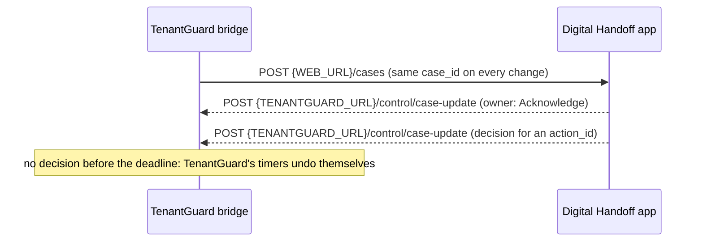

[← TenantGuard](../../README.md)

# TenantGuard × Web PS3 Digital Handoff: sample data

**What TenantGuard sends to the Digital Handoff app, what it expects back, and the rules both sides keep.**

## At a glance

| File | What it is |
|---|---|
| `cases/01-costly-pattern-K.json` | a case with verdict `costly_pattern` |
| `cases/02-over-plan-C.json` | verdict `over_plan` |
| `cases/03-honest-growth-J.json` | verdict `honest_growth` |
| `cases/04-host-fault-w4.json` | verdict `host_fault` |
| `cases/05-mitigated-no-blame.json` | verdict `mitigated_no_blame` |
| `case-update-examples.json` | the `owner` and `decision` updates the Web app sends back |
| `handoff-models.py` | the wire models, for reference |

The bridge that sends and receives these is [`integrations/handoff`](../../integrations/handoff/README.md).

## How it flows

## Rules for the Web app

### Cases

1. TenantGuard sends one JSON body per case to `POST {WEB_URL}/cases`. The five files in `cases/` show one per verdict: `costly_pattern`, `over_plan`, `honest_growth`, `host_fault`, `mitigated_no_blame`.
2. Create one case per `case_id`. TenantGuard re-sends the **same** `case_id` whenever something changes: update the case, never create a duplicate.
3. On the case page show `title`, `severity` (`low` | `medium` | `high`), `status` (`waiting_for_decision` | `in_progress` | `resolved` | `closed`), `context.summary` and `history`.

### Pending actions

4. Each item in `pending_actions` has an `action_id` and a `deadline` (`HH:MM:SS`, same day, IST). Show it as a task and alert when the deadline is near.
5. Handoff completeness check: block a handoff while any pending action has no decision.
6. If no decision arrives before a deadline, TenantGuard applies its safe default (its timers undo themselves), so a missed click never breaks anything.

### Updates back to TenantGuard

7. When the new owner clicks **Acknowledge**, send the `owner` example from `case-update-examples.json` to `POST {TENANTGUARD_URL}/control/case-update`.
8. The **Approve / Reject / Extend / Release / Resolve** buttons send the matching `decision` example for that `action_id`.
9. Every update carries the shared partner token in the `X-Handoff-Token` header; the bridge refuses updates without it.

### Reference data

10. `affected` lists tenant ids. The seeded tenants are A Aarogya Health, B BazaarKart, C Chitra Studio, D DhanSetu Payments, E Ekalavya Learn, F FitZone, G GaadiGo, H HisaabBooks, I IdliExpress, J JhatpatMart, K KaamKaro, L LokVani News. An operator can add more tenants, so accept any id.
11. `evidence_link` is `http://<ui-host>:5173/case/<incident_id>`: replace `<ui-host>` with the TenantGuard UI machine's address on the day.

## Related docs

- [Handoff bridge](../../integrations/handoff/README.md) · [v2 architecture](../v2/02_ARCHITECTURE.md)
