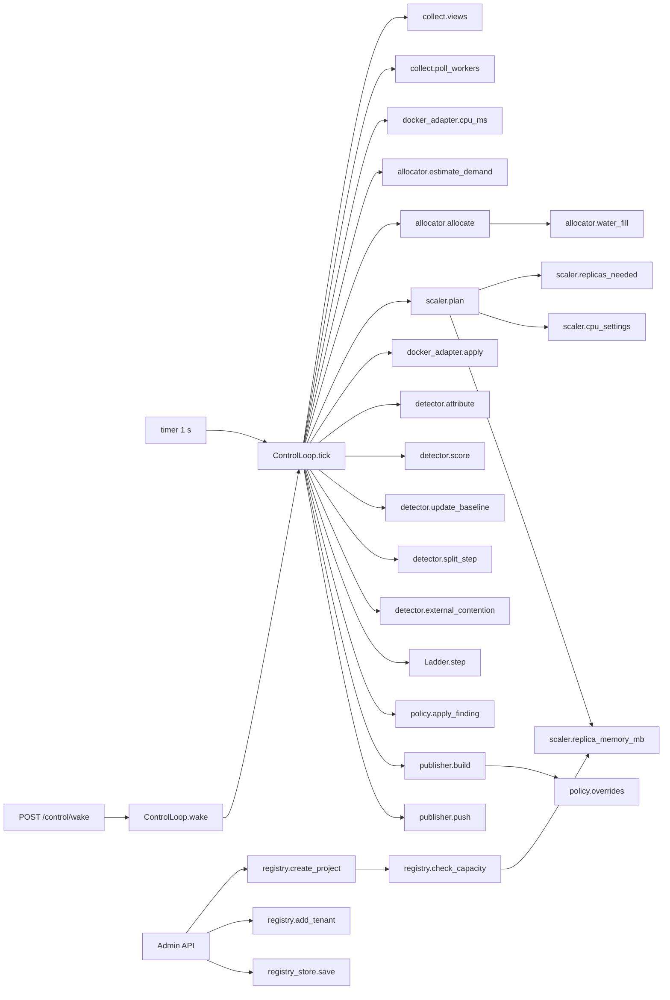

# 04 — v2 function catalog (one task → one function)

## 1. Rules
| # | Rule | Check |
|---|---|---|
| F1 | Each task has exactly one function. If two places need it, they call the same function. | §3 task index: every task appears once |
| F2 | Every function has at least one caller in production code (tests don't count). | `vulture` with min-confidence 80 in CI |
| F3 | ≤ 30 lines, ≤ 4 parameters, a one-line docstring saying the task. | `ruff` (C901 complexity ≤ 8, PLR0913) |
| F4 | Pure functions (allocator, scaler, detector math, costs) do no I/O. I/O lives only in adapters (`docker_adapter`, `http_clients`, `registry_store`). | Import-linter contract |
| F5 | Only `ControlLoop.tick` mutates control state. Only `DockerAdapter` imports the Docker client. | Import-linter contract + grep test |

**Column key:**
- **v1 source:** where the code comes from (`reuse` = keep the file; `adapt` = small change; `new`).
- **Caller:** the production caller.

## 2. Modules
### 2.1 `common/tg_common/contracts.py`: data only (see `05_DATA_AND_CONFIG.md`)
No functions except Pydantic validators.

### 2.2 `brain/tg_brain/registry.py`: who exists
| Function | Task | In → Out | Caller | v1 source |
|---|---|---|---|---|
| `check_capacity(pool, projects) -> list[str]` | Validate I2, I3 | Pool, projects → error list (empty = ok) | `create_project`, `update_project`, `set_pool` | new |
| `set_pool(reg, pool) -> Registry` | Admin sets the capacity | → new registry | Admin API `PUT /admin/pool` | new |
| `create_project(reg, spec) -> Registry` | Add a project | ProjectSpec → registry | `POST /admin/projects` | new |
| `update_project(reg, id, patch) -> Registry` | Change floor, cap, tier, warm_min | → registry | `PATCH /admin/projects/{id}` | new |
| `add_tenant(reg, project_id, name) -> tuple[Registry, str]` | Bind a new tenant to a project (I1), make its key | → (registry, plain key shown once) | `POST /admin/projects/{id}/tenants` | adapt `tenants.py` hashing |
| `remove_tenant(reg, tenant_id) -> Registry` | Unbind a tenant | → registry | `DELETE /admin/tenants/{id}` | new |

### 2.3 `brain/tg_brain/registry_store.py`: persistence (I/O adapter)
| Function | Task | Caller |
|---|---|---|
| `load(path) -> Registry` | Read `registry.json`, or seed it from `tenantguard.yaml` | brain startup |
| `save(reg, path) -> None` | Atomic write (write to a temp file, then rename) | every Admin API mutation |

### 2.4 `brain/tg_brain/allocator.py`: pure
| Function | Task | Caller |
|---|---|---|
| `estimate_demand(prev, sample, alpha, cap) -> float` | EWMA demand of one project (03 §2) | `ControlLoop.tick` |
| `water_fill(surplus, wants, weights) -> dict` | Split the surplus (03 §3) | `allocate` |
| `allocate(pool, projects, demand) -> dict[str, Alloc]` | Floors + loans + caps (03 §3) | `ControlLoop.tick` |

### 2.5 `brain/tg_brain/scaler.py`: pure
| Function | Task | Caller |
|---|---|---|
| `replica_memory_mb(n_tenants, cfg) -> int` | Memory of one replica (02 §6) | `plan`, `registry.check_capacity` |
| `replicas_needed(project, alloc, demand, hyst, cfg) -> tuple[int, Hyst]` | Target count with hysteresis (03 §5.1) | `plan` |
| `cpu_settings(project, alloc, n) -> CpuSettings` | NanoCpus and CpuShares per replica (03 §4) | `plan` |
| `plan(state, allocs, demand, cfg) -> list[Action]` | Ordered actions: drain → stop → lower → start → raise (03 §5.2) | `ControlLoop.tick` |

### 2.6 `brain/tg_brain/docker_adapter.py`: the only Docker caller (I/O)
| Function | Task | Caller | v1 source |
|---|---|---|---|
| `list_replicas() -> list[Replica]` | Rebuild the replica set from labels `tg.project`, `tg.replica`, `tg.borrowed` | brain startup (reconcile) | adapt T12 `DockerControl` label filter |
| `apply(actions) -> list[ActionResult]` | Run start / stop / update; never raises, failures are returned | `ControlLoop.tick` | adapt T12 `set_cpus` (NanoCpus) + new create/start/stop |
| `cpu_ms(replica_ids) -> dict[str, float]` | Cumulative cgroup CPU per container (`/containers/{id}/stats?stream=false`) | `ControlLoop.tick` | new |

### 2.7 `brain/tg_brain/detector.py`: pure
| Function | Task | Caller |
|---|---|---|
| `attribute(project_view) -> Attribution` | Tenant CPU + unattributed remainder (03 §7.1) | `ControlLoop.tick` |
| `score(tenant_view, project_view, baselines) -> float` | v1 score formula, project scope (03 §7.2) | `ControlLoop.tick` |
| `update_baseline(b, p95, calm, half_life) -> float` | Victim p95 baseline (v1 rule: learn only when calm) | `ControlLoop.tick` |
| `split_step(state, observation) -> SplitState` | One step of the hash split; ends with a Finding (03 §7.3) | `ControlLoop.tick` |
| `external_contention(views) -> Finding | None` | No-blame host contention (03 §7.4) | `ControlLoop.tick` |

### 2.8 `brain/tg_brain/ladder.py`: v1 file, reused
| Function | Task | Caller |
|---|---|---|
| `Ladder.step(score, now) -> LadderOut` | Escalate / recover one tenant (v1 thresholds) | `ControlLoop.tick` |
| `Ladder.hold(kind, until)` | Operator release / extend / resume (v1) | Operator API |

### 2.9 `brain/tg_brain/policy.py`
| Function | Task | Caller |
|---|---|---|
| `apply_finding(finding, ladders, log) -> None` | Write the event (I7), then pass the evidence to that tenant's ladder | `ControlLoop.tick` |
| `overrides(ladders, now) -> list[LimitsCmd]` | Current per-tenant factors with TTL | `publisher.build` |

### 2.10 `brain/tg_brain/publisher.py`
| Function | Task | Caller |
|---|---|---|
| `build(reg, replicas, overrides, pins, version) -> Snapshot` | One immutable snapshot | `ControlLoop.tick` |
| `push(snapshot) -> bool` | POST to the gateway `/control/snapshot` (I/O) | `ControlLoop.tick` |

### 2.11 `brain/tg_brain/control.py`
| Function | Task | Caller |
|---|---|---|
| `ControlLoop.tick()` | Run the steps of `05_DATA_AND_CONFIG.md` §4 in order; the only writer | timer (1 s) and `wake` |
| `ControlLoop.wake(project_id)` | Mark the project as demanded and tick now (debounced) | `POST /control/wake` from the gateway |

### 2.12 `brain/tg_brain/collect.py`: inputs (I/O)
| Function | Task | Caller |
|---|---|---|
| `on_telemetry(msg)` | Store the latest gateway telemetry (250 ms WebSocket, v1) | WebSocket handler |
| `poll_workers(replicas) -> dict` | `/stats` of each replica (v1 runtime polling) | `ControlLoop.tick` |
| `views(now) -> Views` | Build per-tenant / per-project windows from the stored samples | `ControlLoop.tick` |

### 2.13 `gateway/tg_gateway/`
| Function | Task | Caller | v1 source |
|---|---|---|---|
| `identify(key) -> Identity` | Key hash → tenant, project | `handle` | reuse `tenants.py` |
| `classify(req) -> str` | Class id with size bucket (03 §6.2) | `handle` | adapt `tenants.py:26-29` |
| `RetryBudget.check(...)` | v1 retry budget | `handle` | reuse `retry.py` |
| `admit(identity, snapshot) -> Refusal | None` | Block / token / concurrency | `handle` | adapt `admission.py` (drop cost) |
| `ProjectQueues.enqueue(item)` / `.next()` | Lanes + DRR per project | `handle`, `pump` | reuse `scheduler.py` (one instance per project) |
| `route(tenant, project, lane, snapshot, windows) -> Replica | None` | Pin, else rendezvous with bounded spill (03 §6.6) | `pump` | new (replaces `router.py`) |
| `Window.allow(lane)` / `.observe(rtt, cpu)` | Gradient2 per replica | `route`, `observe` | reuse `limiter.py` |
| `observe(item, response)` | Debit costs, update the window, record telemetry | `handle` | adapt `core.py:310-319` |
| `request_wake(project)` | Debounced POST `/control/wake` | `handle` (when the project has 0 ready replicas) | new |
| `on_snapshot(snapshot)` | Atomic swap; drop queues of removed tenants | `/control/snapshot` | new (replaces most of `overrides.py`) |
| `costs.reference_cost(tenant, cls) -> float` | **The only** cost estimate: calibration seed → EWMA α 0.2 | `enqueue` (gateway), `billing.charge` | new; replaces `core.py:121-125` and the billing EWMA |
| `costs.update(tenant, cls, ms)` | Feed the EWMA | `observe` | — |

### 2.14 `worker/app/` (v1, one addition)
| Function | Task | Caller |
|---|---|---|
| `BlackBox.hand_off(tenant, docs)`: add a counter `docs_by_tenant[tenant] += n` | Lets the brain split black-box CPU by documents (03 §7.1) | `ingest` endpoint |
| Everything else | Unchanged | — |

### 2.15 `billing/` (T17): input source change only
| Function | Task | Caller |
|---|---|---|
| `charge(bucket, attribution, prices) -> Lines` | T17 pricing, using `tenant_ms_t` and `costs.reference_cost` | billing timer |

## 3. Task index: proof of "one task, one function"
| Task | The single function | v1 had |
|---|---|---|
| Validate capacity | `registry.check_capacity` | — |
| Estimate demand | `allocator.estimate_demand` | — |
| Split the surplus | `allocator.water_fill` | — |
| Decide replica count | `scaler.replicas_needed` | Fixed fleet |
| Change containers | `docker_adapter.apply` | T12 `set_cpus` only |
| Per-request cost | `costs.reference_cost` | Gateway EWMA + billing EWMA + unused calibration (3) |
| Move traffic | `route` (reads snapshot pins and replicas) | RouteWeightsCmd + RelocateCmd + DrainCmd (3) |
| Lower a tenant's limits | `Ladder.step` → `policy.overrides` | Ladder + verdict `force_throttle` (2) |
| Attribute CPU | `detector.attribute` | Ledger hints in decoder + billing unmetered line (2) |
| Find a hidden culprit | `detector.split_step` | Decoder + prover + verdicts (3) |
| Host / external slowness | `detector.external_contention` | `health.py` + HostProver (2) |
| Publish policy | `publisher.build` + `push` | Many separate commands with separate TTLs |

## 4. Call graph

