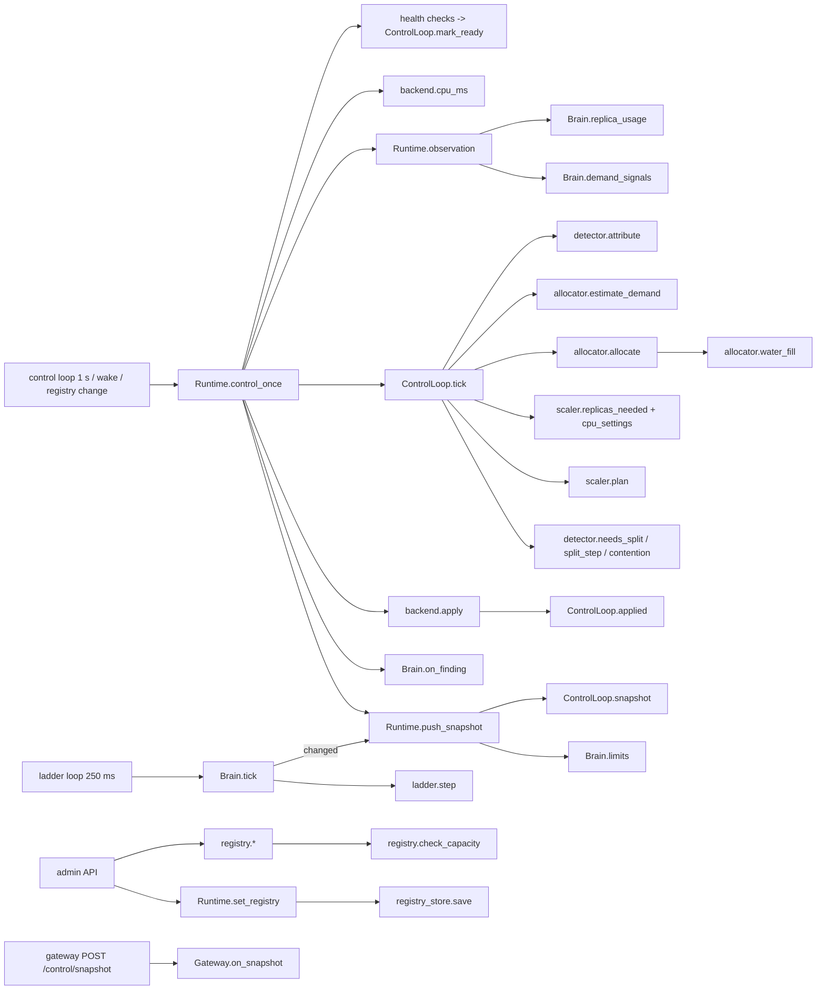

# 04 — v2 function catalog (as built: one task, one function)

This catalog matches the code on branch `v2/main`. Differences from the first draft of the spec, and the reasons for them, are in `09_AS_BUILT.md`.

## 1. Rules
| # | Rule | How it holds |
|---|---|---|
| F1 | Each task has exactly one function; other places call it | §3 task index |
| F2 | Every function has a production caller | Callers listed below; v1 code without a caller was deleted (§4) |
| F3 | Small functions with a one-line docstring | Followed in the new modules; v1 modules kept as they were |
| F4 | Pure logic has no I/O | `registry`, `allocator`, `scaler`, `detector`, `control`, `core` (brain) and `router`, `costs`, `admission`, `scheduler`, `limiter` (gateway) import no network or Docker client |
| F5 | One writer per kind of state | `ControlLoop` writes allocations, replicas, splits and blame. `Brain` writes ladders and incidents. Only `backends.py` touches Docker or processes |

## 2. Modules
### 2.1 `common/tenantguard_common/`
| Function | Task | Callers |
|---|---|---|
| `config.load_settings()` | Read `tenantguard.yaml` | Every service |
| `config.load_pool()`, `load_projects()`, `load_tenants()` | Seed pool / projects / tenants from the yaml | `brain.settings.load`; handoff, narrator, lab, worker (tenant metadata) |
| `config.tier_quota()` | One tier's per-tenant quota | `load_tenants`, `brain.settings.load` |
| `contracts.*` | Data only (Pydantic): `PoolSpec`, `ProjectSpec`, `TenantCreate`, `ReplicaView`, `SnapTenant`, `Snapshot`, `WakeCmd`, `PoolView`, `ProjectView`, plus the v1 models still in use | All |

### 2.2 `brain/tenantguard_brain/registry.py`: who exists (pure)
| Function | Task | Callers |
|---|---|---|
| `check_capacity(reg, cfg)` | List every broken invariant (I2, I3, memory reservation) | `_checked` (every change), tests |
| `set_pool`, `create_project`, `update_project`, `remove_project`, `add_tenant`, `remove_tenant` | One validated registry change each | `main.admin_router` |
| `seed(pool, projects, tenants, cfg)` | Registry from the yaml | `runtime.load_registry` |
| `snap_tenants(reg, quotas)` | Tenants as the gateway needs them | `ControlLoop.snapshot`, `Runtime` (brain topology) |
| `usable(pool)`, `tenants_of(reg, p)`, `hash_key(key)` | Small shared helpers | Registry, control, tests |

### 2.3 `registry_store.py` (I/O)
| Function | Task | Callers |
|---|---|---|
| `load(path, seed)` | Saved registry, or the seed on first start | `runtime.load_registry` |
| `save(reg, path)` | Atomic write (temp file + rename) | `load`, `Runtime.set_registry` |

### 2.4 `allocator.py` (pure)
| Function | Task | Callers |
|---|---|---|
| `estimate_demand(prev, raw, alpha, cap)` | Demand EWMA, clipped | `ControlLoop._demand` |
| `water_fill(surplus, wants, weights)` | Weighted split with re-split of capped excess | `allocate`; `sim._host_share` (models kernel shares) |
| `allocate(usable, projects, weights, demand, mode)` | Floors first, then the surplus by tier weight (`industry` = floors; `off` = caps) | `ControlLoop.tick` |

### 2.5 `scaler.py` (pure)
| Function | Task | Callers |
|---|---|---|
| `replica_memory_mb(n_tenants, cfg)` | Memory of one replica | `registry.check_capacity`, `_starts` |
| `own_replicas(p, cfg)` | Replicas whose memory a project always has reserved; more are borrowed | `check_capacity`, `_starts`, `ControlLoop._targets` |
| `replicas_needed(p, current, demand, alloc, hyst, cfg)` | Target count with hysteresis, sleep and wake | `ControlLoop._targets` |
| `cpu_settings(p, alloc, n, cfg, mode)` | NanoCpus and CpuShares per replica | `ControlLoop._targets` |
| `plan(fleet, targets, usable_mem, now, cfg)` | Ordered actions: drain → reclaim → stop → lower → start → raise | `ControlLoop.tick` |

### 2.6 `backends.py`: the only code that starts, stops or resizes replicas
| Function | Task | Callers |
|---|---|---|
| `DockerBackend.apply(actions)` | Engine API create/start, update (NanoCpus, CpuShares), delete; never raises | `Runtime.control_once` |
| `DockerBackend.list_replicas()` | Our stack's replicas (label `tg.stack`) after a restart | `Runtime.start` |
| `DockerBackend.cpu_ms(ids)` | Cumulative cgroup CPU per replica | `Runtime.control_once` |
| `ProcessBackend.*` | The same interface with local worker processes (no Docker on the laptop) | `runtime.make_backend` when `backend: process` |

### 2.7 `detector.py` (pure)
| Function | Task | Callers |
|---|---|---|
| `attribute(usage, cfg, blamed)` | Replica CPU → tenants (metered, black box by docs, overhead by requests up to the ceiling) + the unattributed rest | `ControlLoop._attribute` |
| `needs_split(...)` | Unexplained CPU above the ratio and the floor, a hurt tenant, ≥ 2 active tenants | `ControlLoop._detect` |
| `split_step(split, unattributed, now, cfg)` | One tick of the hash split: settle → sample → keep the heavier half | `ControlLoop._advance_split` |
| `halves(suspects, round)` | Balanced split ordered by a per-round hash | `split_step`, `Split.pins` |
| `contention(slow, over_alloc)` | Every project slow, none above its allocation | `ControlLoop._contention` |

### 2.8 `control.py`: `ControlLoop`, the single writer of allocation and replicas
| Method | Task | Callers |
|---|---|---|
| `tick(obs)` | Container rates → attribution → demand → allocate → targets → plan → detection | `Runtime.control_once` |
| `applied(results, now)`, `mark_ready(rid)`, `adopt(replicas, now)` | Keep the fleet in step with the backend and health checks | `Runtime` |
| `set_registry(reg)`, `wake(project, now)` | React to admin changes and gateway wakes | `Runtime.set_registry`, `Runtime.wake` |
| `snapshot(limits)` | The one message the gateway receives | `Runtime.push_snapshot`, `GET /snapshot` |
| `pool_view()`, `tenant_cpu_by_replica()`, `replicas_of(p)` | Views for the API, the brain's scores, topology | `main`, `Runtime` |

### 2.9 `core.py`: `Brain`, the ladder and incidents
| Method | Task | Callers |
|---|---|---|
| `ingest_frame`, `ingest_stats` | Gateway telemetry, replica meters | `Runtime` loops |
| `set_topology`, `set_attribution` | Project tenants and replicas; per-tenant CPU from the control loop | `Runtime._sync_topology` |
| `replica_usage`, `demand_signals` | Meters and the queued/refused cost the control loop needs | `Runtime.observation` |
| `tick(now)` | Score → ladder transitions → incident events | `Runtime._ladder_loop` |
| `limits()` | Active per-tenant overrides for the snapshot | `Runtime.push_snapshot` |
| `on_finding(...)` | Control-loop findings → incident events | `Runtime.control_once` |
| `operator(cmd)`, `adopt_overrides(ov)` | Human decisions; take over limits after a restart | `main`, `Runtime._adopt_once` |
| `snapshot(now, pool)`, `status_sentence`, `debug` | UI views | `main`, `Runtime._ui_loop` |

### 2.10 `runtime.py` (I/O) and `main.py` (HTTP)
| Function | Task |
|---|---|
| `Runtime.control_once(now)` | One control tick: health checks, container CPU, `ControlLoop.tick`, backend, findings, snapshot |
| `Runtime.push_snapshot()` | POST `/control/snapshot` to the gateway |
| `Runtime.set_registry(reg)` | Save, apply, tick at once |
| `Runtime.observation(now, container)` | Build the control loop's input from the brain's windows |
| `Runtime.audit(kind, data)` | Append to the audit log |
| `main.admin_router`, `main.create_app` | Admin API, `/snapshot`, `/control/wake`, operator, UI reads |

### 2.11 `gateway/tenantguard_gateway/`
| Function | Task | Callers |
|---|---|---|
| `Gateway.on_snapshot(snap)` | Swap tenants, replicas, limits, pins | `POST /control/snapshot`, `fetch_snapshot` |
| `Gateway.handle(...)` | The request path | `/api/*` |
| `tenants.request_class(..., size)`, `tenants.size_bucket(...)` | Class id with size bucket | `handle` |
| `costs.Costs.reference_cost(tenant, cls, method, path)` | **The only** cost estimate: EWMA → calibration seed → default | `handle` |
| `costs.Costs.update(...)`, `costs.load_seed(path)` | Learn from the CPU header; read `calibration.json` | `_measure`, `Gateway.__init__` |
| `admission.admit(...)` | Block, token bucket, concurrency | `handle` |
| `router.choose(tenant, ready, has_capacity, pin)`, `router.rank(...)` | Pin, else rendezvous with spill | `_route`, `admin_view` |
| `Gateway.request_wake(project)` | Debounced wake to the brain | `handle`, `tick` |
| `overrides.Overrides.apply_snapshot`, `set_block`, getters | TTL'd limits, pins, blocks; fail-static clock | `on_snapshot`, `/control/block`, the request path |
| `app.snapshot_problems(snap, ttl_max)` | Validate a snapshot (400) | `/control/snapshot` |

### 2.12 `worker/app/` (v1 + 2 changes)
| Change | Task | Callers |
|---|---|---|
| `BlackBox.submit(docs, tenant)` + `docs_by_tenant` in `/stats` | Lets attribution split black-box CPU by documents | `/api/ingest` |
| `config._tenants(settings)` | The replica's tenant list from `TENANTGUARD_TENANTS` (set by the brain) | `load_config` |

## 3. Task index: one task, one function
| Task | The single function | v1 had |
|---|---|---|
| Validate capacity | `registry.check_capacity` | — |
| Estimate demand | `allocator.estimate_demand` (called once per project in `ControlLoop._demand`) | — |
| Split the surplus | `allocator.water_fill` | — |
| Decide replica count | `scaler.replicas_needed` | Fixed fleet |
| Change containers | `backends.*.apply` | T12 `set_cpus` only |
| Cost of a request class | `gateway.costs.Costs.reference_cost` | Gateway EWMA + brain reference push + unused calibration (3) |
| Move traffic | `gateway.router.choose` (reads snapshot replicas + pins) | RouteWeights + Relocate + Drain commands (3) |
| Lower a tenant's limits | `ladder.step` → `Brain.limits` → snapshot | Ladder sends + verdict `force_throttle` (2) |
| Per-tenant CPU | `detector.attribute` (used by scores and views) | Worker meters + decoder ledger hints |
| Find a hidden culprit | `detector.split_step` | Decoder + prover + verdicts (3) |
| Slowness outside the projects | `detector.contention` | `health.py` + HostProver (2) |
| Publish policy | `ControlLoop.snapshot` + `Runtime.push_snapshot` | 7 control endpoints with separate TTLs |
| Fail-static signal | Snapshot receive time (`Overrides.snapshot_age`) | Separate heartbeat loop and endpoint |

## 4. Deleted (no caller left in v2)
- **Brain:** `stage3.py`, `health.py`, `rescue.py`, `decoder.py`, `prover.py`, `tools/fake_gateway.py`
- **Gateway:** route weights / relocate / drain / charge / reference-cost / limits / heartbeat endpoints; the CPU cost bucket; admin tenant CRUD (the brain owns the registry); `tools/prove.py`, `tools/prove_t7.py`
- **Other:** `layouts/ag23.json`, `lab/tools/stub_gateway.py`, `config.worker_urls`
- **Contracts:** `RouteWeightsCmd`, `RelocateCmd`, `DrainCmd`, `ChargeCmd`, `ReferenceCostsCmd`, `Heartbeat`, `QuotaPatch`, `Quota.cost_ms_per_s`

## 5. Call graph

