# 06 — v2 diagrams (Mermaid)

**Index**

| Group | Diagrams |
|---|---|
| Structure | 1 Context · 2 Hierarchy · 3 Runtime topology · 4 Components and ownership |
| Flows | 5 End-to-end architecture flow · 6 Gateway request flow · 7 Control tick |
| Lifecycles | 8 Project scaling state machine · 9 Replica lifecycle |
| Sequences | 10 Onboarding · 11 Request lifecycle · 12 Cold wake from zero · 13 Honest spike → scale up · 14 Owner returns (reclaim) · 15 Noisy tenant inside a project · 16 Hash split for hidden work · 17 Brain crash |
| Models and charts | 18 Class diagram · 19 ER diagram · 20 Allocation chart (03 §3 numbers) · 21 Build dependency graph |

## 1. Context
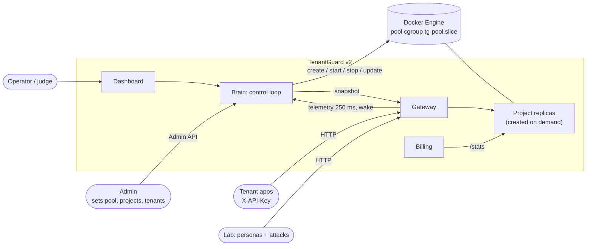

## 2. Hierarchy
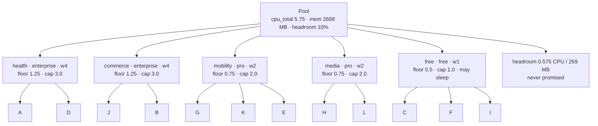

## 3. Runtime topology (example: §3.1 allocation)
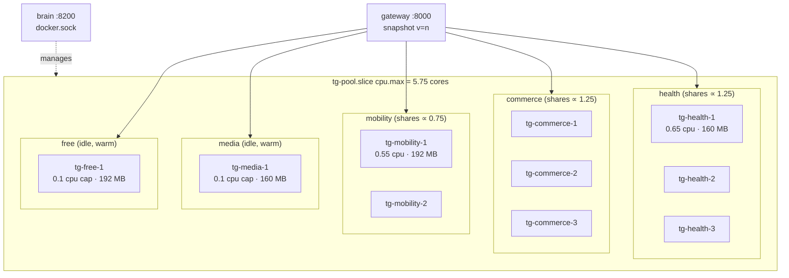

## 4. Components and ownership (who may write what)
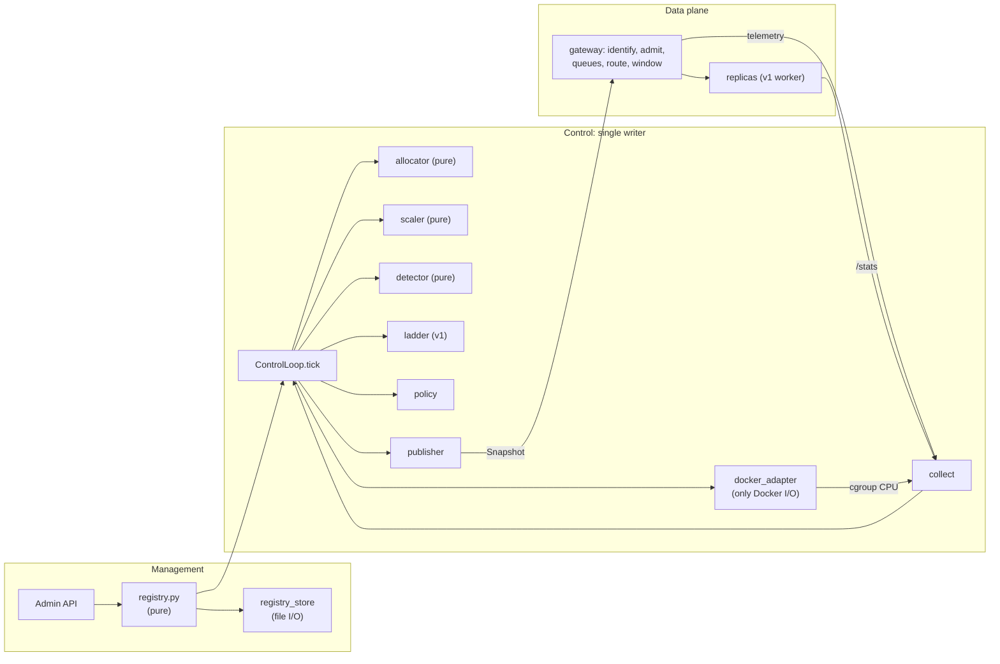

## 5. End-to-end architecture flow
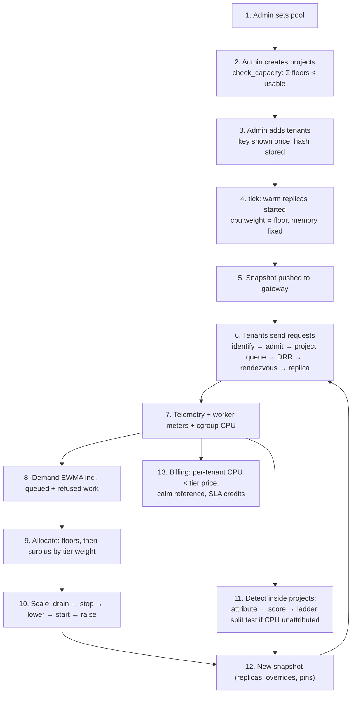

## 6. Gateway request flow
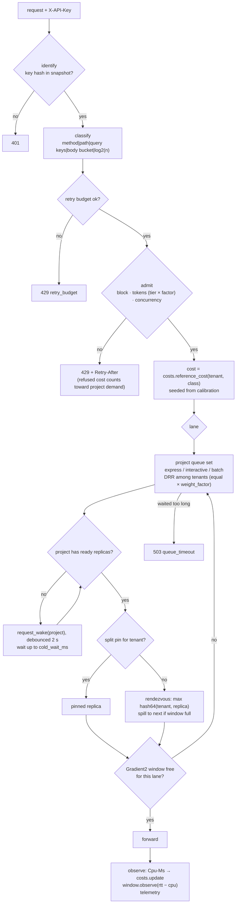

## 7. Control tick
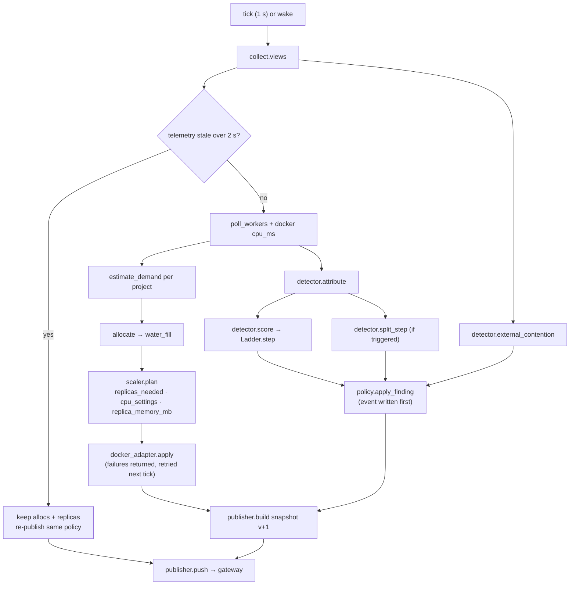

## 8. Project scaling state machine
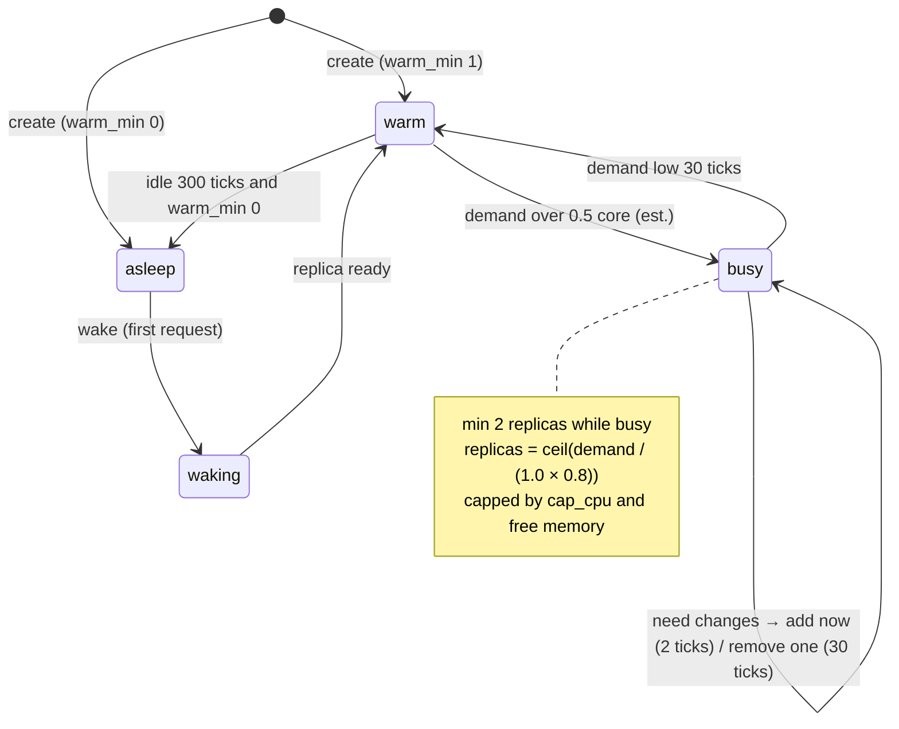

## 9. Replica lifecycle
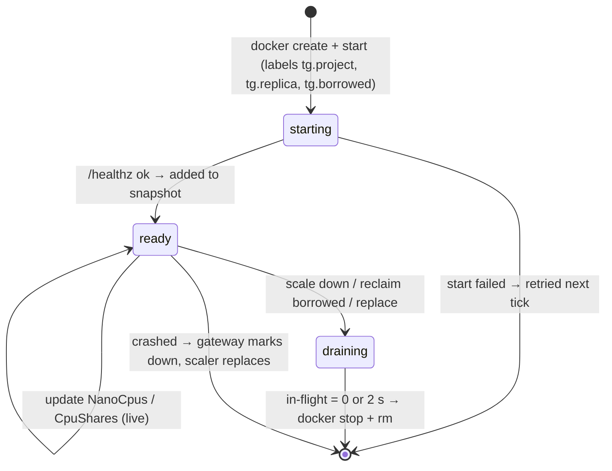

## 10. Sequence: onboarding
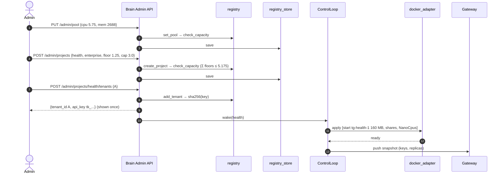

## 11. Sequence: request lifecycle
```mermaid
sequenceDiagram
  autonumber
  participant T as Tenant A
  participant GW as Gateway
  participant R as tg-health-2
  participant BR as Brain
  T->>GW: GET /api/search?n=50000 (X-API-Key)
  GW->>GW: identify → (A, health); classify (size bucket 2^16)
  GW->>GW: retry ok · tokens ok · concurrency ok
  GW->>GW: cost = reference_cost(A, class) (calibration seed 3.83 ms → EWMA)
  GW->>GW: enqueue health/interactive; DRR picks A
  GW->>GW: route: rendezvous(A) = tg-health-2, window free
  GW->>R: forward + X-TenantGuard-Tenant A
  R-->>GW: 200 + X-TenantGuard-Cpu-Ms
  GW->>GW: costs.update · window.observe · telemetry
  GW-->>T: 200
  GW-->>BR: telemetry (250 ms batch)
```

## 12. Sequence: cold wake from zero (free project)
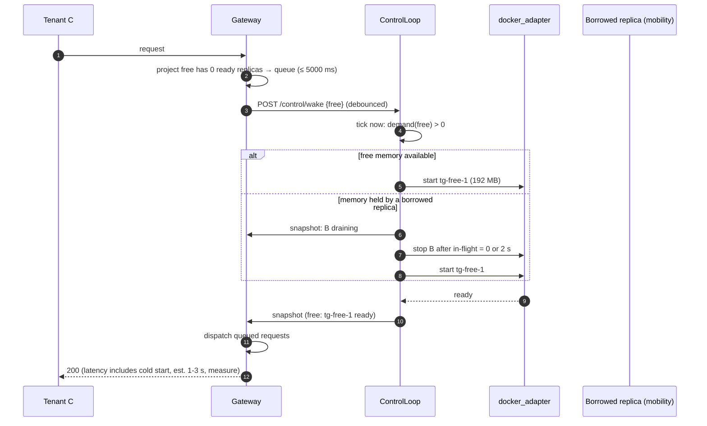

## 13. Sequence: honest spike → scale up (lending)
```mermaid
sequenceDiagram
  autonumber
  participant K as Tenant K (mobility)
  participant GW as Gateway
  participant BR as ControlLoop
  participant DA as docker_adapter
  participant K1 as Kernel (pool cgroup)
  K->>GW: traffic 3× normal
  K1->>K1: idle CPU of media and free flows to mobility at once (work-conserving)
  GW-->>BR: queued_cost(mobility) rising
  BR->>BR: demand ↑ → allocate: mobility 0.75 + loan → 1.095
  BR->>BR: replicas_needed = ceil(1.095 / 0.8) = 2 (held 2 ticks)
  BR->>DA: start tg-mobility-2 (192 MB) · NanoCpus 0.55 each
  BR->>GW: snapshot (2 replicas) → rendezvous moves about half of mobility's tenants
  Note over GW,K: K served, not refused; no other project dropped below its floor
```

## 14. Sequence: owner returns (reclaim)
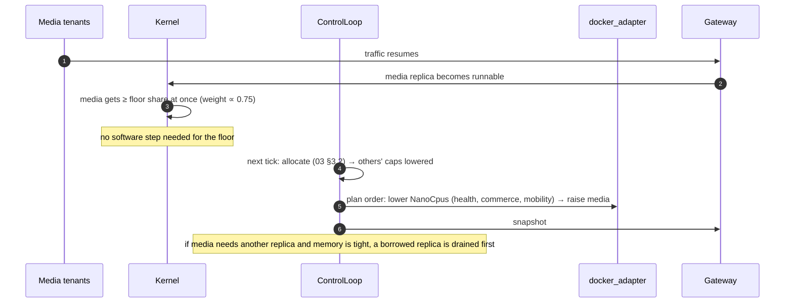

## 15. Sequence: noisy tenant inside a project
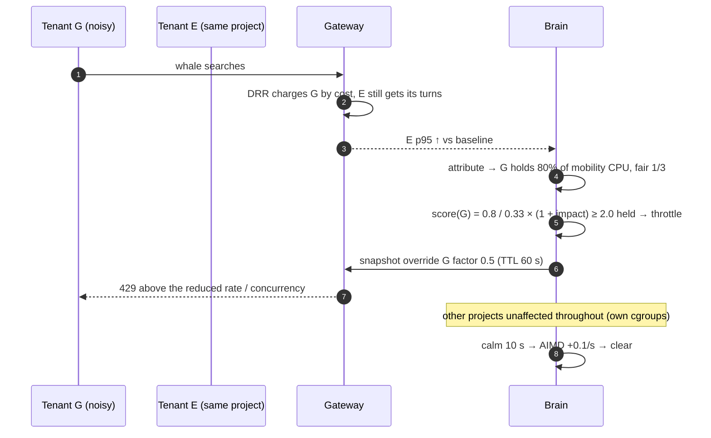

## 16. Sequence: hash split for hidden work
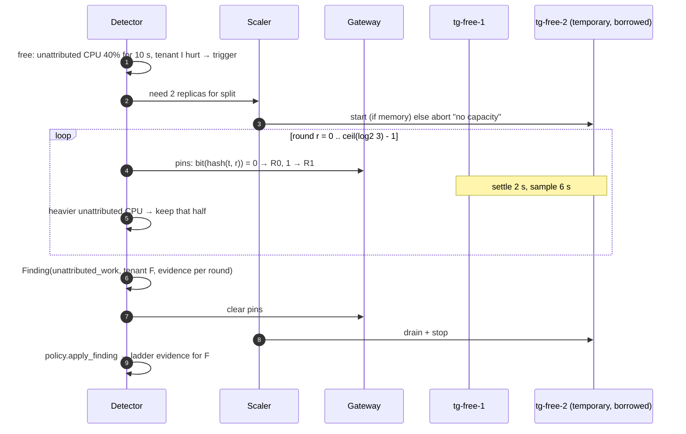

## 17. Sequence: brain crash
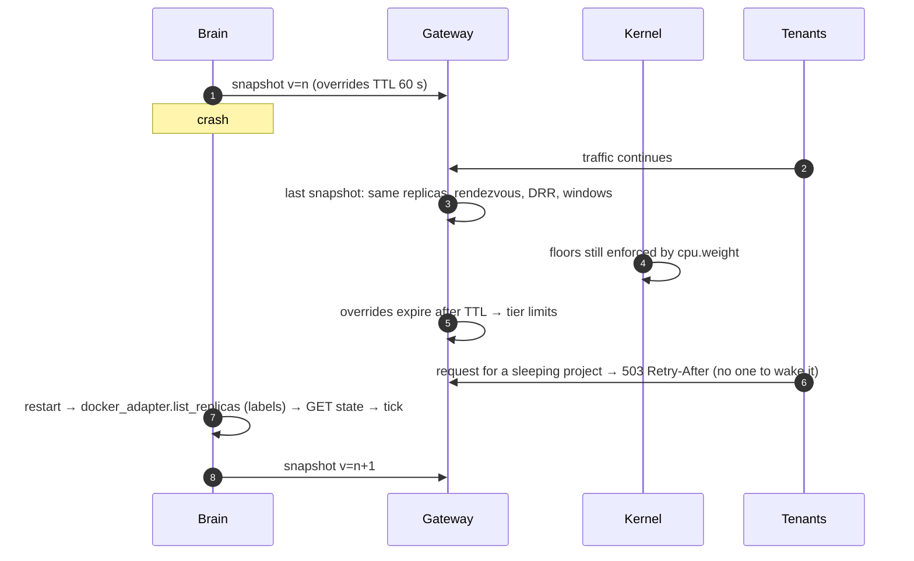

## 18. Class diagram
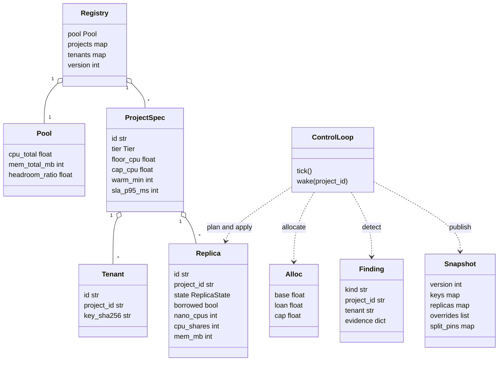

## 19. ER diagram (persistent data)
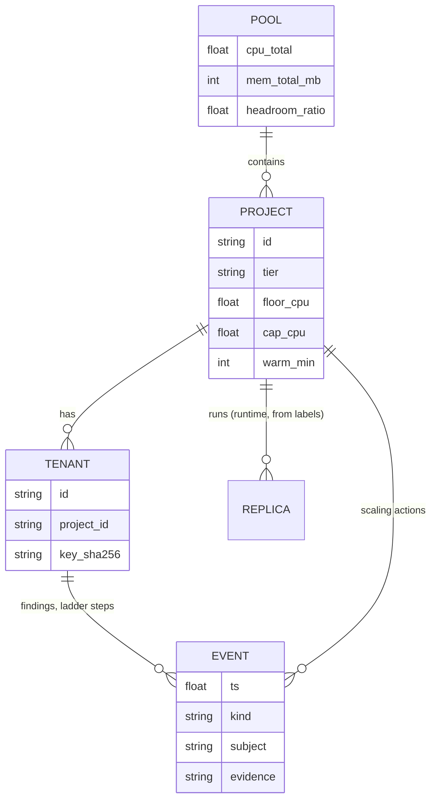

## 20. Allocation chart (03 §3.1 → 3.2, computed)
```mermaid
xychart-beta
  title "CPU per project: media idle, then media wakes"
  x-axis ["media idle", "media wakes"]
  y-axis "cores" 0 --> 2.2
  bar [1.94, 1.608]
  bar [1.94, 1.608]
  bar [1.095, 0.929]
  bar [0.1, 0.929]
  bar [0.1, 0.1]
```
The bars, in order, are health, commerce, mobility, media and free.

## 21. Build dependency graph (07)
```mermaid
flowchart LR
  V1["V1 contracts + config"] --> V2["V2 registry + Admin API"]
  V1 --> V3["V3 allocator + scaler (pure)"]
  V1 --> V4["V4 docker_adapter"]
  V1 --> V5["V5 gateway v2"]
  V1 --> V7["V7 worker counter + tenant list from env"]
  V2 & V3 & V4 --> V6["V6 control loop + detector + publisher"]
  V5 & V6 --> V8["V8 lab v2 + scorecard"]
  V6 --> V9["V9 UI"]
  V6 --> V10["V10 billing inputs"]
  V8 --> V11["V11 docs + acceptance"]
  V9 & V10 --> V11
```
