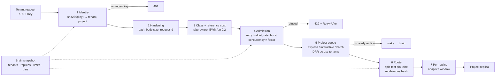

[← TenantGuard](../README.md)

# Gateway

**The single front door for tenant traffic: it identifies each request's tenant and project, admits it against the tier quota, queues it fairly inside the project, and routes it to one of that project's ready replicas.**

  

## At a glance

| Role | Port | Entry point | Talks to |
|---|---|---|---|
| Data plane: identity, admission, per-project fair queues, replica routing, telemetry | 8000 (`services.gateway`) | `python -m tenantguard_gateway` | Replicas (forwards `/api/*`), brain (receives `POST /control/snapshot`, sends `POST /control/wake`, serves `WS /internal/telemetry`), handoff bridge (`POST /control/block`) |

The gateway keeps no registry of its own. Tenants, projects, replicas, limits and pins all come from the brain's **snapshot** (`POST /control/snapshot`, or `GET {brain}/snapshot` at start), swapped in atomically.

## How it works



- **Identity:** the SHA-256 of `X-API-Key` is looked up in the snapshot's tenants. A missing or unknown key gets **401** before the body is read.
- **Hardening:** the path must stay under `/api/`; the body is capped at `worker.body_limit_bytes` (**413**); `X-Request-Id` is validated; gateway-owned headers are stripped.
- **Class and cost:** a class is `sha1(METHOD | path | sorted query keys | body-size bucket | size bucket)[:8]`. The size bucket is `log2` of the numeric `gateway.size_params` (`n`, `limit`, `pages`), so `search?n=1000` and `search?n=500000` get separate costs. Cost = the measured (tenant, class) EWMA, else the endpoint's handler CPU from `worker/calibration.json`, else 5 ms.
- **Admission** (every mode except `off`): block, retry budget, token bucket (tier `rate_rps`, `burst` × the brain's factor) and concurrency (tier × factor). A refusal returns **429** with `Retry-After` and `RateLimit` headers; its cost is reported to the brain as unmet demand (`refused_cost_ms`). There is no CPU bucket: a project's CPU is bounded by its replicas' cgroups.
- **Fair queues per project:** each project has its own express / interactive / batch lanes, each a DRR across its tenants (weight 1 × the ladder's `weight_factor`, quantum 5 CPU-ms). A flood in one project never delays another project. Waiting is bounded (**503** `queue_timeout`); batch is shed first when the project's replicas are saturated.
- **Wake on demand:** if the tenant's project has no ready replica, the gateway asks the brain to start one (`POST /control/wake`, debounced by `wake_debounce_s`) and holds the request up to `cold_wait_ms`.
- **Routing:** a split-test pin (tenantguard mode) if present, else rendezvous hashing over the project's ready replicas. A tenant sticks to one replica and spills to the next in rendezvous order only when its first choice has no free slot. Adding a replica moves about 1/(n+1) of the tenants; removing one moves only its own tenants.
- **Per-replica window:** a Gradient2 concurrency limiter per replica.
- **Forward:** with trusted headers plus `X-TenantGuard-Replica`. The response carries `X-TenantGuard-Server` (the replica id), `X-TenantGuard-Lane` and the replica's measured CPU (`X-TenantGuard-Cpu-Ms`).
- **Fail-static:** if no snapshot arrives within `fail_static_after_s`, the gateway keeps serving with the last one and reports `fail_static: true`.

**Modes** (`GET/POST /admin/mode`):

| Mode | Admission | Scheduler | Brain overrides (limits, pins, blocks) |
|---|---|---|---|
| `off` | none | one FIFO per project, fixed window | stored, not applied |
| `industry` | retry budget + rate + concurrency | 3 DRR lanes per project, adaptive window | stored, not applied |
| `tenantguard` | same as industry | same, DRR × `weight_factor` | applied |

## API

| Method | Path | Auth | What it does |
|---|---|---|---|
| any | `/api/{path}` | `X-API-Key` | The tenant request path above |
| GET | `/healthz` | none | Liveness: mode, tenant count, replica count, snapshot version |
| WS | `/internal/telemetry` | none | `TelemetryFrame` every `tick_ms`: cells per (tenant, replica); queue stats with `queued_cost_ms` and `refused_cost_ms` |
| GET | `/internal/telemetry/latest` | none | The latest frame |
| GET | `/metrics` | none | Prometheus text |
| GET | `/admin/tenants`, `/admin/tenants/{id}` | control token | `TenantAdminView`: project, replicas in this tenant's rendezvous order, factors, pin. Never a key or key hash |
| GET / POST | `/admin/mode` | control token | Read / set `off`, `industry`, `tenantguard` |
| GET | `/admin/overrides` | control token | Limits, blocks, pins, expiries, snapshot version and age, fail-static |
| GET | `/admin/costs` | control token | Cost seed and measured EWMAs |
| POST | `/control/snapshot` | control token | `Snapshot` from the brain. 400 for factors outside (0, 1], a bad TTL, or pins to unknown tenants or replicas |
| POST | `/control/block` | control token | `BlockCmd` from the handoff bridge; `blocked=false` clears it |

The control token travels as `X-TenantGuard-Control-Token`; without it every `/admin/*` and `/control/*` call gets **401**. Limits and pins in a snapshot replace the previous ones and expire at their TTL (at most `ttl_max_s`).

## Configuration

| Env var / yaml key | Default | Meaning |
|---|---|---|
| `TENANTGUARD_CONTROL_TOKEN` | `dev` | Token for `/admin/*` and `/control/*`; also sent to the brain |
| `TENANTGUARD_BRAIN_URL` | `services.brain` (`http://127.0.0.1:8200`) | Where snapshots come from and wakes go |
| `TENANTGUARD_GATEWAY_HOST` / `TENANTGUARD_GATEWAY_PORT` | `0.0.0.0` / port of `services.gateway` (8000) | Bind address |
| `TENANTGUARD_CORS_ORIGINS` | `http://127.0.0.1:5173,http://localhost:5173` | Comma list of UI origins |
| `TENANTGUARD_UPSTREAM_TIMEOUT_S` / `gateway.upstream_timeout_s` | 30 | Guard against a hung replica |
| `gateway.default_mode` | `tenantguard` | Mode at start |
| `gateway.tick_ms` | 250 | Telemetry frame period |
| `gateway.max_queue_wait_ms` | interactive 1000, batch 5000 | Bounded queue wait before 503 |
| `gateway.cold_wait_ms` / `wake_debounce_s` | 5000 / 2 | Hold time while a sleeping project wakes; wake debounce |
| `gateway.express_cost_ms` | 5 | Requests at or below this cost use the express lane |
| `gateway.fail_static_after_s` | 2 | Snapshot age that turns on fail-static |
| `gateway.batch_routes` | `["/api/export"]` | Routes that always use the batch lane |
| `gateway.size_params` | `["n", "limit", "pages"]` | Query params that split a class by size |
| `gateway.cost_seed` | `worker/calibration.json` | Measured endpoint costs used before the EWMA warms up |
| `gateway.retry_budget` | ratio 0.1, window 10 s, min 3 | Retries allowed per tenant |
| `gateway.limiter` | initial 8, min 2, max 64 | Per-replica adaptive window |
| `gateway.ttl_max_s` | 3600 | Longest accepted override TTL |
| `tiers.<tier>.quota` | enterprise 100 rps / burst 200 / 16 conc · pro 50 / 100 / 8 · free 20 / 40 / 4 | Per-tenant quota of each tier |

## Run it

```
cd gateway
pip install -r requirements.txt                 # tenantguard_common must be installed (pip install -e ../common)
python -m tenantguard_gateway                   # binds 0.0.0.0:8000
python tools/stub_worker.py --name w0 --port 8100   # optional echo upstream for experiments
```

The gateway needs a brain behind it. To run the whole system on one machine without Docker (brain, gateway, replicas as processes, lab, handoff, narrator and UI): `python brain/tools/local_stack.py` from the repo root.

## Test it

```
cd gateway
PYTHONPATH=<repo>/common python -m pytest       # 91 passed
```

## Files

```
tenantguard_gateway/
  app.py          FastAPI routes: /api, /healthz, telemetry, /metrics, /admin, /control
  core.py         the request path, per-project dispatch, wake
  tenants.py      identity, request class, registry from the snapshot
  costs.py        reference cost: calibration seed + (tenant, class) EWMA
  admission.py    block, rate, burst and concurrency checks
  buckets.py      token bucket
  retry.py        retry budget
  scheduler.py    DRR lanes
  limiter.py      Gradient2 per-replica window
  router.py       split-test pin + rendezvous hashing
  overrides.py    snapshot limits and pins, blocks, fail-static clock
  security.py     path and request-id checks
  telemetry.py    TelemetryFrame builder
  metrics.py      Prometheus output
  settings.py     settings from tenantguard.yaml + env
tools/stub_worker.py   echo upstream for experiments
```

## Related docs

- [v2 architecture](../docs/v2/02_ARCHITECTURE.md)
- [Algorithms (DRR, rendezvous, admission)](../docs/v2/03_ALGORITHMS.md)
- [Function catalog](../docs/v2/04_FUNCTIONS.md)
- [Data and configuration](../docs/v2/05_DATA_AND_CONFIG.md)
- [As built](../docs/v2/09_AS_BUILT.md)
