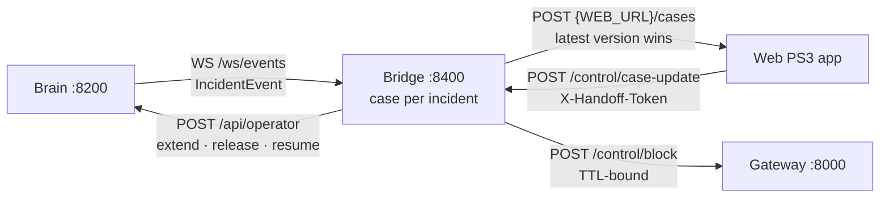

[← TenantGuard](../../README.md)

# Handoff bridge

**Every TenantGuard incident becomes a case in the Web PS3 "Digital Handoff" app, and the on-call engineer's decisions flow back and take effect live.**

  

## At a glance

| Role | Port | Entry point | Talks to |
|---|---|---|---|
| Convergence bridge to the partner Web app | 8400 | `python -m tenantguard_handoff` | brain (WS in, operator commands out), gateway (block commands), the Web app (cases out, updates in) |

## How it works



- **One case per incident.** The brain's `incident_id` maps to a bridge-assigned `INC-NNNN`, persisted, so a restart never reuses an id at the Web app.
- **Affected tenants** are the other tenants of the culprit's project: they share its replicas, so they are the possible victims.
- **Humans act through the brain.** The bridge never sends raw limits; the brain owns the ladder, so an operator decision and the ladder never fight.
- **Safe default.** If no decision arrives before a deadline, the action expires and TenantGuard's timers undo themselves.

### Two formats, converted at the edge

| Format | Where | Shape |
|---|---|---|
| Wire (the partner's) | `wire.py`, samples in `docs/convergence/` | strict (unknown fields rejected), `case_id` `INC-NNNN`, times as `"HH:MM:SS"` IST strings |
| Internal | `CaseView` in `contracts.py` | epoch floats, `*_ist` strings for display only; `timefmt.py` is the only converter |

`evidence_link` = `{TENANTGUARD_UI_URL}/case/<incident_id>`.

### Incident → case

| Brain event | Case |
|---|---|
| any stage | history line `"<Stage>: <detail>"`; `summary` = latest detail; replayed events (reconnect backfill) are ignored |
| first event | new case: title, verdict `over_plan` until the brain sends one, `affected` = the culprit's project peers |
| level throttle / deprioritize / quarantine | severity medium / medium / high (never lowered); pending **hold** action "auto-reverts at HH:MM:SS: extend or release?", deadline = `brain.ttl_s` |
| level quarantine | an extra pending **block** action, deadline = `decision_window_s` |
| finding without a tenant (`srv-…`) | severity medium; title says which: a **hash split** of one project's hidden CPU, or a **host-wide slowdown** nobody is blamed for |
| split `verdict`, top suspect ≥ `brain.confidence_to_prove` | the case adopts the culprit (title, affected peers); no decision is asked here: the split case closes at once, and the culprit's own ladder case asks if it escalates |
| any event whose `verdict` (or `report.verdict`) is a known verdict | `context.verdict` set, history line added |
| `verdict` | `context.verdict` |
| back to warn / normal | the hold action expires |
| resolved / closed | status resolved / closed; pending actions expire |
| deadline passes with no decision | the action expires; the history notes the safe default |

`status` = `waiting_for_decision` while any action is pending, else `in_progress` (until resolved or closed).

### Decision → control

| Action | Decision | Effect |
|---|---|---|
| hold | approve / extend | brain `OperatorCmd extend`, `until_s = min(extend_s, ttl_max_s)`: the ladder holds its level |
| hold | release | brain `OperatorCmd release`: back to normal, no re-escalation for `until_s` |
| hold / block | reject | nothing; the timers' safe default applies |
| block | approve / extend | gateway `BlockCmd`, `ttl_s = min(block_s, ttl_max_s)`: never permanent |
| block | release | gateway `BlockCmd blocked=false` |
| any | resolve | case resolved; clears only what the bridge applied (unblock, `OperatorCmd resume`) |

Every outcome of a control call is written to the case history.

### Delivery

The outbox keeps the latest version per case, retries with exponential backoff (0.5 s to 8 s) and gives other cases their turn while one fails. `put()` never blocks, so a dead Web app only causes stale versions to be skipped. A permanent 4xx from the Web app is logged and dropped.

## API

| Method | Path | Auth | What it does |
|---|---|---|---|
| GET | `/healthz` | none | brain connection, outbox counters, last error, bad messages |
| GET | `/cases` | none | every `CaseView` |
| GET | `/cases/{case_id}` | none | one `CaseView` (404 if unknown) |
| GET | `/cases/{case_id}/wire` | none | exactly what the Web app receives |
| POST | `/control/case-update` (alias `/cases/update`) | `X-Handoff-Token` | owner or decision from the Web app: 404 unknown case or action, 409 impossible decision, 400 malformed |

## Configuration

| Variable / yaml key | Default | Meaning |
|---|---|---|
| `WEB_URL` | `http://127.0.0.1:8500` | the partner app (the default is the mock) |
| `TENANTGUARD_BRAIN_URL` | yaml `services.brain` | brain WS + operator API |
| `TENANTGUARD_GATEWAY_URL` | yaml `services.gateway` | gateway control API |
| `TENANTGUARD_CONTROL_TOKEN` | `dev` | sent on every control call |
| `TENANTGUARD_UI_URL` | `http://127.0.0.1:5173` | base of `evidence_link` |
| `TENANTGUARD_CORS_ORIGINS` | `http://127.0.0.1:5173,http://localhost:5173` | UI origins allowed |
| `HANDOFF_STATE_PATH` | `data/handoff-state.json` | case-id persistence |
| `HANDOFF_PARTNER_TOKEN` | *(none)* | **required** for inbound updates; without it every update returns 503 (fail closed), a wrong or missing `X-Handoff-Token` returns 401 |
| `handoff.decision_window_s` | `120` | deadline of a block decision |
| `handoff.block_s` / `handoff.extend_s` | `300` / `120` | block length / hold extension |
| `handoff.push_timeout_s` | `3` | per push to the Web app |
| `handoff.history_wire_max` / `history_keep` | `50` / `500` | history items sent per case / kept in memory |
| `handoff.retention_s` | `3600` | closed cases are evicted this long after they close |
| `handoff.id_map_max` | `2000` | incident → case id entries kept |

The bridge also reads `brain.ttl_s`, `brain.confidence_to_prove` and `gateway.ttl_max_s`.

## Run it

```bash
# the whole system on one laptop, including this bridge and the mock Web app
python brain/tools/local_stack.py

# the bridge alone
cd integrations/handoff
pip install -r requirements.txt                     # tenantguard_common must already be installed
export HANDOFF_PARTNER_TOKEN=<shared secret>
WEB_URL=http://<web-host>:<port> python -m tenantguard_handoff

# stand-in for the Web app
python tools/mock_web.py serve --port 8500
python tools/mock_web.py owner INC-0001 Rahul
python tools/mock_web.py decide INC-0001 A1 extend Rahul
python tools/mock_web.py down | up                  # simulate a partner outage
```

## Test it

```bash
cd integrations/handoff
python -m pytest            # 48 tests
```

## Files

```
integrations/handoff/
├─ tenantguard_handoff/
│  ├─ app.py        FastAPI routes and the update endpoint
│  ├─ bridge.py     brain consumer, decisions → control calls
│  ├─ cases.py      incident → case rules, pending actions, deadlines
│  ├─ outbox.py     latest-version-wins delivery with backoff
│  ├─ wire.py       the partner's wire format (strict)
│  ├─ timefmt.py    epoch ↔ IST strings
│  └─ settings.py   env + yaml
├─ tools/           mock Web app, end-to-end proof script
└─ tests/
```

## Related docs

- [Partner sample data](../../docs/convergence/README.md) · [v2 architecture](../../docs/v2/02_ARCHITECTURE.md) · [As built](../../docs/v2/09_AS_BUILT.md)
