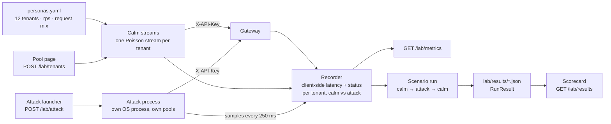

[← TenantGuard](../README.md)

# Traffic lab

**Realistic tenant traffic on demand: 12 Poisson personas, five attacks you can launch and stop, and scripted scenario runs that write the measured results the Scorecard shows.**

  

## At a glance

| Role | Port | Entry point | Talks to |
|---|---|---|---|
| Load generator and experiment runner | 8300 (`services.lab`) | `python -m tenantguard_lab serve` | Gateway (tenant traffic with each tenant's `X-API-Key`; `POST /admin/mode` for runs), brain (`/api/incidents` for time-to-detect, `/api/pool` for calibration), UI (attack launcher, Scorecard, Pool page) |

## How it works



- **Personas** (`personas.yaml`): each tenant has an rps (A, D, G, J 14 · B, E, H, K 10 · C, F, I, L 5) and a request mix (default light 45 %, read 30 %, search 15 %, write 10 %). The effective rate is `rps × rate_scale`. Arrivals are Poisson on an absolute schedule, so loop jitter does not lower the rate.
- **Tenants added at runtime:** a tenant created on the Pool page has its key shown once, so the page hands it to the lab (`POST /lab/tenants`). It gets a calm persona at the median rate of its tier and can be attacked like any other tenant.
- **Connection pools:** each tenant, and each attack, has its own keep-alive pool, so an attacker's connections never queue a victim's request on the client side. Streams cap in-flight requests (`client.max_inflight_per_tenant` 64, `max_inflight_per_attack` 512); arrivals over the cap count as `client_dropped`.
- **Attack isolation:** attacks run in their own OS process (`client.attack_isolation: process`), so attack traffic never shares the victims' event loop and the results measure the platform, not the lab. `GET /lab/metrics` reports the lab's own event-loop lag; if its p99 is high, read client latencies with care.

**Attacks** (intensity 0.1–5 multiplies the rate, or the concurrency for `hog`):

| Attack | Profile at intensity 1 (`personas.yaml`) | What it tests |
|---|---|---|
| `flood` | 10 × the tenant's persona rate of `/api/light` | Request-rate abuse |
| `whale` | 2 rps of `/api/search?n=1500000` | A few very expensive requests |
| `hog` | 24 closed-loop `/api/export` (1000 rows, chunks of 50, 50 ms pauses) | Holding concurrency |
| `memory` | 4 rps, 24 MB each held 1 s | Memory pressure |
| `retry_storm` | 3 × persona rate of `/api/read`; every 429/503 retried at once, ignoring `Retry-After`, up to 50 times | Retry amplification |

`background_bomb`, `blackbox_bomb`, `cache_flood`, `faulty_server` and `honest_spike` are not in this build: the lab answers **501** for them.

## API

| Method | Path | Auth | What it does |
|---|---|---|---|
| GET | `/healthz` | none | Liveness, gateway URL, calm on/off |
| GET | `/lab/status` | none | `LabStatus`: attacks, `calm_running`, run in progress |
| POST | `/lab/calm/start` `{rate_scale?}` | none | Start calm traffic (optionally change the rate scale live) |
| POST | `/lab/calm/stop` | none | Stop calm traffic |
| POST | `/lab/attack` | none | `AttackReq` → `AttackStatus`. 501 for an attack not in this build, 404 for an unknown tenant, 422 for intensity outside 0.1–5 |
| DELETE | `/lab/attack/{id}` | none | Stop one attack |
| DELETE | `/lab/attacks` | none | Stop every attack |
| GET | `/lab/metrics?window_s=10` | none | Per tenant, client-side: p50 / p95 / p99, count / ok / 429 / 503 / errors per second, calm vs attack; attack counters; lab event-loop lag |
| GET | `/lab/personas` | none | Personas with effective rates and the estimated CPU load |
| POST | `/lab/tenants` `{tenant, api_key, name, project, tier, rps?}` | none | 201. Calm persona for a tenant created through the brain admin API (rps defaults to the median of its tier). Kept in memory only. 409 for a tenant configured in `tenantguard.yaml`, 422 for an unknown tier |
| DELETE | `/lab/tenants/{id}` | none | 204. Stops its calm traffic and attacks. 409 for a configured tenant, 404 for an unknown one |
| POST | `/lab/run` (`RunReq`) | none | 202 + run view. Sets the gateway mode, then runs calm → attack → calm. 409 if a run is in progress |
| GET | `/lab/run/{id}` | none | Run progress: phase, result |
| DELETE | `/lab/run` | none | Cancel the run: attack stopped, calm restored |
| GET | `/lab/results?scenario=&mode=` | none | Every `RunResult` in `lab/results/`, newest first (the Scorecard reads this) |

The lab has no auth of its own; it sends the control token (`TENANTGUARD_CONTROL_TOKEN`) only on the gateway's `/admin/mode`.

**What a run measures (`RunResult`):**
- **Timeline:** warm-up (3 s), plus 10 s if calm traffic was cold, then `calm_s` baseline, `attack_s` attack, `calm_s` after. Defaults: 20 s / 40 s.
- **Victims:** every tenant except the attacker, counting only their calm `light` and `read` requests (`run.victim_kinds`, the interactive probes), so a victim's own heavy searches do not set its p99.
- **`victim_p99_ms`:** pooled and per tenant, per phase (linear interpolation).
- **`time_to_recover_s`:** from attack start to the first 5 consecutive 1 s buckets with pooled victim p99 ≤ 1.5 × baseline, after victims first degraded. 0 if they never degraded; null if they never recovered.
- **`time_to_detect_s`:** from attack start to the brain's first incident event for the attacker. Null if the brain is unreachable.
- **`attacker_429` / `attacker_503`:** the attacker's refusals from attack start to run end.

## Configuration

| Env var / yaml key | Default | Meaning |
|---|---|---|
| `TENANTGUARD_GATEWAY_URL` | `services.gateway` (`http://127.0.0.1:8000`) | Where traffic goes |
| `TENANTGUARD_BRAIN_URL` | `services.brain` (`http://127.0.0.1:8200`) | Time-to-detect and calibration |
| `TENANTGUARD_LAB_URL` | `services.lab` (`http://127.0.0.1:8300`) | The server the CLI commands talk to |
| `TENANTGUARD_UI_ORIGINS` | `http://127.0.0.1:5173` | CORS, comma list |
| `TENANTGUARD_CONTROL_TOKEN` | `dev` | Sent on `/admin/mode` |
| `TENANTGUARD_LAB_RATE_SCALE` / `rate_scale` | 1.0 | Multiplies every persona rate (the local stack uses 0.25) |
| `TENANTGUARD_LAB_AUTOSTART` / `autostart` | true | Start calm traffic when the server starts |
| `TENANTGUARD_LAB_PERSONAS` | `lab/personas.yaml` | Personas, endpoints, attacks, run and client settings |
| `TENANTGUARD_LAB_RESULTS` | `lab/results/` | Where `RunResult` files go |
| `default_attacker` | `K` | Attacker when a run names none |
| `target_fleet_util` | 0.30 | Calm load `calibrate` aims for |
| `client.timeout_s` | 10 | Client request timeout |
| `run.recover_ratio` / `recover_hold_s` / `bucket_s` | 1.5 / 5 / 1.0 | Recovery rule above |

## Run it

```
cd lab
pip install -r requirements.txt                 # tenantguard_common must be installed
python -m tenantguard_lab serve                 # API on 0.0.0.0:8300, calm traffic starts (--no-calm to skip)
python -m tenantguard_lab calm [--scale 0.25]   # start calm traffic
python -m tenantguard_lab attack whale K [--intensity 1] [--duration 60]
python -m tenantguard_lab stop <attack_id|all>
python -m tenantguard_lab status
python -m tenantguard_lab metrics [--window 10]
python -m tenantguard_lab run whale tenantguard [--tenant K] [--calm-s 20] [--attack-s 40] [--local]
python -m tenantguard_lab calibrate [--seconds 20]   # calm traffic + the brain's measured pool CPU → suggested rate_scale
docker compose --profile lab up lab             # from the repo root
```

CLI commands talk to a running lab server when one answers, so the dashboard sees the same attacks; otherwise, or with `--local`, they run in-process. To run the whole system on one machine without Docker: `python brain/tools/local_stack.py` from the repo root (the lab starts at 0.25 × the persona rates).

## Test it

```
cd lab
PYTHONPATH=<repo>/common python -m pytest       # 35 passed
```

## Files

```
personas.yaml      personas, request mix, endpoints, attack profiles, run and client settings
results/           RunResult files written by scenario runs
tenantguard_lab/
  app.py           FastAPI routes
  core.py          Lab: calm, attacks, runtime tenants, runs, time-to-detect
  engine.py        keep-alive pools, calm Poisson streams, request recording
  attacks.py       the five attack profiles (and the 501 list)
  isolation.py     runs an attack in its own OS process
  poisson.py       Poisson arrivals on an absolute schedule
  scenario.py      run timeline and RunResult computation
  stats.py         recorder, percentiles, per-tenant metrics
  settings.py      LabConfig from tenantguard.yaml, personas.yaml and env
  __main__.py      CLI
```

## Related docs

- [v2 architecture](../docs/v2/02_ARCHITECTURE.md)
- [Data and configuration](../docs/v2/05_DATA_AND_CONFIG.md)
- [Build plan (scorecard scenarios)](../docs/v2/07_BUILD_PLAN.md)
- [As built](../docs/v2/09_AS_BUILT.md)
