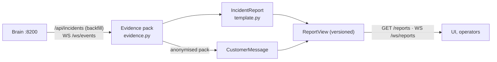

[← TenantGuard](../README.md)

# Incident narrator

**Turns each incident into a plain-English report for the operator and an anonymised note for affected customers, built only from the brain's own evidence.**

  

## At a glance

| Role | Port | Entry point | Talks to |
|---|---|---|---|
| Read-only report writer (template-based, deterministic) | 8700 | `python -m tenantguard_narrator` | brain (`/api/incidents` backfill + `WS /ws/events`) |

The narrator never makes a decision and never calls a control API.

## How it works



1. **Evidence pack** (`evidence.py`), built when an incident reaches `named`, `verdict` or `closed` and rebuilt on every later event:
   - stages with IST times and the brain's own details;
   - suspects with confidence %;
   - the case kind: a **tenant** case from the ladder, a **hash split** of one project's hidden CPU (with every round: the two halves, the unexplained CPU per replica, who was kept), or a **host-wide slowdown** nobody is blamed for (with the projects that slowed);
   - the project, and the verdict (from the event or its report);
   - actions with their TTLs, the peak level and the verdict;
   - affected tenants: the other tenants of the culprit's project.

   Replayed events (reconnect backfill) are ignored.
2. **Incident report** (`template.py`): `IncidentReport {headline, timeline, cause, evidence_points, action_taken, operator_recommendation}`, worded per kind: a tenant case explains the over-use of its project; a split names the tenant the hidden CPU followed, round by round, or says nobody could be tied to it; a host-wide slowdown says the cause is outside the projects and nobody was throttled.
3. **Customer message**, built from an **anonymised** pack: times, duration, a generic cause per kind and whether the cause was limited. No tenant, no project and no copied brain text, so nothing can leak.
4. **Versions:** a report is republished (version + 1) only when its evidence changes. The store is bounded by `max_reports`.

## API

| Method | Path | Auth | What it does |
|---|---|---|---|
| GET | `/healthz` | none | brain connection and counters |
| GET | `/reports?limit=50` | none | `List[ReportView]`, newest first |
| GET | `/reports/{incident_id}` | none | one `ReportView` (404 if none) |
| WS | `/ws/reports` | none | the latest 50 on connect, then every new version |

`ReportView` (contracts §8): `incident_id`, `tenant`, `trigger_stage`, `version`, `report`, `customer_message`, `evidence`, `created_at`, `updated_at`.

## Configuration

| Variable / yaml key | Default | Meaning |
|---|---|---|
| `TENANTGUARD_BRAIN_URL` | yaml `services.brain` | where incidents come from |
| `TENANTGUARD_CORS_ORIGINS` | `http://127.0.0.1:5173,http://localhost:5173` | UI origins allowed |
| `NARRATOR_HOST` / `NARRATOR_PORT` | `0.0.0.0` / `8700` | bind address |
| `narrator.max_reports` | `200` | reports kept in memory |

## Run it

```bash
# the whole system on one laptop, including the narrator
python brain/tools/local_stack.py

# the narrator alone
cd narrator
pip install -r requirements.txt       # tenantguard_common must already be installed
python -m tenantguard_narrator        # binds 0.0.0.0:8700
```

## Test it

```bash
cd narrator
python -m pytest            # 10 tests
```

## Files

```
narrator/
├─ tenantguard_narrator/
│  ├─ app.py        FastAPI routes, brain consumer, WS push
│  ├─ evidence.py   incident book-keeping and the evidence packs
│  ├─ template.py   report and customer-message templates
│  ├─ service.py    events → evidence pack → versioned ReportView
│  └─ settings.py   env + yaml
└─ tests/
```

## Related docs

- [v2 architecture](../docs/v2/02_ARCHITECTURE.md) · [Data and config](../docs/v2/05_DATA_AND_CONFIG.md) · [As built](../docs/v2/09_AS_BUILT.md)
