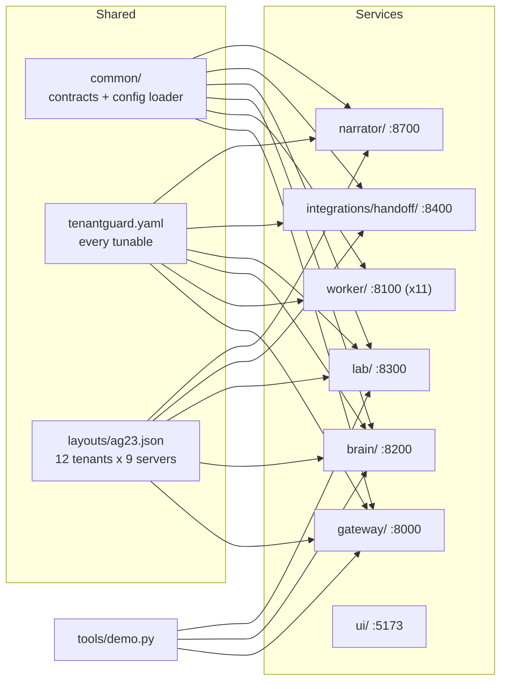

# TenantGuard prototype documentation: index

This folder documents the TenantGuard prototype exactly as it is built on the `master` branch: what it does, how it is designed, and every source file and function. Work that is still on task branches is marked **in progress**; it is never described as done.

## How to read it

| If you want to... | Read |
|---|---|
| Understand the idea in 5 minutes | `01_OVERVIEW.md` |
| See how the pieces fit | `02_ARCHITECTURE.md`, then `05_SEQUENCE_DIAGRAMS.md` |
| Judge the code quality and design | `03_SOLID_AND_DESIGN.md` |
| Know the data exchanged between services | `04_DATA_MODELS.md` |
| See what could go wrong and how it is handled | `06_RISKS_AND_MITIGATIONS.md` |
| See what is new compared with a rate limiter | `07_UNIQUE_FEATURES.md` |
| Configure or deploy it | `09_CONFIG_REFERENCE.md` (+ `docs/SETUP.md`) |
| Check how it is tested | `10_TESTING.md` |
| Look up a file or function | the `11_FILES_*.md` catalogs |

Suggested order for a reviewer: 01 → 02 → 05 → 07 → 03 → 06 → 10, then the file catalogs as needed.

## All files

| File | Contents |
|---|---|
| `00_INDEX.md` | This map |
| `01_OVERVIEW.md` | The problem, what is built, a status table, the demo script |
| `02_ARCHITECTURE.md` | System diagram, the three planes, the five isolation layers, the two-laptop deployment, components and ports |
| `03_SOLID_AND_DESIGN.md` | SOLID principles with concrete code from the repo, design patterns, refactorings done and possible |
| `04_DATA_MODELS.md` | Every contract model and field (with units), class diagrams, layout and yaml shapes, the per-tenant SQLite schema |
| `05_SEQUENCE_DIAGRAMS.md` | Request path, admission/429, fair dispatch, detection → throttle ladder → recovery, health → rescue → naming, host fault, operator/handoff decision, narrator report, UI live stream |
| `06_RISKS_AND_MITIGATIONS.md` | Technical, operational, security and demo risks, each with its mitigation and where it lives |
| `07_UNIQUE_FEATURES.md` | What TenantGuard does that a rate limiter or a typical fair-share gateway does not |
| `08_ARCHITECTURE_FLOW.md` | One end-to-end flow diagram (technical + simple) and the attack protection loop |
| `09_CONFIG_REFERENCE.md` | Every `tenantguard.yaml` key, environment variable, port and token |
| `10_TESTING.md` | Test suites, counts, what they prove, mutation checks |
| `11_FILES_gateway.md` | `gateway/`: every file and function |
| `11_FILES_worker.md` | `worker/`: every file and function |
| `11_FILES_brain.md` | `brain/`: every file and function |
| `11_FILES_lab.md` | `lab/`: every file and function |
| `11_FILES_ui.md` | `ui/`: every file, component and function |
| `11_FILES_common.md` | `common/`: contracts and config loader |
| `11_FILES_handoff.md` | `integrations/handoff/`: the Web PS3 convergence bridge |
| `11_FILES_narrator.md` | `narrator/`: the incident report service |
| `11_FILES_tools.md` | `tools/`: the demo driver |

## Repository at a glance

## Conventions used in these documents
- **Times:** every `ts` / `*_at` field is epoch seconds; every `*_ms` field is milliseconds; `*_ist` fields are display strings (`HH:MM:SS`, India Standard Time).
- **Numbers:** only measured values from committed files are quoted (`worker/calibration.json`, test assertions). Anything else is marked *to be measured*.
- **Paths** are relative to the repository root.
