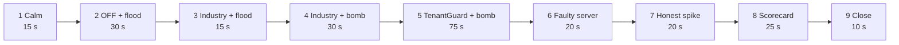

# 01: Overview

## The problem

In a multi-tenant SaaS, many customers (tenants) share the same servers. When one tenant does something expensive, everybody on those servers gets slower. This is the **noisy-neighbour problem**. Three things make it hard:

1. **Request counters are blind to cost.** A rate limiter counts requests. A few cheap-looking requests can trigger large hidden work (background jobs, a vendor indexer), and the limiter never sees it.
2. **The victim's symptom is not the culprit's identity.** Operators see slow servers, but which tenant caused it?
3. **Punishing the wrong tenant is as bad as doing nothing.** A legitimate sale-day burst must not be throttled, and a faulty host must not be blamed on a customer.

## What TenantGuard is

TenantGuard is a fair-share control plane in front of a shared service. It:

- **identifies** every request's tenant (hashed API key);
- **admits** it against quotas on *resources*, not just request count: rate, measured CPU milliseconds and concurrency, plus a retry budget;
- **schedules** fairly: per-tenant weighted deficit round robin in three lanes, so a cheap request never waits behind a whale;
- **routes** each tenant to its own 3 of 9 servers (its "barcode"), so that any two tenants share at most one server;
- **measures** every tenant's latency per server and its CPU on each worker;
- **detects, rescues and names**: a usage-share detector drives a graduated throttle ladder. Server health is checked against peers, victims are rescued by routing around slow servers, and a barcode decoder names the culprit with a confidence, or says "host fault, no tenant blamed";
- **acts safely**: every control action has a timer and undoes itself, the gateway keeps working if the brain dies (fail-static), and humans can hold or release actions without fighting the automation;
- **explains**: a live dashboard, an incident report per incident, and a case in the on-call team's handoff app (the Web PS3 convergence partner).

## What is built (status on `master`)

| Area | Status | Where |
|---|---|---|
| Gateway: identity, rate + CPU-cost + concurrency quotas, retry budget, 429 with `Retry-After` and `RateLimit` headers | done | `gateway/` |
| Gateway: 3-lane weighted DRR, bounded wait, adaptive per-worker window, barcode routing, control overrides with TTL, fail-static, admin API, telemetry, `/metrics` | done | `gateway/` |
| Gateway hardening: control token, path guard, bounded TTLs and quotas, capped bodies | done | `gateway/` |
| Workers: per-tenant SQLite + cache, tenant-tagged background jobs, black-box indexer, per-tenant CPU metering, fault injection, calibration | done | `worker/` |
| Brain Stage 2: usage-share noisy score, throttle ladder, incidents, live UI stream | done | `brain/` |
| Brain Stage 3: server health (peer ratio), rescue (route-around), barcode decoder naming, operator holds, business-impact meter | done | `brain/` |
| Brain: relocation prover, five verdicts, host calibration | **in progress** (T12) | branch `task/T12-brain-prover` |
| Lab: 12 Poisson personas; flood, whale, hog, memory, retry_storm attacks; scenario runner; results files | done | `lab/` |
| Lab: black-box bomb, background bomb, cache flood, faulty server, honest spike; crash-test runner | **in progress** (T10) | branch `task/T10-lab-crashtest` |
| UI: Control Room, Tenants, Cases, Case File, Scorecard, impact panel, flow view | done | `ui/` |
| Handoff bridge (Web PS3 convergence) | done | `integrations/handoff/` |
| Incident narrator (deterministic reports) | done | `narrator/` |
| Demo driver | done | `tools/demo.py` |
| Fair billing ("Why was I slow?") | **in progress** (T17) | branch `task/T17-billing`; compose already has a `billing` profile |
| Measured OFF / Industry / TenantGuard scorecard | **to be measured** | `lab/results/` is empty on master |

## The one measured fact that motivates the design

From `worker/calibration.json` (Docker host, one worker limited to 0.5 CPU, mean per request):

| Endpoint | Handler CPU (what request metering sees) | Black-box indexer CPU (hidden) |
|---|---|---|
| `GET /api/light` | 0.396 ms | 0 |
| `POST /api/ingest` | **0.066 ms** | **20.25 ms** |

An `ingest` call looks about 6× cheaper than a `light` call to anything that meters the request, yet it makes the worker burn about 300× more CPU than it reports. That is why TenantGuard watches server health and decodes the culprit from the barcode layout, instead of trusting request counters.

## Modes

The gateway runs in one of three modes, switched live through `POST /admin/mode`:

| Mode | Admission | Scheduling | Brain control |
|---|---|---|---|
| `off` | none | one FIFO queue, fixed window | ignored |
| `industry` | retry budget, rate, CPU cost, concurrency | 3 DRR lanes, adaptive window | ignored |
| `tenantguard` | the same + brain limits / blocks | the same, with the brain's weight factors | applied (with TTL) |

`industry` is a strong, honest baseline: everything a good gateway does on its own. `tenantguard` adds the adaptive loop. Comparing them shows what the loop adds.

## The demo (4 minutes, `tools/demo.py`)

| # | What the audience sees |
|---|---|
| 1 | 12 green tiles, fairness near 1 |
| 2 | Protection off; tenant K floods; everyone sharing K's servers turns red |
| 3 | Industry limits refuse the flood with 429s; victims stay green |
| 4 | K sends cheap-looking requests that trigger hidden work; the rate limiter barely sees them; victims turn red |
| 5 | TenantGuard: victims rescued, K named with a confidence, a case appears for the on-call engineer, an incident report is written |
| 6 | A server goes bad by itself: host fault, no tenant blamed |
| 7 | An Enterprise tenant's sale day: a genuine burst that is not throttled |
| 8 | The OFF / Industry / TenantGuard table, from measured runs |
| 9 | "Every tenant gets its fair share. Every slowdown gets a name." |

The driver preflights the lab and skips any attack the lab cannot run yet (steps 4–7 depend on T10's attacks); the black-box bomb falls back to the whale attack. Each step prints live numbers from the brain and the lab, and every attack is stopped on exit.
