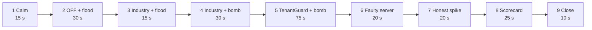

# 01: Overview

## The problem

In a multi-tenant SaaS, many customers (tenants) share the same servers. When one tenant does something expensive, everybody on those servers gets slower. This is the **noisy-neighbour problem**. Three things make it hard:

1. **Request counters are blind to cost.** A rate limiter counts requests. A few cheap-looking requests can trigger large hidden work (background jobs, a vendor indexer), and the limiter never sees it.
2. **The victim's symptom is not the culprit's identity.** Operators see slow servers, but which tenant caused it?
3. **Punishing the wrong tenant is as bad as doing nothing.** A legitimate sale-day burst must not be throttled, and a faulty host must not be blamed on a customer.

## What TenantGuard is

TenantGuard is a fair-share control plane in front of a shared service. It:

- **identifies** every request's tenant (hashed API key);
- **admits** it against quotas on *resources*, not just request count: rate, measured CPU milliseconds and concurrency, plus a retry budget;
- **schedules** fairly: per-tenant weighted deficit round robin in three lanes, so a cheap request never waits behind a whale;
- **routes** each tenant to its own 3 of 9 servers (its "barcode"), so that any two tenants share at most one server;
- **measures** every tenant's latency per server and its CPU on each worker;
- **detects, rescues and names**: a usage-share detector drives a graduated throttle ladder. Server health is checked against peers, victims are rescued by routing around slow servers, and a barcode decoder names the culprit with a confidence, or says "host fault, no tenant blamed";
- **acts safely**: every control action has a timer and undoes itself, the gateway keeps working if the brain dies (fail-static), and humans can hold or release actions without fighting the automation;
- **proves before it punishes**: a named culprit is moved to the spare server; if its old servers recover and the harm follows it, one of five verdicts decides what happens next;
- **bills fairly**: victims pay calm reference prices during an incident, get SLA credits, and can ask "Why was I slow?";
- **explains**: a live dashboard, an incident report per incident, and a case in the on-call team's handoff app (the Web PS3 convergence partner).

## What is built (status on `master`)

Everything in this table is merged on `master` and covered by tests.

| Area | Status | Where |
|---|---|---|
| Gateway: identity, rate + CPU-cost + concurrency quotas, retry budget, 429 with `Retry-After` and `RateLimit` headers | done | `gateway/` |
| Gateway: 3-lane weighted DRR, bounded wait, adaptive per-worker window, barcode routing, control overrides with TTL, fail-static, admin API, telemetry, `/metrics` | done | `gateway/` |
| Gateway: background-CPU charge-back (`POST /control/charge`, idempotent `charge_id`, `tenantguard` mode only) | done | `gateway/` |
| Gateway hardening: control token, path guard, bounded TTLs and quotas, capped bodies | done | `gateway/` |
| Workers: per-tenant SQLite + cache, tenant-tagged background jobs, black-box indexer, per-tenant CPU metering, fault injection, calibration, memory returned to the OS | done | `worker/` |
| Brain Stage 2: usage-share noisy score, throttle ladder, incidents, live UI stream | done | `brain/` |
| Brain Stage 3: server health (peer ratio, SLA-tied floor), rescue (route-around), barcode decoder naming, held hosts, operator holds, business-impact meter | done | `brain/` |
| Brain: relocation prover (`DockerProver` moves the named culprit to the spare through the Docker socket; `HostProver` drains a host suspect) | done | `brain/tenantguard_brain/prover.py` |
| Brain: five verdicts (`mitigated_no_blame`, `over_plan`, `costly_pattern`, `honest_growth`, `host_fault`), action budget, repeat-offender memory | done | `brain/tenantguard_brain/verdicts.py`, `stage3.py` |
| Brain: calibration for real host noise (sustained signals, SLA floor, `over_use` 1.6, 4+ hurt neighbours, 5 s warn hold) | done | `tenantguard.yaml` `brain:` |
| Brain: per-tenant background-CPU charge sent to the gateway once per second (`ChargeCmd`) | done | `brain/tenantguard_brain/core.py` |
| Tiers and per-tenant SLA (`sla_p95_ms`) in the layout; tiers balanced so no server carries more than two enterprise tenants | done | `layouts/ag23.json`, `tenantguard.yaml` |
| Lab: 12 Poisson personas; flood, whale, hog, memory, retry_storm attacks; scenario runner with run marks; results files | done | `lab/` |
| Lab: scorecard runner (OFF / Industry / TenantGuard, several runs per cell, brain alignment) | done | `lab/tenantguard_lab/scorecard.py` |
| Lab: black-box bomb, background bomb, cache flood, faulty server, honest spike | **not included** (a decision; the lab answers 501). The faulty-server scene is triggered through the worker's `/admin/fault` instead | `lab/tenantguard_lab/attacks.py` (`WAVE2`) |
| UI: Control Room (status bar headline, scenario badge, tile reasons), Tenants, Cases, Case File, Scorecard, impact panel, flow view with reroute hint | done | `ui/` |
| Handoff bridge (Web PS3 convergence) | done | `integrations/handoff/` |
| Incident narrator (deterministic reports) | done | `narrator/` |
| Fair billing: bills at calm reference prices, SLA credits, unmetered true-cost line for a named culprit, "Why was I slow?" | done | `billing/` (:8600, compose profile `billing`) |
| Demo driver | done | `tools/demo.py` |
| Measured OFF / Industry / TenantGuard scorecard | done (see below) | `lab/results/summary-scorecard-host.json` + 18 run files |

## Measured results

### Scorecard (Docker host)

`lab/results/summary-scorecard-host.json` and its 18 `RunResult` files: attacker K, 3 runs per cell, 20 s calm then 40 s attack. Median victim p99 in ms (baseline → attack → after):

| Scenario | OFF | Industry | TenantGuard |
|---|---|---|---|
| whale | 149 → **691** → 254 | 157 → 176 → 165 | 158 → 183 → 154 |
| flood | 200 → 162 → 186 | 166 → 164 → 163 | 143 → 144 → 175 |

- No innocent tenant was penalised in any run.
- Attacker 429 medians: whale industry 315, whale TenantGuard 321, flood industry 3,133, flood TenantGuard 2,977.
- The brain named no culprit in these runs: the gateway limits contained the attacker first.

How to read it honestly: whale and flood are contained by the gateway limits that both protected modes share, so Industry and TenantGuard are about equal here. Both are far better than OFF on the whale. One OFF-mode flood run (`20261012-222805-flood-off.json`) recorded 1,522 attacker 429s, which OFF (no admission) should not produce; it is most likely a carry-over from the previous mode switch. Another OFF flood run (`20261012-222323-flood-off.json`) recorded 6,415 attacker 503s; that is expected, because the bounded queue wait applies in every mode.

### Host acceptance run (the brain's own value)

The brain's distinct value shows in the acceptance run of 2026-10-13 on commit `7f72906`, run in the lab container on the Docker host:

| Check | Result |
|---|---|
| Idle fleet | 0 events |
| Calm traffic | 0 ladder moves; 2 real slowdowns of `w7` were rerouted, no tenant blamed |
| K as a big-plan whale | named with 99% confidence, proved by relocation (R = 0.88), verdict `honest_growth`; held hosts `w1` and `w8` were judged on K first; victims rerouted |
| Fault on `w4` | `host_fault` at 5.1× its peers while idle, no tenant blamed |
| End state | 0 overrides left |

## The one measured fact that motivates the design

From `worker/calibration.json` (Docker host, one worker limited to 0.5 CPU, mean per request):

| Endpoint | Handler CPU (what request metering sees) | Black-box indexer CPU (hidden) |
|---|---|---|
| `GET /api/light` | 0.396 ms | 0 |
| `POST /api/ingest` | **0.066 ms** | **20.25 ms** |

An `ingest` call looks about 6× cheaper than a `light` call to anything that meters the request, yet it makes the worker burn about 300× more CPU than it reports. That is why TenantGuard watches server health and decodes the culprit from the barcode layout, instead of trusting request counters.

## Modes

The gateway runs in one of three modes, switched live through `POST /admin/mode`:

| Mode | Admission | Scheduling | Brain control |
|---|---|---|---|
| `off` | none | one FIFO queue, fixed window | ignored |
| `industry` | retry budget, rate, CPU cost, concurrency | 3 DRR lanes, adaptive window | ignored |
| `tenantguard` | the same + brain limits / blocks | the same, with the brain's weight factors | applied (with TTL) |

`industry` is a strong, honest baseline: everything a good gateway does on its own. `tenantguard` adds the adaptive loop. Comparing them shows what the loop adds.

## The demo (4 minutes, `tools/demo.py`)

| # | What the audience sees |
|---|---|
| 1 | 12 green tiles, fairness near 1 |
| 2 | Protection off; tenant K floods; everyone sharing K's servers turns red |
| 3 | Industry limits refuse the flood with 429s; victims stay green |
| 4 | K sends cheap-looking requests that trigger hidden work; the rate limiter barely sees them; victims turn red |
| 5 | TenantGuard: victims rescued, K named with a confidence, a case appears for the on-call engineer, an incident report is written |
| 6 | A server goes bad by itself: host fault, no tenant blamed |
| 7 | An Enterprise tenant's sale day: a genuine burst that is not throttled |
| 8 | The OFF / Industry / TenantGuard table, from the measured runs above |
| 9 | "Every tenant gets its fair share. Every slowdown gets a name." |

The driver preflights the lab and skips any attack the lab cannot run. The second-wave attacks are not included, so the black-box bomb in steps 4 and 5 falls back to the whale attack, the faulty server in step 6 is injected through the worker's `/admin/fault`, and the honest spike in step 7 is skipped. Each step prints live numbers from the brain and the lab, and every attack and fault is cleared on exit.
