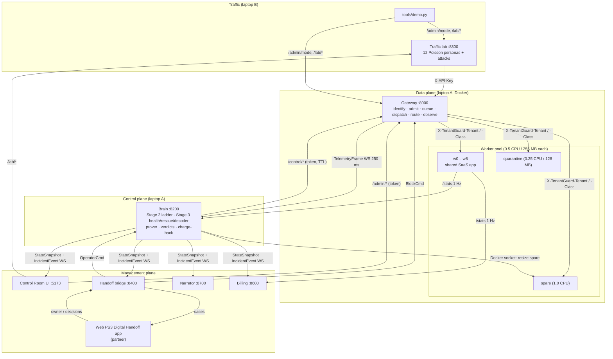
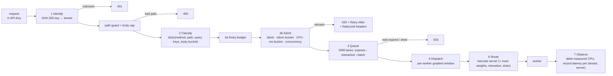
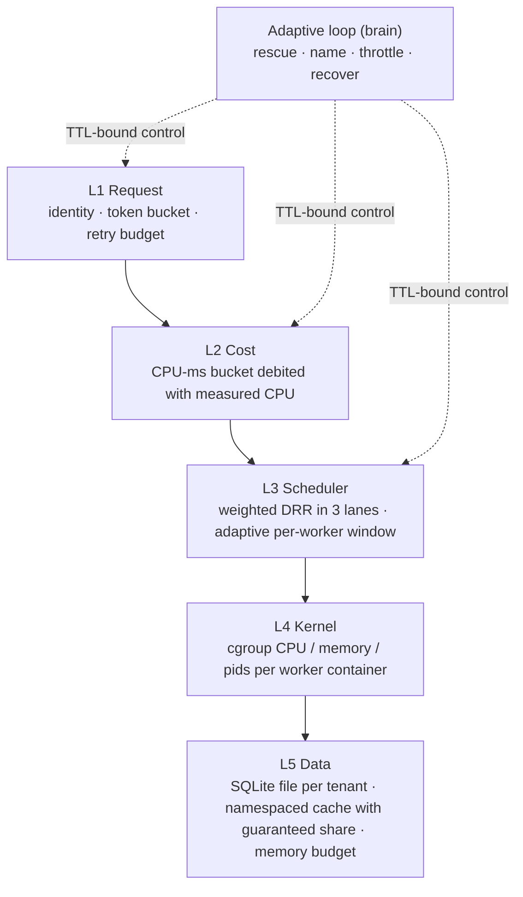
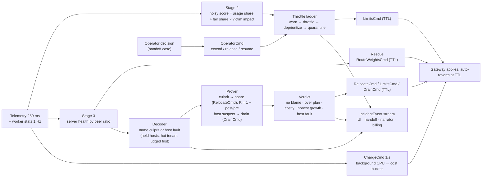
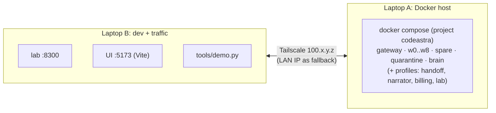

# 02: Architecture

## 1. System view

## 2. The three planes

| Plane | Components | Responsibility |
|---|---|---|
| **Data plane** | gateway, `w0..w8`, `spare`, `quarantine` | Serve every tenant request: identify, admit, queue fairly, route by barcode, measure |
| **Control plane** | brain | Watch telemetry and worker stats; rescue victims; name the culprit; prove it by relocation and give a verdict; throttle with timers; charge background CPU back; explain every action |
| **Management plane** | admin API, UI, handoff bridge, narrator, billing, lab, demo driver | Let people see and steer it: modes, quotas, cases, reports, bills, attacks, scorecard |

The planes talk only through the contracts in `common/tenantguard_common/contracts.py` (Pydantic models). Every tunable value is in `tenantguard.yaml`, read by `common/tenantguard_common/config.py`.

## 3. Inside the gateway: one request

Files: `gateway/tenantguard_gateway/core.py` (the request path), `tenants.py`, `security.py`, `retry.py`, `admission.py`, `buckets.py`, `scheduler.py`, `limiter.py`, `router.py`, `overrides.py`, `telemetry.py`, `metrics.py`, `app.py`. See `11_FILES_gateway.md`.

## 4. The five isolation layers (+ the adaptive loop)

| Layer | Stops | Lives in |
|---|---|---|
| L1 Request | Floods and retry storms (429 with an accurate `Retry-After`) | `gateway/.../admission.py`, `buckets.py`, `retry.py` |
| L2 Cost | Few-but-heavy requests, because the bucket is debited with the CPU the worker measured | `gateway/.../buckets.py`, `core.py` |
| L3 Scheduler | Head-of-line blocking: a cheap request never waits behind a whale; per-tenant fairness by weight | `gateway/.../scheduler.py`, `limiter.py` |
| L4 Kernel | One container eating the whole host | `docker-compose.yml` (`cpus`, `mem_limit`, `pids_limit`) |
| L5 Data | Reading another tenant's data; cache thrashing by one tenant | `worker/app/store.py`, `cache.py`, `memory.py`, `tenancy.py` |
| Adaptive loop | Harm that L1–L2 cannot see (hidden background work, a faulty host) | `brain/` |

## 5. The barcode layout (why naming works)

`layouts/ag23.json` places 12 tenants on 9 servers so that **any two tenants share at most one server** (an AG(2,3) design). Each tenant's 3 servers are its "barcode":

| Tenant | Servers | Tenant | Servers | Tenant | Servers |
|---|---|---|---|---|---|
| A | w0 w1 w2 | E | w1 w4 w7 | I | w2 w3 w7 |
| B | w3 w4 w5 | F | w2 w5 w8 | J | w0 w5 w7 |
| C | w6 w7 w8 | G | w0 w4 w8 | K | w1 w3 w8 |
| D | w0 w3 w6 | H | w1 w5 w6 | L | w2 w4 w6 |

If the slow servers are exactly w1, w3 and w8, only one tenant's barcode covers them: K. If one server is slow on its own, no tenant's barcode explains it, so it is a host fault and no tenant is blamed. The brain's decoder (`brain/tenantguard_brain/decoder.py`) turns this into a confidence. Victims are rescued first: the gateway is told to route their traffic to their other, healthy servers (`rescue.py`).

## 6. Control loop

The ladder acts only when harm persists after the rescue. Every action carries a TTL and is renewed only while it is still needed. If the brain stops sending heartbeats, the gateway keeps its last configuration (fail-static) while TTLs still expire.

Once a culprit is named with at least `confidence_to_prove` (0.8), the prover moves it to the spare (sized to `spare_sizing` × its CPU footprint through the Docker socket), waits `prove_settle_s`, measures for `prove_window_s` and computes R = 1 − post/pre slowdown on its old servers. It is confirmed when R ≥ `recovery_R` and the harm followed it to the spare. The verdict then picks the action: `honest_growth` stays on the spare as a burst lane, `costly_pattern` sends its most expensive request class to the quarantine worker, `over_plan` goes home with tightened limits, `mitigated_no_blame` goes home with no action. A host suspect is drained and measured idle; still ≥ `host_idle_ratio` × its peers means `host_fault`, and it stays drained. A server where a hot tenant runs is a *held host*: it is not treated as a faulty host until that tenant has been judged. An action budget caps relocations (6/min), quarantines (one per 30 s) and drains (one at a time, only while peers are below 75% busy). Separately, once a second in `tenantguard` mode the brain sends each tenant's background-job CPU to the gateway as a `ChargeCmd`, so hidden work is debited from the tenant's own cost bucket.

## 7. Deployment: two laptops over Tailscale

- **Why two laptops:** 11 worker containers at 0.5 CPU each, plus the brain, need about 8 cores to themselves. Generating traffic on the same machine would distort the latencies being measured.
- Laptop B drives laptop A's Docker over a single SSH session: `git archive` of `master` is shipped, then `docker compose up -d --build` runs on the host. Details: `docs/SETUP.md`, `docs/DOCKER-HOST-SETUP.md`.
- The measured scorecard and the acceptance run used the lab container on the Docker host itself (compose profile `lab`), so the traffic generator and the stack share one machine's clock and network; the comparison between modes is fair because every mode ran under the same conditions.
- Host ports are configurable (`GATEWAY_PORT`, `BRAIN_PORT`, `LAB_PORT`, `HANDOFF_PORT`, `NARRATOR_PORT`, `BILLING_PORT`) and so is the project name (`COMPOSE_PROJECT_NAME`), so a frozen demo stack can run beside a development stack.

## 8. Components and ports

| Component | Path | Port | Exposed by compose | Built with |
|---|---|---|---|---|
| Gateway | `gateway/` | 8000 | yes (`GATEWAY_PORT`) | Python 3.12, FastAPI, httpx, uvicorn |
| Workers `w0..w8` | `worker/` | 8100 in compose (local 8100–8108) | no | Python, FastAPI (sync handlers), SQLite, psutil |
| `spare` / `quarantine` | `worker/` | 8100 in compose (local 8109 / 8110) | no | same image; spare 1.0 CPU, quarantine 0.25 CPU / 128 MB |
| Brain | `brain/` | 8200 | yes (`BRAIN_PORT`) | Python asyncio, websockets, httpx, Pydantic; Docker socket mounted for the prover (`COMPOSE_PROJECT` picks this stack's spare) |
| Lab | `lab/` | 8300 | yes, profile `lab` | Python asyncio + httpx |
| Handoff bridge | `integrations/handoff/` | 8400 | yes, profile `handoff` | Python, FastAPI, websockets |
| Billing | `billing/` | 8600 | yes, profile `billing` | Python, FastAPI, httpx, websockets |
| Narrator | `narrator/` | 8700 | yes, profile `narrator` | Python, FastAPI, websockets |
| UI | `ui/` | 5173 | runs outside Docker | React 18, Vite, TypeScript, Tailwind, Recharts |
| Web PS3 app (partner) | n/a | `WEB_URL` (mock: 8500) | n/a | `integrations/handoff/tools/mock_web.py` for demos |

## 9. Cross-cutting rules

- **One schema:** every cross-service message is a model in `common/tenantguard_common/contracts.py`.
- **One config:** every tunable is in `tenantguard.yaml`; peer URLs come from yaml or env and never assume `127.0.0.1`.
- **Every service binds `0.0.0.0`** and allows CORS only from the UI origin.
- **Security:** a shared control token on all `/admin/*` and `/control/*` endpoints and on the brain's `/api/operator`. Tenants are identified only by API key at the gateway; workers trust only gateway-set headers.
- **Safety:** every control action is TTL-bound; the gateway is fail-static; control input is validated to 400 and never crashes a service.
