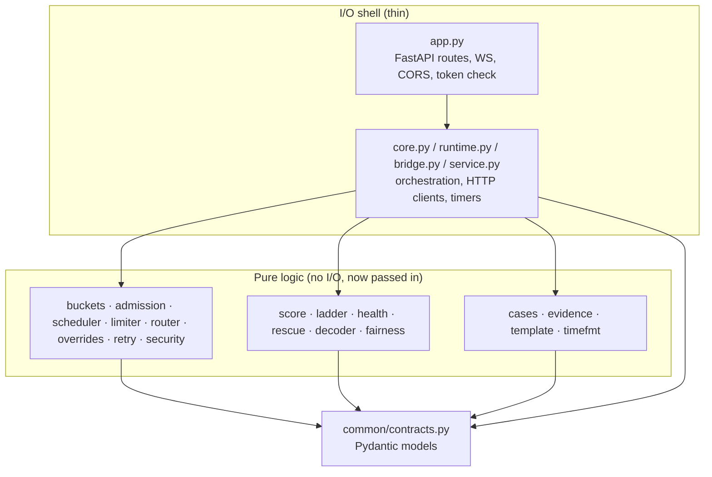

# 03: SOLID principles and design

TenantGuard is a set of small services around a shared contract. Inside each service, the pattern repeats: **pure decision logic** (no I/O, no clock, fully testable) sits under a **thin I/O shell** (FastAPI routes, WebSocket loops, HTTP clients). This page shows how that maps onto the SOLID principles, with real code from `master`, and lists the patterns used and the refactorings done and still possible.



## S: Single Responsibility

Each module has one reason to change.

| Module | Its one job |
|---|---|
| `gateway/.../buckets.py` | Token and CPU-cost bucket arithmetic |
| `gateway/.../admission.py` | Combine the dimensions into one decision and the `RateLimit` headers |
| `gateway/.../scheduler.py` | Weighted deficit round robin over per-tenant queues |
| `gateway/.../limiter.py` | The per-worker gradient window |
| `gateway/.../router.py` | Choose a server for a request |
| `gateway/.../overrides.py` | Store control overrides and expire them |
| `gateway/.../retry.py` | Detect retries and enforce the budget |
| `gateway/.../security.py` | Validate paths and request ids |
| `brain/.../score.py`, `ladder.py`, `decoder.py`, `rescue.py` | Score, throttle ladder, culprit decoding, route-around planning |
| `integrations/handoff/.../wire.py` / `cases.py` / `outbox.py` | Partner format / case logic / delivery |
| `narrator/.../evidence.py` / `template.py` | Collect evidence / write the report |

Example: the router does nothing but pick candidates. It knows nothing about HTTP, queues or modes:

```python
# gateway/tenantguard_gateway/router.py
def candidates(servers, known, weights=None, relocation=None, drained=None) -> Candidates:
    """Weighted candidate servers for one request. ...never black-holed..."""

def choose(cands, has_capacity=lambda s: True, rng=None) -> Optional[str]:
    """Weighted random pick among candidates that have dispatch capacity; None if all are full."""
```

The gateway core (`core.py`) then only *orchestrates* these pieces for one request. When the brain added relocation and drains, only `router.py` and the override store changed.

## O: Open/Closed

Behaviour is extended by adding data or a new strategy, not by editing working code.

- **Lanes:** the gateway runs three independent `Scheduler` instances (express, interactive, batch) keyed in a dict, plus a per-lane capacity rule (`Gateway.lane_cap`). Adding a lane means adding a key and a cap, while `Scheduler` itself stays unchanged.
- **Modes:** `off` / `industry` / `tenantguard` are switches (`Gateway.adaptive`, `Gateway.controlled`) read at decision points. The admission, scheduler and router code is the same in every mode.
- **Ladder levels and thresholds** come from `tenantguard.yaml` (`brain.noisy`) through `LadderParams`, so new thresholds need no code change.
- **Partner decisions:** the handoff bridge maps a `(action kind, decision)` pair through a table of allowed transitions in `CaseBook.on_decision`. A new action kind is a new entry plus its command mapping.

## L: Liskov Substitution

Anything that satisfies an interface can replace the real thing, and the tests rely on it:

- The gateway's upstream is any `httpx.AsyncClient`. Tests pass a `MockTransport` that behaves like a worker (`gateway/tests/test_api.py`), and production passes a pooled real client.
- The narrator's and bridge's brain feed is "a stream of dicts" given to `ingest()`, whether it comes from the live WebSocket, the `/api/incidents` backfill or a test list.
- The brain's relocation prover is defined as an interface (`brain/.../prover.py`, `Prover` protocol) with a `NullProver` used until the Docker-host implementation lands (**in progress**, T12). The rest of Stage 3 works unchanged with either.

## I: Interface Segregation

Callers depend only on the narrow function they need, usually as a callable.

```python
# gateway/tenantguard_gateway/scheduler.py
class Scheduler:
    def __init__(self, weight_fn: Callable[[str], float], quantum_ms: float = 5.0, fifo: bool = False): ...
    def pop(self, eligible: Eligible = _always) -> Optional[Item]: ...
```

The scheduler does not see tenants, quotas or the brain. It needs a weight per tenant (`weight_fn`) and a yes/no on whether an item can be dispatched now (`eligible`). Similarly:

- `router.choose(cands, has_capacity)` only needs "does this server have a free slot?";
- `Gateway.handle(..., read_body)` only needs "give me the body, capped at N bytes", so the body is not read until the API key and path checks pass;
- `Outbox(on_delivered=...)` only needs a callback to mark a case delivered;
- `Overrides(clock=...)` only needs a clock.

## D: Dependency Inversion

High-level policy depends on abstractions (contracts, callables, injected clients), not on concrete infrastructure.

- **Contracts:** every service depends on `common/tenantguard_common/contracts.py`, not on another service's code. The gateway, brain, UI, lab, bridge and narrator never import each other.
- **Injected clients and clocks:** `Gateway(settings, tenants, workers, client=..., rng=...)`, `Overrides(clock=...)`, `Bridge(settings, tenants, control_client=..., web_client=...)`, `Narrator(tenants, clock=...)`, and `Demo(..., client=..., sleep=..., clock=..., out=...)`. Production wiring happens once, in each `create_app()` / `main()`.
- **Configuration:** values come from `tenantguard.yaml` through `common/config.py` into a settings dataclass per service (`GatewaySettings`, `HandoffSettings`, `NarratorSettings`); the logic receives the dataclass.

## Design patterns used

| Pattern | Where | Why |
|---|---|---|
| **Functional core, imperative shell** | gateway pure modules vs `core.py`/`app.py`; brain `score`/`ladder`/`decoder` vs `runtime.py`; bridge `cases.py` vs `bridge.py`; narrator `evidence`/`template` vs `service.py` | Decisions are testable without I/O; the risky parts have no side effects |
| **Strategy** | three DRR `Scheduler` lanes; FIFO vs DRR in `Scheduler.pop`; `Prover` / `NullProver` | Swap behaviour by mode or lane without branching everywhere |
| **Token bucket / leaky bucket** | `buckets.py` | Rate and CPU-cost admission with burst |
| **Deficit round robin** | `scheduler.py` | O(1)-amortised weighted fairness with variable request cost |
| **Gradient concurrency limit** | `limiter.py` | Adaptive window from latency (minRTT / sampleRTT on excess latency) |
| **Circuit-breaker-like timers (TTL + auto-revert)** | `overrides.py`; brain action renewal | Every action undoes itself; safe under brain failure |
| **Fail-static** | gateway heartbeat tracking | Keep the last good config when the control plane is silent |
| **Observer / publish–subscribe** | telemetry WS, brain `/ws/events`, narrator `/ws/reports`, per-subscriber bounded queues | One producer, many consumers; a slow consumer drops its oldest frames instead of blocking |
| **Event-driven dispatch** | `Gateway._pump()` called on enqueue and on slot release | No polling loop; dispatch happens exactly when capacity appears |
| **Latest-wins outbox** | `integrations/handoff/.../outbox.py` | Never block on a slow partner; only the newest version of each case is sent |
| **Adapter / anti-corruption layer** | `integrations/handoff/.../wire.py` + `timefmt.py` | The partner's format (HH:MM:SS, `INC-NNNN`) never leaks into TenantGuard's contracts |
| **Idempotency keys** | `charge_id` in the gateway; case-id persistence in the bridge; event dedupe in the bridge and narrator | Safe resends and reconnect backfills |
| **Repository with implicit tenant** | `worker/app/store.py` + `tenancy.py` (tenant from a `ContextVar`) | Code cannot pass the wrong tenant to the data layer |

## Refactorings done during the build

| Refactoring | Before → after | Benefit |
|---|---|---|
| Single scheduler → three DRR lanes | one `Scheduler` → `lanes: Dict[str, Scheduler]` + `lane_cap()` | Express and batch behaviour without touching DRR |
| Fixed window → `GradientLimiter` per worker | constant `initial_window` → `limiter.py` fed with excess latency | Queueing moves to the gateway, where it can be ordered fairly |
| Body read up front → `BodyReader` callable | `await request.body()` in the route → `read_body(limit)` called after the key, path and Content-Length checks | Unauthenticated callers cannot make the gateway read large bodies |
| Inline auth → router dependencies | per-route checks → `APIRouter(dependencies=[Depends(require_token)])` for `/admin` and `/control` | One place enforces the control token |
| Monotonic clock → `perf_counter` | coarse Windows ticks (15.6 ms) → fine-grained timing | Latency and wait measurements became accurate |
| Wire / internal split in the bridge | one model set → `wire.py` (partner) + `CaseView` (contracts) | Partner format changes cannot leak inward |
| Narrator: external writer removed | async writer + grounding check → deterministic `template.py` only | Fewer moving parts, no external dependency, same contract |

## Refactorings still possible

- **Gateway `core.py` `handle()`** is long, because it holds the whole request path. It could be split into `_identify`, `_admit`, `_enqueue`, `_forward` and `_account` steps sharing a small request-context object.
- **Shared WebSocket consumer:** the bridge and the narrator each implement "backfill, then follow the brain WS with backoff". A small helper in `common/` would remove the duplication.
- **Settings loading:** each service has its own settings dataclass reading yaml and env. A generic loader with typed sections could validate everything in one place at start-up.
- **Shared multi-gateway state:** limiter, bucket and override state live in one gateway process. Moving them behind an interface would allow a shared store (for example Redis) for several gateways.
- **Metrics:** `/metrics` is hand-written Prometheus text. A registry abstraction would make adding metrics less error-prone.
