# 04 · Data models

Every message that crosses a service boundary in TenantGuard is a Pydantic model in
`common/tenantguard_common/contracts.py`. No service redefines a contract locally, and changes go
through the coordinator. This page documents every model and field on `master`, the configuration
and layout shapes that feed them, and the storage each worker keeps per tenant.

Contents
1. [Conventions: units, headers, enumerations](#1-conventions)
2. [Who sends what (map)](#2-who-sends-what)
3. [Tenancy and admin](#3-tenancy-and-admin-gateway-admin)
4. [Telemetry (gateway → brain)](#4-telemetry-gateway--brain)
5. [Worker statistics (worker → brain)](#5-worker-statistics-worker--brain-billing)
6. [Control commands (brain → gateway)](#6-control-commands-brain--gateway)
7. [Live state and incidents (brain → UI)](#7-live-state-and-incidents-brain--ui-handoff-narrator)
8. [Fault injection (lab → worker)](#8-fault-injection)
9. [Traffic lab](#9-traffic-lab)
10. [Handoff cases (partner convergence)](#10-handoff-cases)
11. [Billing views (contract on master; service in progress)](#11-billing-views)
12. [Incident narrator](#12-incident-narrator)
13. [Configuration shapes: `tenantguard.yaml` and the layout](#13-configuration-shapes)
14. [Worker storage: per-tenant SQLite, cache, meters](#14-worker-storage)
15. [Measured endpoint costs (`worker/calibration.json`)](#15-measured-endpoint-costs)

---

## 1. Conventions

**Units** (from the header of `contracts.py`; they apply to every model unless a field says otherwise):

| Pattern | Unit |
|---|---|
| `ts`, any `*_at` field | Unix epoch seconds, `float`, from `time.time()` (never a monotonic clock) |
| any `*_ms` field | milliseconds, `float` |
| any `*_s` field | seconds, `float` |
| fields documented as `0..1` | fractions, not percentages |
| `*_pct` | percent, 0..100 |
| `*_rs` | Indian rupees |
| `*_ist` / `time` strings | display only, `"HH:MM:SS"` in IST (UTC+05:30) |

**HTTP headers** (constants in `contracts.py`):

| Constant | Header | Set by | Meaning |
|---|---|---|---|
| `H_TENANT` | `X-TenantGuard-Tenant` | gateway, on every forwarded request | the tenant id; workers trust only this header |
| `H_CLASS` | `X-TenantGuard-Class` | gateway | request-class hash, 8 hex characters |
| `H_REQUEST_ID` | `X-Request-Id` | gateway (and the lab) | request correlation id |
| `H_CPU_MS` | `X-TenantGuard-Cpu-Ms` | worker, on every response | handler CPU of this request, decimal ms as a string (e.g. `"12.375"`); background CPU is not included |
| `H_CONTROL_TOKEN` | `X-TenantGuard-Control-Token` | brain, UI, lab, handoff, demo driver | required on gateway `/admin/*` and `/control/*` and brain `POST /api/operator`; value = env `TENANTGUARD_CONTROL_TOKEN` (default `dev`), compared with `hmac.compare_digest`; missing or wrong → 401 |

Two more headers exist outside `contracts.py`: `X-Admin-Token` (worker `/admin/fault`, env
`TENANTGUARD_ADMIN_TOKEN`) and `X-Handoff-Token` (handoff bridge inbound updates, env
`HANDOFF_PARTNER_TOKEN`).

**Enumerations** (`Literal` types):

| Name | Values |
|---|---|
| `Mode` | `off`, `industry`, `tenantguard` |
| `Tier` | `enterprise`, `pro`, `free` |
| `Level` | `normal`, `warn`, `throttle`, `deprioritize`, `quarantine`, `blocked` (in escalation order) |
| `Stage` | `detected`, `level_change`, `rescued`, `named`, `proving`, `verdict`, `resolved`, `explained`, `closed` |
| `AttackName` | `flood`, `whale`, `hog`, `memory`, `retry_storm`, `background_bomb`, `blackbox_bomb`, `cache_flood`, `faulty_server`, `honest_spike` |
| `Verdict` | `costly_pattern`, `over_plan`, `honest_growth`, `host_fault`, `mitigated_no_blame` |
| `Severity` | `low`, `medium`, `high` |
| `CaseStatus` | `waiting_for_decision`, `in_progress`, `resolved`, `closed` |
| `CaseDecision` | `approve`, `reject`, `extend`, `release`, `resolve` |
| `ActionState` | `pending`, `approved`, `rejected`, `extended`, `released`, `resolved`, `expired` |
| `WhyCause` | `none`, `neighbor`, `host_fault`, `own_usage`, `unknown` |

---

## 2. Who sends what

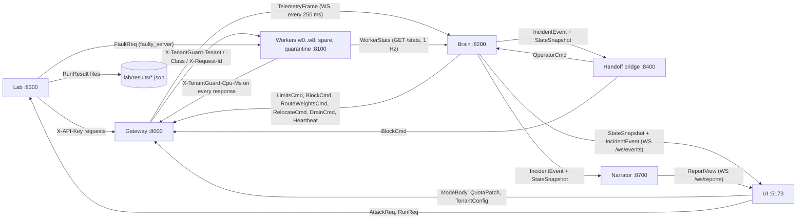

Which service imports each model on `master` (from the source, tests excluded):

| Model | Producer | Consumers |
|---|---|---|
| `TenantConfig`, `Quota` | layout file via `load_tenants()`; UI `POST /admin/tenants` | gateway, brain, lab, handoff, narrator |
| `TenantAdminView`, `QuotaPatch`, `ModeBody`, `OverridesView` | gateway `/admin/*` | UI, brain (`ModeBody`, `OverridesView`) |
| `TelemetryFrame`, `Cell`, `QueueStat`, `LimiterStat` | gateway | brain |
| `WorkerStats`, `TenantUsage`, `ClassCost` | worker `/stats` | brain (billing service in progress) |
| `LimitsCmd`, `BlockCmd`, `RouteWeightsCmd`, `RelocateCmd`, `DrainCmd`, `Heartbeat`, `ControlAck` | brain (`BlockCmd` also handoff) | gateway |
| `ReferenceCostsCmd`, `ChargeCmd` | defined and accepted by the gateway; no sender on `master` yet | gateway |
| `StateSnapshot`, `TenantView`, `ServerView`, `IncidentEvent`, `Suspect` | brain | UI, handoff, narrator |
| `ImpactView` | defined; `StateSnapshot.impact` is optional and not filled by the brain on `master` | UI (falls back to its own meter) |
| `FaultReq` | lab / demo driver / tests | worker |
| `AttackReq`, `AttackStatus`, `LabStatus`, `RunReq`, `PhaseP99`, `RunResult` | lab | UI, demo driver |
| `CaseView`, `CaseContext`, `CaseAction`, `CaseHistoryItem`, `OperatorCmd` | handoff bridge | UI; brain (`OperatorCmd`) |
| `BillLine`, `BillView`, `WhyEpisode`, `WhyView` | billing service (**in progress**, not on `master`) | UI (planned) |
| `IncidentReport`, `CustomerMessage`, `ReportView` | narrator | UI |

---

## 3. Tenancy and admin (gateway `/admin/*`)

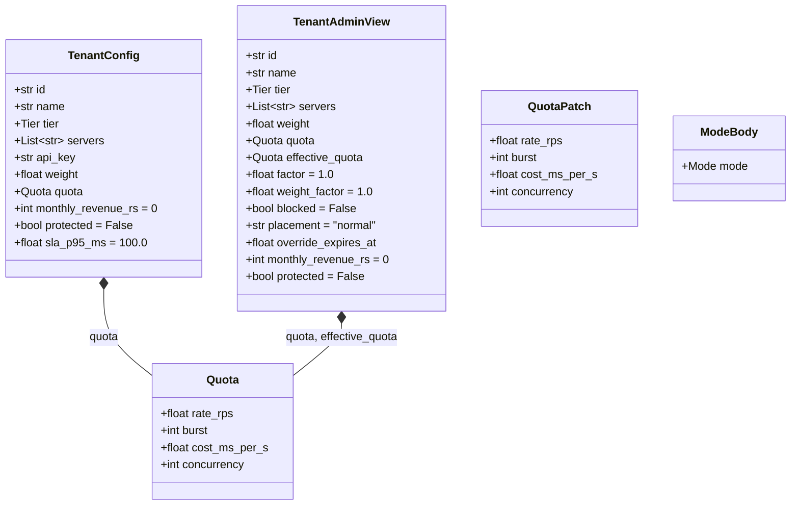

### `Quota`
A tenant's plan limits, enforced by the gateway's admission stage.

| Field | Type | Unit | Meaning |
|---|---|---|---|
| `rate_rps` | float | requests/s | token-bucket refill rate |
| `burst` | int | requests | token-bucket capacity |
| `cost_ms_per_s` | float | CPU-ms/s | cost-bucket refill; capacity = this × `gateway.cost_bucket_s` (2 s). The bucket is debited with the worker-measured `X-TenantGuard-Cpu-Ms` |
| `concurrency` | int | requests | maximum in-flight requests |

Tier defaults (`tenantguard.yaml tiers`): enterprise 100 rps / burst 200 / 600 CPU-ms/s / 16 in flight;
pro 50 / 100 / 300 / 8; free 20 / 40 / 150 / 4.

### `TenantConfig`
One tenant as defined in the layout file (and the input of `POST /admin/tenants`). It contains the
demo API key, so it is never returned by an API.

| Field | Type | Default | Meaning |
|---|---|---|---|
| `id` | str | | tenant id, `"A"`..`"L"` in the layout |
| `name` | str | | display name |
| `tier` | `Tier` | | plan tier |
| `servers` | list[str] | | the tenant's **barcode**: its 3 servers, e.g. `["w0","w1","w2"]` |
| `api_key` | str | | demo plaintext key; the gateway keeps only its SHA-256 |
| `weight` | float | | scheduler weight, filled from the tier by `load_tenants()` (4 / 2 / 1) |
| `quota` | `Quota` | | configured plan quota, filled from the tier; `PATCH` changes it |
| `monthly_revenue_rs` | int | 0 | what the tenant pays per month (used for impact numbers) |
| `protected` | bool | False | protected customer (shown in the UI and cases) |
| `sla_p95_ms` | float | 100.0 | end-to-end p95 promised to this tenant (used for SLA credits). The layout on `master` sets no per-tenant value, so every tenant has 100 ms; per-tenant targets are **in progress** on a coordinator branch |

### `TenantAdminView`
Output of `GET /admin/tenants` and `GET /admin/tenants/{id}`: the configured tenant plus the state of
any active override, without the API key.

| Field | Type | Default | Meaning |
|---|---|---|---|
| `id`, `name`, `tier`, `servers`, `weight` | | | as in `TenantConfig` |
| `quota` | `Quota` | | configured quota (after any `PATCH`) |
| `effective_quota` | `Quota` | | quota after the active `LimitsCmd` factor |
| `factor` | float | 1.0 | active throttle factor (rate, burst, cost, concurrency) |
| `weight_factor` | float | 1.0 | active scheduler-weight factor |
| `blocked` | bool | False | an active `BlockCmd` |
| `placement` | str | `"normal"` | `normal`, `spare`, `quarantine` or `wN` (relocation target) |
| `override_expires_at` | float or null | null | epoch s when the active override reverts |
| `monthly_revenue_rs`, `protected` | | | as in `TenantConfig` |

### `QuotaPatch`
Body of `PATCH /admin/tenants/{id}/quota`. Every field is optional; only the fields sent change. The
gateway bounds them (finite, > 0, ≤ `gateway.quota_max`).

### `ModeBody`
Body of `POST /admin/mode` and output of `GET /admin/mode`: `mode` ∈ `off | industry | tenantguard`.

---

## 4. Telemetry (gateway → brain)

Pushed by the gateway on WebSocket `/internal/telemetry` once per tick (`gateway.tick_ms`, 250 ms); the
latest frame is also served at `GET /internal/telemetry/latest`.

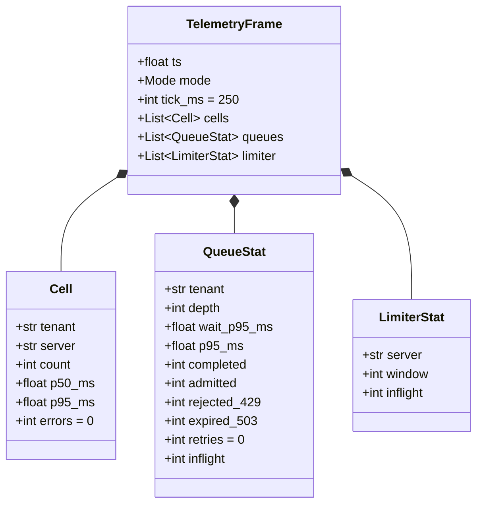

### `TelemetryFrame`
| Field | Type | Unit | Meaning |
|---|---|---|---|
| `ts` | float | epoch s | frame time |
| `mode` | `Mode` | | the gateway's current mode (the brain acts only in `tenantguard`) |
| `tick_ms` | int | ms | tick length (default 250) |
| `cells` | list[`Cell`] | | one per (tenant, server) pair with traffic in the tick |
| `queues` | list[`QueueStat`] | | one per tenant |
| `limiter` | list[`LimiterStat`] | | one per worker |

### `Cell`
Requests of one tenant served by one server during the last tick. Latency is **server-side** (it
excludes the gateway queue wait).

| Field | Type | Unit | Meaning |
|---|---|---|---|
| `tenant`, `server` | str | | the pair |
| `count` | int | requests | completed in the tick |
| `p50_ms`, `p95_ms` | float | ms | upstream latency percentiles |
| `errors` | int | requests | 5xx / transport errors in the tick |

### `QueueStat`
Per tenant, during the last tick.

| Field | Type | Unit | Meaning |
|---|---|---|---|
| `tenant` | str | | |
| `depth` | int | requests | queued now |
| `wait_p95_ms` | float | ms | p95 of gateway queue wait |
| `p95_ms` | float | ms | **end-to-end** p95 (queue wait + upstream) of completed requests; `0` when `completed == 0`, and consumers must skip such ticks instead of reading them as fast |
| `completed` | int | requests | finished in the tick |
| `admitted` | int | requests | passed admission |
| `rejected_429` | int | requests | refused by admission (rate, cost, concurrency, block, retry budget) |
| `expired_503` | int | requests | dropped after the bounded queue wait, or batch shed under saturation |
| `retries` | int | requests | identified as retries (repeated `Idempotency-Key`, or a repeat of a request that failed with 429/503/5xx within `gateway.retry_budget.window_s`) |
| `inflight` | int | requests | in flight now |

### `LimiterStat`
The adaptive per-worker dispatch window: `window` = current concurrency window (bounded by
`gateway.limiter.min_window`..`max_window`), `inflight` = requests dispatched to that worker now.

---

## 5. Worker statistics (worker → brain, billing)

Served by every worker at `GET /stats` and polled at 1 Hz. **All counters are cumulative since the
worker process started**; a consumer diffs consecutive samples and treats a change of `started_at` as a
restart (counters start again from zero).

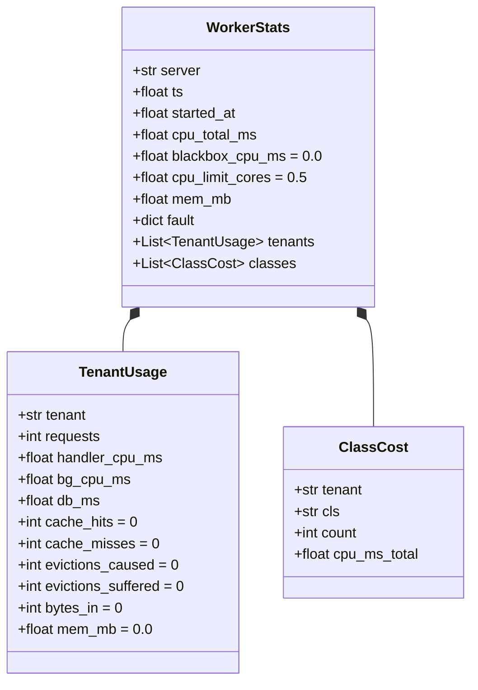

### `WorkerStats`
| Field | Type | Unit | Meaning (as filled by `worker/app/main.py Worker.stats`) |
|---|---|---|---|
| `server` | str | | `SERVER_NAME` (e.g. `w1`) |
| `ts` | float | epoch s | sample time |
| `started_at` | float | epoch s | process start (`psutil` create time); a change means the counters were reset |
| `cpu_total_ms` | float | ms, cumulative | CPU of the whole process tree (worker + black-box child + reaped children), from `psutil` |
| `blackbox_cpu_ms` | float | ms, cumulative | CPU of the "vendor indexer" child process; never attributed to a tenant |
| `cpu_limit_cores` | float | cores | env `CPU_LIMIT_CORES`, else the container's cgroup `cpu.max` (follows `docker update`), else `worker.cpus` |
| `mem_mb` | float | MB (gauge) | RSS of the process tree |
| `fault` | dict or null | | active fault: `{latency_ms, cpu_burn_pct, since, until}` (`until` null = until cleared) |
| `tenants` | list[`TenantUsage`] | | every configured tenant plus any seen, sorted by id |
| `classes` | list[`ClassCost`] | | one per (tenant, class) seen |

Unattributed CPU = `cpu_total_ms − Σ(handler_cpu_ms + bg_cpu_ms)`: that is where black-box work and
injected CPU burn show up.

### `TenantUsage`
| Field | Type | Unit | Meaning |
|---|---|---|---|
| `tenant` | str | | |
| `requests` | int | cumulative | `/api/*` requests that passed tenant validation |
| `handler_cpu_ms` | float | ms, cumulative | sum of the handler-thread CPU (equals the sum of the `X-TenantGuard-Cpu-Ms` headers sent) |
| `bg_cpu_ms` | float | ms, cumulative | CPU of background jobs the tenant caused (e.g. indexing after `/api/write`) |
| `db_ms` | float | ms, cumulative | wall time spent in the tenant's SQLite file |
| `cache_hits`, `cache_misses` | int | cumulative | the tenant's own cache lookups |
| `evictions_caused` | int | cumulative | entries of *other* tenants this tenant evicted |
| `evictions_suffered` | int | cumulative | entries of this tenant evicted by others |
| `bytes_in` | int | bytes, cumulative | request bodies received |
| `mem_mb` | float | MB (gauge) | memory held now: active `/api/memory` allocations + the tenant's cache bytes |

### `ClassCost`
| Field | Type | Unit | Meaning |
|---|---|---|---|
| `tenant` | str | | |
| `cls` | str | | `X-TenantGuard-Class` of the requests, or `"none"` when absent |
| `count` | int | cumulative | requests of this class |
| `cpu_ms_total` | float | ms, cumulative | their handler CPU |

---

## 6. Control commands (brain → gateway)

Sent to the gateway as `POST /control/{kind}` with the control token. Every override carries a TTL and
reverts by itself; the gateway validates input and answers 400 rather than failing.

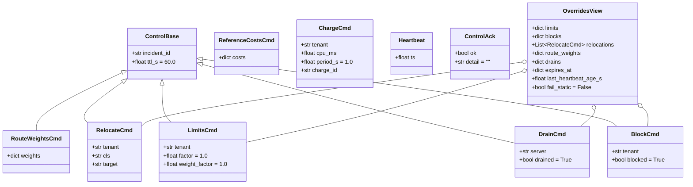

### `ControlBase` (shared fields)
| Field | Type | Default | Meaning |
|---|---|---|---|
| `incident_id` | str or null | null | the incident that caused the command (for audit) |
| `ttl_s` | float | 60.0 | seconds until the gateway reverts the override; must be finite and `0 < ttl_s ≤ gateway.ttl_max_s` (3600), else 400 |

### Overrides
| Model | Endpoint | Fields | Semantics |
|---|---|---|---|
| `RouteWeightsCmd` | `/control/route_weights` | `weights`: tenant → server → weight | per-tenant routing weights over its servers; normalised by the gateway. Used by the brain's rescue (route around slow servers) |
| `RelocateCmd` | `/control/relocate` | `tenant`; `cls` (null = whole tenant); `target` = `spare` \| `quarantine` \| `wN` (null = clear) | move a tenant (or one of its request classes) to another worker |
| `LimitsCmd` | `/control/limits` | `tenant`, `factor`, `weight_factor` | throttle / deprioritise one tenant. The latest command **replaces** the previous one (both factors) and restarts the TTL. The base is the tenant's current configured quota (after any PATCH). Effective integer fields = `max(1, round(base × factor))`, floats = `base × factor`. `factor == 1.0` and `weight_factor == 1.0` clear the override at once. Either factor `≤ 0` or `> 1` → 400. **Senders always send both factors**, because an omitted one defaults to 1.0 and silently un-throttles that dimension |
| `DrainCmd` | `/control/drain` | `server`, `drained` | stop (or resume) routing to a server, e.g. a faulty host |
| `BlockCmd` | `/control/block` | `tenant`, `blocked` | refuse all of a tenant's requests; `blocked=false` clears at once |

### Other control messages
| Model | Endpoint | Fields | Semantics |
|---|---|---|---|
| `ReferenceCostsCmd` | `/control/reference_costs` | `costs`: class → reference CPU ms | the latest table replaces the previous one (values finite and > 0); applied in `tenantguard` mode. No sender on `master` yet |
| `ChargeCmd` | `/control/charge` | `tenant`, `cpu_ms`, `period_s` (informational), `charge_id` | debit CPU a tenant used outside the request path from its cost bucket. Not an override (no TTL), applied once, only in `tenantguard` mode; `charge_id` makes resends idempotent (the gateway remembers the last 1024). `cpu_ms < 0`, not finite, or unknown tenant → 400. No sender on `master` yet |
| `Heartbeat` | `/control/heartbeat` | `ts` (sender clock) | the brain sends it every 500 ms; the gateway uses its **own** receive time. With no heartbeat for `gateway.fail_static_after_s` (2 s) the gateway keeps its last configuration (fail-static) |
| `ControlAck` | response of every `/control/*` | `ok`, `detail` | acceptance and a plain-English detail |
| `OverridesView` | `GET /admin/overrides` | active `limits` and `blocks` (tenant → command), `relocations`, `route_weights`, `drains` (server → command), `expires_at` (`"<kind>:<key>"` → epoch s), `last_heartbeat_age_s`, `fail_static` | the gateway's current override state |

---

## 7. Live state and incidents (brain → UI, handoff, narrator)

The brain broadcasts a `StateSnapshot` at 2 Hz and every `IncidentEvent` on WebSocket `/ws/events`
(also `GET /api/state` and `GET /api/incidents`). Both carry a `type` field so one socket carries both.

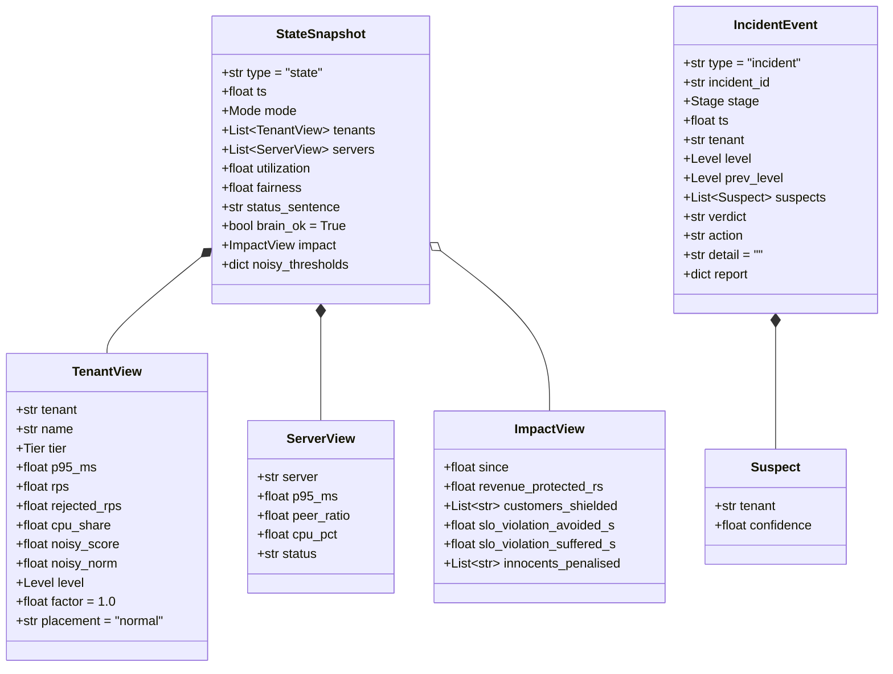

### `StateSnapshot`
| Field | Type | Unit | Meaning |
|---|---|---|---|
| `type` | `"state"` | | discriminator on the shared socket |
| `ts` | float | epoch s | |
| `mode` | `Mode` | | gateway mode, read from the latest telemetry frame |
| `tenants` | list[`TenantView`] | | one per tenant |
| `servers` | list[`ServerView`] | | one per worker |
| `utilization` | float | 0..1 | used CPU over the fleet CPU limit (w0..w8) |
| `fairness` | float | 0..1 | Jain's index over per-tenant (completed rps ÷ weight) of active tenants |
| `status_sentence` | str | | one plain-English line for the dashboard |
| `brain_ok` | bool | | the brain's own health |
| `impact` | `ImpactView` or null | | optional; not filled by the brain on `master` |
| `noisy_thresholds` | dict | | e.g. `{"warn":1.5,"throttle":2.0,"quarantine":4.0}` from `brain.noisy`; the UI must use these, not copies |

### `TenantView`
| Field | Type | Unit | Meaning |
|---|---|---|---|
| `tenant`, `name`, `tier` | | | identity |
| `p95_ms` | float | ms | end-to-end p95 over the last 5 s |
| `rps` | float | requests/s | completed, averaged over the last 5 s |
| `rejected_rps` | float | requests/s | 429 + 503 over the last 5 s |
| `cpu_share` | float | 0..1 | (handler + background CPU of the tenant) ÷ (same for all tenants), last 5 s |
| `noisy_score` | float | ratio ≥ 0 | raw usage-share score; compare with `brain.noisy` thresholds |
| `noisy_norm` | float | 0..1 | `min(1, noisy_score / brain.noisy.quarantine)`, for bars |
| `level` | `Level` | | position on the throttle ladder |
| `factor` | float | | throttle factor currently applied |
| `placement` | str | | `normal`, `spare`, `quarantine` or `wN` |

### `ServerView`
| Field | Type | Unit | Meaning |
|---|---|---|---|
| `server` | str | | |
| `p95_ms` | float | ms | server-side p95 over the last 2 s |
| `peer_ratio` | float | ratio | this server's p95 ÷ median p95 of the other servers |
| `cpu_pct` | float | 0..100 | CPU used as a percentage of the container limit (`cpu_limit_cores`) |
| `status` | `healthy` \| `slow` \| `drained` | | |

### `ImpactView`
Business impact since `since` (epoch s): `revenue_protected_rs` (victims' `monthly_revenue_rs` ×
SLO-violation seconds avoided ÷ 2 592 000), `customers_shielded` (threatened tenants that stayed within
SLO), `slo_violation_avoided_s`, `slo_violation_suffered_s`, and `innocents_penalised` (tenants acted on
while their own score was below `warn`; must stay empty).

### `IncidentEvent`
One stage of an incident. Every action stores its reason in `detail`.

| Field | Type | Meaning |
|---|---|---|
| `type` | `"incident"` | discriminator |
| `incident_id` | str | `inc-<epoch>-<tenant>-<seq>` for a usage-ladder incident about one tenant; `srv-<epoch>-<seq>` for a fleet (slow-server) incident |
| `stage` | `Stage` | `detected` → `level_change` / `rescued` → `named` → `proving` → `verdict` → `resolved` → `explained` → `closed` (not every incident passes every stage) |
| `ts` | float (epoch s) | |
| `tenant` | str or null | primary tenant (the over-user, or the named culprit of a server incident) |
| `level`, `prev_level` | `Level` or null | new and previous ladder level (`level_change`) |
| `suspects` | list[`Suspect`] | named culprits with `confidence` 0..1 |
| `verdict` | str or null | one of `Verdict` when decided |
| `action` | str or null | the control command taken, in words |
| `detail` | str | plain-English reason (may name tenants: operator-facing) |
| `report` | dict or null | structured evidence, e.g. on `named`: `{p_slow, confidence, host_suspects, culprits:[{tenant, confidence, covers}]}` |

---

## 8. Fault injection

### `FaultReq`
Body of worker `POST /admin/fault` (header `X-Admin-Token`). Simulates a faulty host.

| Field | Type | Range | Meaning |
|---|---|---|---|
| `latency_ms` | float | 0..10 000 | added sleep before every `/api/*` and `/canary` handler (not counted as CPU) |
| `cpu_burn_pct` | float | 0..100 | duty cycle of a busy thread inside the worker (unattributed CPU) |
| `duration_s` | float or null | 0 < x ≤ 3600 | auto-clear after this long; null = until `DELETE /admin/fault` |

---

## 9. Traffic lab

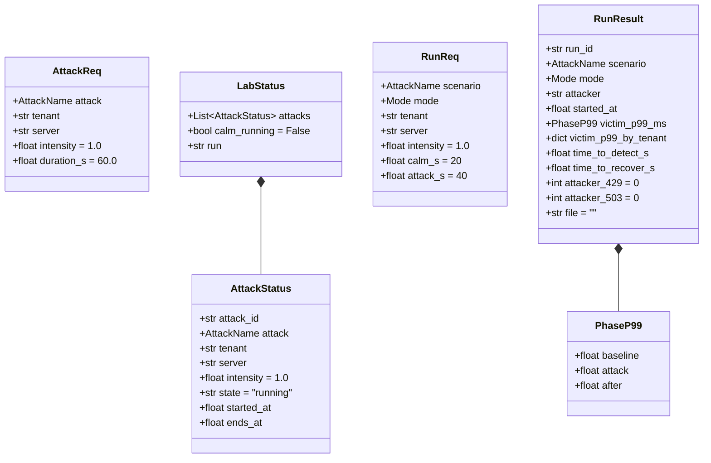

| Model | Endpoint | Notes |
|---|---|---|
| `AttackReq` | `POST /lab/attack` | `intensity` multiplies the attack's default profile (flood: 10× persona rps at 1.0; whale/hog/memory: request rate), valid 0.1..5 else 422; `duration_s` 0 < x ≤ 600; `faulty_server` uses `server` instead of `tenant` |
| `AttackStatus` | response of `POST /lab/attack`, items of `LabStatus` | `state` ∈ `running`, `stopped`, `done`; `started_at`/`ends_at` epoch s |
| `LabStatus` | `GET /lab/status` | running attacks, whether calm traffic runs, id of the scenario run in progress |
| `RunReq` | `POST /lab/run` | scripted calm (`calm_s`) → attack (`attack_s`) → calm, after setting the gateway mode |
| `PhaseP99` | inside `RunResult` | p99 in ms for the baseline, attack and after phases |
| `RunResult` | written to `lab/results/<ts>-<scenario>-<mode>.json` | `victim_p99_ms` pooled over all non-attacker tenants; `victim_p99_by_tenant`; `time_to_detect_s` (attack start → first incident event, if the brain is reachable); `time_to_recover_s` (attack start → victim p99 ≤ 1.5× baseline for 5 s); the attacker's 429/503 counts; the file path. Slide numbers come only from these files |

The `background_bomb`, `blackbox_bomb`, `cache_flood`, `faulty_server` and `honest_spike` attacks are
defined in `AttackName`, but on `master` the lab answers 501 for them (lab wave 2 is **in progress**).

---

## 10. Handoff cases

The handoff bridge (`integrations/handoff`, :8400) turns brain incidents into cases for the partner's
Web app and turns the partner's decisions into TTL-bound control commands. These are its internal view
models; the partner's strict wire format (`"HH:MM:SS"` strings) exists only inside the bridge.

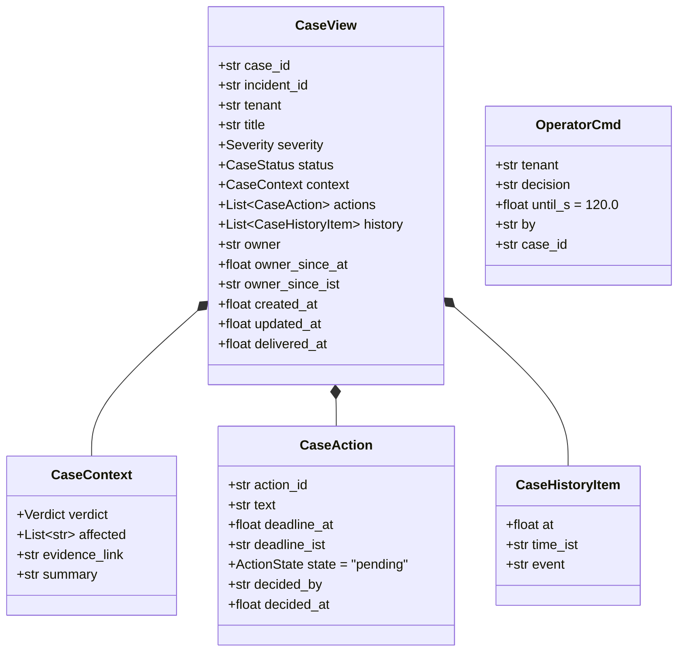

| Model | Fields and meaning |
|---|---|
| `CaseView` | `case_id` (`"INC-0001"`, assigned by the bridge), `incident_id` (brain id), `tenant`, `title`, `severity`, `status`, `context`, `actions`, `history`, `owner` + `owner_since_at`/`_ist` (who acknowledged), `created_at`, `updated_at`, `delivered_at` (last successful push to the Web app; null = not yet) |
| `CaseContext` | `verdict`, `affected` (victim tenant ids: the tenant's barcode neighbours), `evidence_link` (`http://<ui-host>:5173/case/<incident_id>`), `summary` |
| `CaseAction` | `action_id` (`A1`, `A2`, … unique in a case), `text`, `deadline_at` (after it TenantGuard applies its safe default: TTL auto-undo) + `deadline_ist`, `state`, `decided_by`, `decided_at` |
| `CaseHistoryItem` | `at` (epoch s), `time_ist`, `event` |
| `OperatorCmd` | human decision → brain `POST /api/operator` (control token). `release` forces the ladder to normal and suppresses re-escalation for `until_s`; `extend` holds the current level for `until_s`; `resume` cancels a hold. `until_s` must be finite and `0 < until_s ≤ gateway.ttl_max_s`, else 400 |

---

## 11. Billing views

The models below are on `master` in `contracts.py` (section 7). The billing service that serves them
(`billing/`, :8600) is **in progress**: built and tested on its own branch, waiting to merge.

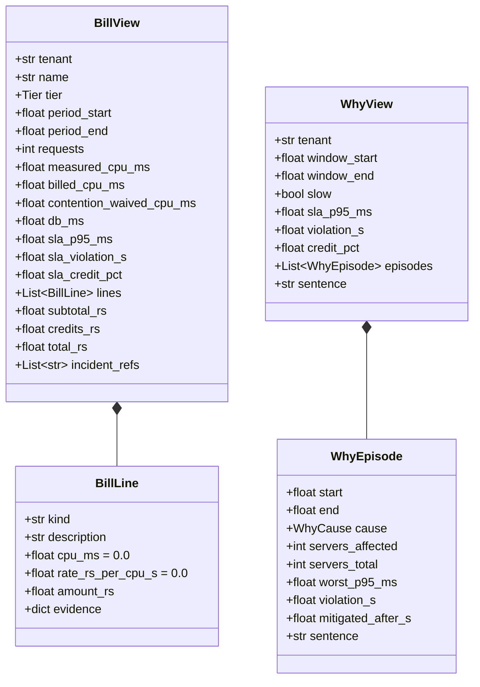

| Model | Key fields |
|---|---|
| `BillLine` | `kind` ∈ `compute`, `background`, `db`, `unmetered`, `sla_credit`; `amount_rs` negative for credits; `evidence` for `unmetered` = `{incident_id, confidence, servers, excess_cpu_ms}`, for `sla_credit` = `{violation_s, pct}`; `description` never names another tenant |
| `BillView` | `measured_cpu_ms` (handler + background as measured), `billed_cpu_ms` (after calm-reference pricing), `contention_waived_cpu_ms` (measured − billed, ≥ 0), SLA target / violation seconds / credit %, `subtotal_rs`, `credits_rs` (≤ 0), `total_rs`, `incident_refs` (own incidents: brain ids; incidents suffered as a victim: opaque `ref-<8 hex>`) |
| `WhyEpisode` | one slowdown: `cause`, servers affected out of the tenant's total, worst p95, violation seconds, `mitigated_after_s` (detected → rescued, or → first throttle of the culprit), and its sentence |
| `WhyView` | answer to "Why was I slow?" for a window; never names another tenant |

---

## 12. Incident narrator

The narrator (`narrator/`, :8700) builds an operator report and an anonymised customer message from the
brain's incident evidence, deterministically from templates.

| Model | Fields and meaning |
|---|---|
| `IncidentReport` | `headline`, `timeline` (`"HH:MM:SS stage: what happened"`, oldest first), `cause`, `evidence_points`, `action_taken`, `operator_recommendation` |
| `CustomerMessage` | `message` for an affected tenant, built from the anonymised evidence pack so it never names another tenant |
| `ReportView` | `GET /reports` (newest first), `GET /reports/{incident_id}`, WS `/ws/reports`: `incident_id`, `tenant`, `trigger_stage` (`named`, `verdict` or `closed`), `version` (+1 per change), `report`, `customer_message`, `evidence` (the pack it was built from), `created_at`, `updated_at` |

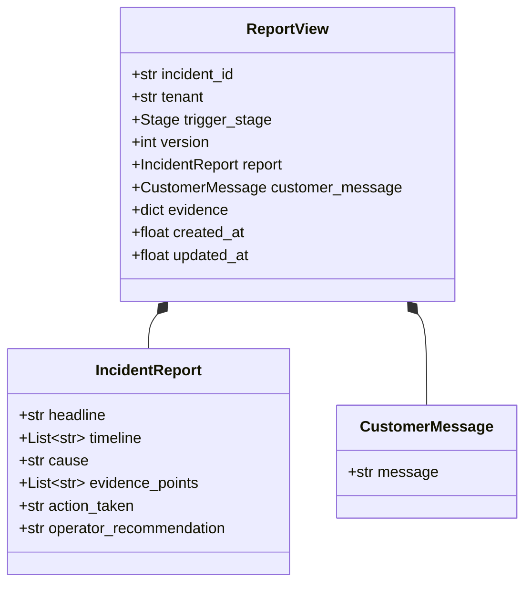

---

## 13. Configuration shapes

### `tenantguard.yaml`
Every tunable lives in this one file, read through `tenantguard_common.config.load_settings()` (path
override env `TENANTGUARD_CONFIG`). The full key-by-key reference is in `09_CONFIG_REFERENCE.md`; this
is the shape.

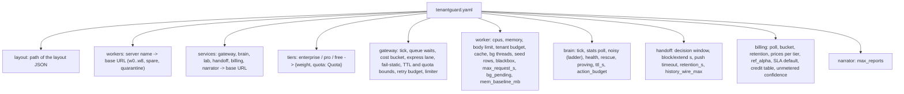

The `worker:` section, read by `worker/app/config.py load_config()`:

| Key | Value on `master` | Used for |
|---|---|---|
| `cpus` | 0.5 | `cpu_limit_cores` fallback |
| `mem_limit_mb` | 256 | memory-limit fallback when no cgroup `memory.max` |
| `body_limit_bytes` | 1 048 576 | request body limit → 413 |
| `tenant_mem_budget_mb` | 32 | per-tenant budget (held + cache) → 507 `tenant_memory_budget` |
| `cache_mb` | 8 | shared cache capacity |
| `cache_guaranteed_share` | 0.125 | per-tenant protected slice of the cache |
| `bg_threads` | 4 | background job thread pool |
| `seed_rows` | 1000 | rows seeded per tenant database |
| `blackbox.cpu_ms_per_doc` | 2.0 | CPU the vendor indexer burns per ingested doc |
| `blackbox.queue_max` | 5000 | docs queued at most; the rest is dropped and counted |
| `max_request_s` | 30 | `/api/export` estimate bound → 422 |
| `bg_pending.per_tenant` / `.total` | 200 / 1000 | background backlog caps → 503 `bg_backlog` |
| `mem_baseline_mb` | 80 | worker-wide cap = memory limit − this → 507 `worker_memory` |

### Layout file (`layouts/ag23.json`)
Read by `load_tenants()` (path override env `TENANTGUARD_LAYOUT`), which fills `weight` and `quota`
from the tier and returns `TenantConfig` objects.

```json
{
  "name": "AG(2,3)",
  "note": "...",
  "servers": ["w0", "...", "w8"],
  "tenants": [
    {"id": "A", "name": "Aarogya Health", "tier": "enterprise", "servers": ["w0", "w1", "w2"],
     "api_key": "tk_A_demo", "monthly_revenue_rs": 900000, "protected": true}
  ]
}
```

The 12 tenants on `master`. Each tenant's three servers form its **barcode**; the AG(2,3) design
guarantees that any two tenants share at most one server, which is what lets the brain name a culprit
from which servers are slow.

| Id | Name | Tier | Servers | Monthly revenue (₹) | Protected |
|---|---|---|---|---|---|
| A | Aarogya Health | enterprise | w0, w1, w2 | 900 000 | yes |
| B | BazaarKart | pro | w3, w4, w5 | 250 000 | |
| C | Chitra Studio | free | w6, w7, w8 | 0 | |
| D | DhanSetu Payments | enterprise | w0, w3, w6 | 1 200 000 | yes |
| E | Ekalavya Learn | pro | w1, w4, w7 | 200 000 | |
| F | FitZone | free | w2, w5, w8 | 0 | |
| G | GaadiGo | enterprise | w0, w4, w8 | 800 000 | |
| H | HisaabBooks | pro | w1, w5, w6 | 150 000 | |
| I | IdliExpress | free | w2, w3, w7 | 0 | |
| J | JhatpatMart | enterprise | w0, w5, w7 | 1 500 000 | |
| K | KaamKaro | pro | w1, w3, w8 | 180 000 | |
| L | LokVani News | free | w2, w4, w6 | 0 | |

A rebalanced layout (tiers spread so no server carries more than two enterprise tenants, plus
per-tenant `sla_p95_ms`) is **in progress** on a coordinator branch and merges with the brain's
prover work.

---

## 14. Worker storage

### Per-tenant SQLite
Each worker keeps **one SQLite file per tenant**: `{data_dir}/{tenant}.db`, where `data_dir` is
`/data` in Docker (`WORKER_DATA_DIR`) and `./data/<server>/` locally. Files are deleted and re-seeded at
every worker start, so every run starts from the same data. The repository (`worker/app/store.py
TenantStore`) takes the tenant only from the request context, so no handler can open another tenant's
file; ids must match the configured tenant list exactly (on a case-insensitive filesystem `a` would
otherwise open `A.db`).

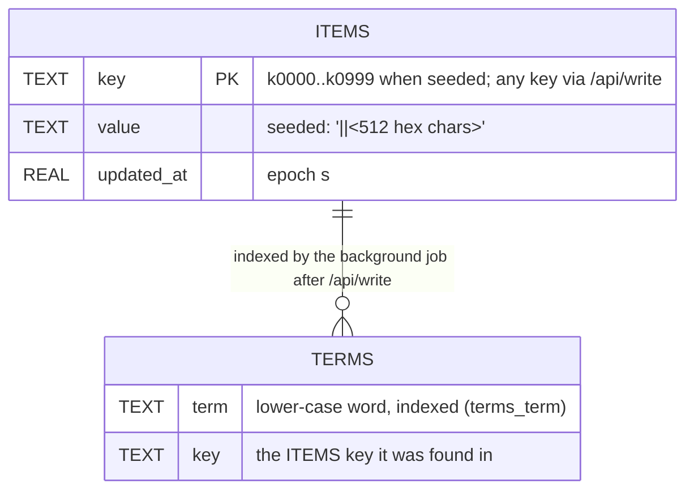

```sql
CREATE TABLE IF NOT EXISTS items (key TEXT PRIMARY KEY, value TEXT NOT NULL, updated_at REAL NOT NULL);
CREATE TABLE IF NOT EXISTS terms (term TEXT NOT NULL, key TEXT NOT NULL);
CREATE INDEX IF NOT EXISTS terms_term ON terms(term);
-- connection settings: PRAGMA journal_mode=WAL; PRAGMA synchronous=NORMAL; autocommit (isolation_level=None)
```

| Aspect | Rule |
|---|---|
| Seed | `worker.seed_rows` (1000) rows, keys `k0000`.. ; value = `seed_value(tenant, key)` = `"<tenant>|<key>|"` + 512 chars of `sha256(tenant/key)` repeated. The owner prefix makes any cross-tenant leak detectable in tests |
| Writes | `/api/write` → `INSERT OR REPLACE` into `items`; its background job replaces that key's rows in `terms` (up to 64 distinct words) |
| Reads | `/api/read` → cache first, then `SELECT value FROM items WHERE key=?` |
| Export | `/api/export` pages `items` in key order (`key > ?` … `LIMIT ?`) |
| Canary | a separate `_canary.db` with the same schema, written by `/canary/db`; never attributed to a tenant |
| Timing | every transaction's wall time is added to the tenant's `db_ms` |
| Concurrency | one connection per tenant, shared across threads, serialised by a per-tenant lock; closed under that lock at shutdown |

### Shared cache (in memory)
`worker/app/cache.py TenantCache`: one LRU per tenant, keyed by `(tenant, key)` with the tenant from
context. Entry = `(value, size, tick)`, size = `len(key) + len(value) + 64` bytes. Capacity =
`worker.cache_mb`; each tenant has a guaranteed share of `capacity × cache_guaranteed_share`. When the
cache is full, the victim is the least recently used entry among tenants **above** their guaranteed
share. Each eviction of another tenant's entry is counted (`evictions_caused` / `evictions_suffered`)
and its bytes are recorded in a ledger `(evictor, victim) → bytes`.

### Meters (in memory)
`worker/app/meter.py Meters`: per tenant a `Usage` record (`requests`, `handler_cpu_ms`, `bg_cpu_ms`,
`db_ms`, `bytes_in`, `bg_jobs`) and per (tenant, class) a `[count, cpu_ms]` pair, all cumulative and
guarded by one lock. `Worker.stats()` turns them into `WorkerStats`.

---

## 15. Measured endpoint costs

`worker/calibration.json` was measured inside a worker container on the Docker host (0.5-CPU cgroup,
`where = "docker"`, server `w1`, tenant A, one sequential client inside the container, default
parameters). Means in ms:

| Endpoint | Handler CPU (header) | Process CPU per request | Background CPU | Black-box CPU | Latency mean / p95 | Capacity at 100 % of 0.5 CPU (req/s) |
|---|---|---|---|---|---|---|
| `GET /api/light` | 0.396 | 0.95 | 0 | 0 | 2.36 / 1.52 | 526.3 |
| `GET /api/read` (cold) | 0.030 | 0.5 | 0 | 0 | 1.10 / 0.99 | 1000.0 |
| `GET /api/read` (warm) | 0.010 | 0.5 | 0 | 0 | 1.34 / 0.74 | 1000.0 |
| `GET /api/search` (n = 20 000) | 3.831 | 4.667 | 0 | 0 | 8.86 / 53.52 | 107.1 |
| `POST /api/write` | 0.185 | 3.1 | 1.429 | 0 | 6.34 / 55.11 | 161.3 |
| `POST /api/ingest` (10 docs) | 0.066 | 23.5 | 0 | 20.25 | 9.85 / 76.41 | 21.3 |
| `GET /api/memory` (1 MB, 500 ms hold) | 0.420 | 7.0 | 0 | 0 | 506.66 / 542.57 | 71.4 |
| `GET /api/export` (1000 rows) | 19.498 | 26.0 | 0 | 0 | 225.47 / 231.40 | 19.2 |
| `GET /canary` | 1.007 | 2.3 | 0 | 0 | 4.54 / 3.60 | 217.4 |

How to read it: the gateway's cost bucket is debited with the handler CPU, while a worker's real CPU
budget is consumed by the process CPU (which also includes HTTP handling, background jobs and the black
box). `/api/ingest` shows the hidden-cost pattern: 0.066 ms visible to the tenant's meter, about 20 ms of
black-box CPU behind it.
