# 05 · Sequence diagrams

Thirteen flows, traced from the code on this branch. Every arrow names the real function or endpoint; config values come from `tenantguard.yaml` (or are marked *code default*). Units: `ts` / `*_at` are epoch seconds, `*_ms` are milliseconds, shares are 0..1.

| # | Flow | Main code |
|---|---|---|
| 1 | [Request path](#1-request-path) | `gateway/tenantguard_gateway/app.py`, `core.py`; `worker/app/main.py`, `meter.py` |
| 2 | [Admission refusal (429 / 503 / 401 / 413)](#2-admission-refusal) | `core.py`, `admission.py`, `buckets.py`, `retry.py`, `overrides.py` |
| 3 | [DRR dispatch](#3-drr-dispatch) | `core.py`, `scheduler.py`, `router.py`, `limiter.py` |
| 4 | [Detection → throttle ladder → recovery](#4-detection--throttle-ladder--recovery) | `brain/tenantguard_brain/runtime.py`, `core.py`, `score.py`, `ladder.py`, `incidents.py` |
| 5 | [Health → rescue → decoder naming](#5-health--rescue--decoder-naming) | `stage3.py`, `health.py`, `rescue.py`, `decoder.py` |
| 6 | [Held hosts (hot tenants judged first)](#6-held-hosts) | `stage3.py` (`hot_on`, `held_by_culprit`) |
| 7 | [Relocation proof](#7-relocation-proof) | `stage3.py` (`_judge`), `runtime.py` (`_run_job`), `prover.py` (`DockerProver`, `EngineDocker`), `verdicts.py` (`evaluate_proof`) |
| 8 | [Verdict application](#8-verdict-application) | `stage3.py` (`on_proof`, `_verdict`), `verdicts.py` (`classify`), `core.py` (`force_throttle`) |
| 9 | [Host fault and drain test](#9-host-fault-and-drain-test) | `worker/app/fault.py`, `stage3.py`, `prover.py` (`HostProver`) |
| 10 | [Background CPU charge](#10-background-cpu-charge) | brain `core.py` (`ingest_stats`, `_charges`), `runtime.py`; gateway `app.py`, `core.py` (`charge`) |
| 11 | [Operator / handoff decision](#11-operator--handoff-decision) | `integrations/handoff/tenantguard_handoff/*`, brain `/api/operator` |
| 12 | [Narrator report](#12-narrator-report) | `narrator/tenantguard_narrator/*` |
| 13 | [UI live stream](#13-ui-live-stream) | brain `main.py`, `runtime.py`, `core.py`; `ui/src/lib/*` |

---

## 1. Request path

A tenant request is identified by its API key, classified, admitted, queued per tenant, routed to one of the tenant's three barcode servers, metered by the worker and debited on the way back.

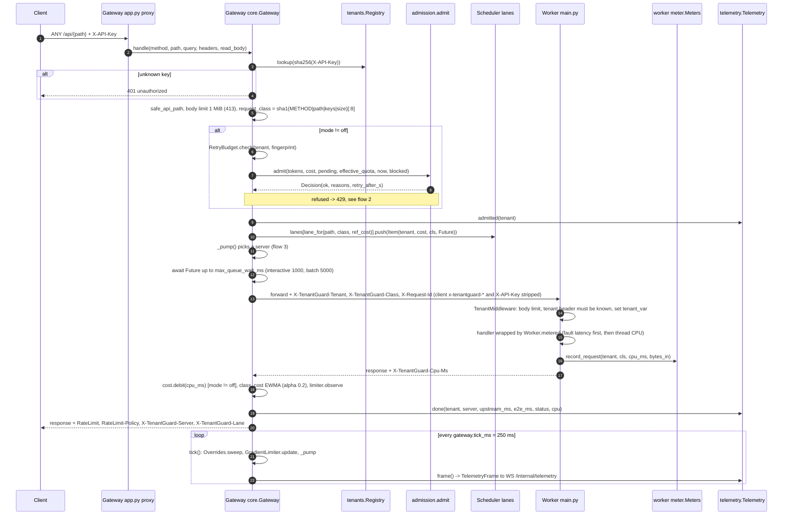

**Notes**
- The cost bucket is in CPU-ms: capacity `cost_ms_per_s × gateway.cost_bucket_s` (2 s), debited **after** the response with the worker-measured CPU, so it is a real resource quota rather than a request count.
- Workers trust only the gateway-set headers; the gateway strips any `x-tenantguard-*` header a client sends (after reading a client `X-TenantGuard-Class: batch` hint for lane choice).
- Background work (`POST /api/write` jobs) is charged to the tenant in `Meters.add_bg`, but it is not part of the `X-TenantGuard-Cpu-Ms` header. In `tenantguard` mode the brain debits it from the cost bucket once a second through `POST /control/charge` (flow 10).
- Upstream errors return **502** `bad_gateway`. A missing CPU header debits 0 and is counted by `Telemetry.cpu_missing`.

---

## 2. Admission refusal

All dimensions are checked together; a token is consumed only if every dimension passes. `Retry-After` is the longest wait among the refusing dimensions.

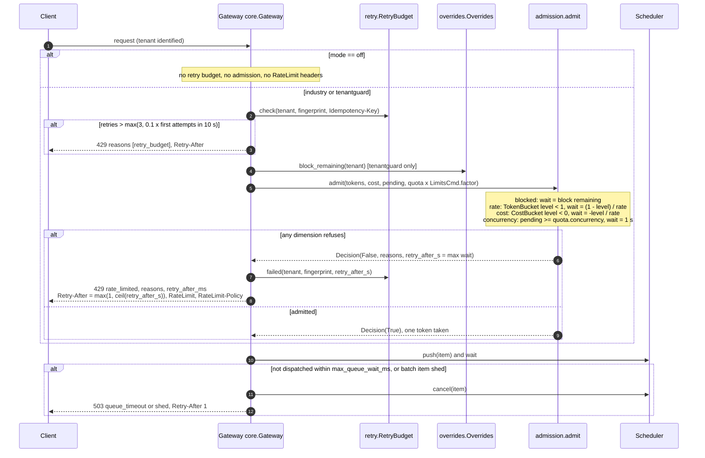

**Notes**
- `RateLimit-Policy` names one policy per dimension: `"rate";q=<burst>;w=…, "cost";q=<cost_ms_per_s×cost_bucket_s>;w=…;qu="cpu-ms", "concurrency";q=<concurrency>`; `RateLimit` gives the remaining amount and reset per dimension. Both are on admitted and refused responses in non-off modes.
- With an active `LimitsCmd` (tenantguard mode only) the effective quota is `max(1, round(base × factor))` for integer fields and `base × factor` for floats; bucket levels are kept and clamped to the new capacity.
- Other refusals: **401** for an unknown `X-API-Key`, and for `/admin/*` or `/control/*` without the right `X-TenantGuard-Control-Token` (`hmac.compare_digest`); **413** above `worker.body_limit_bytes` (checked by gateway and worker); **400** for a bad path or bad Content-Length.

---

## 3. DRR dispatch

Three lanes (express, interactive, batch), each a weighted deficit round robin over per-tenant queues; a per-worker adaptive window limits in-flight work.

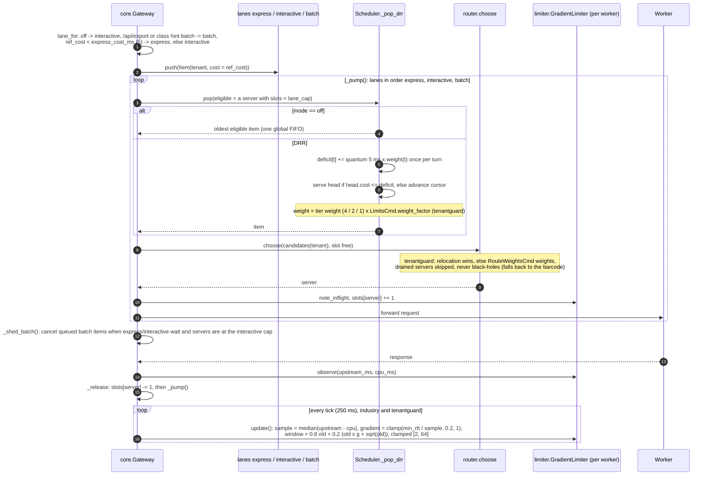

**Notes**
- Item cost comes, in order, from brain-pushed `reference_costs[cls]` (tenantguard), the measured per-(tenant, class) EWMA, or `DEFAULT_CLASS_COST_MS` = 5 ms. Nothing on this branch sends `ReferenceCostsCmd`, so the EWMA or the default is used.
- Lane caps with window `w` (8 initially, `gateway.limiter`): express `w`, interactive `w − max(1, w//8)`, batch `max(1, min(interactive, w//2))`; batch is shed first.
- The limiter's RTT sample excludes the request's own CPU, so one heavy request does not shrink the window by itself.
- Relocations (`RelocateCmd`, flows 7 and 8) and drains (`DrainCmd`, flow 9) are applied here by `router.choose`.

---

## 4. Detection → throttle ladder → recovery

The brain ingests gateway telemetry (4 Hz) and worker stats (1 Hz), scores each tenant against its fair share on its own servers, walks a graduated ladder with hold times, and drives the gateway with TTL-bound `LimitsCmd`s.

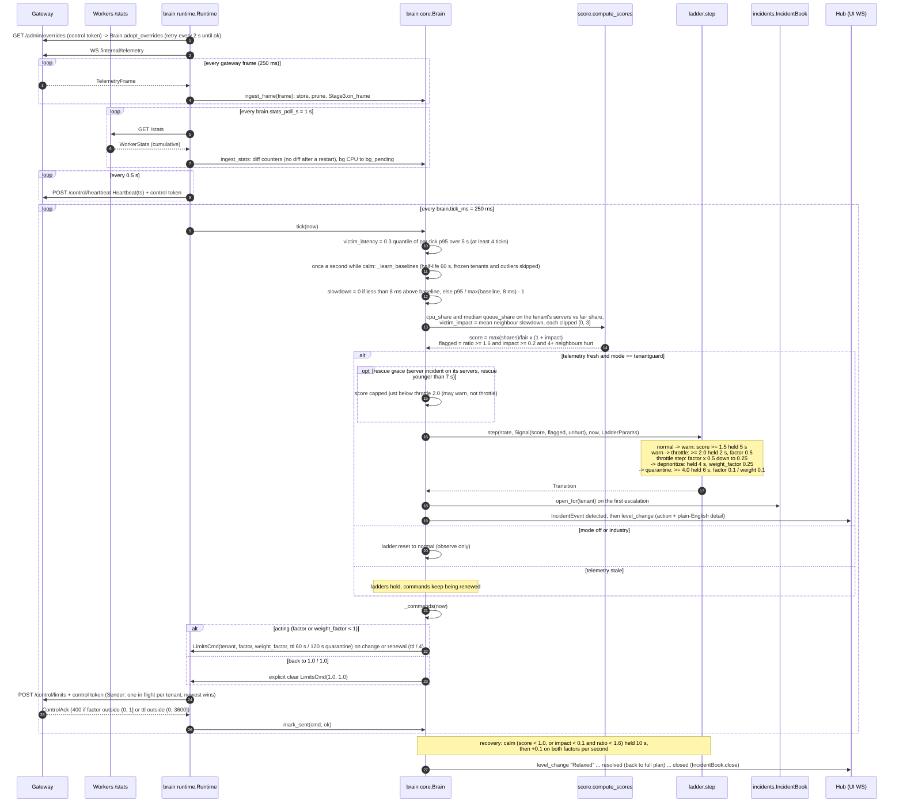

**Notes**
- Holds use `hold_ratio` 0.8: at least 80 % of the ticks in the hold window must qualify, including the current one. Every escalation restarts all hold clocks.
- Gateway-side safety: every override has a TTL that the gateway sweeps each tick and re-checks on read; `ttl_s` ≤ `gateway.ttl_max_s` (3600). If heartbeats stop for `fail_static_after_s` (2 s) the gateway keeps its last configuration and reports `fail_static: true` in `/admin/overrides`; TTLs still expire.
- Senders always send **both** factors; the latest `LimitsCmd` for a tenant replaces the previous one.
- The ladder's quarantine rung is a 0.1 / 0.1 `LimitsCmd`. Moving a tenant's work to the quarantine worker is done by the `costly_pattern` verdict (flow 8).
- Every tightening is checked by the impact meter: a tenant tightened while its own score was below `warn` would be listed in `ImpactView.innocents_penalised`.

---

## 5. Health → rescue → decoder naming

Stage 3 compares each tenant with itself across its own servers (traffic) and uses canary round trips as a fallback, routes victims away from slow servers within a capacity guard, and names the cause by decoding which tenant's barcode explains the slow set.

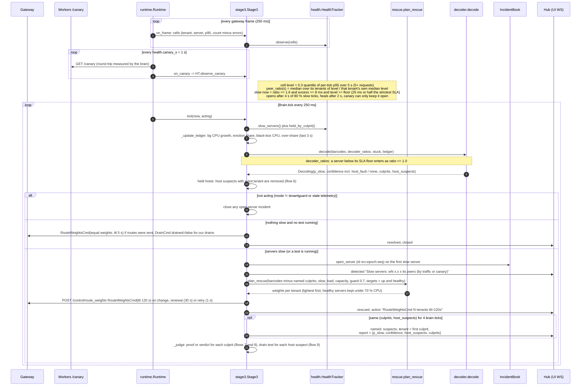

**Notes**
- Decoder (yaml `brain.decoder`): `p_slow(s) = logistic(8 × (peer_ratio − 1.6))`; each tenant is scored from the min and mean `p_slow` of its barcode, whether it is stuck (all its servers slow) and ledger hints; `host_fault` and `none` compete in the same softmax. A tenant is accepted when the tenants together hold ≥ 0.5 and it is the top option; its servers are explained away, up to two culprits; residual slow servers become `host_suspects`.
- Health, ledger and decoding always run (they feed `ServerView.peer_ratio` and `status`); route changes, tests and server incidents happen only in tenantguard mode with fresh telemetry.
- A named culprit is excluded from rescue so that its load is not spread to healthy servers. The prover moves it instead.
- With `NullProver` (no Docker socket, or no `COMPOSE_PROJECT`), a culprit at or above the confidence bar is named only, and the `named` detail says relocation needs the Docker host.

---

## 6. Held hosts

During a ramp the decoder can see one or two of a culprit's servers slow before all three, which looks like a faulty host. Before any host suspect is named or drained, Stage 3 asks whether a hot tenant runs there. If one does, the tenant is judged first and the server is a **held host**.

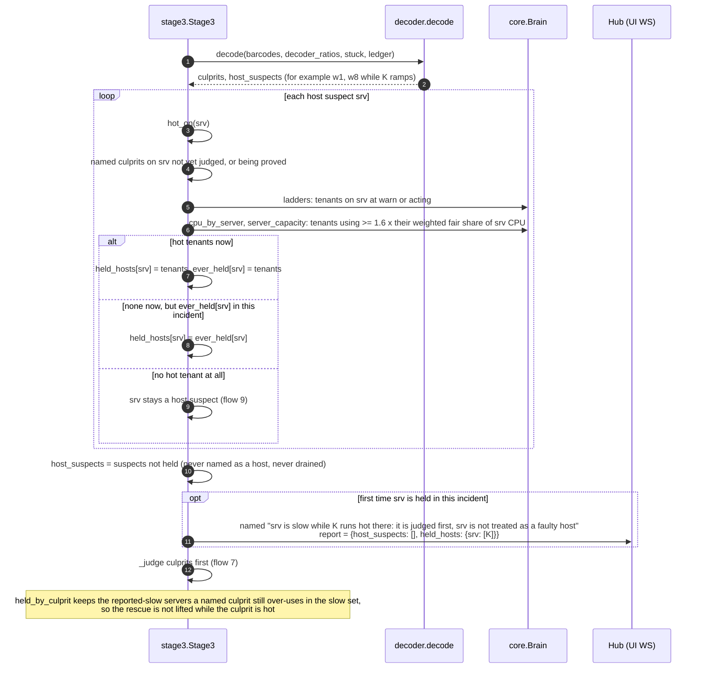

**Notes**
- The "hot on this server" test uses the entitlement over every tenant placed on the server, not only those still sending there, so a culprit left alone after a rescue is still hot.
- `ever_held` is kept for the rest of the incident: a server explained by a hot tenant earlier is not drained later in the same incident.
- In the host acceptance run, the K big-plan whale was named, proved (R = 0.88) and judged `honest_growth`, with held hosts w1 and w8 judged first.

---

## 7. Relocation proof

A culprit named at or above `confidence_to_prove` (0.8) is proved by moving it to the spare and watching whether its original servers recover and the harm follows it. The test runs as an async job so the tick loop never waits.

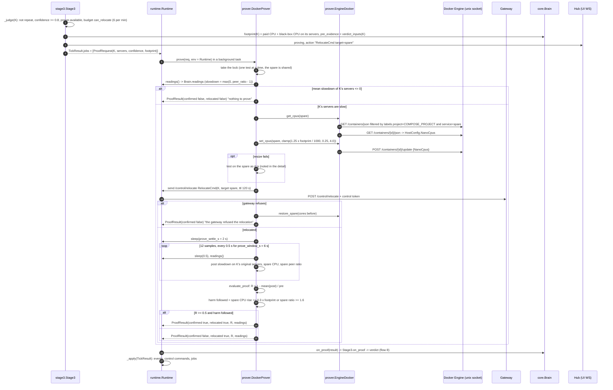

**Notes**
- The relocation is left in place after the test; the verdict decides whether K stays on the spare, goes to the quarantine lane or goes home.
- The spare is resolved by **both** compose labels, or by `TENANTGUARD_SPARE_CONTAINER`. Without a project or explicit name, `make_prover` returns `NullProver` and no Docker call is made.
- While a test runs, `Stage3.tick` keeps the server incident and the rescue open even if K's servers look fine (they look fine *because* K was moved).
- If the incident has closed by the time the result arrives, `on_proof` sends `RelocateCmd(target=None)` and restores the spare.

---

## 8. Verdict application

`Stage3.on_proof` classifies on the evidence captured *before* the test (what K did on its own servers) plus the proof result, then `_verdict` queues the control commands for that outcome. A culprit below the confidence bar, or a repeat offender, reaches `_verdict` straight from `_judge` without a test.

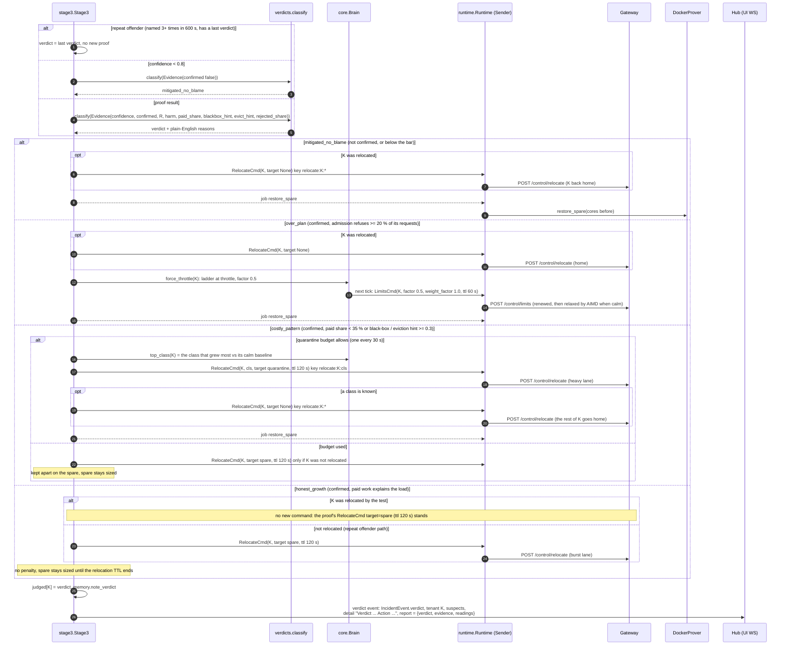

**Notes**
- The fifth outcome, `host_fault`, belongs to host suspects and is applied in flow 9.
- `over_plan` is checked before `costly_pattern`. A not-confirmed repeat offender is judged on its pre-test evidence.
- Relocation commands use their own sender keys (`relocate:<tenant>:<cls or *>`), so a class move and a whole-tenant move never replace each other.
- Every relocation has a TTL (120 s), so nothing stays moved without the brain renewing it.

---

## 9. Host fault and drain test

A slow host with no tenant behind it: TenantGuard rescues the victims, the decoder names the host instead of blaming a tenant, and a drain test confirms it.

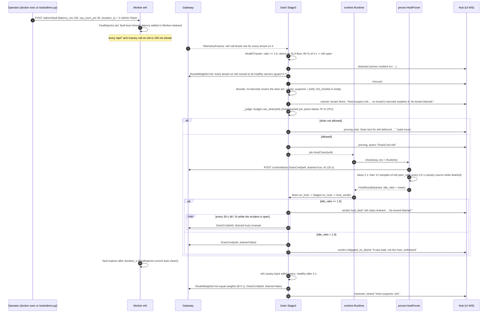

**Notes**
- Peer comparison means a fleet-wide slowdown accuses no single server. The canary keeps a routed-away or drained server measurable, so it can be judged healed, but the canary alone never opens an incident.
- The lab's `faulty_server` attack is not included (the lab answers 501 for it), so the faulty-server scene is triggered with the worker's `/admin/fault` (a `docker exec` on the host, or `tools/demo.py inject_fault`).
- At most one server is drained at a time (`action_budget.max_drained` 1). In the host acceptance run, a w4 fault gave `host_fault` at 5.1x idle and no tenant was blamed.
- `ServerView.status` in the brain snapshot is `healthy` or `slow`; the drain shows in the gateway's `/admin/overrides`.

---

## 10. Background CPU charge

Background jobs burn CPU outside the request path, so the worker's `X-TenantGuard-Cpu-Ms` header does not include it. In `tenantguard` mode the brain pushes it to the gateway once a second and the gateway debits the tenant's cost bucket.

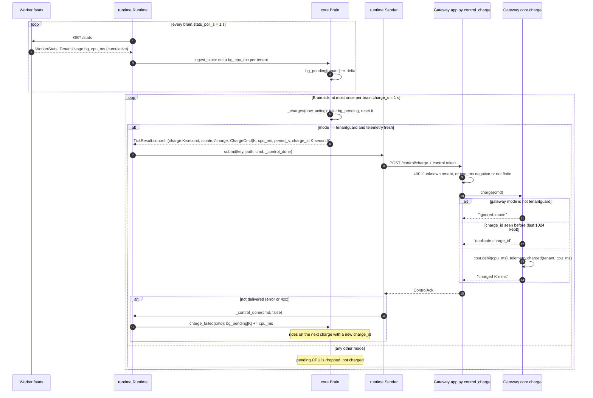

**Notes**
- `ChargeCmd` is not an override: no TTL, applied once. The per-second sender key means two charges for the same tenant never replace each other in the `Sender`.
- The debited CPU makes the cost bucket refuse sooner (flow 2) for a tenant whose background jobs are heavy, in `tenantguard` mode only.

---

## 11. Operator / handoff decision

The handoff bridge turns brain incidents into partner cases with an owner and pending actions; the partner's decision flows back as a TTL-bound command; a missed deadline applies the safe default (timers auto-undo).

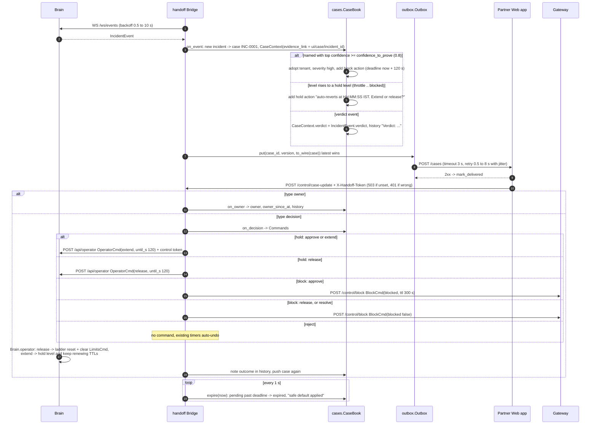

**Notes**
- Every command the bridge sends is TTL-bound (block 300 s, extend 120 s, both capped by `gateway.ttl_max_s`), so "no decision" can never leave a tenant blocked.
- The brain's ladder obeys `OperatorCmd` (release suppresses re-escalation until the hold ends), so humans and the ladder do not fight.
- The bridge's naming bar (`confidence_to_name`) is read from `brain.confidence_to_prove` in `tenantguard.yaml` (code default 0.6). A case starts with `CaseContext.verdict = "over_plan"` and takes the brain's verdict when a `verdict` event arrives.
- HH:MM:SS IST strings exist only on the partner wire; internal `CaseView` fields are epoch seconds plus `*_ist` display strings. The bridge runs under the docker-compose profile `handoff`.

---

## 12. Narrator report

A template narrator follows the brain and writes a plain-English incident report and a tenant-neutral customer message whenever the evidence changes.

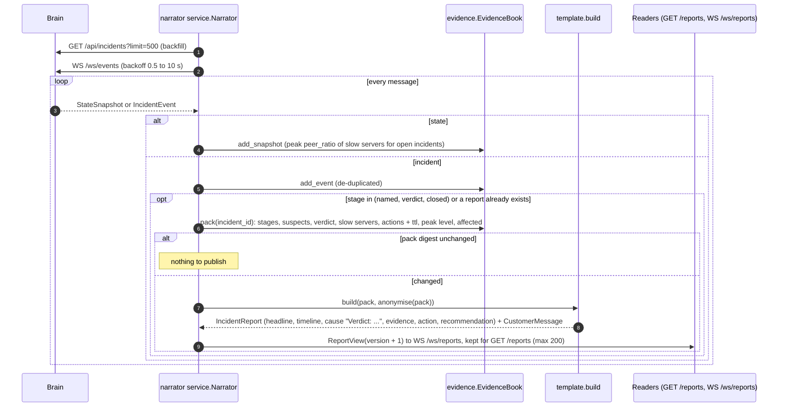

**Notes**
- Reports are deterministic templates that use only fields from the evidence pack; the customer message names no tenant or server.
- `IncidentEvent.report` is a different thing: Stage 3 `named` events carry the decoder dict, and `verdict` events carry `{verdict, evidence, readings}`.
- The UI's Case File reads the brain's incident events, not the narrator's `/reports`; when the brain has not written a report it shows a template placeholder. The narrator runs on :8700 under the docker-compose profile `narrator`.

---

## 13. UI live stream

The brain pushes state at 2 Hz and every incident event as it happens; the UI polls the gateway admin API for quotas and overrides, the lab for attacks and results, and the bridge for cases.

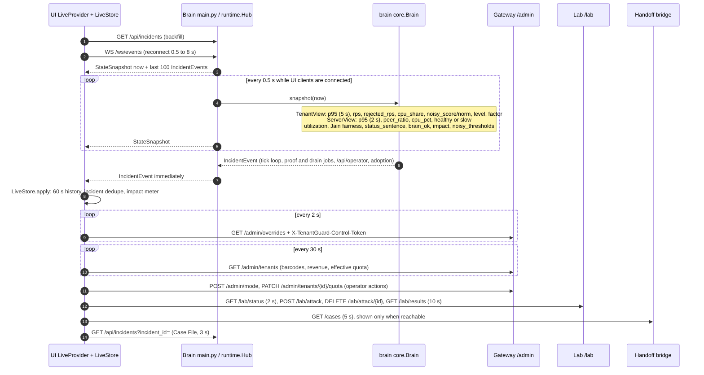

**Notes**
- The hub's per-client queue holds 256 messages; when it is full the oldest message is dropped, so a slow browser never stalls the brain.
- A wrong or missing control token gets 401 on every gateway `/admin/*` and `/control/*` route.
- The brain fills `StateSnapshot.impact` (`ImpactView` from `impact.ImpactMeter`). The UI's ₹ impact meter (`ui/src/lib/impact.ts`) is computed client-side from the snapshot stream. `TenantView.placement` is always `normal` in the brain snapshot.

---

## Endpoints and their callers

| Endpoint | Caller |
|---|---|
| gateway `POST /control/charge` (`ChargeCmd`) | brain `Brain._charges`, once a second in tenantguard mode (flow 10) |
| gateway `POST /control/relocate` (`RelocateCmd`) | brain `DockerProver` and `Stage3._verdict` (flows 7 and 8); also `gateway/tools/prove.py` |
| gateway `POST /control/drain` (`DrainCmd`) | brain `HostProver`, `Stage3.on_host`, `_renew_drains`, `_close` (flow 9) |
| gateway `POST /control/reference_costs` (`ReferenceCostsCmd`) | implemented, no sender on this branch |
| lab wave-2 attacks (`background_bomb`, `blackbox_bomb`, `cache_flood`, `faulty_server`, `honest_spike`) | not included; the lab answers 501 for them |
