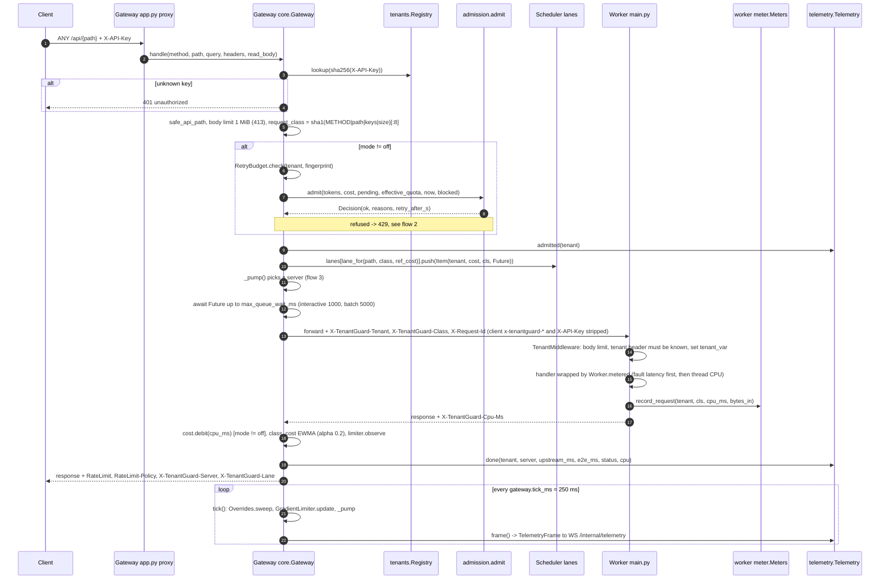
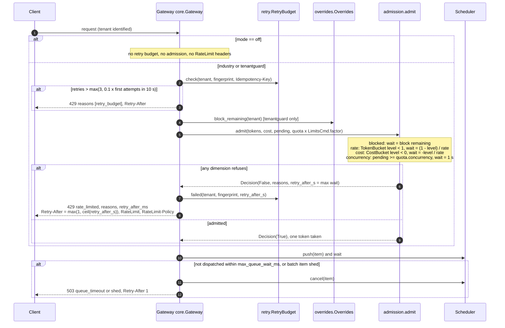
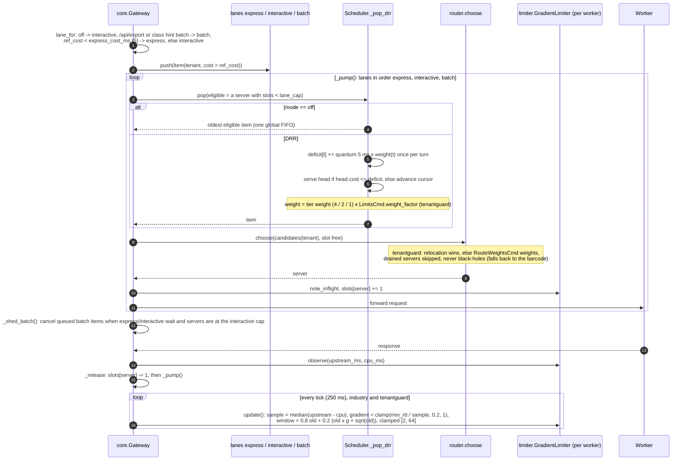
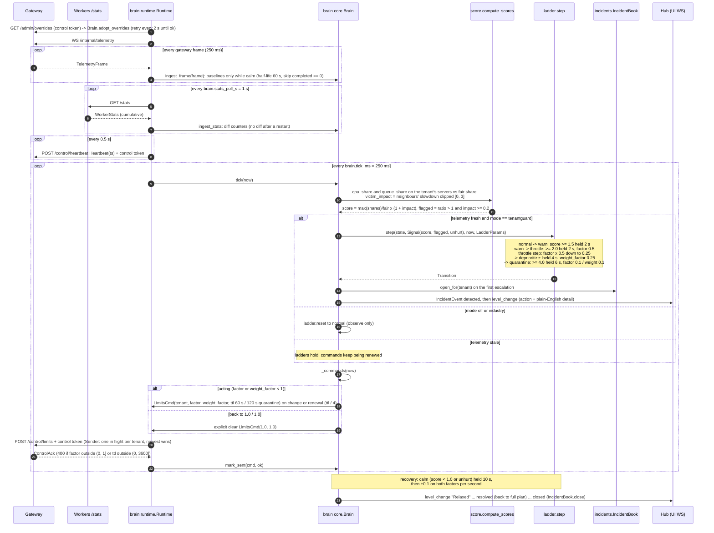
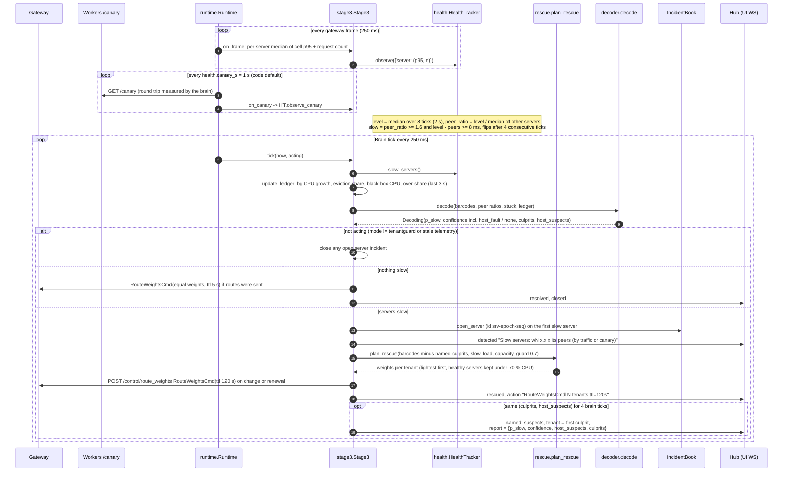
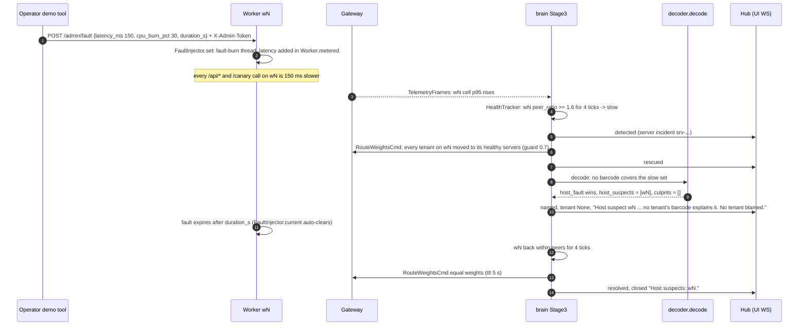
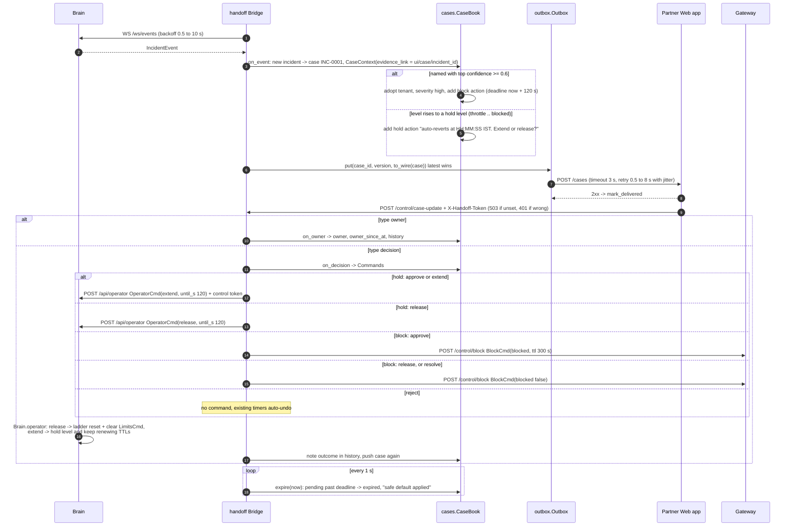
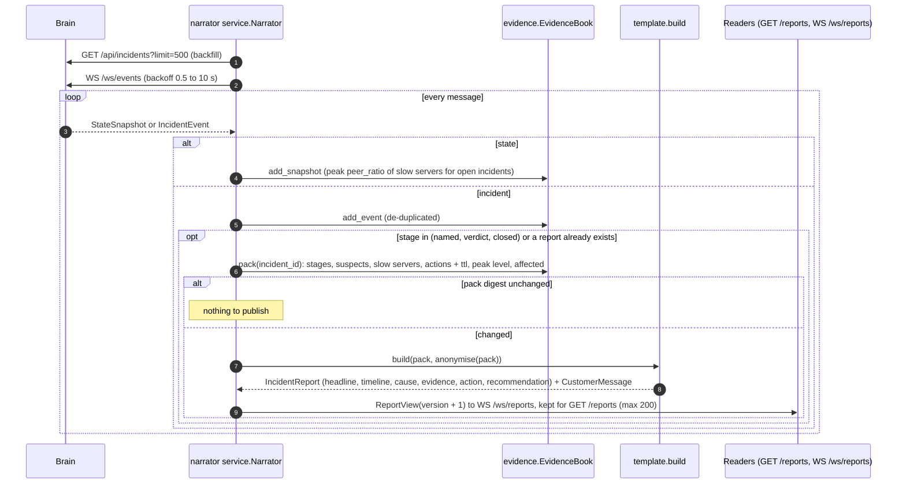
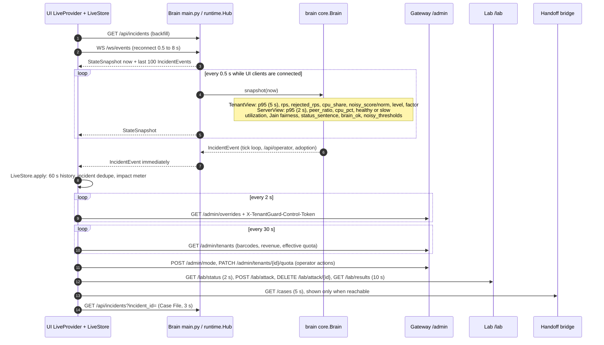

# 05 · Sequence diagrams

Nine flows, traced from the code on `master`. Every arrow names the real function or endpoint; config values come from `tenantguard.yaml` (or are marked *code default*). Units: `ts` / `*_at` are epoch seconds, `*_ms` are milliseconds, shares are 0..1.

| # | Flow | Main code |
|---|---|---|
| 1 | [Request path](#1-request-path) | `gateway/tenantguard_gateway/app.py`, `core.py`; `worker/app/main.py`, `meter.py` |
| 2 | [Admission refusal (429 / 503 / 401 / 413)](#2-admission-refusal) | `core.py`, `admission.py`, `buckets.py`, `retry.py`, `overrides.py` |
| 3 | [DRR dispatch](#3-drr-dispatch) | `core.py`, `scheduler.py`, `router.py`, `limiter.py` |
| 4 | [Detection → throttle ladder → recovery](#4-detection--throttle-ladder--recovery) | `brain/tenantguard_brain/runtime.py`, `core.py`, `score.py`, `ladder.py`, `incidents.py` |
| 5 | [Health → rescue → decoder naming](#5-health--rescue--decoder-naming) | `stage3.py`, `health.py`, `rescue.py`, `decoder.py`, `prover.py` |
| 6 | [Host fault](#6-host-fault) | `worker/app/fault.py`, Stage 3 path |
| 7 | [Operator / handoff decision](#7-operator--handoff-decision) | `integrations/handoff/tenantguard_handoff/*`, brain `/api/operator` |
| 8 | [Narrator report](#8-narrator-report) | `narrator/tenantguard_narrator/*` |
| 9 | [UI live stream](#9-ui-live-stream) | brain `main.py`, `runtime.py`, `core.py`; `ui/src/lib/*` |

---

## 1. Request path

A tenant request is identified by its API key, classified, admitted, queued per tenant, routed to one of the tenant's three barcode servers, metered by the worker and debited on the way back.

**Notes**
- The cost bucket is in CPU-ms: capacity `cost_ms_per_s × gateway.cost_bucket_s` (2 s), debited **after** the response with the worker-measured CPU, so it is a real resource quota rather than a request count.
- Workers trust only the gateway-set headers; the gateway strips any `x-tenantguard-*` header a client sends (after reading a client `X-TenantGuard-Class: batch` hint for lane choice).
- Background work (`POST /api/write` jobs) is charged to the tenant in `Meters.add_bg`, but it is not part of the `X-TenantGuard-Cpu-Ms` header, so the gateway does not debit it.
- Upstream errors return **502** `bad_gateway`. A missing CPU header debits 0 and is counted by `Telemetry.cpu_missing`.

---

## 2. Admission refusal

All dimensions are checked together; a token is consumed only if every dimension passes. `Retry-After` is the longest wait among the refusing dimensions.

**Notes**
- `RateLimit-Policy` names one policy per dimension: `"rate";q=<burst>;w=…, "cost";q=<cost_ms_per_s×cost_bucket_s>;w=…;qu="cpu-ms", "concurrency";q=<concurrency>`; `RateLimit` gives the remaining amount and reset per dimension. Both are on admitted and refused responses in non-off modes.
- With an active `LimitsCmd` (tenantguard mode only) the effective quota is `max(1, round(base × factor))` for integer fields and `base × factor` for floats; bucket levels are kept and clamped to the new capacity.
- Other refusals: **401** for an unknown `X-API-Key`, and for `/admin/*` or `/control/*` without the right `X-TenantGuard-Control-Token` (`hmac.compare_digest`); **413** above `worker.body_limit_bytes` (checked by gateway and worker); **400** for a bad path or bad Content-Length.

---

## 3. DRR dispatch

Three lanes (express, interactive, batch), each a weighted deficit round robin over per-tenant queues; a per-worker adaptive window limits in-flight work.

**Notes**
- Item cost comes, in order, from brain-pushed `reference_costs[cls]` (tenantguard), the measured per-(tenant, class) EWMA, or `DEFAULT_CLASS_COST_MS` = 5 ms. Nothing on master sends `ReferenceCostsCmd`, so the EWMA or the default is used.
- Lane caps with window `w` (8 initially, `gateway.limiter`): express `w`, interactive `w − max(1, w//8)`, batch `max(1, min(interactive, w//2))`; batch is shed first.
- The limiter's RTT sample excludes the request's own CPU, so one heavy request does not shrink the window by itself.

---

## 4. Detection → throttle ladder → recovery

The brain ingests gateway telemetry (4 Hz) and worker stats (1 Hz), scores each tenant against its fair share on its own servers, walks a graduated ladder with hold times, and drives the gateway with TTL-bound `LimitsCmd`s.

**Notes**
- Holds use `hold_ratio` 0.8: at least 80 % of the ticks in the hold window must qualify, including the current one. Every escalation restarts all hold clocks.
- Gateway-side safety: every override has a TTL that the gateway sweeps each tick and re-checks on read; `ttl_s` ≤ `gateway.ttl_max_s` (3600). If heartbeats stop for `fail_static_after_s` (2 s) the gateway keeps its last configuration and reports `fail_static: true` in `/admin/overrides`; TTLs still expire.
- Senders always send **both** factors; the latest `LimitsCmd` for a tenant replaces the previous one.
- **In progress:** quarantine is a 0.1 / 0.1 `LimitsCmd` on master. Relocating the tenant to the quarantine worker is a Wave 2 TODO in `ladder.py`.

---

## 5. Health → rescue → decoder naming

Stage 3 watches every server against its peers (traffic p95 and canary round trips), routes victims away from slow servers within a capacity guard, and names the cause by decoding which tenant's barcode explains the slow set.

**Notes**
- Decoder (code defaults): `p_slow(s) = logistic(8 × (peer_ratio − 1.6))`; each tenant is scored from the min and mean `p_slow` of its barcode, whether it is stuck (all its servers slow) and ledger hints; `host_fault` and `none` compete in the same softmax. A tenant above 0.5 is accepted and its servers explained away, up to two culprits; residual slow servers become `host_suspects`.
- Health, ledger and decoding always run (they feed `ServerView.peer_ratio` and `status`); route changes and server incidents happen only in tenantguard mode with fresh telemetry.
- A named culprit is excluded from rescue so that its load is not spread to healthy servers.
- **In progress:** the relocation **prover** is an interface only (`prover.Prover`, `NullProver` with `available = False`). Stage 3 never calls it, the `named` detail says the culprit is "not yet proven", and the brain emits no `proving`, `verdict` or `explained` stages on master. The gateway's `/control/relocate` endpoint exists but nothing in the brain sends `RelocateCmd`.

---

## 6. Host fault

A slow host with no tenant behind it: TenantGuard still rescues the victims, and the decoder names the host instead of blaming a tenant.

**Notes**
- Peer comparison means a fleet-wide slowdown accuses no single server; the canary keeps a routed-away server measurable so it can be judged healed.
- **In progress:** the lab's `faulty_server` attack returns 501 on master (Wave 2), so the fault is injected directly on the worker (`tools/demo.py inject_fault`). The brain sets no `verdict` (such as `host_fault`) on its events, and sends no `DrainCmd`: the gateway's `/control/drain` endpoint and drain-aware routing exist but are unused, so `ServerView.status` is never `drained`.

---

## 7. Operator / handoff decision

The handoff bridge turns brain incidents into partner cases with an owner and pending actions; the partner's decision flows back as a TTL-bound command; a missed deadline applies the safe default (timers auto-undo).

**Notes**
- Every command the bridge sends is TTL-bound (block 300 s, extend 120 s, both capped by `gateway.ttl_max_s`), so "no decision" can never leave a tenant blocked.
- The brain's ladder obeys `OperatorCmd` (release suppresses re-escalation until the hold ends), so humans and the ladder do not fight.
- HH:MM:SS IST strings exist only on the partner wire; internal `CaseView` fields are epoch seconds plus `*_ist` display strings.
- **In progress:** the brain never sets `IncidentEvent.verdict`, so every case keeps the default `CaseContext.verdict = "over_plan"`, including host-fault cases. The bridge runs under the docker-compose profile `handoff`.

---

## 8. Narrator report

A template narrator follows the brain and writes a plain-English incident report and a tenant-neutral customer message whenever the evidence changes.

**Notes**
- Reports are deterministic templates that use only fields from the evidence pack; the customer message names no tenant or server.
- `IncidentEvent.report` is a different thing: it carries the decoder dict from Stage 3 `named` events.
- **In progress:** the `verdict` trigger never fires on master (the brain sets no verdict), so reports appear on `named` and `closed`. The UI does not read the narrator's `/reports` yet; its Case File shows the decoder report or a template placeholder. The narrator runs on :8700 under the docker-compose profile `narrator`.

---

## 9. UI live stream

The brain pushes state at 2 Hz and every incident event as it happens; the UI polls the gateway admin API for quotas and overrides, the lab for attacks and results, and the bridge for cases.

**Notes**
- The hub's per-client queue holds 256 messages; when it is full the oldest message is dropped, so a slow browser never stalls the brain.
- A wrong or missing control token gets 401 on every gateway `/admin/*` and `/control/*` route.
- **In progress:** `StateSnapshot.impact` (`ImpactView`) is in the contracts but the brain leaves it empty on master; the UI computes its ₹ impact meter client-side (`ui/src/lib/impact.ts`). `TenantView.placement` is always `normal` and `ServerView.status` is never `drained` on master.

---

## Implemented endpoints that nothing calls on master

| Endpoint | Status |
|---|---|
| gateway `POST /control/charge` (`ChargeCmd`), `POST /control/reference_costs` (`ReferenceCostsCmd`) | implemented, no sender (the billing service is in progress) |
| gateway `POST /control/relocate`, `POST /control/drain` | implemented, used only by `gateway/tools/prove.py` and `brain/tools/fake_gateway.py` |
| lab Wave 2 attacks (`background_bomb`, `blackbox_bomb`, `cache_flood`, `faulty_server`, `honest_spike`) | return 501 (in progress) |
