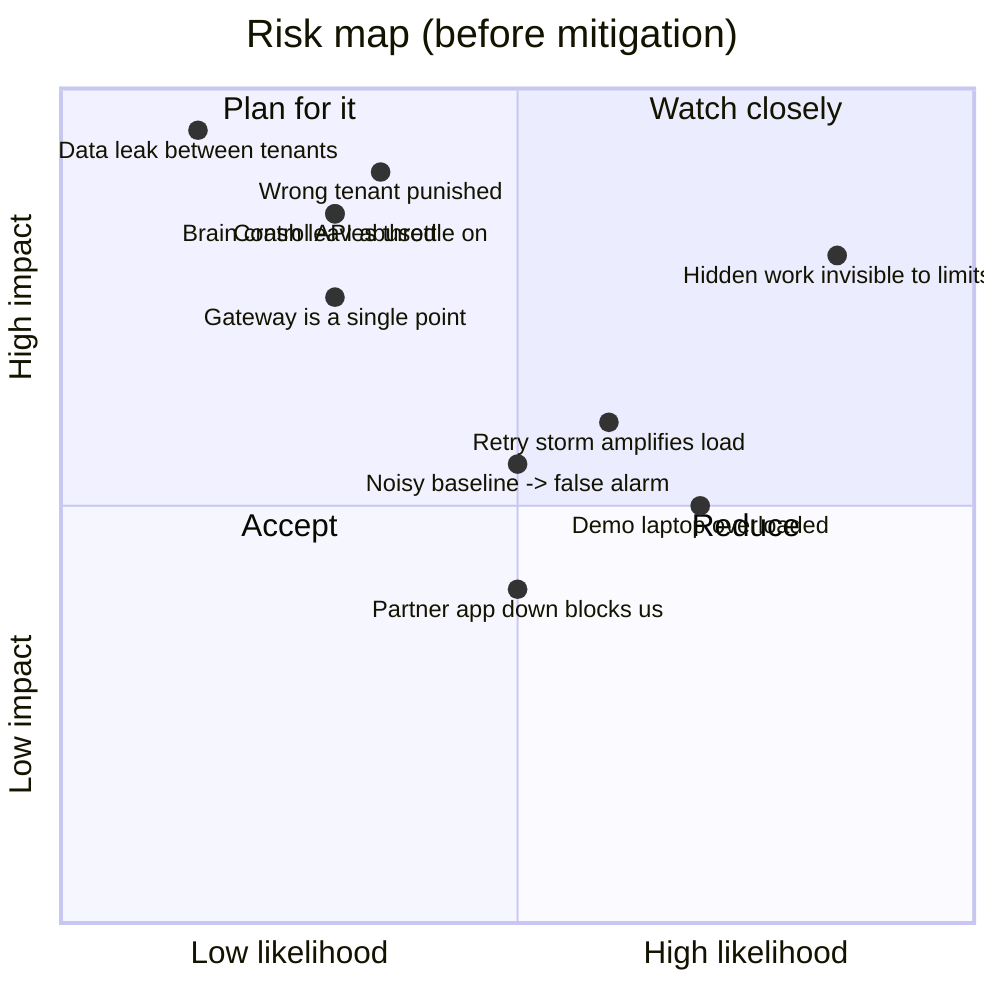

# 06: Risks and mitigations

Each risk lists what could go wrong, how likely and how bad it is, what TenantGuard does about it, and where that mitigation lives. Mitigations marked **in progress** are on task branches, not on `master`.

## 1. Correctness and fairness risks

| # | Risk | Mitigation | Where |
|---|---|---|---|
| R1 | **Punishing an innocent tenant** (a legitimate burst, or a tenant that merely shares a slow server) | A tenant is flagged only if it over-uses **and** its neighbours are hurt (`min_victim_impact`). Victims are rescued first, and the ladder acts only if harm persists. The decoder blames nobody for a single slow server or a fleet-wide slowdown. Holds and hysteresis stop flapping. The impact meter tracks `innocents_penalised`, which must stay empty | `brain/.../score.py`, `ladder.py`, `decoder.py`, `stage3.py`; `ImpactView` in contracts |
| R2 | **Hidden work invisible to the gateway** (background jobs, a vendor indexer) | The cost bucket is debited with worker-measured CPU, not an estimate. Server health by peer ratio catches harm that no meter attributes, and the barcode decoder names the tenant. Background CPU can be charged back through `POST /control/charge` (gateway ready; brain sender planned) | `gateway/.../buckets.py`, `core.py`; `worker/app/meter.py`, `blackbox.py`; `brain/` Stage 3 |
| R3 | **A whale starves cheap requests** | Weighted DRR per tenant; an express lane with reserved headroom; the gradient window keeps the queue at the gateway, where it is ordered fairly; bounded wait (503) | `gateway/.../scheduler.py`, `limiter.py`, `core.py` |
| R4 | **Retry storms amplify an outage** | A retry budget counts repeats of *failed* requests and repeated `Idempotency-Key`s; over budget → 429 `retry_budget` with an honest `Retry-After` | `gateway/.../retry.py` |
| R5 | **False alarms from a noisy baseline** (few requests per tick, slow drift) | Time-based baseline with a half-life, frozen while a neighbour over-uses; ticks with no completions are skipped; debounce (`open_after_ticks`); peer ratio plus an absolute-ms floor | `brain/.../score.py`, `health.py` |
| R6 | **Barcode ambiguity** (two culprits, or culprit vs host fault) | AG(2,3) layout: any two tenants share at most one server, so every single culprit and all 66 pairs decode exactly (tested); a lone slow server is a host suspect | `layouts/ag23.json`, `brain/.../decoder.py` |

## 2. Safety and availability risks

| # | Risk | Mitigation | Where |
|---|---|---|---|
| R7 | **The brain crashes while a tenant is throttled** | Every control override has a finite TTL (≤ `ttl_max_s`) and auto-reverts; the brain renews it only while needed. The gateway goes fail-static (keeps its config) but TTLs still expire, so nobody stays punished | `gateway/.../overrides.py`; brain action renewal |
| R8 | **Humans and automation fight** (an operator releases, the ladder re-throttles) | Human decisions go to the brain as `OperatorCmd` (release / extend / resume), and the ladder obeys the hold. The handoff bridge never sends raw limits | `brain/.../core.py` (`operator`), `integrations/handoff/.../cases.py` |
| R9 | **The gateway is a single point of failure** | Stateless apart from in-memory buckets and overrides; restarts in seconds; overrides re-adopted by the brain on start. A multi-gateway shared store is on the roadmap | `gateway/`; brain `adopt` logic |
| R10 | **A slow or dead partner app blocks incident handling** | Latest-wins outbox, never blocking, with backoff; cases are kept and delivered on recovery; history and case store are bounded | `integrations/handoff/.../outbox.py`, `bridge.py` |
| R11 | **Unbounded memory** (queues, cases, reports, histories) | Bounded per-tenant concurrency and queue wait; bounded WS subscriber queues (drop oldest); bounded case store, wire history and id map (T20); narrator `max_reports`; worker memory budgets and backlog caps | gateway `core.py`; handoff `cases.py`; `narrator/.../service.py`; `worker/app/memory.py`, `jobs.py` |
| R12 | **A worker or fault takes the fleet down** | cgroup limits per container (CPU, memory, pids); health → rescue routes around a slow server; drains never black-hole a tenant | `docker-compose.yml`; `gateway/.../router.py`; brain Stage 3 |

## 3. Security risks

| # | Risk | Mitigation | Where |
|---|---|---|---|
| R13 | **Unauthorised control** (anyone could throttle or block a tenant) | Control token on every `/admin/*` and `/control/*` endpoint and on the brain's `/api/operator`, compared in constant time; partner updates need `HANDOFF_PARTNER_TOKEN` and are refused when it is unset (fail-closed) | `gateway/.../app.py`; `brain/.../main.py`; `integrations/handoff/.../app.py` |
| R14 | **Path traversal to worker admin endpoints** | The raw path must provably stay under `/api/` (encoded `/`, `\`, NUL, `#`, `?`, dot segments and `//` rejected); the raw path is forwarded so the worker decodes exactly what was checked; client `X-TenantGuard-*` and `X-Admin-Token` headers are stripped | `gateway/.../security.py`, `core.py` |
| R15 | **Bad control input crashes or corrupts state** (Infinity TTL, NaN quota) | TTLs finite and ≤ `ttl_max_s`; quotas finite, > 0 and ≤ `quota_max`; validation errors on `/control/*` → 400 | `gateway/.../app.py`, `tenants.py` |
| R16 | **Memory exhaustion via large bodies** | Key, path and `Content-Length` are checked before the body is read; bodies are read as a capped stream (413) | `gateway/.../core.py`, `app.py`; `worker` body limit |
| R17 | **Tenant data leak** | Tenant identity only from the API key at the gateway; workers trust only gateway headers; one SQLite file per tenant; the repository takes the tenant only from context; unknown and case-variant tenant ids are rejected | `gateway/.../tenants.py`; `worker/app/tenancy.py`, `store.py` |
| R18 | **Customer messages reveal another tenant** | The customer message is built from an anonymised pack with no tenant, no server and no copied brain text (mutation-tested) | `narrator/.../evidence.py`, `template.py` |
| R19 | **Plain HTTP between services** | Designed for a closed network (Tailscale or LAN); tokens must be changed from `dev` outside the demo. TLS is a roadmap item | `docs/SETUP.md` |

## 4. Delivery and demo risks

| # | Risk | Mitigation |
|---|---|---|
| R20 | **The development laptop is too weak to run the stack** (latency tails are machine noise) | The heavy stack runs on a separate Docker host over Tailscale; only one session may run a local stack at a time; slide numbers come only from measured runs on the host |
| R21 | **A wave-2 attack is not ready on demo day** | `tools/demo.py` preflights the lab, skips attacks it cannot run, falls back from the black-box bomb to the whale, and can inject a server fault directly as a fallback |
| R22 | **Network change at the venue** | Tailscale address stable across networks; LAN IP as fallback; host ports and compose project name configurable for a frozen demo stack |
| R23 | **The demo leaves the system in a bad state** | Every step stops the previous attacks; the driver's cleanup always stops all attacks and returns to `tenantguard` mode, even on error or Ctrl-C |
| R24 | **Claims outrun the code** | Documentation marks unmerged work as in progress; scorecard numbers come only from `lab/results/*.json` (**to be measured**) |
