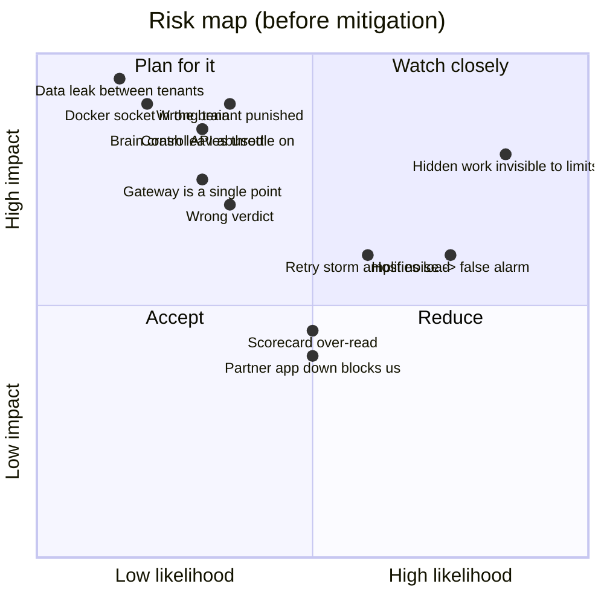

# 06: Risks and mitigations

Each risk lists what could go wrong, what TenantGuard does about it, and where that mitigation lives. Every mitigation listed here is merged on `master`. Where a risk is only partly covered, the row says so.

## 1. Correctness and fairness risks

| # | Risk | Mitigation | Where |
|---|---|---|---|
| R1 | **Punishing an innocent tenant** (a legitimate burst, or a tenant that merely shares a slow server) | A tenant is flagged only if it uses at least `over_use` (1.6) × its fair share **and** at least `min_hurt_neighbours` (4) neighbours are hurt. Victims are rescued first, and the ladder acts only if harm persists. The decoder blames nobody for a single slow server or a fleet-wide slowdown. No tenant is penalised without a proof: below `confidence_to_prove` (0.8), or when the relocation test does not confirm, the verdict is `mitigated_no_blame`. The impact meter tracks `innocents_penalised`; it stayed empty in every scorecard run | `brain/.../score.py`, `ladder.py`, `decoder.py`, `stage3.py`, `verdicts.py`; `ImpactView` in contracts |
| R2 | **Hidden work invisible to the gateway** (background jobs, a vendor indexer) | The cost bucket is debited with worker-measured CPU, not an estimate. Once a second the brain sends each tenant's background-job CPU to the gateway as a `ChargeCmd`, debited from that tenant's cost bucket (`tenantguard` mode only, idempotent `charge_id`). Black-box CPU, which no meter attributes, is caught by server health (peer ratio) and named by the barcode decoder. Billing adds an "unmetered" true-cost line for a named culprit | `gateway/.../buckets.py`, `core.py`; `brain/.../core.py` (`_charges`); `worker/app/meter.py`, `blackbox.py`; `billing/` |
| R3 | **A whale starves cheap requests** | Weighted DRR per tenant; an express lane with reserved headroom; the gradient window keeps the queue at the gateway, where it is ordered fairly; bounded wait (503) | `gateway/.../scheduler.py`, `limiter.py`, `core.py` |
| R4 | **Retry storms amplify an outage** | A retry budget counts repeats of *failed* requests and repeated `Idempotency-Key`s; over budget → 429 `retry_budget` with an honest `Retry-After` | `gateway/.../retry.py` |
| R5 | **False alarms from host noise** (CPU-quota stalls on 0.5-CPU containers, few requests per tick, slow drift) | This risk was real. In the first host acceptance run the calm step **failed**: in 270 s of calm traffic there were 78 server detections across all 9 servers, 20 culprits named and 19 ladder moves, from CFS throttling spikes (e.g. 54 ms against 5 ms). The brain was then calibrated: every signal must be *sustained* (a server opens only after `open_hold_s` 4 s with ≥ 80% slow ticks; levels use the 0.3 quantile of per-tick p95 over 5 s); a server is never slow below an SLA-tied floor (`min_slow_ms` 25 ms, or `sla_fraction` × the strictest SLA there); flagging needs `over_use` 1.6 and 4+ hurt neighbours; the warn hold is 5 s. The final acceptance run then **passed**: 0 ladder moves in calm, and the 2 real `w7` slowdowns were rerouted with no tenant blamed. `brain/tests/test_host_noise.py` simulates this host noise (1 to 3 s CPU-quota stalls of a whole server, tail spikes on 5% of cells) and checks that calm opens nothing while a real whale and a real host fault are still found | `tenantguard.yaml` `brain.noisy`, `brain.health`; `brain/.../health.py`, `score.py` |
| R6 | **Barcode ambiguity** (two culprits, or culprit vs host fault) | AG(2,3) layout: any two tenants share at most one server, so every single culprit and all 66 pairs decode exactly (tested); a lone slow server is a host suspect. A server where a hot tenant runs is a *held host*: it is not treated as a faulty host until that tenant has been judged (in the acceptance run `w1` and `w8` were held while K was judged) | `layouts/ag23.json`, `brain/.../decoder.py`, `stage3.py` |
| R7 | **A wrong verdict** (an honest tenant judged `costly_pattern` or `over_plan`; a busy host judged `host_fault`) | A verdict needs a confirmed proof: R = 1 − post/pre slowdown ≥ `recovery_R` (0.5) **and** the harm must follow the tenant to the spare (spare CPU up by ≥ 30% of its footprint, or spare latency ≥ 1.6× peers). A culprit that pauses during the test is not confirmed. Verdict evidence is captured *before* the test moves the tenant. Every verdict action is TTL-bound (relocation and quarantine 120 s), and every verdict event lists its reasons and readings. `host_fault` needs the server to stay ≥ `host_idle_ratio` (1.5) × its peers while drained and idle; otherwise it is undrained. Limits: only five verdicts exist, and a repeat offender (named 3 times in 10 min) gets its last verdict again at once, without a new proof | `brain/.../verdicts.py`, `stage3.py`, `prover.py` |

## 2. Safety and availability risks

| # | Risk | Mitigation | Where |
|---|---|---|---|
| R8 | **The brain crashes while a tenant is throttled or relocated** | Every control override has a finite TTL (≤ `ttl_max_s`) and auto-reverts; the brain renews it only while needed. The gateway goes fail-static (keeps its config) but TTLs still expire, so nobody stays punished. In the acceptance run 0 overrides were left at the end | `gateway/.../overrides.py`; brain action renewal |
| R9 | **The controller itself over-acts** (relocation storms, quarantining many tenants, draining several servers) | `ActionBudget`: at most `relocations_per_min` (6) proofs a minute, one quarantine every `quarantine_every_s` (30 s), at most `max_drained` (1) server drained, and a drain only while the other servers are below `drain_peer_busy` (75%) busy. Only one relocation test runs at a time (the spare is shared). A deferred proof or drain is said once, with its reason | `brain/.../verdicts.py` (`ActionBudget`), `prover.py`, `stage3.py` |
| R10 | **Humans and automation fight** (an operator releases, the ladder re-throttles) | Human decisions go to the brain as `OperatorCmd` (release / extend / resume), and the ladder obeys the hold. The handoff bridge never sends raw limits | `brain/.../core.py` (`operator`), `integrations/handoff/.../cases.py` |
| R11 | **The gateway is a single point of failure** | Stateless apart from in-memory buckets and overrides; restarts in seconds; overrides re-adopted by the brain on start. A multi-gateway shared store is not built | `gateway/`; brain `adopt` logic |
| R12 | **A slow or dead partner app blocks incident handling** | Latest-wins outbox, never blocking, with backoff; cases are kept and delivered on recovery; history and case store are bounded | `integrations/handoff/.../outbox.py`, `bridge.py` |
| R13 | **Unbounded memory** (queues, cases, reports, histories, worker heap) | Bounded per-tenant concurrency and queue wait; bounded WS subscriber queues (drop oldest); bounded case store, wire history and id map; narrator `max_reports`; billing `retention_h`; worker memory budgets, backlog caps, bounded class meters (`max_classes_per_tenant`) and memory returned to the OS (allocator tuning plus a periodic `malloc_trim`) | gateway `core.py`; handoff `cases.py`; `narrator/.../service.py`; `billing/`; `worker/app/memory.py`, `jobs.py`, `malloc.py`, `meter.py` |
| R14 | **A worker or fault takes the fleet down** | cgroup limits per container (CPU, memory, pids); health → rescue routes around a slow server; a confirmed host fault stays drained; drains never black-hole a tenant | `docker-compose.yml`; `gateway/.../router.py`; brain Stage 3 |
| R15 | **The prover cannot run** (no Docker socket, wrong stack, refused relocation) | `brain.prover: auto` falls back to `NullProver` when the socket is missing or no compose project is set: culprits are still named and victims rescued, but nobody is proved or penalised. If the spare cannot be resized, the test still runs on the spare as it is. A refused relocation restores the spare. If the incident ends during a test, the tenant is sent home and the spare restored. The spare's size is clamped (0.25 to 4 cores) | `brain/.../prover.py` (`make_prover`, `DockerProver`), `stage3.py` (`on_proof`) |

## 3. Security risks

| # | Risk | Mitigation | Where |
|---|---|---|---|
| R16 | **Unauthorised control** (anyone could throttle or block a tenant) | Control token on every `/admin/*` and `/control/*` endpoint and on the brain's `/api/operator`, compared in constant time; partner updates need `HANDOFF_PARTNER_TOKEN` and are refused when it is unset (fail-closed). The billing service is read-only | `gateway/.../app.py`; `brain/.../main.py`; `integrations/handoff/.../app.py`; `billing/` |
| R17 | **The Docker socket in the brain** (the socket gives control of the host's containers) | The brain uses only four Engine calls: `/_ping`, list and inspect containers, and `POST /containers/{id}/update` to change the spare's CPU. It acts only on the spare of its own stack, found by both compose labels (`com.docker.compose.project` = `COMPOSE_PROJECT` and `com.docker.compose.service` = `spare`) or an exact `TENANTGUARD_SPARE_CONTAINER`; an ambiguous or missing match is refused, and with no project set it does nothing. Residual risk: whoever controls the brain process controls the socket, so the brain must stay on a closed network | `brain/.../prover.py` (`EngineDocker`); `docker-compose.yml` |
| R18 | **Path traversal to worker admin endpoints** | The raw path must provably stay under `/api/` (encoded `/`, `\`, NUL, `#`, `?`, dot segments and `//` rejected); the raw path is forwarded so the worker decodes exactly what was checked; client `X-TenantGuard-*` and `X-Admin-Token` headers are stripped | `gateway/.../security.py`, `core.py` |
| R19 | **Bad control input crashes or corrupts state** (Infinity TTL, NaN quota, negative charge) | TTLs finite and ≤ `ttl_max_s`; quotas finite, > 0 and ≤ `quota_max`; `ChargeCmd.cpu_ms` finite and ≥ 0; validation errors on `/control/*` → 400 | `gateway/.../app.py`, `tenants.py` |
| R20 | **Memory exhaustion via large bodies** | Key, path and `Content-Length` are checked before the body is read; bodies are read as a capped stream (413) | `gateway/.../core.py`, `app.py`; `worker` body limit |
| R21 | **Tenant data leak** | Tenant identity only from the API key at the gateway; workers trust only gateway headers; one SQLite file per tenant; the repository takes the tenant only from context; unknown and case-variant tenant ids are rejected | `gateway/.../tenants.py`; `worker/app/tenancy.py`, `store.py` |
| R22 | **Customer-facing text reveals another tenant** | The narrator's customer message is built from an anonymised pack with no tenant, no server and no copied brain text (mutation-tested). Billing never copies the brain's `detail` text; a victim's bill and "Why was I slow?" never name the culprit, and incidents a victim suffered appear only as opaque `ref-<8 hex>` ids (tested) | `narrator/.../evidence.py`, `template.py`; `billing/.../timeline.py`, `bill.py` |
| R23 | **Plain HTTP between services** | Designed for a closed network (Tailscale or LAN); tokens must be changed from `dev` outside the demo. TLS is not built | `docs/SETUP.md` |

## 4. Measurement, delivery and demo risks

| # | Risk | Mitigation |
|---|---|---|
| R24 | **The development laptop is too weak to run the stack** (latency tails are machine noise) | The heavy stack runs on a separate Docker host; slide numbers come only from measured runs on the host. The scorecard and the acceptance run used the lab container on the host |
| R25 | **The scorecard is over-read** | The measured table is reported as it is. Caveats: (1) on whale and flood the gateway limits that Industry and TenantGuard share contain the attacker first, so Industry ≈ TenantGuard there and the brain named no culprit in those runs; the brain's own value is shown by the host acceptance run, not by this table. (2) One OFF-mode flood run (`20261012-222805-flood-off.json`) recorded 1,522 attacker 429s, which OFF (no admission) should not produce; it is most likely a carry-over from the previous mode switch, and the medians over 3 runs per cell limit its effect. The 6,415 attacker 503s in another OFF flood run (`20261012-222323-flood-off.json`) are expected: the bounded queue wait applies in every mode. (3) Only whale and flood were measured, 3 runs per cell, attacker K. The runner interleaves modes inside each repetition so that host drift does not favour one mode |
| R26 | **An attack is not available on demo day** | The second-wave attacks are not included. `tools/demo.py` preflights the lab, skips attacks it cannot run, falls back from the black-box bomb to the whale, and injects the faulty server directly through the worker's `/admin/fault` |
| R27 | **Network change at the venue** | Tailscale address stable across networks; LAN IP as fallback; host ports and compose project name configurable for a frozen demo stack |
| R28 | **The demo leaves the system in a bad state** | Every step stops the previous attacks; the driver's cleanup always stops all attacks, clears faults and returns to `tenantguard` mode, even on error or Ctrl-C |
| R29 | **Claims outrun the code** | The documents describe only merged code; anything not built is called "not included" or "not built"; numbers come only from `lab/results/*.json`, `worker/calibration.json`, test assertions and the recorded acceptance run |
