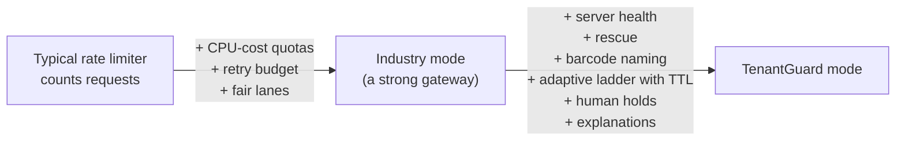

# 07: Unique features

What TenantGuard does that a rate limiter, or a typical fair-share API gateway, does not. Each item says what is built on `master` and where; work still on task branches is marked **in progress**.

## 1. Quotas on real resources, measured by the worker
A rate limiter counts requests; TenantGuard's cost bucket is debited with the **CPU each request actually used**, measured on the worker with the handler thread's CPU clock and returned in `X-TenantGuard-Cpu-Ms`. A tenant sending few but heavy requests is refused with reason `cost` and an accurate `Retry-After`. Concurrency and a retry budget are separate dimensions, and every refusal names the dimension that failed.
Where: `worker/app/meter.py`, `gateway/tenantguard_gateway/buckets.py`, `admission.py`, `core.py`.

## 2. Seeing harm nobody bills for
`worker/calibration.json` shows the problem: `POST /api/ingest` reports **0.066 ms** of handler CPU but causes **20.25 ms** in an unattributed black-box indexer. No request meter can see that. TenantGuard does not need to: it watches each server's latency against its peers, so the harm shows up wherever it lands.
Where: `worker/app/blackbox.py`, `brain/tenantguard_brain/health.py`.

## 3. Naming the culprit with a "barcode"
Tenants are placed on servers with an AG(2,3) design: each tenant gets 3 of 9 servers, and **any two tenants share at most one server**. The set of slow servers therefore decodes to the tenant whose barcode matches, with a confidence. If one server is slow on its own, no barcode explains it, so it is a host fault and nobody is blamed. The tests show every single culprit and **all 66 culprit pairs** are named exactly.
Where: `layouts/ag23.json`, `brain/tenantguard_brain/decoder.py`, `stage3.py`.

## 4. Victims first: rescue before punishment
When servers turn slow, the brain first moves the innocent tenants to their other, healthy servers (route weights), keeping every server under the 70% capacity guard. The throttle ladder only acts if harm persists. Victims recover in seconds without anyone being throttled.
Where: `brain/tenantguard_brain/rescue.py`, `gateway/tenantguard_gateway/router.py`.

## 5. A graduated, self-recovering throttle ladder
The ladder goes normal → warn → throttle (AIMD × 0.5 steps) → deprioritize (scheduler weight × 0.25) → quarantine, with hold times, hysteresis and step-wise recovery (+0.1 per tick). A tenant is flagged only if it over-uses **and** its neighbours are hurt, so a legitimate burst with no victims never leaves `normal` (tested).
Where: `brain/tenantguard_brain/score.py`, `ladder.py`, `core.py`.

## 6. Every action undoes itself
Every control command carries a TTL (finite, ≤ 1 hour) and reverts on its own; the brain renews it only while needed. If the brain stops sending heartbeats, the gateway keeps its last configuration (fail-static), but the TTLs still expire. A dead control plane can never leave a tenant punished.
Where: `gateway/tenantguard_gateway/overrides.py`, `app.py`.

## 7. Humans and automation never fight
An operator's release / extend / resume goes to the brain as an `OperatorCmd`, and the ladder obeys the hold. A block always needs a human approval and is TTL-bound.
Where: `brain/tenantguard_brain/core.py` (`operator`), `integrations/handoff/`.

## 8. Fair scheduling that keeps the queue where it can be ordered
Three weighted-DRR lanes (express › interactive › batch):
- **Express** requests use reserved headroom.
- **Batch** is shed first when a worker saturates.
- **Window:** a per-worker gradient window, computed on *excess* latency (latency minus the request's own CPU), shrinks when a worker is congested, so queueing happens at the gateway, in fair order, instead of inside the worker.

In a live comparison with a whale saturating a worker, the express lane cut the victim's gateway queue wait from a median of 358 ms to 49 ms (development laptop, not a slide number).
Where: `gateway/tenantguard_gateway/scheduler.py`, `limiter.py`, `core.py`.

## 9. An honest baseline: three switchable modes
`off`, `industry` and `tenantguard` run in the same gateway, switched live. `industry` is everything a good gateway does on its own (CPU-cost quotas, retry budget, fair lanes, adaptive window), so the comparison with `tenantguard` isolates exactly what the adaptive loop adds. The lab writes one measured result file per scenario and mode for the scorecard (**to be measured**).
Where: `gateway/tenantguard_gateway/core.py`, `lab/tenantguard_lab/scenario.py`.

## 10. Every step is explained
- **Brain events:** every event carries a plain-English `detail` (why), and every action carries its command and TTL.
- **Dashboard:** the UI shows tiles, the server grid, the incident timeline, a flow view and an impact panel (revenue protected, customers shielded, innocents penalised).
- **Narrator:** writes a deterministic incident report per incident and an anonymised customer message that never names another tenant or a server.

Where: `brain/`, `ui/src/pages/`, `narrator/`.

## 11. Built for the on-call handover (Web PS3 convergence)
Every incident becomes a case in the partner's Digital Handoff app, with:
- an owner;
- pending actions with deadlines;
- history, sent again on every change (latest-wins, never blocking).

The engineer's acknowledge, approve, extend, release or resolve flows back and takes effect live. A missed deadline falls back to TenantGuard's safe default (the timers).
Where: `integrations/handoff/`.

## 12. Security as a feature
- **Control token:** required on every control and admin endpoint.
- **Path guard:** forwards the raw path, so traversal to worker admin endpoints is impossible.
- **Bounded inputs:** TTLs and quotas must be finite and within limits.
- **Body handling:** bodies are capped, and are not read before authentication.
- **Partner endpoint:** fail-closed.
- **Isolation:** tenant data is isolated per SQLite file, and the repository takes the tenant only from context.

Where: `gateway/tenantguard_gateway/security.py`, `app.py`; `worker/app/tenancy.py`, `store.py`.

## Still in progress (not on `master`)
- **Relocation prover:** move a suspect to the spare and show the slowdown follows it. **In progress** (T12).
- **Five verdicts:** costly pattern, over plan, honest growth, host fault, mitigated / no blame. **In progress** (T12).
- **Wave-2 attacks:** black-box bomb, background bomb, cache flood, faulty server, honest spike. **In progress** (T10).
- **Fair billing with SLA credits and "Why was I slow?":** **in progress** (T17).
