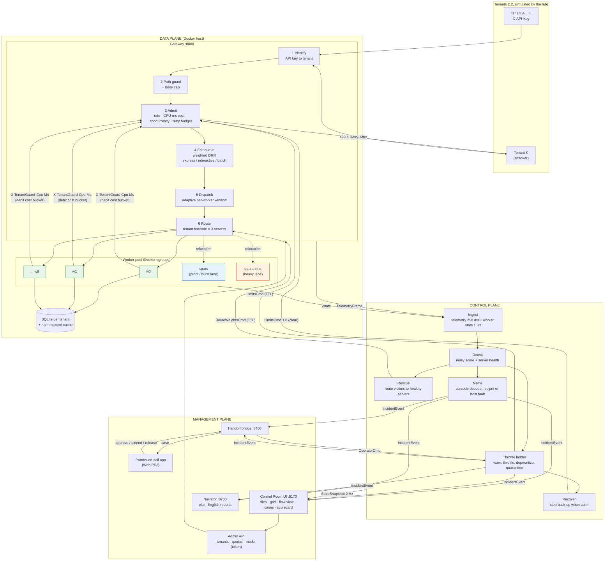
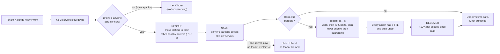
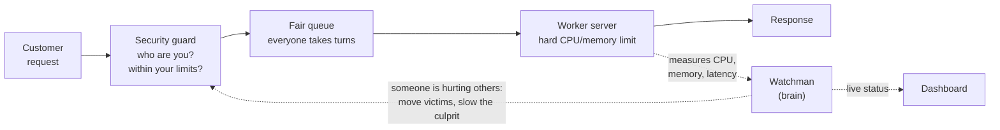

# 08: Architecture Flow Diagram

This page shows the whole of TenantGuard as one flow: a tenant's request goes in, gets protected, and is measured, and the loop protects everyone else. For details, see `02_ARCHITECTURE.md` (components), `05_SEQUENCE_DIAGRAMS.md` (step-by-step messages) and the `11_FILES_*.md` catalogs (every function).

---

## 1. End-to-end flow (technical)

---

## 2. The protection loop (what happens during an attack)

---

## 3. Simple version (for non-technical listeners)

---

## 4. Where each box lives in the code

| Box in the diagram | Code |
|---|---|
| Identify, path guard, admit | `gateway/tenantguard_gateway/tenants.py`, `security.py`, `admission.py`, `buckets.py`, `retry.py` |
| Fair queue, dispatch, route | `gateway/tenantguard_gateway/scheduler.py`, `limiter.py`, `router.py`, `core.py` |
| Telemetry out of the gateway | `gateway/tenantguard_gateway/telemetry.py` |
| Worker app, per-tenant data | `worker/app/main.py`, `tenancy.py`, `store.py`, `cache.py`, `memory.py`, `jobs.py`, `blackbox.py` |
| Ingest, detect, ladder | `brain/tenantguard_brain/runtime.py`, `core.py`, `score.py`, `ladder.py` |
| Server health, rescue, naming | `brain/tenantguard_brain/health.py`, `rescue.py`, `decoder.py`, `stage3.py` |
| Operator decisions | `brain/tenantguard_brain/main.py` (`POST /api/operator`) |
| Dashboard | `ui/src/` |
| Handoff to the partner app | `integrations/handoff/tenantguard_handoff/` |
| Incident reports | `narrator/tenantguard_narrator/` |
| Shared message formats | `common/tenantguard_common/contracts.py` |
| Every tunable | `tenantguard.yaml` |

**Status:** proving the culprit by relocation to the spare, the five verdicts and the calibrated health thresholds are **in progress** (T12). The attacks beyond flood/whale/hog/memory/retry storm and the scorecard runner are **in progress** (T10). Fair billing is **in progress** (T17).
