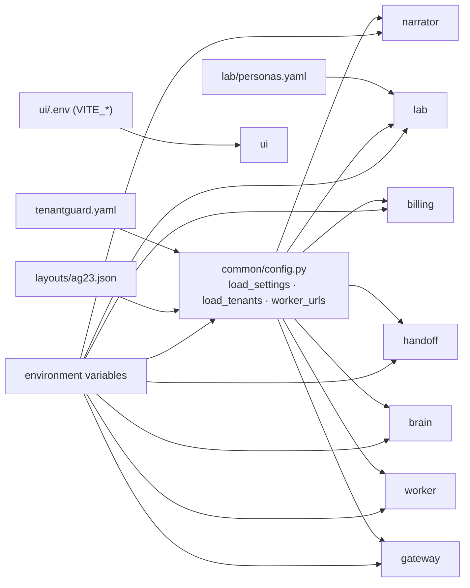

# 09: Configuration reference

Every tunable value lives in `tenantguard.yaml`, read through `common/tenantguard_common/config.py` (`load_settings()`, `load_tenants()`, `worker_urls()`). The traffic lab's own tunables live in `lab/personas.yaml`. Environment variables are only for deployment concerns (URLs, ports, tokens, paths, the prover switch). This page lists every yaml key, environment variable, port and token on `master`.

## 1. `tenantguard.yaml`

### Top level
| Key | Value | Used by | Meaning |
|---|---|---|---|
| `layout` | `layouts/ag23.json` | all Python services (`load_tenants`) | The tenant layout: id, name, tier, 3 servers, demo API key, monthly revenue, protected flag, `sla_p95_ms` (see the layout section below) |
| `workers.<name>` | `w0..w8` → `http://127.0.0.1:8100..8108`, `spare` → `:8109`, `quarantine` → `:8110` | gateway, brain, lab, billing | Worker base URLs for local runs; `TENANTGUARD_WORKER_URLS` overrides them in compose |
| `services.<name>` | gateway `:8000`, brain `:8200`, lab `:8300`, handoff `:8400`, billing `:8600`, narrator `:8700` | every service and `tools/demo.py` | Default peer URLs and each service's own port |

### `tiers`
| Tier | `weight` | `rate_rps` | `burst` | `cost_ms_per_s` | `concurrency` |
|---|---|---|---|---|---|
| `enterprise` | 4 | 100 | 200 | 600 | 16 |
| `pro` | 2 | 50 | 100 | 300 | 8 |
| `free` | 1 | 20 | 40 | 150 | 4 |

- `weight`: the scheduler weight (DRR quantum multiplier).
- `rate_rps` / `burst`: token-bucket refill (requests/s) and capacity.
- `cost_ms_per_s`: CPU-ms bucket refill; capacity = `cost_ms_per_s × gateway.cost_bucket_s`.
- `concurrency`: maximum queued + in-flight requests per tenant.

### `gateway`
| Key | Value | Meaning |
|---|---|---|
| `default_mode` | `tenantguard` | Mode at start (`off` / `industry` / `tenantguard`) |
| `tick_ms` | 250 | Telemetry frame period; also the limiter update period |
| `max_queue_wait_ms.interactive` / `.batch` | 1000 / 5000 | Bounded queue wait; expired requests get 503 and are never forwarded |
| `cost_bucket_s` | 2 | Cost-bucket capacity in seconds of refill |
| `express_cost_ms` | 5 | Classes whose reference cost is below this use the express lane |
| `fail_static_after_s` | 2 | No brain heartbeat for this long → `fail_static` = true (config kept, TTLs still expire) |
| `batch_routes` | `["/api/export"]` | Paths that always use the batch lane (also `X-TenantGuard-Class: batch`) |
| `upstream_timeout_s` | 30 | Timeout for a forwarded request (env `TENANTGUARD_UPSTREAM_TIMEOUT_S` overrides) |
| `ttl_max_s` | 3600 | Every control TTL must be finite and in (0, this], else 400 |
| `quota_max` | rate 10000, burst 20000, cost 100000, concurrency 1024 | Upper bounds for quota POST/PATCH (also finite and > 0) |
| `retry_budget` | ratio 0.1, window_s 10, min_allowed 3 | Retries allowed ≤ max(min_allowed, ratio × first attempts in the window), else 429 `retry_budget` |
| `limiter` | min_window 2, max_window 64, initial_window 8 | Bounds and start value of the per-worker gradient concurrency window |

### `worker`
| Key | Value | Meaning |
|---|---|---|
| `cpus` / `mem_limit_mb` | 0.5 / 256 | Container limits (compose); `cpu_limit_cores` in `/stats` |
| `body_limit_bytes` | 1048576 | Request body cap (413); the gateway enforces the same cap before forwarding |
| `tenant_mem_budget_mb` | 32 | Per-tenant held memory + cache bytes (507 beyond) |
| `cache_mb` / `cache_guaranteed_share` | 8 / 0.125 | Shared cache size and each tenant's guaranteed slice |
| `bg_threads` | 4 | Background job threads |
| `seed_rows` | 1000 | Rows seeded per tenant SQLite file |
| `blackbox.cpu_ms_per_doc` / `.queue_max` | 2.0 / 5000 | The unattributed "vendor indexer" cost per ingested document, and its queue cap |
| `max_request_s` | 30 | Any single request must finish within this |
| `bg_pending.per_tenant` / `.total` | 200 / 1000 | Background backlog caps (503 `bg_backlog`) |
| `mem_baseline_mb` | 80 | RSS reserved for the process; worker-wide memory cap = `mem_limit_mb` − this |
| `memory_trim_s` | 30 | Interval of the background `malloc_trim(0)` that returns free heap pages to the OS (glibc only; 0 disables) |
| `max_classes_per_tenant` | 256 | Distinct request classes metered per tenant; further classes are counted under `other`, so a client cannot grow the meter without bound |

### `brain`
Read by `brain/tenantguard_brain/settings.py` and the `from_yaml` methods of `LadderParams`, `HealthParams`, `DecoderParams`, `VerdictParams`, `ProverParams` and `ActionBudget`. Every key has a code default, used when the key is missing.

**Loop**

| Key | Value | Meaning |
|---|---|---|
| `tick_ms` | 250 | Brain loop period |
| `stats_poll_s` | 1.0 | Worker `/stats` poll period |

**`noisy`: Stage 2 detector, victims and ladder**

| Key | Value | Meaning |
|---|---|---|
| `noisy.warn` / `.throttle` / `.quarantine` | 1.5 / 2.0 / 4.0 | Noisy-score thresholds of the ladder (also sent to the UI as `noisy_thresholds`) |
| `noisy.recover_below` | 1.0 | Score under which recovery starts |
| `noisy.hold_s` | warn 5, throttle 2, deprioritize 4, quarantine 6, recover 10 | How long a condition must hold before a level change |
| `noisy.throttle_factor` / `.recover_step` | 0.5 / 0.1 | AIMD: multiply quota by 0.5 per throttle step; add 0.1 per recovery tick. `throttle_factor` is also the cut applied on an `over_plan` verdict |
| `noisy.min_victim_impact` | 0.2 | Neighbours must be hurt at least this much before anyone is flagged |
| `noisy.baseline_alpha` | 0.05 | Legacy per-frame EWMA, superseded by `baseline_half_life_s` (not read) |
| `noisy.baseline_half_life_s` | 60 | Time-based EWMA of the calm baseline p95; frozen while a neighbour over-uses |
| `noisy.hold_ratio` | 0.8 | A level holds if at least this share of ticks in the hold window are above threshold |
| `noisy.recover_tick_s` | 1.0 | Recovery step period |
| `noisy.throttle_floor` | 0.25 | Lowest AIMD factor before deprioritize |
| `noisy.deprioritize_weight` | 0.25 | Weight factor at deprioritize |
| `noisy.quarantine_factor` / `.quarantine_weight` | 0.1 / 0.1 | Quota and weight factors at quarantine |
| `noisy.victim_window_s` | 5.0 | Victim latency is a sustained statistic over this window |
| `noisy.victim_quantile` | 0.3 | Quantile of the per-tick p95 in that window (robust to short CPU-quota stalls) |
| `noisy.victim_min_ticks` | 4 | Ticks with completions needed in the window |
| `noisy.victim_abs_ms` | 8.0 | A victim must be at least this many ms above its baseline |
| `noisy.over_use` | 1.6 | A tenant is flagged only above this multiple of its fair share; also the per-server "hot tenant" test for held hosts |
| `noisy.min_hurt_neighbours` | 4 | ... and only when at least this many of its neighbours are hurt |

**`health`: Stage 3 server health and canaries**

| Key | Value | Meaning |
|---|---|---|
| `health.probe_window_ticks` | 8 | Ticks of history for server health (also sets the victim detection window) |
| `health.slow_peer_ratio` / `.slow_abs_ms` | 1.6 / 8 | A server is slow if its level is ≥ 1.6× its peers and ≥ 8 ms above them. `slow_peer_ratio` is also the decoder's centre and the default `verdicts.harm_follow_ratio` |
| `health.open_after_ticks` | 4 | Legacy; persistence is now `open_hold_s` |
| `health.window_s` | 5.0 | Window of per-tick p95 samples for a server's level |
| `health.level_quantile` | 0.3 | Cell level = this quantile of per-tick p95 over `window_s` |
| `health.open_hold_s` / `.heal_hold_s` | 4.0 / 2.0 | A server opens (heals) only after this long with ≥ `hold_ratio` slow (healthy) ticks |
| `health.hold_ratio` | 0.8 | Share of ticks needed for open / heal |
| `health.min_slow_ms` | 25.0 | A server is never slow below this absolute level ... |
| `health.sla_fraction` | 0.5 | ... nor below this fraction of the strictest tenant SLA (`sla_p95_ms`) on the server |
| `health.min_cell_requests` | 5 | Requests a (tenant, server) cell needs to count |
| `health.min_tenants` | 2 | Tenants a server needs to be judged on traffic |
| `health.canary_s` | 1.0 | Canary probe period |
| `health.min_canaries` / `.canary_window_s` | 3 / 6.0 | Canary samples and window when a server has too little traffic |
| `health.canary_abs_ms` | 8.0 | Canaries can keep a slow server open, never open one |

**Rescue, proof and verdicts**

| Key | Value | Meaning |
|---|---|---|
| `rescue_capacity_guard` | 0.7 | Rescue never pushes a healthy server over 70% CPU |
| `confidence_to_prove` | 0.8 | Minimum culprit confidence to start a relocation proof; below it the verdict is `mitigated_no_blame`. Also the handoff bridge's "named" threshold |
| `spare_sizing` | 1.25 | The spare is resized to this × the suspect's CPU footprint (clamped to 0.25 to 4 cores) |
| `prove_settle_s` / `prove_window_s` | 2 / 6 | Wait after the relocation (or drain), then measuring window |
| `recovery_R` | 0.5 | Proof confirmed only if R = 1 − post/pre slowdown ≥ this (and the harm followed) |
| `paid_share_costly` | 0.35 | Paid share of the footprint below this → `costly_pattern` |
| `host_idle_ratio` | 1.5 | A drained, idle server still ≥ this × its peers → `host_fault` |
| `ttl_s.relocate` / `.quarantine` / `.throttle` | 120 / 120 / 60 | TTL of relocations and drains (also the proof's relocation) / quarantine relocations and ladder quarantine / ladder throttle |
| `ttl_s.probation` | 300 | Present in the yaml; not read by any service on `master` |
| `action_budget.relocations_per_min` | 6 | Relocation proofs per minute; more are deferred |
| `action_budget.quarantine_every_s` | 30 | At most one quarantine per this many seconds |
| `action_budget.max_drained` | 1 | Servers drained at once |
| `action_budget.drain_peer_busy` | 0.75 | A drain test runs only while the other servers are below this utilisation |
| `prover` | `auto` | `auto` (Docker prover when the socket answers and a compose project is set, else none), `docker` (must work, else the brain fails at start), `null` (no proof: culprits are named only). Env `TENANTGUARD_PROVER` wins |
| `charge_s` | 1.0 | Period of the background-CPU `ChargeCmd` to the gateway |

**`decoder`: barcode decoder** (`brain/tenantguard_brain/decoder.py`)

| Key | Value | Meaning |
|---|---|---|
| `k` | 8 | Logistic steepness of p(server slow) around `health.slow_peer_ratio` |
| `w_min` / `w_mean` / `w_stuck` / `w_ledger` | 4 / 2 / 1 / 2 | Evidence weights: all of a tenant's servers slow; share of unexplained slowness covered; every server it can use is slow; ledger hints (background CPU, evictions, black-box growth, over fair share) |
| `w_host` / `w_none` | 4 / 3 | Weights of the "host fault" and "nothing is slow" options |
| `temperature` | 1.0 | Softmax temperature for the confidences |
| `min_confidence` | 0.5 | Tenants together must hold at least this to accept a tenant |
| `max_culprits` | 2 | Explain-away rounds (names up to two culprits) |
| `host_p` | 0.5 | Residual p(slow) above this makes a server a host suspect |

**`verdicts`** (`brain/tenantguard_brain/verdicts.py`)

| Key | Value | Meaning |
|---|---|---|
| `over_plan_rejected_share` | 0.2 | Admission refusing ≥ this share of its requests → `over_plan` |
| `harm_follow_share` | 0.3 | Harm followed if the spare's CPU rose by ≥ this share of the footprint ... |
| `harm_follow_ratio` | 1.6 | ... or the spare's latency reached this peer ratio |
| `evidence_hint` | 0.3 | A black-box or eviction hint above this counts as `costly_pattern` evidence |
| `repeat_count` / `repeat_window_s` | 3 / 600 | Named this many times within this window = repeat offender (last verdict applied again without a new proof) |

Keys read with a code default but not written in the yaml: `verdicts.prove_sample_s` (0.5 s sampling during a proof), `verdicts.min_spare_cores` / `max_spare_cores` (0.25 / 4.0), and `ttl_s.rescue` (falls back to `ttl_s.relocate`).

### `handoff`
| Key | Value | Meaning |
|---|---|---|
| `decision_window_s` | 120 | Deadline given to the on-call for a pending action |
| `block_s` | 300 | Duration of an approved block (always TTL-bound, ≤ `gateway.ttl_max_s`) |
| `extend_s` | 120 | Hold duration for extend / release (`OperatorCmd.until_s`) |
| `push_timeout_s` | 3 | Timeout for a POST to the partner app and for control calls |
| `retention_s` | 3600 | Closed/resolved cases are evicted this long after they close |
| `history_wire_max` | 50 | History items sent to the partner per case (+ an "N earlier events" line) |
| `history_keep` | 500 | History items kept per case in memory (older ones counted, not kept) |
| `id_map_max` | 2000 | incident_id → case_id entries kept and persisted (live cases always keep their ids) |

### `billing`
Read by `billing/tenantguard_billing/settings.py` (code defaults in `DEFAULTS` are the same values).

| Key | Value | Meaning |
|---|---|---|
| `poll_s` | 5 | Period of the worker `/stats`, brain `/api/incidents` and gateway `/admin/tenants` poll |
| `bucket_s` | 60 | Metering bucket length |
| `retention_h` | 24 | Buckets and history kept |
| `price_rs_per_cpu_s` | enterprise 0.40, pro 0.60, free 0.80 | Price per CPU second by tier |
| `db_price_rs_per_s` | 0.0 | Price per second of SQLite time (0 = the `db` line is informational) |
| `ref_alpha` | 0.2 | EWMA weight of a calm bucket in the calm reference cost per (tenant, class) and per class |
| `sla_default_p95_ms` | 100 | SLA for a tenant the layout does not know (layout tenants use their own `sla_p95_ms`) |
| `sla_credit_table` | 2 s → 2%, 10 s → 4%, 60 s → 10%, 300 s → 25% | Credit (percent of the period's usage subtotal) by seconds of SLA violation |
| `unmetered_min_confidence` | 0.6 | A named culprit gets the "unmetered" true-cost line only at or above this confidence |

### Layout fields used as configuration (`layouts/ag23.json`)
| Field | Meaning |
|---|---|
| `tier` | `enterprise` (D, F, J, L), `pro` (A, B, E, H, K), `free` (C, G, I); sets weight and quota from `tiers`. No server carries more than two enterprise tenants |
| `sla_p95_ms` | Per-tenant end-to-end p95 target: D 40; A, F, J, L 50; B, E, H, K 80; C, G, I 150. Used by billing (credits, "Why was I slow?"), the brain's health floor (`health.sla_fraction`) and the lab personas |
| `monthly_revenue_rs`, `protected` | Impact numbers and the protected badge |

### `narrator`
| Key | Value | Meaning |
|---|---|---|
| `max_reports` | 200 | Reports kept in memory (oldest evicted) |

### Lab (`lab/personas.yaml`, read by `lab/tenantguard_lab/settings.py`)
`tenantguard.yaml` has no `lab:` section. The lab reads `services`, `workers` and `worker.cpus` from it, and everything else from its own file (path override `TENANTGUARD_LAB_PERSONAS`).

| Key | Value | Meaning |
|---|---|---|
| `rate_scale` | 1.0 | Multiplies every persona's rate (env `TENANTGUARD_LAB_RATE_SCALE` wins) |
| `autostart` | true | Start calm traffic when the lab server boots (env `TENANTGUARD_LAB_AUTOSTART=0` disables) |
| `default_attacker` | K | Tenant used by `/lab/run` when `RunReq.tenant` is empty |
| `target_fleet_util` | 0.30 | Calibration target (share of fleet CPU at calm) |
| `client.timeout_s` | 10.0 | Per-request timeout |
| `client.max_inflight_per_tenant` | 64 | Calm traffic: arrivals beyond this are counted as `client_dropped` |
| `client.max_inflight_per_attack` | 512 | In-flight cap per attack |
| `client.attack_isolation` | `process` | Each attack in its own process (`inline` = same loop, for tests) |
| `client.keyspace` | 1000 | `/api/read` and `/api/write` keys `k0000..k0999` (matches `worker.seed_rows`) |
| `endpoints.<kind>` | light, read, search (`n` 200000), write | Method, path, params and `est_cpu_ms` (for the calibration printout only) |
| `mix` | light 0.45, read 0.30, search 0.15, write 0.10 | Default request mix (normalised) |
| `personas.<id>` | `rps` 5 to 14, `end_users`, optional `mix`, `note` | Per-tenant calm behaviour; names, tiers and SLA come from the layout |
| `attacks.flood` | multiplier 10, endpoint light | 10× persona rps of `/api/light` |
| `attacks.whale` | rps 2.0, `n` 1500000, max_inflight 32 | Few, very heavy `/api/search` |
| `attacks.hog` | concurrency 24, `/api/export` rows 1000, chunk 50, pause_ms 50 | Closed-loop long exports |
| `attacks.memory` | rps 4.0, mb 24, hold_ms 1000, max_inflight 32 | Overlapping holds over the 32 MB tenant budget |
| `attacks.retry_storm` | multiplier 3, endpoint read, max_retries 50 | Retries at once on 429/503, ignoring `Retry-After` |
| `attacks.blackbox_bomb` | rps 10, docs 60 | `POST /api/ingest`: a cheap metered handler, about 120 ms of unmetered black-box CPU each |
| `attacks.background_bomb` | rps 8, index_rounds 20000 | `POST /api/write`: cheap handler, about 140 ms of background indexing each (charged as `bg_cpu_ms`) |
| `attacks.cache_flood` | multiplier 4, keyspace 10000000 | 4× persona rps of `/api/read`, every key new (all cache misses) |
| `attacks.honest_spike` | multiplier 3 | 3× the tenant's own request mix: busy but within its plan |
| `attacks.faulty_server` | latency_ms 150, cpu_burn_pct 30 | Fault put on `AttackReq.server` through `/admin/fault`, cleared when the attack stops |
| `run.warmup_s` / `.cold_start_s` | 3 / 10 | Discarded warm-up; extra warm-up if calm traffic was off |
| `run.recover_ratio` / `.recover_hold_s` | 1.5 / 5 | Recovered when victim p99 ≤ 1.5× baseline for 5 s |
| `run.bucket_s` | 1.0 | Latency bucket for the run timeline |
| `run.victim_kinds` | `[light, read]` | Request kinds whose latency counts as the victims' SLO (`[]` = every calm request) |

The five second-wave profiles (`blackbox_bomb` to `faulty_server`) are starting points sized from `worker/calibration.json` (2 ms CPU per black-box doc, about 7 µs per index round). They have not been measured on the Docker host yet; re-check them there. The bombs should push the attacker's servers past about 80% CPU while its request rate and metered cost stay inside the pro quota (50 req/s, 300 cost-ms/s).

## 2. Environment variables

| Variable | Read by | Default | Meaning |
|---|---|---|---|
| `TENANTGUARD_ROOT` | `common/config.py` | repo root | Where `tenantguard.yaml` and `layouts/` live (`/app` in containers) |
| `TENANTGUARD_CONFIG` | `common/config.py` | `$ROOT/tenantguard.yaml` | Alternative config file |
| `TENANTGUARD_LAYOUT` | `common/config.py` | `$ROOT/<layout>` | Alternative layout file |
| `TENANTGUARD_WORKER_URLS` | `common/config.py` → gateway, brain, lab, billing, demo driver | yaml `workers` | `w0=http://..,w1=..,spare=..` |
| `TENANTGUARD_GATEWAY_URL` | brain, lab, handoff, billing, `tools/demo.py`, gateway tools | yaml `services.gateway` | Gateway URL |
| `TENANTGUARD_BRAIN_URL` | lab, handoff, narrator, billing, `tools/demo.py` | yaml `services.brain` | Brain URL |
| `TENANTGUARD_LAB_URL` | lab CLI, `tools/demo.py` | yaml `services.lab` | Lab URL |
| `TENANTGUARD_CONTROL_TOKEN` | gateway, brain, lab, handoff, billing, `tools/demo.py`, gateway and brain tools | `dev` | Shared control token (see Tokens) |
| `TENANTGUARD_CORS_ORIGINS` | gateway, brain, handoff, narrator, billing | `http://127.0.0.1:5173,http://localhost:5173` (billing: `http://127.0.0.1:5173`) | Allowed UI origins |
| `TENANTGUARD_UI_ORIGINS` | worker, lab; billing (fallback when `TENANTGUARD_CORS_ORIGINS` is unset); compose (host-side value passed to every service as its CORS origin) | `http://127.0.0.1:5173` | Allowed UI origins |
| `TENANTGUARD_UPSTREAM_TIMEOUT_S` | gateway | yaml `gateway.upstream_timeout_s` | Forwarding timeout |
| `TENANTGUARD_GATEWAY_HOST` / `_PORT` | gateway `__main__` | `0.0.0.0` / yaml port | Bind address |
| `TENANTGUARD_BRAIN_HOST` / `_PORT` | brain | `0.0.0.0` / yaml port | Bind address |
| `TENANTGUARD_PROVER` | brain | yaml `brain.prover` (`auto`) | `auto`, `docker` or `null`; overrides the yaml |
| `TENANTGUARD_DOCKER_SOCKET` | brain prover | `/var/run/docker.sock` | Docker Engine socket (compose mounts the host's socket into the brain) |
| `COMPOSE_PROJECT` | brain prover | unset (compose sets it to `${COMPOSE_PROJECT_NAME:-codeastra}`) | Compose project whose `spare` the prover may resize; unset → no Docker action (`auto`) or a start error (`docker`) |
| `TENANTGUARD_SPARE_CONTAINER` | brain prover | unset | Exact spare container name; overrides the label lookup |
| `SERVER_NAME` | worker (and `gateway/tools/stub_worker.py`) | `stub` / required | The worker's name (`w0`…, `spare`, `quarantine`) |
| `WORKER_DATA_DIR` | worker | `./data/<server>` (`/data` in Docker) | Per-tenant SQLite directory |
| `CPU_LIMIT_CORES` | worker | cgroup `cpu.max`, else yaml `worker.cpus` | CPU limit reported for `cpu_pct` |
| `MALLOC_ARENA_MAX` / `MALLOC_MMAP_THRESHOLD_` | worker image (glibc) | `2` / `131072` (set in `worker/Dockerfile`) | Allocator settings so memory freed by request threads goes back to the OS; the worker also applies them at start with `mallopt`, and the env covers the black-box child process |
| `TENANTGUARD_ADMIN_TOKEN` | worker, lab, `tools/demo.py` | `dev` | `X-Admin-Token` for worker `/admin/fault` (the lab's `faulty_server` attack, and the demo's direct fault fallback) and `/admin/memory` |
| `TENANTGUARD_LAB_PERSONAS` | lab | `lab/personas.yaml` | Persona file |
| `TENANTGUARD_LAB_RATE_SCALE` | lab | yaml `rate_scale` (1.0) | Multiplies every persona's rate |
| `TENANTGUARD_LAB_AUTOSTART` | lab | yaml `autostart` (true) | `0` / `false` / `no` / `off` = do not start calm traffic on boot |
| `TENANTGUARD_LAB_RESULTS` | lab | `lab/results` | Where measured run JSON files are written |
| `STUB_RPS`, `STUB_FORWARD` | lab stub gateway tool | n/a | Development stub only |
| `WEB_URL` | handoff, `mock_web.py` | `http://127.0.0.1:8500` | The partner Digital Handoff app |
| `TENANTGUARD_UI_URL` | handoff | `http://127.0.0.1:5173` | Host used in each case's `evidence_link` |
| `HANDOFF_STATE_PATH` | handoff | `data/handoff-state.json` (`/data/...` in compose) | Persisted case-id counter and incident→case map |
| `HANDOFF_PARTNER_TOKEN` | handoff, `mock_web.py`, `prove_handoff.py` | unset | Required on inbound partner updates (`X-Handoff-Token`); unset → 503 (fail-closed), wrong → 401. The partner tools send it and refuse to run without it |
| `HANDOFF_HOST` / `HANDOFF_PORT` | handoff `__main__` | `0.0.0.0` / yaml port | Bind address |
| `HANDOFF_URL`, `FAKE_GW_URL` | handoff tools (`mock_web.py`, `prove_handoff.py`) | `:8400`, `:8099` | Tool targets |
| `NARRATOR_HOST` / `NARRATOR_PORT` | narrator `__main__` | `0.0.0.0` / yaml port | Bind address |
| `COMPOSE_PROJECT_NAME` | compose | `codeastra` | Project name (a frozen demo stack can run beside a dev stack); passed to the brain as `COMPOSE_PROJECT` |
| `TENANTGUARD_ROOT` = `/app` | compose, every service | | Set in every container so the yaml and layout are found |
| `GATEWAY_PORT`, `BRAIN_PORT`, `LAB_PORT`, `HANDOFF_PORT`, `NARRATOR_PORT`, `BILLING_PORT` | compose | 8000, 8200, 8300, 8400, 8700, 8600 | Host ports published by compose |

### UI (`ui/.env`, see `ui/.env.example`)
| Variable | Meaning |
|---|---|
| `VITE_BRAIN_URL`, `VITE_GATEWAY_URL`, `VITE_LAB_URL`, `VITE_HANDOFF_URL` | Backend URLs |
| `VITE_CONTROL_TOKEN` | Sent as `X-TenantGuard-Control-Token` on gateway `/admin/*` calls |
| `VITE_MOCK` | `1` = built-in fixture replay, no backend (also `?mock=1`) |
| `VITE_P95_WARN_MS`, `VITE_P95_BAD_MS` | Tile colour thresholds (default 150 / 400 ms) |
| `VITE_NOISY_WARN`, `VITE_NOISY_THROTTLE`, `VITE_NOISY_QUARANTINE` | Fallback only when `StateSnapshot.noisy_thresholds` is empty |

## 3. Ports

| Service | Port | Compose |
|---|---|---|
| gateway | 8000 | published (`GATEWAY_PORT`) |
| workers `w0..w8` | 8100 in compose; local 8100–8108 | internal only |
| `spare`, `quarantine` | 8100 in compose; local 8109, 8110 | internal only |
| brain | 8200 | published (`BRAIN_PORT`) |
| lab | 8300 | profile `lab` (`LAB_PORT`) |
| handoff bridge | 8400 | profile `handoff` (`HANDOFF_PORT`) |
| mock partner app | 8500 | not in compose (`integrations/handoff/tools/mock_web.py`) |
| billing | 8600 | profile `billing` (`BILLING_PORT`) |
| narrator | 8700 | profile `narrator` (`NARRATOR_PORT`) |
| UI (Vite) | 5173 | outside Docker |

## 4. Tokens and keys

| Secret | Header | Where checked | Default |
|---|---|---|---|
| Control token (`TENANTGUARD_CONTROL_TOKEN`) | `X-TenantGuard-Control-Token` | gateway `/admin/*` and `/control/*`; brain `POST /api/operator` (constant-time compare; missing or wrong → 401). Billing sends it to read the gateway's `/admin/tenants` | `dev` |
| Tenant API keys | `X-API-Key` | gateway only; stored as SHA-256; plaintext demo keys are in `layouts/ag23.json` (`tk_A_demo`…) | per layout |
| Worker admin token (`TENANTGUARD_ADMIN_TOKEN`) | `X-Admin-Token` | worker `/admin/fault` and `/admin/memory` (never reachable through the gateway's path guard) | `dev` |
| Partner token (`HANDOFF_PARTNER_TOKEN`) | `X-Handoff-Token` | handoff `POST /control/case-update` and `/cases/update` | unset → inbound updates refused (503) |

The brain also holds the host's Docker socket (compose volume `/var/run/docker.sock`); it uses it only to resize its own stack's spare. Use non-default values for every token outside a closed demo network. Services talk plain HTTP; the design assumes a private network (Tailscale or LAN).
