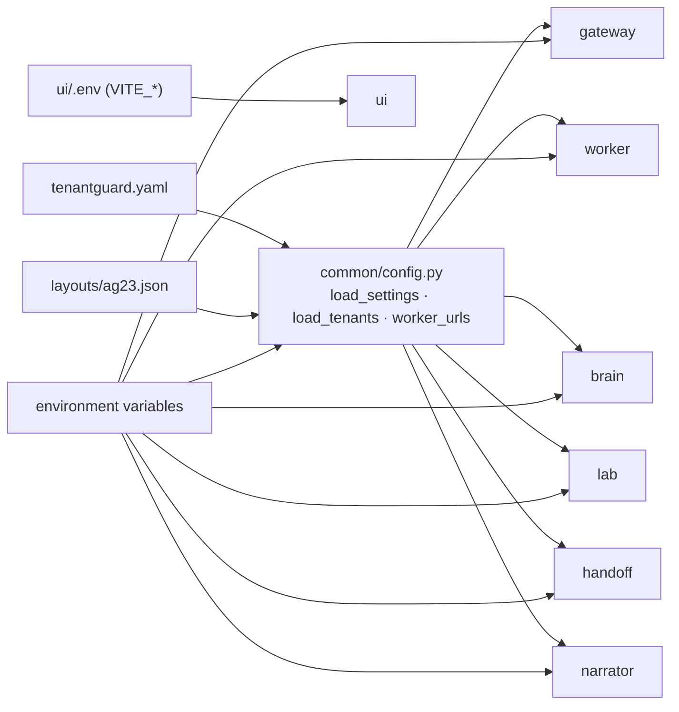

# 09: Configuration reference

Every tunable value lives in `tenantguard.yaml`, read through `common/tenantguard_common/config.py` (`load_settings()`, `load_tenants()`, `worker_urls()`). Environment variables are only for deployment concerns (URLs, ports, tokens, paths). This page lists every yaml key, environment variable, port and token on `master`.

## 1. `tenantguard.yaml`

### Top level
| Key | Value | Used by | Meaning |
|---|---|---|---|
| `layout` | `layouts/ag23.json` | all Python services (`load_tenants`) | The tenant layout: id, name, tier, 3 servers, demo API key, monthly revenue, protected flag |
| `workers.<name>` | `w0..w8` → `http://127.0.0.1:8100..8108`, `spare` → `:8109`, `quarantine` → `:8110` | gateway, brain, lab, billing | Worker base URLs for local runs; `TENANTGUARD_WORKER_URLS` overrides them in compose |
| `services.<name>` | gateway `:8000`, brain `:8200`, lab `:8300`, handoff `:8400`, billing `:8600`, narrator `:8700` | every service and `tools/demo.py` | Default peer URLs and each service's own port |

### `tiers`
| Tier | `weight` | `rate_rps` | `burst` | `cost_ms_per_s` | `concurrency` |
|---|---|---|---|---|---|
| `enterprise` | 4 | 100 | 200 | 600 | 16 |
| `pro` | 2 | 50 | 100 | 300 | 8 |
| `free` | 1 | 20 | 40 | 150 | 4 |

- `weight`: the scheduler weight (DRR quantum multiplier).
- `rate_rps` / `burst`: token-bucket refill (requests/s) and capacity.
- `cost_ms_per_s`: CPU-ms bucket refill; capacity = `cost_ms_per_s × gateway.cost_bucket_s`.
- `concurrency`: maximum queued + in-flight requests per tenant.

### `gateway`
| Key | Value | Meaning |
|---|---|---|
| `default_mode` | `tenantguard` | Mode at start (`off` / `industry` / `tenantguard`) |
| `tick_ms` | 250 | Telemetry frame period; also the limiter update period |
| `max_queue_wait_ms.interactive` / `.batch` | 1000 / 5000 | Bounded queue wait; expired requests get 503 and are never forwarded |
| `cost_bucket_s` | 2 | Cost-bucket capacity in seconds of refill |
| `express_cost_ms` | 5 | Classes whose reference cost is below this use the express lane |
| `fail_static_after_s` | 2 | No brain heartbeat for this long → `fail_static` = true (config kept, TTLs still expire) |
| `batch_routes` | `["/api/export"]` | Paths that always use the batch lane (also `X-TenantGuard-Class: batch`) |
| `upstream_timeout_s` | 30 | Timeout for a forwarded request (env `TENANTGUARD_UPSTREAM_TIMEOUT_S` overrides) |
| `ttl_max_s` | 3600 | Every control TTL must be finite and in (0, this], else 400 |
| `quota_max` | rate 10000, burst 20000, cost 100000, concurrency 1024 | Upper bounds for quota POST/PATCH (also finite and > 0) |
| `retry_budget` | ratio 0.1, window_s 10, min_allowed 3 | Retries allowed ≤ max(min_allowed, ratio × first attempts in the window), else 429 `retry_budget` |
| `limiter` | min_window 2, max_window 64, initial_window 8 | Bounds and start value of the per-worker gradient concurrency window |

### `worker`
| Key | Value | Meaning |
|---|---|---|
| `cpus` / `mem_limit_mb` | 0.5 / 256 | Container limits (compose); `cpu_limit_cores` in `/stats` |
| `body_limit_bytes` | 1048576 | Request body cap (413); the gateway enforces the same cap before forwarding |
| `tenant_mem_budget_mb` | 32 | Per-tenant held memory + cache bytes (507 beyond) |
| `cache_mb` / `cache_guaranteed_share` | 8 / 0.125 | Shared cache size and each tenant's guaranteed slice |
| `bg_threads` | 4 | Background job threads |
| `seed_rows` | 1000 | Rows seeded per tenant SQLite file |
| `blackbox.cpu_ms_per_doc` / `.queue_max` | 2.0 / 5000 | The unattributed "vendor indexer" cost per ingested document, and its queue cap |
| `max_request_s` | 30 | Any single request must finish within this |
| `bg_pending.per_tenant` / `.total` | 200 / 1000 | Background backlog caps (503 `bg_backlog`) |
| `mem_baseline_mb` | 80 | RSS reserved for the process; worker-wide memory cap = `mem_limit_mb` − this |

### `brain`
| Key | Value | Meaning |
|---|---|---|
| `tick_ms` / `stats_poll_s` | 250 / 1.0 | Brain loop period; worker `/stats` poll period |
| `noisy.warn` / `.throttle` / `.quarantine` | 1.5 / 2.0 / 4.0 | Noisy-score thresholds of the ladder |
| `noisy.recover_below` | 1.0 | Score under which recovery starts |
| `noisy.hold_s` | warn 2, throttle 2, deprioritize 4, quarantine 6, recover 10 | How long a condition must hold before a level change |
| `noisy.throttle_factor` / `.recover_step` | 0.5 / 0.1 | AIMD: multiply quota by 0.5 per throttle step; add 0.1 per recovery tick |
| `noisy.min_victim_impact` | 0.2 | Neighbours must be hurt at least this much before anyone is flagged |
| `noisy.baseline_alpha` | 0.05 | Legacy per-frame EWMA (superseded by the half-life) |
| `noisy.baseline_half_life_s` | 60 | Time-based EWMA of the calm baseline p95; frozen while a neighbour over-uses |
| `noisy.hold_ratio` | 0.8 | A level holds if at least this share of ticks in the hold window are above threshold |
| `noisy.recover_tick_s` | 1.0 | Recovery step period |
| `noisy.throttle_floor` | 0.25 | Lowest AIMD factor before deprioritize |
| `noisy.deprioritize_weight` | 0.25 | Weight factor at deprioritize |
| `noisy.quarantine_factor` / `.quarantine_weight` | 0.1 / 0.1 | Quota and weight factors at quarantine |
| `health.probe_window_ticks` | 8 | Ticks of history for server health |
| `health.slow_peer_ratio` / `.slow_abs_ms` | 1.6 / 8 | A server is slow if its p95 ≥ 1.6× the median of its peers and ≥ 8 ms above it |
| `health.open_after_ticks` | 4 | Debounce before a server incident opens and before naming |
| `rescue_capacity_guard` | 0.7 | Rescue never pushes a healthy server over 70% CPU |
| `confidence_to_prove` | 0.6 | Minimum culprit confidence to start a proof; also the handoff bridge's "named" threshold |
| `spare_sizing`, `prove_settle_s`, `prove_window_s`, `recovery_R` | 1.25, 2, 6, 0.5 | Relocation prover parameters (**in progress**, T12) |
| `paid_share_costly`, `host_idle_ratio` | 0.35, 1.5 | Verdict thresholds (**in progress**, T12) |
| `ttl_s` | relocate 120, quarantine 120, throttle 60, probation 300 | TTL of each kind of brain action |
| `action_budget` | relocations_per_min 6, quarantine_every_s 30, max_drained 1 | Rate limits on drastic actions |

### `handoff`
| Key | Value | Meaning |
|---|---|---|
| `decision_window_s` | 120 | Deadline given to the on-call for a pending action |
| `block_s` | 300 | Duration of an approved block (always TTL-bound, ≤ `gateway.ttl_max_s`) |
| `extend_s` | 120 | Hold duration for extend / release (`OperatorCmd.until_s`) |
| `push_timeout_s` | 3 | Timeout for a POST to the partner app and for control calls |
| `retention_s` | 3600 | Closed/resolved cases are evicted this long after they close |
| `history_wire_max` | 50 | History items sent to the partner per case (+ an "N earlier events" line) |

### `billing` (**in progress**, T17: keys exist; the service code is not on master)
`poll_s` 5, `bucket_s` 60, `retention_h` 24, `price_rs_per_cpu_s` (enterprise 0.40, pro 0.60, free 0.80), `db_price_rs_per_s` 0.0, `ref_alpha` 0.2, `sla_default_p95_ms` 100, `sla_credit_table` (2 s → 2%, 10 s → 4%, 60 s → 10%, 300 s → 25%), `unmetered_min_confidence` 0.6.

### `narrator`
| Key | Value | Meaning |
|---|---|---|
| `max_reports` | 200 | Reports kept in memory (oldest evicted) |

## 2. Environment variables

| Variable | Read by | Default | Meaning |
|---|---|---|---|
| `TENANTGUARD_ROOT` | `common/config.py` | repo root | Where `tenantguard.yaml` and `layouts/` live (`/app` in containers) |
| `TENANTGUARD_CONFIG` | `common/config.py` | `$ROOT/tenantguard.yaml` | Alternative config file |
| `TENANTGUARD_LAYOUT` | `common/config.py` | `$ROOT/<layout>` | Alternative layout file |
| `TENANTGUARD_WORKER_URLS` | `common/config.py` → gateway, brain, lab | yaml `workers` | `w0=http://..,w1=..,spare=..` |
| `TENANTGUARD_GATEWAY_URL` | brain, lab, handoff, `tools/demo.py`, gateway tools | yaml `services.gateway` | Gateway URL |
| `TENANTGUARD_BRAIN_URL` | lab, handoff, narrator, `tools/demo.py` | yaml `services.brain` | Brain URL |
| `TENANTGUARD_LAB_URL` | lab CLI, `tools/demo.py` | yaml `services.lab` | Lab URL |
| `TENANTGUARD_CONTROL_TOKEN` | gateway, brain, lab, handoff, `tools/demo.py` | `dev` | Shared control token (see Tokens) |
| `TENANTGUARD_CORS_ORIGINS` | gateway, brain, handoff, narrator | `http://127.0.0.1:5173,http://localhost:5173` | Allowed UI origins |
| `TENANTGUARD_UI_ORIGINS` | worker, lab | `http://127.0.0.1:5173` | Allowed UI origins |
| `TENANTGUARD_UPSTREAM_TIMEOUT_S` | gateway | yaml `gateway.upstream_timeout_s` | Forwarding timeout |
| `TENANTGUARD_GATEWAY_HOST` / `_PORT` | gateway `__main__` | `0.0.0.0` / yaml port | Bind address |
| `TENANTGUARD_BRAIN_HOST` / `_PORT` | brain | `0.0.0.0` / yaml port | Bind address |
| `SERVER_NAME` | worker (and `gateway/tools/stub_worker.py`) | `stub` / required | The worker's name (`w0`…, `spare`, `quarantine`) |
| `WORKER_DATA_DIR` | worker | `./data/<server>` (`/data` in Docker) | Per-tenant SQLite directory |
| `CPU_LIMIT_CORES` | worker | cgroup `cpu.max`, else yaml `worker.cpus` | CPU limit reported for `cpu_pct` |
| `TENANTGUARD_ADMIN_TOKEN` | worker, `tools/demo.py` | `dev` | `X-Admin-Token` for worker `/admin/fault` (demo fault fallback) |
| `TENANTGUARD_LAB_PERSONAS` | lab | `lab/personas.yaml` | Persona file |
| `TENANTGUARD_LAB_RATE_SCALE` | lab | 1.0 | Multiplies every persona's rate |
| `TENANTGUARD_LAB_RESULTS` | lab | `lab/results` | Where measured run JSON files are written |
| `STUB_RPS`, `STUB_FORWARD` | lab stub gateway tool | n/a | Development stub only |
| `WEB_URL` | handoff, `mock_web.py` | `http://127.0.0.1:8500` | The partner Digital Handoff app |
| `TENANTGUARD_UI_URL` | handoff | `http://127.0.0.1:5173` | Host used in each case's `evidence_link` |
| `HANDOFF_STATE_PATH` | handoff | `data/handoff-state.json` (`/data/...` in compose) | Persisted case-id counter and incident→case map |
| `HANDOFF_PARTNER_TOKEN` | handoff | unset | Required on inbound partner updates (`X-Handoff-Token`); unset → 503 (fail-closed), wrong → 401 |
| `HANDOFF_HOST` / `HANDOFF_PORT` | handoff `__main__` | `0.0.0.0` / yaml port | Bind address |
| `HANDOFF_URL`, `FAKE_GW_URL` | handoff tools (`mock_web.py`, `prove_handoff.py`) | `:8400`, `:8099` | Tool targets |
| `NARRATOR_HOST` / `NARRATOR_PORT` | narrator `__main__` | `0.0.0.0` / yaml port | Bind address |
| `COMPOSE_PROJECT_NAME` | compose | `codeastra` | Project name (a frozen demo stack can run beside a dev stack) |
| `GATEWAY_PORT`, `BRAIN_PORT`, `LAB_PORT`, `HANDOFF_PORT`, `NARRATOR_PORT`, `BILLING_PORT` | compose | 8000, 8200, 8300, 8400, 8700, 8600 | Host ports published by compose |

### UI (`ui/.env`, see `ui/.env.example`)
| Variable | Meaning |
|---|---|
| `VITE_BRAIN_URL`, `VITE_GATEWAY_URL`, `VITE_LAB_URL`, `VITE_HANDOFF_URL` | Backend URLs |
| `VITE_CONTROL_TOKEN` | Sent as `X-TenantGuard-Control-Token` on gateway `/admin/*` calls |
| `VITE_MOCK` | `1` = built-in fixture replay, no backend (also `?mock=1`) |
| `VITE_P95_WARN_MS`, `VITE_P95_BAD_MS` | Tile colour thresholds (default 150 / 400 ms) |
| `VITE_NOISY_WARN`, `VITE_NOISY_THROTTLE`, `VITE_NOISY_QUARANTINE` | Fallback only when `StateSnapshot.noisy_thresholds` is empty |

## 3. Ports

| Service | Port | Compose |
|---|---|---|
| gateway | 8000 | published (`GATEWAY_PORT`) |
| workers `w0..w8` | 8100 in compose; local 8100–8108 | internal only |
| `spare`, `quarantine` | 8100 in compose; local 8109, 8110 | internal only |
| brain | 8200 | published (`BRAIN_PORT`) |
| lab | 8300 | profile `lab` |
| handoff bridge | 8400 | profile `handoff` |
| mock partner app | 8500 | not in compose (`integrations/handoff/tools/mock_web.py`) |
| billing | 8600 | profile `billing` (**in progress**) |
| narrator | 8700 | profile `narrator` |
| UI (Vite) | 5173 | outside Docker |

## 4. Tokens and keys

| Secret | Header | Where checked | Default |
|---|---|---|---|
| Control token (`TENANTGUARD_CONTROL_TOKEN`) | `X-TenantGuard-Control-Token` | gateway `/admin/*` and `/control/*`; brain `POST /api/operator` (constant-time compare; missing or wrong → 401) | `dev` |
| Tenant API keys | `X-API-Key` | gateway only; stored as SHA-256; plaintext demo keys are in `layouts/ag23.json` (`tk_A_demo`…) | per layout |
| Worker admin token (`TENANTGUARD_ADMIN_TOKEN`) | `X-Admin-Token` | worker `/admin/fault` (never reachable through the gateway's path guard) | `dev` |
| Partner token (`HANDOFF_PARTNER_TOKEN`) | `X-Handoff-Token` | handoff `POST /control/case-update` and `/cases/update` | unset → inbound updates refused (503) |

Use non-default values for every token outside a closed demo network. Services talk plain HTTP; the design assumes a private network (Tailscale or LAN).
