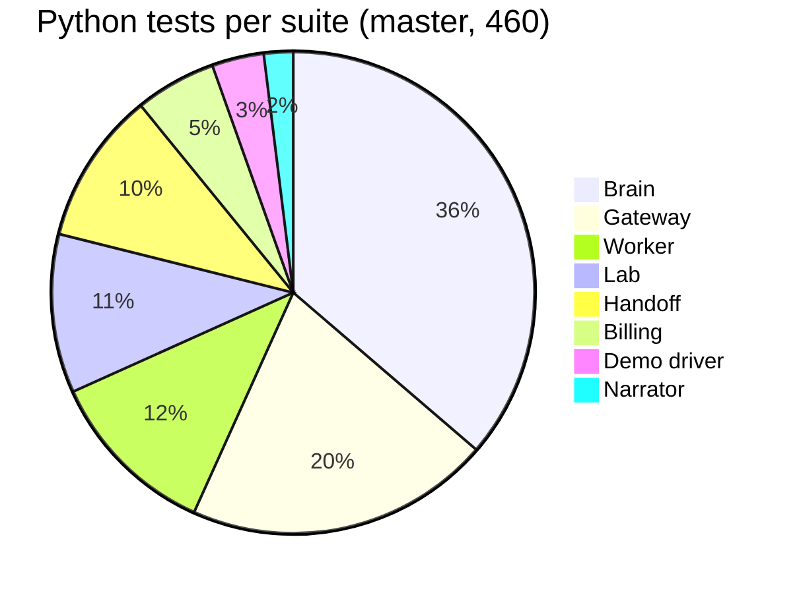

# 10: Testing

Every service has its own test suite, which runs with `python -m pytest` in the service directory (`npm test` for the UI). The suites are offline: the gateway, brain, billing, handoff bridge, narrator and demo driver are tested against in-process fakes (mocked HTTP transports, stubbed upstreams, a fake Docker engine, simulated fleets, fake clocks), so no network, Docker or real worker is needed. The UI also has a Playwright end-to-end suite. Live behaviour was then proven separately on the Docker host; see the end of this page.

## Suites and counts on `master`

| Suite | Command | Tests | Test files |
|---|---|---|---|
| Gateway | `cd gateway && python -m pytest` | 94 | `test_buckets.py`, `test_scheduler.py`, `test_router.py`, `test_overrides.py`, `test_limiter_retry.py`, `test_api.py`, `test_wave2_api.py`, `test_security.py`, `test_telemetry.py` |
| Worker | `cd worker && python -m pytest` | 53 + 1 skipped off Linux | `test_isolation.py`, `test_metering.py`, `test_blackbox.py`, `test_limits_fault.py`, `test_calibrate.py`, `test_review_fixes.py`, `test_memory_return.py` |
| Brain | `cd brain && python -m pytest` | 167 | `test_score.py`, `test_ladder.py`, `test_fairness.py`, `test_core.py`, `test_impact.py`, `test_stage3_pure.py`, `test_stage3_sim.py`, `test_prover.py`, `test_verdicts.py`, `test_t12_sim.py`, `test_t12_regressions.py`, `test_host_noise.py`, `test_operator.py`, `test_runtime.py`, `test_api.py` |
| Lab | `cd lab && python -m pytest` | 49 | `test_poisson.py`, `test_stats.py`, `test_scenario.py`, `test_scorecard.py`, `test_api.py`, `test_isolation.py` |
| Billing | `cd billing && python -m pytest` | 25 | `test_meter.py`, `test_billing.py`, `test_api.py` |
| Handoff bridge | `cd integrations/handoff && python -m pytest` | 47 | `test_wire_cases.py`, `test_bridge_api.py`, `test_t20_fixes.py`, `test_t23_tools.py` |
| Narrator | `cd narrator && python -m pytest` | 9 | `test_narrator.py` |
| Demo driver | `cd tools && python -m pytest` | 16 | `test_demo.py`, `test_demo_t20.py` |
| **Total (Python)** | | **460** | |
| UI unit | `cd ui && npm test` (vitest) | 76 | 12 files: `src/lib/*.test.ts` (backend, case, clarity, flow, impact, quota, scorecard, status, store, thresholds), `src/mock/*.test.ts` (handoff, sim) |
| UI end-to-end | `cd ui && npm run e2e` (Playwright) | 27 declared, 26 run by default | `e2e/api.spec.ts` (10), `e2e/ui.spec.ts` (10), `e2e/layout.spec.ts` (3 tests × 2 screen sizes = 6), `e2e/live.spec.ts` (1, tagged `@live`, runs only with `E2E_LIVE=1`) |

Python counts are the numbers `pytest --collect-only` reports on `master` (parametrised cases count separately). The worker's skipped test checks glibc allocator behaviour and runs only on Linux. The UI also has `npm run build` (TypeScript type-check plus the production build) and `npm run lint` (zero warnings).

## What the suites prove

### Gateway (94)
- **Buckets and admission:** token-bucket refill and burst; CPU-cost bucket overdraw and pay-back; a token is consumed only on admission; `Retry-After` is the maximum wait over every refusing dimension, rounded up; the exact `RateLimit` / `RateLimit-Policy` header shapes.
- **Fair scheduling:** weighted DRR with weights 4/2/1 over 10,000 requests is within ±5% for equal and mixed costs; weight changes take effect; a whale with 1,000 queued 500 ms requests cannot starve two light tenants; FIFO mode really serves in arrival order; cancelled items are skipped; a tenant whose servers are full does not block others.
- **Routing and overrides:** equal spread by default; route weights, drains and relocations; a request is never black-holed; every override kind reverts at its TTL; a newer `LimitsCmd` replaces the old one and restarts its TTL; 1.0/1.0 clears; fail-static uses the gateway's own receive time.
- **Wave 2:** the gradient window grows at baseline latency, shrinks under worker-side contention, ignores a request's own CPU, is clamped, and re-baselines slowly. The express lane keeps light requests fast behind a whale (and the same test fails without it). Batch is shed first. A retry storm is capped while plain repeats are not counted as retries. Background-CPU charges are idempotent. Reference costs change the lane choice. The window moves with real latency.
- **API and security:** 401 for unknown keys; 429 per dimension; quota PATCH changes behaviour; bounded wait gives 503 and nothing is forwarded; control input is validated to 400; the telemetry WS emits frames; `/metrics` text. Also: path traversal (10 encodings) is rejected and never forwarded; the control token is required; TTL and quota bounds (Infinity, NaN, 0, too large); a 4 MB body is never read without a key; chunked bodies are capped; request ids are validated; CPU is charged on client disconnect.
- **Telemetry:** cumulative `/metrics` counters (retries, background-CPU charges) survive missing-CPU-header events; per-tick stats reset every frame.

### Worker (53 + 1)
Tenant B can never read tenant A's data (same key, case-variant ids, unknown tenants, context-only repository); one SQLite file per tenant; the cache keeps its guaranteed share and records evictions caused by a flooder; background jobs are charged to the tenant that wrote; meters add up; the CPU header tracks real work; black-box CPU is never in tenant meters, and its queue is bounded with drops counted; fault injection adds latency and CPU burn, requires the admin token and clears itself; body and memory limits (413 / 507); background backlog caps; the worker-wide memory cap; unhandled errors still carry the CPU header; the calibration CLI.

**Memory return (`test_memory_return.py`):** after heavy load the process RSS comes back near its baseline; a `/api/memory` hold is released at once; the class meter is bounded per tenant (overflow goes to `other`); the `/admin/memory` endpoints; the SQLite page cache and WAL are bounded; the trim thread runs; the allocator tuning behaves as expected on glibc (Linux only).

### Brain (167)
- **Stage 2 and Stage 3 (as before):** noisy-score formula and fair shares; a legit burst with no victim impact is never flagged; victim impact is the mean over neighbours, clipped; the time-based baseline is frozen while a neighbour over-uses; the ladder's hold times, hysteresis, AIMD steps and full walk up and back down; recovery after the attack; operator release / extend / resume; leftover overrides adopted after a restart; peer-ratio health with persistence; a fleet-wide slowdown accuses nobody; the rescue moves every neighbour off a slow server and respects the 70% capacity guard; the decoder names every single culprit and **all 66 culprit pairs exactly**, and a single slow server is a host suspect with nobody blamed; the AG(2,3) property; the API, WS backfill, CORS and contract shape.
- **Prover (`test_prover.py`):** a proof is confirmed when the servers recover and the harm follows; not confirmed when the servers stay slow or the culprit pauses mid-test; nothing to prove when the servers are already fine; the spare size is clamped; a Docker failure still tests on the spare as it is; a refused relocation restores the spare; the `HostProver` confirms a slow idle host and handles a refused drain; `make_prover` picks Docker or null. Safety of the socket: with two stacks on one host the spare is found by project **and** service; no project means no Docker action; an ambiguous or missing spare is refused; an explicit container name overrides; the engine uses `NanoCpus` for compose `cpus:` and `CpuQuota` when the container has one.
- **Verdicts (`test_verdicts.py`):** each of the five verdicts from its evidence (below the confidence bar, not confirmed, over plan from admission refusals, costly from a low paid share or ledger hints, honest growth); over plan wins over costly; a repeat offender is judged without a confirmed proof; the host verdict; proof evaluation (harm can follow by latency alone); the action budget; offender memory; parameters from the yaml.
- **End-to-end verdicts on a simulated fleet (`test_t12_sim.py`):** honest growth stays on the spare as a burst lane; costly pattern sends the guilty class to the heavy lane; a culprit pausing mid-test is `mitigated_no_blame`; over plan tightens limits and sends it home; below the confidence bar nothing is proved; a repeat offender gets its last verdict without re-proving; the relocation budget defers a proof.
- **T12 regressions (`test_t12_regressions.py`):** failed requests (fast 5xx) are not counted as slot usage, so a tenant whose servers are down is not flagged; background CPU is charged once a second in `tenantguard` mode, and not at all outside it.
- **Host noise (`test_host_noise.py`):** the simulator reproduces the host's calm (1 to 3 s CPU-quota stalls of whole servers, tail spikes on 5% of cells). A noisy calm opens nothing and moves nothing (3 seeds × 2 load levels); a whale and a host fault are still found and proved under that noise; a fast server is never slow whatever its ratio; two slow neighbours do not flag an over-user; a server a hot tenant runs on is not drained as a faulty host, while a real host fault with no hot tenant still is; a deferred drain is said once; a server below its floor enters the decoder as normal.
- **Impact (`test_impact.py`):** the meter maths; a whale run shields victims and penalises no innocent; a ladder escalation on a low score counts as an innocent, but a proven `over_plan` throttle below warn (and the step that renews it) does not; the status sentence says "recovering", not "zero share".

### Lab (49)
Poisson arrival counts within ±10% and exponential gaps; percentile maths matching the linear method; the scenario timeline and the result computation (phases from the run marks, time to recover, attacker 429/503 counts); attack lifecycle and validation; the second-wave attacks answering 501; results listed newest first; read/write keys matching the worker's seed.

**Scorecard runner (`test_scorecard.py`):** the plan interleaves modes inside each repetition; every cell is run, unregistered (501) scenarios are skipped and listed, and the cells are aggregated; brain incidents are aligned with each run's marks to find whether the culprit was named and whether any innocent was penalised; a brain that is down still gives a summary; a busy lab is waited for and retried; an overrunning run is cancelled and counted failed; an unreachable lab stops cleanly; aggregate-only mode takes the newest runs per cell; the summary file and table, pure-JSON stdout mode, argument checks, the CLI hook; the summary models come from the contracts.

### Billing (25)
- **Meter:** cumulative counters are diffed into buckets; a worker restart counts its new counters from zero; a worker started after billing counts from its start; a counter drop without a restart is a reset, and duplicates are ignored; servers are summed and classes diffed; black-box CPU is prorated over the window.
- **Pricing and bills:** a victim pays the calm reference price during an incident; references are frozen while an incident is open; the culprit pays what it measured; a whale cannot hide behind a light user's price for a shared class; a provisional bucket does not update references; the credit table and the victim credit maths; no credit without an incident or for tenants without traffic; the unmetered black-box line goes to the named culprit, and not below the confidence bar; a culprit slow in its own incident gets no credit.
- **"Why was I slow?" and privacy:** the victim's sentence; victim views never reveal the culprit; for the culprit the cause is its own usage, without credit; host fault, ladder and quiet cases; WS messages feed the state.
- **API:** bills and why answer; the API is read-only; the poll loop reads workers, brain and gateway.

### Handoff bridge (47)
All 5 sample cases and all 6 update examples round-trip exactly through the strict wire models; event → case mapping (neighbours, deadlines, replay dedupe, recovery, verdicts, server incidents with a named culprit); decision → control mapping for every decision, with TTL bounds; the Web app being down never blocks (50 events absorbed quickly, only the latest version delivered on recovery); owner, approve, 404, 409 and 400 paths; the control token is sent; case ids survive a restart. T20 adds fail-closed partner auth, no duplicate decision requests, bounded history / cases / id map, and per-message stream isolation. T23 checks that the partner tools send `X-Handoff-Token` (and refuse to run without it) and that the history / id-map caps come from yaml.

### Narrator (9)
The evidence pack's contents; the report text for server and tenant incidents (including two regressions found in a live run); the customer message names no tenant and no server; versions increase only when the evidence changes; the store is bounded; replayed and malformed messages are ignored; the API and WS.

### UI unit (76)
The vitest suites cover the backend clients, case and flow helpers, the impact meter, quota editing, scorecard grouping, the status line, the store and the thresholds, plus the mock handoff and simulator. **Clarity (`clarity.test.ts`, 21):** the scenario badge (running attack with a countdown, extra attacks counted, stopped or expired ones ignored, calm / scenario run / no traffic / lab offline, `mm:ss`); the headline (calm, attack with the culprit throttled and neighbours protected, no repetition next to the badge, victims slowed in OFF mode, a slow server with no culprit, a tenant back at 100% not shown as throttled, several tenants listed briefly, lab offline, always short, no traffic); the tile reason (none when normal, throttled with its share and cut, warn, recovering, a quarantined attacker not shown as recovering, a badge always has a reason, latest event per tenant).

### UI end-to-end (27)
Run against a mock stack that Playwright starts itself, or against a real stack with `E2E_*` URLs. Tests that change state (mode, quotas, attacks) run on a real stack only with `E2E_ALLOW_WRITES=1`.
- **API (10):** gateway health, 401 without a key or token, a 200 with the CPU header, 12 tenants with barcodes and quotas; the brain's state and incidents match the contracts; lab, handoff and narrator answers (skipped when not reachable).
- **UI (10):** 12 tiles, the 3×3 grid and a status sentence; a tile outlines its barcode; the mode toggle round-trip; the launcher offers exactly the five supported attacks and starts and stops one; a quota PATCH round-trip; the incident timeline opens the Case File; the Scorecard; the flow view; the Cases page.
- **Layout (3 × 2 sizes):** at 1366×768 and 1920×1080 panels never overlap or spill, the status bar keeps its height with the headline in full, and every tile with a level badge shows why.
- **Live (1, `@live`):** a whale on K is detected, acted on, and recovers on a real stack.

### Demo driver (16)
The full sequence of modes, attacks and durations (240 s); each attack is preceded by stopping the previous ones and setting the mode; the token header; the fallback to whale on 501; a failed attack does not abort the demo; cleanup on interrupt; a dry run sends nothing; the live readout (attacker excluded from victim numbers); scorecard selection; `--only` / `--speed`. T20 adds preflight, the fault fallback and robust cleanup.

## Mutation checks

Where a suite claims to protect a behaviour, that behaviour was broken on purpose and the suite was run again. A behaviour only counts as protected if a test fails.

| Area | Mutations | Caught | Examples |
|---|---|---|---|
| Gateway, Wave 1 | 7 | 7 | DRR replaced by FIFO; weights ignored; TTL never expires; expired requests forwarded; `Retry-After` not rounded up; cost never debited; unknown key accepted |
| Gateway, Wave 2 + security | 17 | 17 | express lane off; no express headroom; batch never shed; retry budget unlimited; window not adaptive; own CPU counted as congestion; traversal allowed; no control-token check; unbounded TTL; quota max ignored; body read before the key check; request id not validated; no debit on disconnect |
| Handoff bridge | 17 | 17 | every version sent; replays not deduped; block TTL unbounded; unknown case not 404; control token not sent; no deadline expiry; wire format leaking internal fields; a Web failure blocking ingest; ids not persisted; partner tools dropping the token header; unset token not refused; yaml caps ignored |
| Demo driver | 7 | 7 | no cleanup; no 501 fallback; no token; dry run sending; attacks not stopped between steps; steps not timed; attacker counted as a victim |
| Narrator anonymisation | 4 | 4 | anonymised pack copies brain text; pack names the culprit; message names the culprit; message names a server |

Mutation results for the worker, brain, lab and UI suites are reported by their own owners and are not repeated here.

## Live verification (outside the unit tests)

| What | How | Result |
|---|---|---|
| Gateway against real workers | 11 real workers + gateway; `gateway/tools/prove.py` | 401s; flood → 429 (rate / concurrency) while the victim stays 200; whale → 429 reason `cost`; quota PATCH changes behaviour; TTL revert; relocation to the spare; WS frames |
| Gateway wave 2 | 3 real workers, `gateway/tools/prove_t7.py` | Express lane on/off comparison; retry storm capped (1,942 of 1,948 storm requests refused with `retry_budget`); window shrinking under load; traversal / token / TTL checks over a real socket |
| Handoff bridge | fake gateway + real brain + bridge + mock Web app | Case created → owner → approve (`BlockCmd` received by the gateway) → release → resolve |
| Narrator | fake gateway + real brain + narrator | Reports published on `named` and republished on `closed`, with anonymised customer messages |
| Brain host acceptance (2026-10-13) | full stack on the Docker host, commit `7f72906`, run in the lab container | The first attempt **failed** the calm step (78 server detections, 20 named, 19 ladder moves in 270 s from CPU-quota noise); after calibration the run **passed**: idle 0 events; calm 0 ladder moves (2 real `w7` slowdowns rerouted, no tenant blamed); K as a big-plan whale named 99%, proved R = 0.88, verdict `honest_growth`, held hosts `w1` / `w8` judged first, victims rerouted; a fault on `w4` judged `host_fault` at 5.1× idle, no tenant blamed; 0 overrides left |
| Scorecard (Docker host) | `python -m tenantguard_lab scorecard`: whale and flood × off / industry / tenantguard × 3 runs, attacker K, 20 s calm / 40 s attack | `lab/results/summary-scorecard-host.json` + 18 run files; median victim p99 (ms, baseline → attack → after): whale off 149 → 691 → 254, industry 157 → 176 → 165, tenantguard 158 → 183 → 154; flood off 200 → 162 → 186, industry 166 → 164 → 163, tenantguard 143 → 144 → 175. No innocent penalised in any run. See `01_OVERVIEW.md` for how to read it |

The first four runs were on a loaded development laptop, so their latency figures are not quoted as results. Slide numbers come only from the host runs above and from `lab/results/*.json`.
