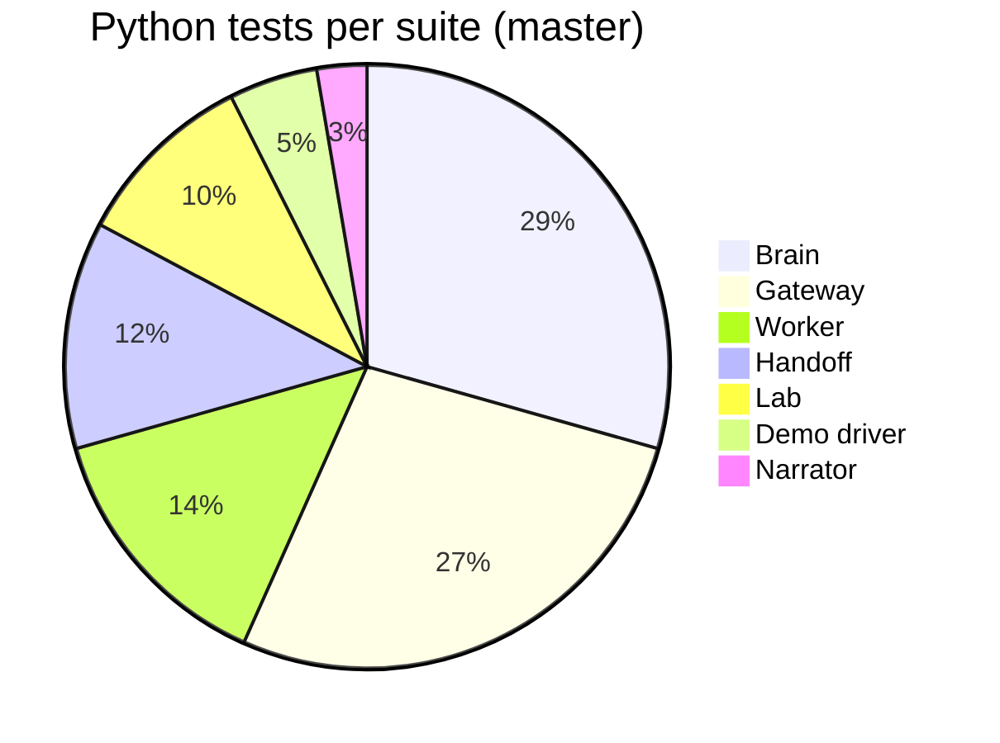

# 10: Testing

Every service has its own test suite, which runs with `python -m pytest` in the service directory (`npm test` for the UI). The suites are offline: the gateway, handoff bridge, narrator and demo driver are tested against in-process fakes (mocked HTTP transports, stubbed upstreams, fake clocks), so no network, Docker or real worker is needed. Live behaviour was then proven separately with real processes; see the end of this page.

## Suites and counts on `master`

| Suite | Command | Tests | Test files |
|---|---|---|---|
| Gateway | `cd gateway && python -m pytest` | 92 | `test_buckets.py`, `test_scheduler.py`, `test_router.py`, `test_overrides.py`, `test_limiter_retry.py`, `test_api.py`, `test_wave2_api.py`, `test_security.py` |
| Worker | `cd worker && python -m pytest` | 47 | `test_isolation.py`, `test_metering.py`, `test_blackbox.py`, `test_limits_fault.py`, `test_calibrate.py`, `test_review_fixes.py` |
| Brain | `cd brain && python -m pytest` | 99 | `test_score.py`, `test_ladder.py`, `test_fairness.py`, `test_core.py`, `test_stage3_pure.py`, `test_stage3_sim.py`, `test_operator.py`, `test_runtime.py`, `test_api.py` |
| Lab | `cd lab && python -m pytest` | 33 | `test_poisson.py`, `test_stats.py`, `test_scenario.py`, `test_api.py`, `test_isolation.py` |
| Handoff bridge | `cd integrations/handoff && python -m pytest` | 41 | `test_wire_cases.py`, `test_bridge_api.py` (+ T20 review-fix tests) |
| Narrator | `cd narrator && python -m pytest` | 9 | `test_narrator.py` |
| Demo driver | `cd tools && python -m pytest` | 16 | `test_demo.py`, `test_demo_t20.py` |
| UI | `cd ui && npm test` (vitest) | about 53 cases | `src/lib/*.test.ts` (backend, case, flow, impact, quota, scorecard, status, store, thresholds), `src/mock/*.test.ts` (handoff, sim) |
| **Total (Python)** | | **337** | |

Python counts are the numbers `pytest --collect-only` reports on `master`. The UI number counts `it(...)` / `test(...)` cases in the test files. The UI also has `npm run build` (TypeScript type-check plus the production build) and `npm run lint` (zero warnings).

## What the suites prove

### Gateway (92)
- **Buckets and admission:** token-bucket refill and burst; CPU-cost bucket overdraw and pay-back; a token is consumed only on admission; `Retry-After` is the maximum wait over every refusing dimension, rounded up; the exact `RateLimit` / `RateLimit-Policy` header shapes.
- **Fair scheduling:** weighted DRR with weights 4/2/1 over 10,000 requests is within ±5% for equal and mixed costs; weight changes take effect; a whale with 1,000 queued 500 ms requests cannot starve two light tenants; FIFO mode really serves in arrival order; cancelled items are skipped; a tenant whose servers are full does not block others.
- **Routing and overrides:** equal spread by default; route weights, drains and relocations; a request is never black-holed; every override kind reverts at its TTL; a newer `LimitsCmd` replaces the old one and restarts its TTL; 1.0/1.0 clears; fail-static uses the gateway's own receive time.
- **Wave 2:** the gradient window grows at baseline latency, shrinks under worker-side contention, ignores a request's own CPU, is clamped, and re-baselines slowly. The express lane keeps light requests fast behind a whale (and the same test fails without it). Batch is shed first. A retry storm is capped while plain repeats are not counted as retries. Background-CPU charges are idempotent. Reference costs change the lane choice. The window moves with real latency.
- **API and security:** 401 for unknown keys; 429 per dimension; quota PATCH changes behaviour; bounded wait gives 503 and nothing is forwarded; control input is validated to 400; the telemetry WS emits frames; `/metrics` text. Also: path traversal (10 encodings) is rejected and never forwarded; the control token is required; TTL and quota bounds (Infinity, NaN, 0, too large); a 4 MB body is never read without a key; chunked bodies are capped; request ids are validated; CPU is charged on client disconnect.

### Worker (47)
Tenant B can never read tenant A's data (same key, case-variant ids, unknown tenants, context-only repository); one SQLite file per tenant; the cache keeps its guaranteed share and records evictions caused by a flooder; background jobs are charged to the tenant that wrote; meters add up; the CPU header tracks real work; black-box CPU is never in tenant meters, and its queue is bounded with drops counted; fault injection adds latency and CPU burn, requires the admin token and clears itself; body and memory limits (413 / 507); background backlog caps; the worker-wide memory cap; unhandled errors still carry the CPU header; the calibration CLI.

### Brain (99)
Noisy-score formula and fair shares; a legit burst with no victim impact is never flagged; victim impact is the mean over neighbours, clipped; the time-based baseline is frozen while a neighbour over-uses; the ladder's hold times, hysteresis, AIMD steps and full walk up and back down; recovery after the attack; operator release / extend / resume; leftover overrides adopted after a restart; peer-ratio health with debounce; a fleet-wide slowdown accuses nobody; the rescue moves every neighbour off a slow server and respects the 70% capacity guard; the decoder names every single culprit and **all 66 culprit pairs exactly**, and a single slow server is a host suspect with nobody blamed; the AG(2,3) property (any two tenants share at most one server); the API, WS backfill, CORS and contract shape.

### Lab (33)
Poisson arrival counts within ±10% and exponential gaps; percentile maths matching the linear method; the scenario timeline and the result computation (phases, time to recover, attacker 429/503 counts); attack lifecycle and validation; wave-2 attacks answering 501 until they ship; results listed newest first; read/write keys matching the worker's seed.

### Handoff bridge (41)
All 5 sample cases and all 6 update examples round-trip exactly through the strict wire models; event → case mapping (neighbours, deadlines, replay dedupe, recovery, verdicts, server incidents with a named culprit); decision → control mapping for every decision, with TTL bounds; the Web app being down never blocks (50 events absorbed quickly, only the latest version delivered on recovery); owner, approve, 404, 409 and 400 paths; the control token is sent; case ids survive a restart. T20 adds fail-closed partner auth, no duplicate decision requests, bounded history / cases / id map, and per-message stream isolation.

### Narrator (9)
The evidence pack's contents; the report text for server and tenant incidents (including two regressions found in a live run); the customer message names no tenant and no server; versions increase only when the evidence changes; the store is bounded; replayed and malformed messages are ignored; the API and WS.

### Demo driver (16)
The full sequence of modes, attacks and durations (240 s); each attack is preceded by stopping the previous ones and setting the mode; the token header; the fallback to whale on 501; a failed attack does not abort the demo; cleanup on interrupt; a dry run sends nothing; the live readout (attacker excluded from victim numbers); scorecard selection; `--only` / `--speed`. T20 adds preflight, the fault fallback and robust cleanup.

## Mutation checks

Where a suite claims to protect a behaviour, that behaviour was broken on purpose and the suite was run again. A behaviour only counts as protected if a test fails.

| Area | Mutations | Caught | Examples |
|---|---|---|---|
| Gateway, Wave 1 | 7 | 7 | DRR replaced by FIFO; weights ignored; TTL never expires; expired requests forwarded; `Retry-After` not rounded up; cost never debited; unknown key accepted |
| Gateway, Wave 2 + security | 17 | 17 | express lane off; no express headroom; batch never shed; retry budget unlimited; window not adaptive; own CPU counted as congestion; traversal allowed; no control-token check; unbounded TTL; quota max ignored; body read before the key check; request id not validated; no debit on disconnect |
| Handoff bridge | 13 | 13 | every version sent; replays not deduped; block TTL unbounded; unknown case not 404; control token not sent; no deadline expiry; wire format leaking internal fields; a Web failure blocking ingest; ids not persisted |
| Demo driver | 7 | 7 | no cleanup; no 501 fallback; no token; dry run sending; attacks not stopped between steps; steps not timed; attacker counted as a victim |
| Narrator anonymisation | 4 | 4 | anonymised pack copies brain text; pack names the culprit; message names the culprit; message names a server |

Mutation results for the worker, brain, lab and UI suites are reported by their own owners and are not repeated here.

## Live verification (outside the unit tests)

| What | How | Result |
|---|---|---|
| Gateway against real workers | 11 real workers + gateway; `gateway/tools/prove.py` | 401s; flood → 429 (rate / concurrency) while the victim stays 200; whale → 429 reason `cost`; quota PATCH changes behaviour; TTL revert; relocation to the spare; WS frames |
| Gateway wave 2 | 3 real workers, `gateway/tools/prove_t7.py` | Express lane on/off comparison; retry storm capped (1,942 of 1,948 storm requests refused with `retry_budget`); window shrinking under load; traversal / token / TTL checks over a real socket |
| Handoff bridge | fake gateway + real brain + bridge + mock Web app | Case created → owner → approve (`BlockCmd` received by the gateway) → release → resolve |
| Narrator | fake gateway + real brain + narrator | Reports published on `named` and republished on `closed`, with anonymised customer messages |

These runs were on a loaded development laptop, so their latency figures are not quoted as results. Measured numbers for the OFF / Industry / TenantGuard comparison will come only from `lab/results/*.json` on the Docker host (**to be measured**).
