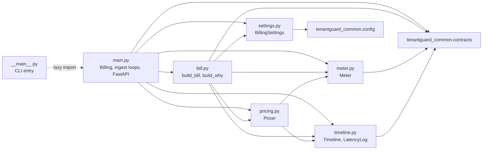
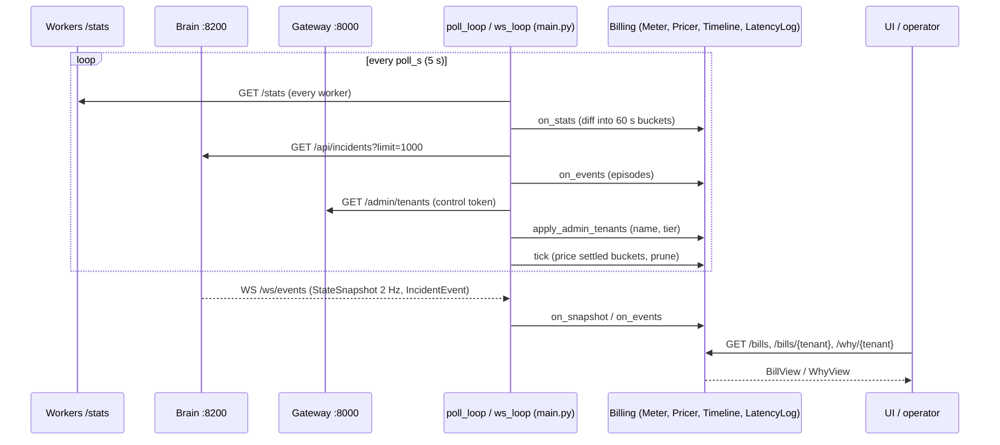

# 11: File catalog: `billing/`

The billing service (port 8600, package `tenantguard_billing`) produces a **fair bill** for every tenant and answers **"Why was I slow?"**. It is read-only: it never sends a control command. It meters each worker's cumulative `/stats` counters into per-tenant, per-class buckets. It prices calm buckets at measured cost, and buckets during a brain incident at the calm reference price, so a victim never pays for contention it did not cause. It gives SLA credits for time a tenant spent over its own `sla_p95_ms` during an incident it was not blamed for. For a culprit the brain named with enough confidence, it adds an **unmetered true-cost line** for the black-box CPU that culprit caused on its servers. Victim-facing text is built only from structured data, so it never names another tenant.

## Module dependencies

## Data flow: workers + brain + gateway → bill

---

### `billing/tenantguard_billing/__init__.py`
Package marker. Its only content is the docstring: TenantGuard fair billing and "Why was I slow?" (read-only service, :8600).

| Function / class | Signature | What it does | Called by |
|---|---|---|---|
| (none) | n/a | Module docstring only | n/a |

**Key decisions**
- No re-exports: callers import the module they need (`main`, `settings`, `bill`, ...).

---

### `billing/tenantguard_billing/__main__.py`
Command-line entry point: `python -m tenantguard_billing [--port 8600] [--host 0.0.0.0] [--log-level warning]`.

| Function / class | Signature | What it does | Called by |
|---|---|---|---|
| `main` | `main() -> None` | Parses `--port` (default 8600), `--host` (default `0.0.0.0`) and `--log-level` (default `warning`). Imports `create_app` from `main.py` after parsing, then runs `uvicorn.run(create_app(), host, port, log_level, access_log=False)` | `python -m tenantguard_billing`; the Dockerfile `CMD` |

**Key decisions**
- The app module is imported only after argument parsing, so `--help` does not load FastAPI or read configuration.
- Binds `0.0.0.0` by default and turns uvicorn access logs off.

---

### `billing/tenantguard_billing/settings.py`
Turns `tenantguard.yaml` (section `billing:`, `services:`, the worker list) and the layout (tiers, barcodes, `sla_p95_ms`) plus environment variables into a typed `BillingSettings`.

| Function / class | Signature | What it does | Called by |
|---|---|---|---|
| `DEFAULTS` | dict | Fallback for every `billing:` key: `poll_s` 5, `bucket_s` 60, `retention_h` 24, `price_rs_per_cpu_s` `{enterprise: 0.40, pro: 0.60, free: 0.80}`, `db_price_rs_per_s` 0.0, `ref_alpha` 0.2, `sla_default_p95_ms` 100, `sla_credit_table` (2 s → 2%, 10 s → 4%, 60 s → 10%, 300 s → 25%), `unmetered_min_confidence` 0.6 | `load` |
| `BillingSettings` | dataclass: `poll_s`, `bucket_s`, `retention_s`, `price_rs_per_cpu_s`, `db_price_rs_per_s`, `ref_alpha`, `sla_default_p95_ms`, `sla_credit_table`, `unmetered_min_confidence`, `tenants: Dict[str, TenantConfig]`, `sla_p95_ms: Dict[str, float]`, `worker_urls: Dict[str, str]`, `brain_url = "http://127.0.0.1:8200"`, `gateway_url = "http://127.0.0.1:8000"`, `control_token = "dev"`, `cors_origins = ["http://127.0.0.1:5173"]` | The whole service configuration. Mutable: `apply_admin_tenants` updates tenant names and tiers at runtime, and tests override fields | `main.Billing`, `bill`, tests |
| `BillingSettings.sla` | `sla(self, tenant: str) -> float` | The tenant's `sla_p95_ms` from the layout, or `sla_default_p95_ms` for an unknown id | `bill.build_bill`, `bill._episode`, `bill.build_why` |
| `BillingSettings.barcode` | `barcode(self, tenant: str) -> List[str]` | The tenant's servers from the layout, or `[]` | `bill.unmetered_lines`, `bill._episode` |
| `BillingSettings.rate_rs_per_ms` | `rate_rs_per_ms(self, tenant: str) -> float` | Price per CPU-ms for the tenant's tier (`price_rs_per_cpu_s[tier] / 1000`). An unknown tenant is priced as `free`; an unknown tier at the highest listed price | `bill.build_bill`, `bill.unmetered_lines`; tests |
| `load` | `load(settings: Optional[Dict[str, Any]] = None, **overrides) -> BillingSettings` | Merges `DEFAULTS` with yaml `billing:`. Loads tenants with `load_tenants`, and takes `sla_p95_ms` per tenant from the layout. `worker_urls` from `worker_urls(settings)` (env `TENANTGUARD_WORKER_URLS` wins). `brain_url` from `TENANTGUARD_BRAIN_URL` or `services.brain`; `gateway_url` from `TENANTGUARD_GATEWAY_URL` or `services.gateway`; `control_token` from `TENANTGUARD_CONTROL_TOKEN` (default `dev`); CORS origins from `TENANTGUARD_CORS_ORIGINS`, else `TENANTGUARD_UI_ORIGINS`, else `http://127.0.0.1:5173` (comma list). Sorts the credit table by `min_violation_s` and converts `retention_h` to seconds. Applies keyword overrides last | `main.create_app`; tests (`cfg` fixture) |

Config keys read from `tenantguard.yaml`:

| Key | Value on this branch | Used for |
|---|---|---|
| `billing.poll_s` | 5 | Worker / brain / gateway poll period; the pricer waits `2 × poll_s` after a bucket ends before closing it |
| `billing.bucket_s` | 60 | Metering bucket width (s) |
| `billing.retention_h` | 24 | How long buckets, episodes and snapshots are kept |
| `billing.price_rs_per_cpu_s` | enterprise 0.40, pro 0.60, free 0.80 | Rs per CPU-second by tier |
| `billing.db_price_rs_per_s` | 0.0 | Rs per second of database time (a `db` line appears only if this is above 0 or there was db time) |
| `billing.ref_alpha` | 0.2 | EWMA weight of one calm bucket in the calm reference cost |
| `billing.sla_default_p95_ms` | 100 | SLA for a tenant id not in the layout |
| `billing.sla_credit_table` | 2 s → 2%, 10 s → 4%, 60 s → 10%, 300 s → 25% | Violation seconds → % of the period's usage subtotal |
| `billing.unmetered_min_confidence` | 0.6 | Minimum culprit confidence for an unmetered line |
| `services.brain`, `services.gateway` | `http://127.0.0.1:8200`, `http://127.0.0.1:8000` | Peer URLs when no env override is set |
| workers (through `worker_urls`) | 9 workers | Which `/stats` endpoints to poll |
| layout: `tier`, `servers`, `sla_p95_ms`, `name` per tenant | `layouts/ag23.json` | Prices, barcodes, SLA targets and display names |

**Key decisions**
- SLA targets come only from the layout. Billing has no SLA copy of its own, so the bill and the lab read the same per-tenant target.
- Every peer URL can be overridden from the environment, which is how compose points billing at `brain:8200` and `gateway:8000`.

---

### `billing/tenantguard_billing/meter.py`
Pure metering (no I/O). Turns cumulative `WorkerStats` into per-(tenant, bucket) usage deltas, per request class, and keeps a per-server record of black-box CPU.

| Function / class | Signature | What it does | Called by |
|---|---|---|---|
| `Usage` | dataclass: `requests: int = 0`, `handler_cpu_ms`, `bg_cpu_ms`, `db_ms` (floats), `classes: Dict[str, List[float]]` (cls → `[count, cpu_ms]`) | Usage in one bucket | `Meter`, `pricing.Pricer` |
| `Usage.add` | `add(self, other: Usage) -> None` | Adds another usage in place, class by class | `Meter._apply` |
| `_d` | `_d(cur: float, prev: float) -> float` | `cur - prev`, or `cur` when the counter went down (a reset counts from zero) | `Meter._apply` |
| `BlackboxSample` | dataclass: `server`, `t0`, `t1`, `cpu_ms` | Black-box CPU used on one server between two polls | `Meter._apply`, `Meter.blackbox_ms`, `bill.calm_blackbox_rate` |
| `Meter` | class | The meter | `main.Billing` |
| `Meter.__init__` | `__init__(self, bucket_s: float, started_at: float, retention_s: float = 86_400)` | Stores the bucket width, the billing start time and retention. Empty last-sample map, `buckets` (defaultdict of `Usage` keyed by `(tenant, bucket_start)`), black-box list and per-server restart counts | `Billing.__init__`; tests |
| `Meter.bucket_of` | `bucket_of(self, ts: float) -> float` | Start of the bucket holding `ts` | `_apply` |
| `Meter.ingest` | `ingest(self, s: WorkerStats) -> None` | Ignores a sample not newer than the last one for that server. On first sight of a server: a worker that started before billing is only a baseline; one that started after billing counts everything since its start. A changed `started_at` is a restart (counted in `restarts`) and the new counters are the delta. Otherwise diffs against the previous sample | `Billing.on_stats`; tests |
| `Meter._apply` | `_apply(self, prev: WorkerStats, cur: WorkerStats) -> None` | Adds per-tenant deltas (requests, handler CPU, background CPU, db time) and per-class deltas (`count`, `cpu_ms_total`) to the bucket of `cur.ts`, skipping zero rows. Appends a `BlackboxSample` for `[prev.ts, cur.ts]` | `ingest` |
| `Meter.prune` | `prune(self, now: float) -> None` | Drops buckets and black-box samples older than `retention_s` | `Billing.tick` |
| `Meter.tenant_buckets` | `tenant_buckets(self, tenant, start, end) -> List[Tuple[float, Usage]]` | The tenant's buckets with start in `[start, end)`, sorted | `bill.build_bill`; tests |
| `Meter.all_buckets` | `all_buckets(self) -> List[Tuple[str, float, Usage]]` | Every bucket, ordered by bucket start then tenant | `pricing.Pricer.close` |
| `Meter.blackbox_ms` | `blackbox_ms(self, servers: List[str], start: float, end: Optional[float]) -> Tuple[float, float]` | Black-box CPU-ms and seconds covered on `servers` within `[start, end]`, pro-rated by overlap for samples that straddle the window | `bill.unmetered_lines`; tests |

**Key decisions**
- Usage from before billing started is never billed: the first sample of an old worker is a baseline only.
- Restarts and counter resets never produce negative usage.
- Black-box CPU is kept per server, not per tenant (the worker cannot attribute it), and is attributed to a tenant only through a named culprit in `bill.unmetered_lines`.

---

### `billing/tenantguard_billing/timeline.py`
Pure incident and latency history, built only from the brain's structured fields. It never copies the brain's `detail` text, because that text names tenants.

| Function / class | Signature | What it does | Called by |
|---|---|---|---|
| `THROTTLE_LEVELS` | `{"throttle", "deprioritize", "quarantine", "blocked"}` | Levels that count as "the over-user was throttled" | `Timeline.ingest` |
| `NOMINAL_TICK_S` | `0.5` | The brain's `StateSnapshot` period (2 Hz) | `LatencyLog.ingest` |
| `MAX_TICK_S` | `1.0` | A longer gap between snapshots (stream down) counts as one nominal tick, never as the whole gap | `LatencyLog.ingest` |
| `Episode` | dataclass: `incident_id`, `kind` (`server` for `srv-*`, `tenant` for usage-ladder `inc-*`), `start`, `end` (None = open), `ladder_tenant`, `culprits: Dict[str, float]`, `named_at`, `host_suspects`, `rescued_at`, `throttled_at` | One brain incident | `Timeline`, `pricing`, `bill` |
| `Episode.overlaps` | `overlaps(self, a: float, b: float) -> bool` | True if the episode overlaps `[a, b)` (an open episode runs to infinity) | `Timeline.overlapping` |
| `Episode.open_at` | `open_at(self, ts: float) -> bool` | True if `ts` is inside the episode | `Timeline.open_at` |
| `Episode.blamed` (property) | `blamed -> Set[str]` | The named culprits plus the ladder tenant: tenants the episode was about. They pay measured cost and get no credit for it | `pricing.Pricer.price`, `bill`, `violations` |
| `Timeline` | class | All episodes | `main.Billing` |
| `Timeline.__init__` | `__init__(self) -> None` | Empty episode map and dedupe set | `Billing.__init__` |
| `Timeline.ingest` | `ingest(self, events: Iterable[IncidentEvent]) -> None` | In time order, skips events already seen (`(incident_id, stage, ts)`). Creates the episode on first sight (ladder tenant set for `tenant` kind). `named`: culprits from `report.culprits` if present, else from `suspects`; `host_suspects` from the report; first `named_at`. `rescued`: first `rescued_at`. `level_change` or `detected` at a throttle level: first `throttled_at`. `closed`: sets `end` | `Billing.on_events`; tests |
| `Timeline.overlapping` | `overlapping(self, a, b) -> List[Episode]` | Episodes overlapping `[a, b)`, by start | `pricing.Pricer.price`, `bill` |
| `Timeline.open_at` | `open_at(self, ts) -> List[Episode]` | Episodes open at `ts` | `violations` |
| `Timeline.blamed_in` | `blamed_in(self, a, b) -> Set[str]` | Union of `blamed` over overlapping episodes | No caller in `billing/` on this branch |
| `Timeline.prune` | `prune(self, cutoff: float) -> None` | Drops closed episodes that ended before `cutoff`, and their dedupe keys | `Billing.tick` |
| `Tick` | dataclass: `ts`, `dt`, `p95: Dict[str, float]`, `slow_servers: Set[str]` | One brain snapshot as billing needs it | `LatencyLog`, `violations`, `bill` |
| `LatencyLog` | class | Snapshot history (2 Hz) | `main.Billing` |
| `LatencyLog.ingest` | `ingest(self, snap: StateSnapshot) -> None` | Ignores snapshots not newer than the last. `dt` is the gap to the previous snapshot, or 0.5 s for the first one or for any gap above 1 s. Stores each tenant's `p95_ms` and the servers whose status is `slow` | `Billing.on_snapshot`; tests |
| `LatencyLog.between` | `between(self, a, b) -> List[Tick]` | Ticks in `[a, b)` (binary search) | `violations`, `bill._episode`, `bill.build_why` |
| `LatencyLog.prune` | `prune(self, cutoff) -> None` | Drops ticks before `cutoff` | `Billing.tick` |
| `violations` | `violations(tenant, sla_ms, log, tl, a, b) -> List[Tuple[Tick, Episode]]` | Ticks in `[a, b)` where the tenant's p95 was above its SLA while an incident it was not blamed for was open. A p95 of 0 (no completed requests) is skipped, never counted as fast or slow | `bill.build_bill`; tests |

**Key decisions**
- Only structured fields are stored (stage times, `report.culprits`, server status, barcodes), so no victim-facing output can leak a culprit's name through copied text.
- A stream outage does not turn into a long violation: a gap is capped at one nominal tick.
- A tenant blamed for an incident earns no SLA seconds from it, even if it was slow itself.

---

### `billing/tenantguard_billing/pricing.py`
Pure calm-reference pricing. A bucket that no brain incident overlaps is calm: it bills measured CPU and updates the calm reference cost per (tenant, class) and per class fleet-wide (EWMA with weight `ref_alpha`). A bucket that overlaps an incident never updates a reference. In such a bucket a victim pays, per class, `min(measured, count × calm reference)`; a tenant the incident is about pays measured.

| Function / class | Signature | What it does | Called by |
|---|---|---|---|
| `Priced` | dataclass: `requests`, `measured_handler_ms`, `billed_handler_ms`, `bg_cpu_ms`, `db_ms`, `calm`, `blamed` | The price of one (tenant, bucket) | `Pricer`, `bill.build_bill` |
| `Priced.waived_ms` (property) | `waived_ms -> float` | `max(0, measured - billed)` handler CPU | No caller in `billing/` on this branch (`build_bill` computes the waived total itself) |
| `Pricer` | class | Reference prices and closed buckets | `main.Billing` |
| `Pricer.__init__` | `__init__(self, alpha: float, bucket_s: float, settle_s: float)` | Stores the EWMA weight, bucket width and settle delay (`2 × poll_s` in `Billing`, because incident reports lag). Empty `ref` ((tenant, cls) → calm ms/request), `gref` (cls → calm ms/request fleet-wide) and `closed` maps | `Billing.__init__` |
| `Pricer._ewma` | `_ewma(self, table, key, value) -> None` | First value is taken as is; later values move it by `alpha × (value - old)` | `close` |
| `Pricer.ref_for` | `ref_for(self, tenant, cls) -> Optional[float]` | The tenant's own calm reference for the class, else the fleet-wide one, else None | `price` |
| `Pricer.price` | `price(self, tenant, b, u: Usage, tl: Timeline) -> Priced` | Calm bucket or blamed tenant: billed = measured. Otherwise, per class, billed = measured if there is no reference, else `min(measured, count × ref)`; handler CPU not covered by any class is billed measured | `close`, `priced` |
| `Pricer.close` | `close(self, meter, tl, now) -> int` | Prices every bucket that has ended at least `settle_s` ago and is not yet closed, in time order. Calm buckets then update the per-tenant and fleet-wide references. Returns how many were closed | `Billing.tick` |
| `Pricer.priced` | `priced(self, tenant, b, u, tl) -> Priced` | The closed price if the bucket is settled, else a provisional price at the current references (provisional prices never update a reference) | `bill.build_bill` |
| `Pricer.prune` | `prune(self, cutoff) -> None` | Drops closed prices for buckets before `cutoff` | `Billing.tick` |

**Key decisions**
- References are per (tenant, class), not just per class. The gateway's request class ignores query values, so `search?n=1k` and a whale's `n=500k` share a class; a fleet-wide price alone would let a whale pay a light user's price.
- Prices are frozen during an incident: contention can never move the reference that later protects victims.
- Buckets are closed in time order, so a reference used for a bucket is always built from earlier calm buckets.

---

### `billing/tenantguard_billing/bill.py`
Pure builders for `BillView` and `WhyView`. Victim-facing text never names another tenant or server.

| Function / class | Signature | What it does | Called by |
|---|---|---|---|
| `IST` | module constant | Fixed UTC+05:30 timezone | `hhmmss` |
| `hhmmss` | `hhmmss(ts: float) -> str` | Epoch seconds → `HH:MM:SS` in IST | `_episode`, `build_why` |
| `opaque_ref` | `opaque_ref(incident_id: str) -> str` | `ref-<first 8 hex of SHA-1>`. A victim sees this instead of the brain id, because a ladder id such as `inc-…-K-3` contains the culprit | `build_bill`; tests |
| `credit_pct` | `credit_pct(cfg, violation_s: float) -> float` | The `pct` of the highest credit-table row whose `min_violation_s` is reached, else 0 | `build_bill`, `build_why`; tests |
| `_r` | `_r(x: float, nd: int = 4) -> float` | Rounding helper | `build_bill`, `unmetered_lines` |
| `_Ctx` | class: `cfg`, `meter`, `pricer`, `tl`, `log`, `now` | Everything a builder needs, passed as one object | `main.Billing.ctx` |
| `calm_blackbox_rate` | `calm_blackbox_rate(ctx, server) -> float` | Black-box CPU-ms per second on a server over samples that overlap no incident (its normal vendor load) | `unmetered_lines` |
| `unmetered_lines` | `unmetered_lines(ctx, tenant, start, end) -> Tuple[List[BillLine], List[str]]` | For each overlapping episode where the tenant is a named culprit with confidence at least `unmetered_min_confidence`: from `named_at` to `end` (or now), clipped to the period, sums each barcode server's black-box CPU above its calm rate. A positive excess becomes an `unmetered` line (amount at the tenant's tier rate) with evidence `incident_id`, `confidence`, `servers`, `excess_cpu_ms`. Also returns the incident ids | `build_bill` |
| `build_bill` | `build_bill(ctx, tenant, start, end) -> BillView` | Sums priced buckets (requests, measured and billed handler CPU, background CPU, db time). Lines: `compute` (billed CPU at calm reference prices; mentions CPU-s not charged when more than 0.5 ms was waived), `background`, `db` (only if priced or used), then the unmetered lines. Then the SLA: violation seconds from `violations`, `credit_pct`, and a negative `sla_credit` line with evidence `{violation_s, pct}`. `incident_refs`: the tenant's own incidents by real id, plus the incidents it suffered as opaque refs. Totals: `subtotal_rs`, `credits_rs`, `total_rs` | `Billing.bill`; tests |
| `_servers_word` | `_servers_word(k, n) -> str` | "k of your n servers" | `_episode` |
| `_episode` | `_episode(ctx, tenant, ep, a, b) -> Optional[WhyEpisode]` | One episode seen from the tenant. None if the tenant was not blamed, never over its SLA and had no slow server. Cause: `own_usage` (blamed), `neighbor` (another culprit named, or a usage-ladder incident), `host_fault` (no culprit, host suspects), else `unknown`. Counts affected servers (slow ones on its barcode, or for a ladder incident the servers shared with the over-user, as a count only). Worst p95, violation seconds (0 if blamed), and time to mitigation (rescue for a server incident, throttle for a ladder incident). Builds the sentence | `build_why` |
| `build_why` | `build_why(ctx, tenant, a, b) -> WhyView` | Joins the episode sentences and adds "A N% service credit has been applied." when a credit applies. With no episode but late ticks: "... slower than your target ... but no platform incident was open: this matches your own load." Otherwise "No slowdown: your requests stayed within your N ms target." | `Billing.why`; tests |

Sentences produced by `_episode` (times in IST):
- `own_usage`: "your own workload used more than its fair share of your servers, so it was slowed down to protect other customers. No credit applies."
- `neighbor`: "another tenant's workload slowed k of your n servers.", plus "Your traffic was moved to healthy servers in X s." (server incident) or "That workload was throttled after X s." (ladder incident).
- `host_fault`: "a fault on k of your n servers slowed your requests. No customer was at fault.", plus the rescue time if any.
- `unknown`: "k of your n servers ran slower than usual; we are still investigating the cause."

**Key decisions**
- A victim's bill and why-text carry only counts, times and opaque refs, never a tenant name, server id or the brain's id.
- The culprit sees its own incident ids, its measured cost and the unmetered line with evidence, so the extra charge is explainable.
- Credits are a percentage of the period's usage subtotal, so they scale with what the tenant actually paid.

---

### `billing/tenantguard_billing/main.py`
Service state, the ingest loops and the FastAPI app on :8600. Inputs: every worker's `/stats`, the brain's `/api/incidents` and `WS /ws/events`, and the gateway's `/admin/tenants` (names and tiers).

| Function / class | Signature | What it does | Called by |
|---|---|---|---|
| `log` | logger `billing` | Logging for bad brain messages | `ws_loop` |
| `WHY_DEFAULT_WINDOW_S` | `900` | Default "Why was I slow?" window: the last 15 minutes | `Billing.why` |
| `Billing` | class | All state, with pure methods, so tests drive it without any network | `create_app`; tests |
| `Billing.__init__` | `__init__(self, cfg, started_at: Optional[float] = None)` | Records the start time (now by default), creates `Meter`, `Pricer(ref_alpha, bucket_s, settle_s=2 × poll_s)`, `Timeline`, `LatencyLog` and the `sources` status map | `create_app`; tests |
| `Billing.ctx` | `ctx(self, now) -> _Ctx` | Bundles the state for the builders | `bill`, `why` |
| `Billing.on_stats` / `on_events` / `on_snapshot` | `(s: WorkerStats)` / `(evs: List[IncidentEvent])` / `(snap: StateSnapshot)` | Feed the meter, the timeline and the latency log | `poll_loop`, `handle_ws_message`; tests |
| `Billing.tick` | `tick(self, now) -> None` | Closes settled buckets, then prunes meter, prices, timeline and latency log to `retention_s` | `poll_loop`; tests |
| `Billing.bill` | `bill(self, tenant, start, end, now) -> BillView` | `build_bill` with the period defaulting to billing start → now | `/bills`, `/bills/{tenant}`; tests |
| `Billing.why` | `why(self, tenant, start, end, now) -> WhyView` | `build_why` with the window defaulting to the last 900 s up to now | `/why/{tenant}`; tests |
| `Billing.apply_admin_tenants` | `apply_admin_tenants(self, views: List[TenantAdminView]) -> None` | Updates name and tier of known tenants from the gateway. Barcodes stay from the layout | `poll_loop`; tests |
| `_ok` | `_ok(b, source, ok, detail="") -> None` | Records a source's state in `sources`: `ok`, `last_ok`, `error` (first 200 characters) | `poll_loop`, `ws_loop` |
| `poll_loop` | `async poll_loop(b, client) -> None` | Forever, every `poll_s`: `GET {worker}/stats` for all workers in parallel, `GET {brain}/api/incidents?limit=1000`, `GET {gateway}/admin/tenants` with the control-token header, then `tick(now)`. Every source failure is recorded and never stops billing | `create_app.lifespan`; tests |
| `handle_ws_message` | `handle_ws_message(b, raw: str) -> None` | Parses one brain WS message: `state` → `on_snapshot`, `incident` → `on_events`, other types ignored | `ws_loop`; tests |
| `ws_loop` | `async ws_loop(b) -> None` | Connects to the brain's `ws(s)://.../ws/events` (open timeout 5 s, max message 4 MB). Bad messages are logged and skipped. On any failure it records the error and reconnects after 1 s | `create_app.lifespan` |
| `create_app` | `create_app(cfg=None, *, ingest: bool = True, billing: Optional[Billing] = None) -> FastAPI` | Loads settings unless given, builds or reuses a `Billing`, defines the routes below, and adds CORS for `cors_origins` allowing GET only. `ingest=False` lets tests run with no loops. API docs are switched off | `__main__.main`; tests |
| `lifespan` (closure) | `async lifespan(_)` | Opens an `httpx.AsyncClient(timeout=max(1.0, 0.8 × poll_s))`, starts `poll_loop` and `ws_loop` if `ingest`, and cancels them and closes the client on shutdown | FastAPI lifespan |
| `known` (closure) | `known(tenant) -> str` | 404 `unknown tenant '<id>'` unless the id matches a layout tenant exactly | `/bills/{tenant}`, `/why/{tenant}` |
| `window` (closure) | `window(start, end) -> None` | 400 `'to' must be after 'from'` when both are given and `to <= from` | all bill and why routes |
| `bills` (route) | `GET /bills?from=&to=` → `List[BillView]` | A bill for every tenant, sorted by id | UI, operators; tests |
| `bill` (route) | `GET /bills/{tenant}?from=&to=` → `BillView` | One tenant's bill | UI, operators; tests |
| `why` (route) | `GET /why/{tenant}?from=&to=` → `WhyView` | "Why was I slow?" for one tenant | UI, operators; tests |
| `healthz` (route) | `GET /healthz` → dict | `ok`, `started_at`, `sources` (per worker, `brain:incidents`, `brain:ws`, `gateway:tenants`), counts of `episodes`, `ticks`, `buckets`, and `worker_restarts` | Docker `HEALTHCHECK`, operators; tests |

Endpoints (port 8600, all read-only GET; `from` and `to` are epoch seconds):

| Endpoint | Returns | Errors |
|---|---|---|
| `GET /bills?from=&to=` | `BillView` per tenant (default period: since billing started) | 400 if `to <= from` |
| `GET /bills/{tenant}?from=&to=` | One `BillView` | 404 unknown id (exact match), 400 bad window |
| `GET /why/{tenant}?from=&to=` | `WhyView` (default: last 15 min) | 404, 400 |
| `GET /healthz` | Source status and counts | none |

**Key decisions**
- Read-only: no POST or DELETE route exists (405), and the only token billing holds is used to read `/admin/tenants`.
- Handlers are `async`, so they run on the same event loop as the ingest loops and never race them.
- A down worker, brain or gateway is recorded in `/healthz` but never stops billing; the other sources keep feeding it.
- Names and tiers can change at runtime through the gateway; barcodes and SLAs always come from the layout.

---

### `billing/tests/conftest.py`
Shared fixtures and builders. It sets `TENANTGUARD_ROOT` to this checkout before `tenantguard_common` is imported, so the layout with `sla_p95_ms` is the one used.

| Function / class | Signature | What it does | Called by |
|---|---|---|---|
| `T0` | `1_800_000_000.0` | A fixed epoch that is a multiple of 60, so buckets start at `T0 + k × 60` | tests |
| `stats` | `stats(server, ts, started_at, tenants, classes=None, blackbox=0.0) -> WorkerStats` | Builds a cumulative worker sample | tests |
| `ev` | `ev(iid, stage, ts, tenant=None, level=None, report=None, suspects=None, detail="") -> IncidentEvent` | Builds a brain incident event | tests |
| `snap` | `snap(ts, p95, slow=()) -> StateSnapshot` | Builds a brain snapshot with the given tenant p95 values and slow servers | tests |
| `cfg` (fixture) | `load()` | Real settings from the repository | tests |
| `billing` (fixture) | `Billing(cfg, started_at=T0 - 1)` | A fresh service | tests |
| `SRV`, `NAMED_DETAIL` | constants | A server incident id, and a brain `named` detail that names KaamKaro (K) | tests |
| `scenario` | `scenario(b) -> None` | Calm minute, incident minute, calm minute on w1 (hosts A and K). In the incident minute A's light requests cost 3× and K's black-box CPU jumps by 20,000 ms. The brain detects w1, rescues A at +1.5 s, names K at 85% and closes at +110 s. A's p95 (SLA 50 ms) is 120 ms for 10 s while w1 is slow | tests |

---

### `billing/tests/test_meter.py`
Metering tests (6 tests).

| Test | What it proves | Target |
|---|---|---|
| `test_diffs_cumulative_counters_into_buckets` | Pre-billing history is a baseline; deltas land in the right 60 s buckets | `Meter.ingest`, `_apply`, `tenant_buckets` |
| `test_worker_restart_counts_new_counters_from_zero` | A changed `started_at` counts the new counters as the delta and increments `restarts` | `Meter.ingest` |
| `test_worker_started_after_billing_counts_from_its_start` | A worker first seen after billing started is billed from its start | `Meter.ingest` |
| `test_counter_drop_without_restart_is_a_reset_and_duplicates_ignored` | Same-ts samples are ignored; a dropped counter is a reset; nothing goes negative | `Meter.ingest`, `_d` |
| `test_servers_sum_and_classes_diffed` | Usage from two servers sums into one bucket, classes included | `Meter._apply`, `Usage.add` |
| `test_blackbox_prorated_over_window` | Black-box CPU is pro-rated over the asked window (250 ms over 25 s) | `Meter.blackbox_ms` |

---

### `billing/tests/test_billing.py`
Pricing, credits, true-cost line and why-text tests (16 tests).

| Test | What it proves | Target |
|---|---|---|
| `test_victim_pays_calm_reference_during_incident` | A: measured 500 CPU-ms, billed 300, 200 waived; compute line priced at A's rate | `Pricer.price`, `build_bill` |
| `test_reference_frozen_while_incident_open` | The incident bucket does not move A's reference (stays 1.0 ms/request) | `Pricer.close` |
| `test_culprit_pays_measured` | K is billed its measured 600 ms, gets no credit and sees its own incident id | `Pricer.price`, `build_bill` |
| `test_whale_cannot_hide_behind_a_shared_class_price` | Same class id, per-tenant references: A 1.0, K 500 ms/request | `Pricer.close`, `ref_for` |
| `test_provisional_bucket_does_not_update_refs` | An unfinished bucket is priced provisionally and leaves no reference | `Pricer.close`, `priced` |
| `test_credit_table` | 0 → 0, 1.9 → 0, 2 → 2, 10 → 4, 59.9 → 4, 60 → 10, 10,000 → 25 | `credit_pct` |
| `test_victim_credit_math` | A: SLA 50 ms, 10 s violation, 4% credit; subtotal, credit and total add up; credit evidence | `build_bill`, `violations` |
| `test_no_credit_without_an_incident_or_for_tenants_without_traffic` | Slow with no incident open: no violation. Incident open but p95 0 (no traffic): no violation | `violations` |
| `test_unmetered_blackbox_attributed_to_named_culprit` | K gets one unmetered line for the black-box CPU above calm from `named` to `closed`, with evidence (incident, 0.85, servers w1/w3/w8); A gets none | `unmetered_lines`, `calm_blackbox_rate` |
| `test_no_unmetered_line_below_confidence` | At 0.4 confidence there is no unmetered line | `unmetered_lines` |
| `test_why_sentence_for_victim` | A: cause `neighbor`, 1 of 3 servers, rescued in 1.5 s, worst 120 ms, the exact sentences and the 4% credit sentence | `build_why`, `_episode` |
| `test_victim_views_never_reveal_the_culprit` | A's and E's bill and why JSON contain no KaamKaro, K, incident id or K's servers; A's ref is opaque | `build_bill`, `build_why`, `opaque_ref` |
| `test_why_for_culprit_is_own_usage_without_credit` | K's why-text is `own_usage` with no credit | `_episode`, `build_why` |
| `test_why_host_fault_and_ladder_and_quiet` | A host fault says "No customer was at fault." without naming w4; a ladder incident says "throttled after 2.5 s" anonymously; a quiet window says "No slowdown" | `_episode`, `build_why` |
| `test_ws_messages_feed_state` | WS `state` and `incident` messages feed the log and timeline; other types are ignored | `handle_ws_message` |
| `test_culprit_slow_in_its_own_incident_gets_no_credit` | K, slow in its own incident, gets 0 violation seconds; E gets 10 s and 4% | `violations`, `build_bill` |

---

### `billing/tests/test_api.py`
HTTP tests through FastAPI's `TestClient` with `ingest=False`, and a poll-loop test on `httpx.MockTransport` (3 tests).

| Test | What it proves | Target |
|---|---|---|
| `test_api_bills_and_why` | `/bills` lists every tenant in id order; A's bill and why show the 4% credit and 200 ms waived; `/bills/a` and `/why/ZZ` give 404; a reversed window gives 400; `/healthz` counts 1 episode; CORS preflight from the UI origin is allowed | `create_app` routes, `known`, `window`, `healthz` |
| `test_api_is_read_only` | POST and DELETE on `/bills/A` give 405 | `create_app` |
| `test_poll_loop_reads_workers_brain_gateway` | The poll loop meters w1 while w2 answers 503, reads brain incidents, sends the control token to `/admin/tenants`, applies the new name and tier, and keeps the layout barcode | `poll_loop`, `_ok`, `apply_admin_tenants` |

The billing suite has 25 tests in total (6 + 16 + 3), run with `python -m pytest` in `billing/`.

**Key decisions**
- Tests drive `Billing` directly with built samples and events, so no network is needed; only the poll-loop test uses a mock transport.
- Anonymity is tested on the full JSON of the victim's bill and why-text, not only on the sentence.

---

### `billing/Dockerfile`
Builds the billing image from the repository root (so it can install `common/`): Python 3.12 slim, installs `common` and `requirements.txt`, copies `tenantguard.yaml`, `layouts/` and the package, sets `TENANTGUARD_ROOT=/app`, and exposes 8600.

| Function / class | Signature | What it does | Called by |
|---|---|---|---|
| `HEALTHCHECK` | every 10 s, timeout 3 s, 3 retries | `GET http://127.0.0.1:8600/healthz` must return 200 | Docker |
| `CMD` | `python -m tenantguard_billing --host 0.0.0.0 --port 8600` | Starts the service | Docker / compose service `billing` (profile `billing`) |

**Key decisions**
- In compose (`docker-compose.yml` service `billing`, profile `billing`), the port is `${BILLING_PORT:-8600}:8600`, and the environment sets `TENANTGUARD_WORKER_URLS`, `TENANTGUARD_BRAIN_URL=http://brain:8200`, `TENANTGUARD_GATEWAY_URL=http://gateway:8000`, `TENANTGUARD_CONTROL_TOKEN` and `TENANTGUARD_CORS_ORIGINS` (from `TENANTGUARD_UI_ORIGINS`). It depends on `brain` and `gateway`. Start it with `docker compose --profile billing up billing`.

---

### `billing/requirements.txt`
Runtime dependencies: `fastapi>=0.104`, `uvicorn>=0.24`, `httpx>=0.25` (worker, brain and gateway polls), `websockets>=11,<13` (brain stream), `pydantic>=2.5`, `PyYAML>=6`.

| Function / class | Signature | What it does | Called by |
|---|---|---|---|
| (dependency list) | n/a | Minimum versions | `pip install -r`, Dockerfile |

**Key decisions**
- The same stack as the other Python services; `tenantguard_common` is installed separately from `common/`.

---

### `billing/pytest.ini`
Test configuration: `pythonpath = .` and `testpaths = tests`.

| Function / class | Signature | What it does | Called by |
|---|---|---|---|
| `pythonpath` | `.` | Makes `tenantguard_billing` importable without installing it | pytest |
| `testpaths` | `tests` | Where tests are collected | pytest |

---

### `billing/README.md`
Operator documentation: how to run and test, the environment variables, the API table, and "How a bill is fair" (metering, calm reference prices, pricing during an incident, SLA credits, the unmetered true-cost line, anonymity by construction).

| Function / class | Signature | What it does | Called by |
|---|---|---|---|
| (documentation) | n/a | Describes the service for operators and developers | readers |
