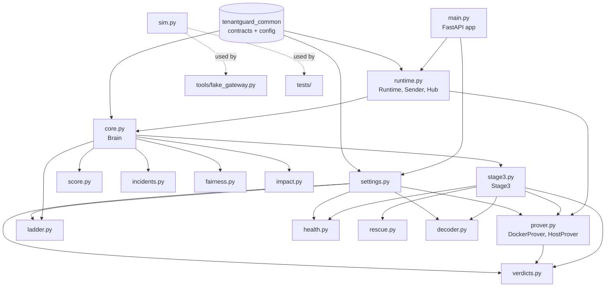
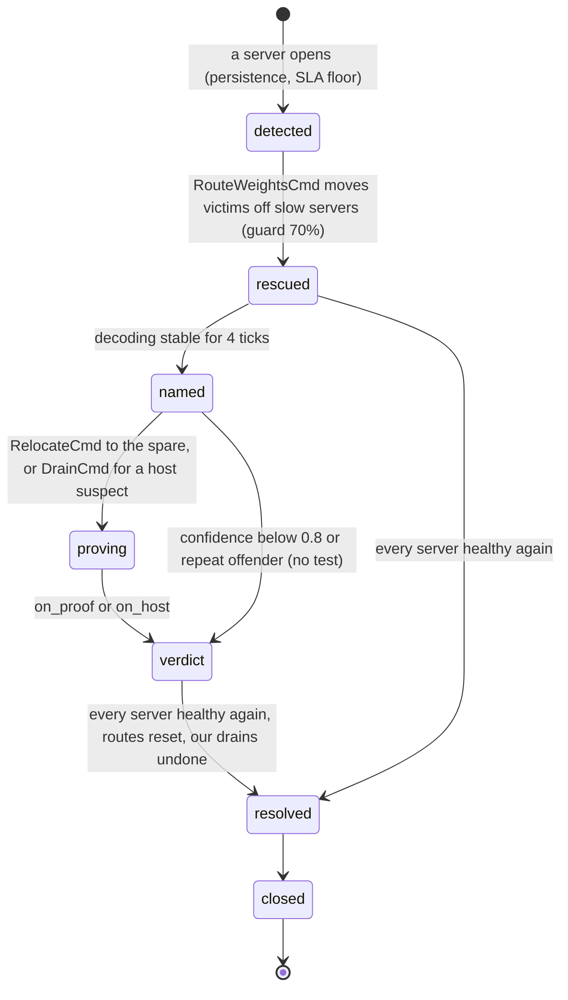

# 11 — Files: `brain/` (the control plane)

The brain is the TenantGuard control plane. It runs on port **8200** and does six things:

- It watches every tenant's usage and latency (gateway telemetry plus worker `/stats`).
- It watches every server's health (tenant-relative peer comparison, with canary probes as a fallback).
- It decides what to do:
  - **Stage 2:** a noisy-neighbour score and a graduated throttle ladder.
  - **Stage 3:** server health → rescue by re-routing → barcode decoder that names the culprit → proof by relocation → one of five verdicts.
- It sends control commands to the gateway (limits, route weights, relocations, drains, background CPU charges).
- It measures business impact (`ImpactView`: revenue protected, customers shielded, innocents penalised).
- It explains every step as an `IncidentEvent`, and streams live state to the dashboard.

This page documents every file in `brain/` on this branch. Each code file has:
- a short purpose,
- a table of **every** function, method and class (private ones included),
- the key design decisions.

---

## 1. File map

| File | Kind | One line |
|---|---|---|
| `brain/README.md` | doc | How to run, env vars, API, loops, detection, ladder and Stage 3 summary |
| `brain/Dockerfile` | build | `python:3.12-slim` image, listens on 8200, health check on `/healthz` |
| `brain/requirements.txt` | build | fastapi, uvicorn, httpx, websockets, pydantic, PyYAML |
| `brain/pytest.ini` | test config | `pythonpath = .`, `testpaths = tests`, `asyncio_mode = auto` |
| `tenantguard_brain/__init__.py` | package | Package docstring only |
| `tenantguard_brain/__main__.py` | entry | `python -m tenantguard_brain` → `main.run()` |
| `tenantguard_brain/settings.py` | config | `BrainSettings` built from `tenantguard.yaml` + env |
| `tenantguard_brain/score.py` | pure logic | Noisy-neighbour score, victim impact, calm baseline |
| `tenantguard_brain/ladder.py` | pure logic | Throttle ladder state machine with holds and hysteresis |
| `tenantguard_brain/incidents.py` | pure logic | Incident book: ids, events, open/closed bookkeeping |
| `tenantguard_brain/fairness.py` | pure logic | Jain fairness index, normalised throughput |
| `tenantguard_brain/impact.py` | pure logic | `ImpactMeter`: SLO seconds avoided / suffered, revenue protected, innocents penalised |
| `tenantguard_brain/health.py` | pure logic | Per-server health: tenant-relative peer ratio, SLA floor, persistence |
| `tenantguard_brain/rescue.py` | pure logic | Route-around plan with a capacity guard |
| `tenantguard_brain/decoder.py` | pure logic | Barcode decoder: names culprit tenant(s) or a host suspect |
| `tenantguard_brain/verdicts.py` | pure logic | Proof evaluation (R), the five verdicts, action budget, repeat-offender memory |
| `tenantguard_brain/prover.py` | I/O (async) | `DockerProver` (relocation proof, resizes the spare through the Docker socket), `HostProver` (drain test), `NullProver` |
| `tenantguard_brain/stage3.py` | pure logic | Stage 3 loop: health → rescue → decoder → named → proving → verdict |
| `tenantguard_brain/core.py` | pure logic | `Brain`: rolling state → scores → ladder → commands + events + views; background CPU charges |
| `tenantguard_brain/runtime.py` | I/O | WS / HTTP loops around `Brain`, serialised control sends, async proof jobs, UI hub |
| `tenantguard_brain/main.py` | I/O | FastAPI app: `/ws/events`, `/api/*`, `/healthz`, operator endpoint |
| `tenantguard_brain/sim.py` | dev/test | Toy fleet simulator producing contract-shaped telemetry; honours every control command |
| `tools/fake_gateway.py` | dev tool | Fake gateway + workers on top of `sim.py` |
| `tools/local_stack.py` | dev tool | Starts real workers + gateway (+ brain) locally without Docker |
| `tools/traffic.py` | dev tool | Calm traffic + optional whale through the real gateway |
| `tools/calibrate_health.py` | dev tool | Watches a running brain for N minutes and reports peer-ratio distributions and any incident |
| `tests/*.py` | tests | 142 test functions in 15 files, 166 tests collected (some parametrised) |

### 1.1 How the modules depend on each other



Only `runtime.py`, `main.py` and `prover.py` do I/O. Everything from `core.py` down is a pure, deterministic state machine: each module takes values in and returns values out, and time is passed in as `now`. The provers talk to the rest of the brain only through a `ProveEnv` (readings, send, sleep), so the tests drive them with scripted readings or the simulator on a virtual clock (`tests/conftest.py::drive_jobs`).

---

## 2. Packaging and entry files

### `brain/Dockerfile`
Builds the brain image with the build context set to the repo root:
- base `python:3.12-slim`;
- installs `common/` (the shared `tenantguard_common` package) and then `requirements.txt`;
- copies `tenantguard.yaml`, `layouts/`, `tenantguard_brain/` and `tools/`;
- runs `python -m tenantguard_brain`.

The health check fetches `http://127.0.0.1:8200/healthz`. `TENANTGUARD_ROOT=/app` points the shared config loader at the copied yaml and layout. In `docker-compose.yml` the brain gets `COMPOSE_PROJECT` and the mounted `/var/run/docker.sock`, which the `DockerProver` needs.

### `brain/requirements.txt`
`fastapi>=0.104`, `uvicorn[standard]>=0.24`, `httpx>=0.25`, `websockets>=11,<13`, `pydantic>=2.5`, `PyYAML>=6`. No numeric or ML libraries and no Docker SDK: every algorithm is plain Python, and the Docker Engine API is called with `httpx` over the unix socket.

### `brain/pytest.ini`
`pythonpath = .` (so `tenantguard_brain` imports from `brain/`), `testpaths = tests`, `asyncio_mode = auto` (async tests run without decorators).

### `brain/README.md`
The operator-facing summary: run commands and environment variables, the HTTP/WS API table, the loops in `runtime.py`, the detection formula and ladder rules, and Stage 3 (health, rescue, decoder, proof, verdicts).

### `brain/tenantguard_brain/__init__.py`
Contains only the package docstring. No functions.

### `brain/tenantguard_brain/__main__.py`

| Function / class | Signature | What it does | Called by |
|---|---|---|---|
| (module body) | — | Imports `run` from `main` and calls it | `python -m tenantguard_brain`, Dockerfile `CMD` |

---

## 3. `brain/tenantguard_brain/settings.py`

Turns `tenantguard.yaml` (through `tenantguard_common.config`) and environment variables into one typed `BrainSettings` object. Nothing else in the brain reads yaml or env directly, except `prover.py`, which reads the Docker socket and compose project from env. The `Brain`, `Runtime` and FastAPI app all receive this object, so tests build it once (`settings.load()`) and reuse it.

| Function / class | Signature | What it does | Called by |
|---|---|---|---|
| `BrainSettings` | `@dataclass` | Every brain tunable (see the key table below), plus the typed parameter blocks `ladder` (`LadderParams`), `health` (`HealthParams`), `decoder` (`DecoderParams`), `verdicts` (`VerdictParams`), `action_budget` (`ActionBudget`) and `prover` (`ProverParams`) | Built by `load`; read by `Brain`, `Stage3`, `Runtime`, `create_app` |
| `load` | `load(raw: dict \| None = None) -> BrainSettings` | Reads yaml (or the dict passed in), env overrides and tenants from the layout. Derives the fleet server list from the tenants' barcodes and builds every parameter block from its yaml section | `main.create_app`, `main.run`, `tests/conftest.py::cfg` |

### 3.1 Yaml keys the brain reads (`tenantguard.yaml` values on this branch)

| Yaml key | Value | Used for |
|---|---|---|
| `brain.tick_ms` | 250 | Tick period (`tick_s` 0.25) |
| `brain.stats_poll_s` | 1.0 | Worker `/stats` poll period |
| `brain.noisy.warn` / `throttle` / `quarantine` / `recover_below` | 1.5 / 2.0 / 4.0 / 1.0 | Ladder thresholds |
| `brain.noisy.hold_s` | warn 5, throttle 2, deprioritize 4, quarantine 6, recover 10 | Ladder hold times (s) |
| `brain.noisy.throttle_factor` / `recover_step` / `recover_tick_s` | 0.5 / 0.1 / 1.0 | AIMD steps |
| `brain.noisy.throttle_floor` / `deprioritize_weight` / `quarantine_factor` / `quarantine_weight` | 0.25 / 0.25 / 0.1 / 0.1 | Ladder rungs |
| `brain.noisy.hold_ratio` | 0.8 | Share of ticks in a hold window that must qualify |
| `brain.noisy.min_victim_impact` | 0.2 | Victim impact needed to flag |
| `brain.noisy.baseline_half_life_s` | 60 | Calm baseline EWMA |
| `brain.noisy.victim_window_s` / `victim_quantile` / `victim_min_ticks` / `victim_abs_ms` | 5.0 / 0.3 / 4 / 8.0 | Victim latency is a sustained statistic |
| `brain.noisy.over_use` | 1.6 | Flag only at this multiple of the fair share (also the "hot on a server" test) |
| `brain.noisy.min_hurt_neighbours` | 4 | Flag only with at least this many hurt neighbours |
| `brain.health.*` | see §8 | Server health |
| `brain.rescue_capacity_guard` | 0.7 | Rescue headroom guard |
| `brain.confidence_to_prove` | 0.8 | Decoder confidence needed before a relocation proof |
| `brain.spare_sizing` / `prove_settle_s` / `prove_window_s` | 1.25 / 2 / 6 | `ProverParams` |
| `brain.recovery_R` / `paid_share_costly` / `host_idle_ratio` | 0.5 / 0.35 / 1.5 | `VerdictParams` |
| `brain.verdicts.*` | `over_plan_rejected_share` 0.2, `harm_follow_share` 0.3, `harm_follow_ratio` 1.6, `evidence_hint` 0.3, `repeat_count` 3, `repeat_window_s` 600 | `VerdictParams`; `prove_sample_s`, `min_spare_cores`, `max_spare_cores` are also read here (code defaults 0.5 / 0.25 / 4.0) |
| `brain.action_budget` | `relocations_per_min` 6, `quarantine_every_s` 30, `max_drained` 1, `drain_peer_busy` 0.75 | `ActionBudget` |
| `brain.ttl_s` | relocate 120, quarantine 120, throttle 60 | Command TTLs; `rescue` falls back to `relocate` (120 s) |
| `brain.prover` | `auto` | `auto` / `docker` / `null` (env `TENANTGUARD_PROVER` wins) |
| `brain.charge_s` | 1.0 | Background CPU charge period |
| `brain.decoder` | `k` 8, `w_min` 4, `w_mean` 2, `w_stuck` 1, `w_ledger` 2, `w_host` 4, `w_none` 3, `temperature` 1.0, `min_confidence` 0.5, `max_culprits` 2, `host_p` 0.5 | `DecoderParams` |
| `gateway.fail_static_after_s` | 2 | Heartbeat period = this / 4 = 0.5 s |
| `gateway.default_mode` / `gateway.ttl_max_s` | `tenantguard` / 3600 | Snapshot mode before the first frame; operator `until_s` bound |
| `gateway.limiter.initial_window` | 8 | Dispatch slots until telemetry reports the window |
| `worker.cpus` | 0.5 | CPU capacity until a worker reports `cpu_limit_cores` |
| `services.gateway` / `services.brain` | URLs | Gateway URL; brain port |

`brain.noisy.baseline_alpha` and `brain.ttl_s.probation` are in the yaml but not read by the brain. `brain.health.open_after_ticks` (4) is marked legacy in the yaml for server opening (persistence uses `open_hold_s` now), but `Stage3` still uses it as the naming debounce.

**Environment variables:** `TENANTGUARD_GATEWAY_URL`, `TENANTGUARD_WORKER_URLS` (through `tenantguard_common.config.worker_urls`), `TENANTGUARD_CORS_ORIGINS`, `TENANTGUARD_CONTROL_TOKEN` (default `dev`), `TENANTGUARD_PROVER`, `TENANTGUARD_BRAIN_HOST`, `TENANTGUARD_BRAIN_PORT`. `prover.py` also reads `TENANTGUARD_DOCKER_SOCKET`, `COMPOSE_PROJECT` and `TENANTGUARD_SPARE_CONTAINER`.

**Key decisions**
- **Heartbeat period** = `gateway.fail_static_after_s / 4` (2 s → 500 ms): four heartbeats inside the gateway's fail-static window, so one lost heartbeat never trips it.
- **Detection window** = `health.probe_window_ticks × tick` (8 × 250 ms = 2 s), used for the scoring frames.
- **Defaults overwritten from live data:** `default_cores` until a worker reports `cpu_limit_cores`; `default_window` until telemetry reports the limiter window.

---

## 4. `brain/tenantguard_brain/score.py` — the noisy-neighbour score

The Stage 2 detector, with no I/O. It answers two questions for each tenant: "is it taking more than its fair share of *its own servers*?" and "are enough of the tenants that share those servers slower than their calm baseline?". A tenant is **flagged** only when both are true.

### 4.1 The formula

```
score(t)       = usage_ratio(t) × (1 + victim_impact(t))
usage_ratio(t) = max(cpu_share(t), queue_share(t)) / fair_share(t)

cpu_share(t)   = t's CPU ms/s (handler + background) on its servers / CPU capacity of those servers
queue_share(t) = t's median (queue depth + inflight) / dispatch slots of its servers
fair_share(t)  = Σ_s weight(t)/Σ_active weight on s × cap(s)  /  Σ_s cap(s)       (s over t's servers)
slowdown(v)    = 0 if p95 − baseline < victim_abs_ms (8 ms), else max(0, p95 / max(baseline, 8 ms) − 1)
victim_impact  = mean over t's neighbours of min(3, slowdown), then clipped to [0, 3]
flagged(t)     = usage_ratio ≥ over_use (1.6)  AND  victim_impact ≥ min_victim_impact (0.2)
                 AND at least min_hurt_neighbours (4) neighbours with slowdown ≥ hurt_off (0.1)
noisy_norm(t)  = min(1, score / brain.noisy.quarantine)        (0..1, for the UI bars)
```

A *neighbour* is any other tenant that shares at least one server with `t`. In the AG(2,3) layout each tenant shares servers with 6 of the other 11 and is disjoint from 5. The victim latency fed into `slowdown` is computed in `core.py` (`Brain.victim_latency`).

| Function / class | Signature | What it does | Called by |
|---|---|---|---|
| `IMPACT_CLIP` | constant `3.0` | Clip for each victim's slowdown and for the mean | `victim_impact` |
| `shares` | `shares(values) -> Dict[str, float]` | Each value's fraction of the (non-negative) total; all 0 when the total is 0 | `Brain.snapshot` (TenantView `cpu_share`) |
| `fair_shares` | `fair_shares(weights, active) -> Dict[str, float]` | `weight / Σ active weights`. An inactive tenant gets the share it *would* have if it became active now, so a first burst is never divided by zero | `compute_scores` (per server) |
| `slowdown` | `slowdown(p95, baseline, floor_ms=0.0, abs_ms=0.0) -> Optional[float]` | The slowdown line above; `None` if either side is unknown | `Brain.tick` |
| `victim_impact` | `victim_impact(culprit, slowdowns, neighbours=None) -> (float, List[(str, float)])` | Mean over neighbours with data, each clipped to [0, 3] first (one victim with a 46x tail must not carry the mean), plus the victims sorted worst first | `compute_scores` |
| `ScoreDetail` | `@dataclass` | `tenant`, `cpu_share`, `queue_share`, `fair_share`, `usage_ratio`, `victim_impact`, `score`, `norm`, `flagged`, `victims` | Built by `compute_scores`; read by `Brain`, `Stage3` |
| `ScoreDetail.dominant` | property `-> str` | `"CPU"` or `"queue"`, whichever share is larger | `Brain._evidence` |
| `noisy_score` | `noisy_score(cpu_share, queue_share, fair_share, impact) -> (score, ratio)` | The formula; `(0, 0)` when the fair share is 0 | `compute_scores` |
| `compute_scores` | `compute_scores(*, weights, servers_of, active, cpu_by_server, cpu_cap, occupancy, slots, slowdowns, neighbours, min_victim_impact, quarantine_threshold, over_use=1.0, min_hurt=1, hurt_level=0.0) -> Dict[str, ScoreDetail]` | Scores every tenant: capacity-weighted fair share over its own servers, CPU and queue shares against those servers, victim impact over its neighbours, flag rule, `norm` | `Brain.tick` |
| `BaselineTracker` | class | Calm-period, **time-based** EWMA of each tenant's victim latency | `Brain.__init__` |
| `BaselineTracker.__init__` | `(half_life_s=60.0, warmup=8)` | Stores the half-life and warm-up length | `Brain.__init__` |
| `BaselineTracker.update` | `update(tenant, p95, now) -> None` | `alpha = 1 − 0.5^(dt / half_life)`; for the first `warmup` samples `alpha ≥ 1/n`. Ignores `p95 ≤ 0` | `Brain._learn_baselines` |
| `BaselineTracker.get` | `get(tenant) -> Optional[float]` | Current baseline | `Brain._learn_baselines`, `Brain.tick` |
| `BaselineTracker.ready` | `ready(tenant, min_samples=4) -> bool` | True after enough samples (the tick uses 3) | `Brain._learn_baselines`, `Brain.tick` |

**Key decisions**
- **Barcode-scoped shares.** The fair share is computed only over the tenant's own servers; with fleet-wide shares, calm free-tier tenants scored around 1.55× and looked noisy.
- **Over-use alone is never enough, and a margin is required.** A tenant must be at 1.6× its fair share *and* hurt at least 4 neighbours. Two slow neighbours are more likely their own servers than a noisy neighbour (`tests/test_host_noise.py::test_two_slow_neighbours_do_not_flag_an_over_user`). A legitimate burst on idle capacity is never flagged (`tests/test_score.py::test_legit_burst_with_no_victim_impact_is_not_flagged`).
- **Neighbours, not "everyone else".** Impact is averaged only over tenants that share a server, so an innocent heavy tenant on disjoint servers is not blamed for someone else's victims.
- **An absolute floor on slowdown.** Less than 8 ms above the baseline is no slowdown at all, so sub-10 ms jitter never reads as harm.
- The module docstring still says `over_use` 1.25 and 3 hurt neighbours; the values in force come from `tenantguard.yaml` (1.6 and 4).

---

## 5. `brain/tenantguard_brain/ladder.py` — the throttle ladder

A graduated, self-recovering state machine per tenant, with no I/O. It escalates multiplicatively and recovers additively (AIMD), and uses hold windows and hysteresis so it never flaps. The ladder only decides `level`, `factor` and `weight_factor`. `core.py` turns these into `LimitsCmd`s.

### 5.1 Levels and transitions (values from `tenantguard.yaml` `brain.noisy`)


Any level returns straight to `normal` (factors 1.0/1.0) through `reset` when the mode leaves `tenantguard` or an operator releases the tenant. An `over_plan` verdict puts the tenant at throttle directly (`Brain.force_throttle`).

| Rule | Condition (all from yaml) |
|---|---|
| A hold is "met" | The history covers the hold time, **≥ 80 %** (`hold_ratio`) of the ticks in the window qualify, and the current tick qualifies too |
| Escalation conditions | The tenant is `flagged` **and** its score is above the rung's threshold (warn 1.5, throttle 2.0, quarantine 4.0) |
| Escalation | warn → throttle: factor 0.5 · each further step ×0.5 down to `throttle_floor` 0.25 · then deprioritize: weight_factor 0.25 · then quarantine: factor 0.1, weight_factor 0.1 |
| Fresh hold | Every escalation restarts all hold clocks |
| Calm | score < `recover_below` (1.0) **or** neighbours clearly unhurt (impact < `hurt_off` 0.1 and usage ratio < `over_use`) |
| Recovery | After `hold_s.recover` (10 s) of calm, factor and weight_factor each rise by 0.1 once per second |
| Hysteresis | Flagging needs impact ≥ 0.2, calm needs impact < 0.1 |
| TTL on commands | `ttl_s.throttle` 60 s; `ttl_s.quarantine` 120 s |

| Function / class | Signature | What it does | Called by |
|---|---|---|---|
| `LEVELS`, `RANK`, `EPS` | constants | Level order `normal < warn < throttle < deprioritize < quarantine`; a rank for comparisons; float tolerance | Whole module, `core.py` |
| `LadderParams` | `@dataclass` | Thresholds, hold times, AIMD factors, floor, deprioritize/quarantine factors, TTLs, `hold_ratio` | Built by `settings.load` |
| `LadderParams.from_yaml` | `classmethod from_yaml(noisy, ttl=None)` | Reads `brain.noisy` and `brain.ttl_s` with defaults | `settings.load` |
| `LadderParams.level_for` | `level_for(factor, weight_factor) -> str` | Level implied by the factors in force | `step`, `Brain.adopt_overrides`, `Brain.force_throttle` |
| `LadderParams.ttl_for` | `ttl_for(level) -> float` | 120 s for quarantine, 60 s otherwise | `Brain._commands`, `Brain._action_text`, `Brain.adopt_overrides` |
| `Signal` | `@dataclass(score, flagged, unhurt)` | One tick's input for one tenant | Built by `Brain.tick` |
| `Hold` | `@dataclass` | One condition's recent history `(t, ok)` plus its start time | Fields of `LadderState` |
| `Hold.add` | `add(now, ok, keep_s)` | Appends a sample and drops old ones | `step` |
| `Hold.held` | `held(hold, now, ratio) -> bool` | The hold rule above | `step` |
| `Hold.restart` | `restart(now)` | A fresh hold from now, keeping this tick's sample | `_apply` |
| `LadderState` | `@dataclass` | `level`, `factor`, `weight_factor`, `changed_at`, `peak`, four `Hold`s (warn, throttle, quarantine, calm), `last_recover_at` | `Brain.ladders` |
| `LadderState.acting` | property `-> bool` | True while factor or weight_factor is below 1 | `step`, `reset`, `Brain`, `Stage3.hot_on` |
| `Transition` | `@dataclass` | `kind` (escalate / step / recover / clear / resolve / reset), previous and new level and factors, `rule` in plain English | Returned by `step` / `reset`; built by `Brain.force_throttle`; read by `Brain._on_transition` |
| `_apply` | `_apply(s, now, kind, level, factor, wf, rule) -> Transition` | Mutates the state, tracks `peak`, restarts holds on escalate/step | `step`, `reset` |
| `step` | `step(s, sig, now, p) -> Optional[Transition]` | Advances one tenant by one tick | `Brain.tick` |
| `step.held` (inner) | `held(hd, key) -> bool` | Shorthand for `hd.held(hold[key], now, hold_ratio)` | `step` |
| `reset` | `reset(s, now, rule) -> Optional[Transition]` | Forces normal with 1.0/1.0 and fresh holds; `None` if already normal | `Brain.tick` (mode is not `tenantguard`), `Brain.operator` (release) |

**Key decisions**
- **AIMD**, as in TCP congestion control: fast to react to harm, cautious coming back.
- **Holds by ratio, not a strict streak** (`tests/test_ladder.py::test_one_dip_does_not_restart_the_hold`); half-duty flapping never escalates.
- **A move is never made on a tick that contradicts it.** `Hold.held` requires the current tick to qualify.
- **Quarantine needs its own threshold** (`test_quarantine_needs_the_quarantine_threshold`).
- **The ladder's quarantine rung is a limit** (factor 0.1, weight_factor 0.1). Moving work to the quarantine worker is done by the `costly_pattern` verdict (`stage3.py`), not by the ladder. The module docstring says so.

---

## 6. `brain/tenantguard_brain/incidents.py`

Incident bookkeeping, with no I/O. There is at most one open incident per tenant, plus server incidents not tied to a tenant. Every event is stored in a bounded log that the API and the UI backfill read.

| Function / class | Signature | What it does | Called by |
|---|---|---|---|
| `Incident` | `@dataclass` | `incident_id`, `tenant` (`""` for server incidents), `opened_at`, `level`, `peak`, `closed_at`, `events` | Created by `IncidentBook` |
| `IncidentBook` | class | Open incidents per tenant, an index by id, a bounded event log (1000), the last 200 closed ids | `Brain.__init__` |
| `IncidentBook.__init__` | `(keep_events=1000, keep_closed=200)` | Sets up the stores | `Brain.__init__` |
| `IncidentBook.open_for` | `open_for(tenant, now) -> Incident` | The tenant's open incident, or a new `inc-<ts>-<tenant>-<seq>` | `Brain._on_transition`, `adopt_overrides`, `operator`, `_held_tick` |
| `IncidentBook.open_server` | `open_server(now) -> Incident` | Opens a fleet incident `srv-<ts>-<seq>` | `Stage3.tick` |
| `IncidentBook.emit` | `emit(inc, now, stage, *, level=None, prev_level=None, action=None, detail="", confidence=None, report=None) -> IncidentEvent` | Builds a contract `IncidentEvent` and appends it to the incident and the log. `Stage3` then sets `tenant`, `suspects` and `verdict` on the returned event where needed | Every event in `core.py` and `stage3.py` |
| `IncidentBook.close` | `close(inc, now)` | Marks closed, frees the tenant slot, trims old closed incidents from the index | `Brain`, `Stage3._close` |
| `IncidentBook.events` | `events(*, incident_id=None, tenant=None, limit=200) -> List[IncidentEvent]` | Filtered tail of the log, oldest first | `GET /api/incidents`, `WS /ws/events` backfill |

**Key decisions:** readable, unique, sortable ids; bounded memory (`deque(maxlen=1000)`).

---

## 7. `brain/tenantguard_brain/fairness.py` and `impact.py`

### `fairness.py`

| Function | Signature | What it does | Called by |
|---|---|---|---|
| `jain` | `jain(values) -> float` | Jain's fairness index `(Σx)² / (n · Σx²)`, in (0, 1]; 1.0 for empty or all-zero input | `Brain.snapshot` |
| `normalized_throughput` | `normalized_throughput(rps, weights) -> dict` | `completed rps / weight` for each active tenant | `Brain.snapshot` |

Fairness is measured on throughput normalised by tier weight, so a pro tenant (weight 2) doing twice the work of a free tenant (weight 1) scores 1.0.

### `impact.py` — business impact since the brain started

Each tick in tenantguard mode, `Brain._measure_impact` passes the **threatened** tenants: tenants with a server in an open server incident (minus named culprits) and neighbours of tenants the ladder is warning or acting on; never a tenant the ladder acts on, and never one using more than its fair share. For each one, the tick counts as **suffered** if its end-to-end p95 is above its plan's `sla_p95_ms` (layout), otherwise **avoided**.

| Function / class | Signature | What it does | Called by |
|---|---|---|---|
| `MONTH_S` | constant `2_592_000.0` | Seconds in 30 days | `ImpactMeter.tick` |
| `ImpactMeter` | class | Accumulates avoided / suffered seconds per tenant, revenue protected, innocents | `Brain._measure_impact` (created on the first frame) |
| `ImpactMeter.__init__` | `(since, sla_ms, revenue_rs)` | Per-tenant SLA p95 and monthly revenue from the layout | `Brain._measure_impact` |
| `ImpactMeter.tick` | `tick(dt, threatened, p95)` | Suffered if p95 > SLA (100 ms if unknown), else avoided; revenue protected += `monthly_revenue_rs × dt / MONTH_S`. A tenant without completions is skipped | `Brain._measure_impact` |
| `ImpactMeter.note_action` | `note_action(tenant, score, warn)` | A tightening while the tenant's own score was below `warn` marks it an innocent | `Brain._on_transition` |
| `ImpactMeter.view` | `view() -> ImpactView` | `customers_shielded` (more avoided than suffered), SLO seconds avoided / suffered, `revenue_protected_rs`, `innocents_penalised` | `Brain.snapshot` (`StateSnapshot.impact`) |

**Key decision:** `innocents_penalised` must stay empty. `Brain._on_transition` calls `note_action` on every ladder tightening (`escalate` or `step`), and the flag rule means the ladder only tightens a tenant whose score is above `warn`. The module docstring says a proven verdict is not an innocent; note that the `over_plan` path (`force_throttle`) also goes through `_on_transition`, so it is checked against the same score.

---

## 8. `brain/tenantguard_brain/health.py` — server health (calibrated)

Decides which servers are slow by comparing each tenant with **itself** across its own servers, never against a fixed number, so a fleet-wide slowdown accuses nobody. It has no I/O. The signals are *sustained*: on the Docker host a 0.5-CPU container stalls for 1-3 s now and then at calm (CPU-quota throttling), and that is not a slow server.

```
cell level(t, s) = count-weighted level_quantile (0.3) of the per-tick p95 of tenant t on server s
                   over window_s (5 s), used only with >= min_cell_requests (5) requests
ref(t)           = median of t's cell levels over its own servers (needs >= 2 servers with data)
peer_ratio(s)    = median over tenants t on s of level(t, s) / ref(t)        (traffic source, >= 2 tenants)
                   canary source: median canary RTT of s / median of the fleet servers' canaries
floor(s)         = max(slow_abs_ms 8, min_slow_ms 25, sla_fraction 0.5 x strictest sla_p95_ms of s's tenants)
slow_now(s)      = peer_ratio >= 1.6 AND median excess >= 8 ms (canary: canary_abs_ms 8) AND level >= floor(s)
open             = slow_now in >= hold_ratio (80 %) of the ticks of the last open_hold_s (4 s)
heal             = not slow_now in >= 80 % of the ticks of the last heal_hold_s (2 s)
```

With the layout's SLAs (40, 50, 80 and 150 ms) the floor is 25 ms on any server that carries a 40 ms or 50 ms tenant. 17 ms against 4 ms is 4x, but no SLA is at risk, so it is not slow. The canary can only **keep** an already-open server open, never open one: an incident needs slow real traffic first. Pool servers (`spare`, `quarantine`) are judged against the fleet but are never anyone's peer and never a suspect.

| Function / class | Signature | What it does | Called by |
|---|---|---|---|
| `HealthParams` | `@dataclass` | `window_ticks` 8, `tick_s`, `window_s` 5.0, `slow_peer_ratio` 1.6, `slow_abs_ms` 8, `open_after_ticks` 4, `min_cell_requests` 5, `min_tenants` 2, `min_canaries` 3, `canary_window_s` 6.0, `canary_abs_ms` 8, `open_hold_s` 4, `heal_hold_s` 2, `hold_ratio` 0.8, `level_quantile` 0.3, `min_slow_ms` 25, `sla_fraction` 0.5 | `settings.load` |
| `HealthParams.from_yaml` | `classmethod from_yaml(health, tick_s)` | Reads `brain.health` (`min_requests` accepted as an older name for `min_cell_requests`) | `settings.load` |
| `ServerHealth` | `@dataclass` | Per server: `source` (traffic / canary / none), `level_ms`, `peer_ms`, `peer_ratio`, `excess_ms`, `tenants_used`, `slow_now`, `slow`, `streak`, `slow_since`, `canary` and `history` deques | `HealthTracker.servers`; read by `Stage3`, `Brain.readings`, `Brain.snapshot`, `Brain.debug` |
| `weighted_quantile` | `weighted_quantile(samples, q) -> float` | q-quantile of values weighted by counts | `_cell_levels`, `weighted_median` |
| `weighted_median` | `weighted_median(samples) -> float` | `weighted_quantile(samples, 0.5)` | Not called on this branch |
| `HealthTracker` | class | All servers' health plus per-(tenant, server) cell samples | `Stage3.__init__` |
| `HealthTracker.__init__` | `(servers, params, barcodes=None, sla_ms=None)` | One `ServerHealth` per server; `fleet` = barcode servers; `floor_ms` per server from the strictest SLA | `Stage3.__init__` |
| `HealthTracker._h` | `_h(s) -> ServerHealth` | Gets the entry, creating it for a new server | `observe_canary`, `observe` |
| `HealthTracker.observe_canary` | `observe_canary(server, rtt_ms, now)` | Records one canary round trip | `Stage3.on_canary` |
| `HealthTracker.observe` | `observe(cells, now) -> List[(server, slow)]` | Feeds one tick of `(tenant, server, p95_ms, count)` cells and returns open-state flips | `Stage3.on_frame` |
| `HealthTracker._cell_levels` | `_cell_levels(now) -> Dict[(t, s), float]` | Drops old samples; level per cell with enough requests | `_evaluate` |
| `HealthTracker._canary_levels` | `_canary_levels(now) -> Dict[str, float]` | Median canary per server with ≥ 3 probes in 6 s | `_evaluate` |
| `HealthTracker._evaluate` | `_evaluate(now) -> List[(server, slow)]` | The block above: source choice, peer ratio, floor, `slow_now`, persistence | `observe` |
| `HealthTracker._held` | `_held(h, value, hold, now) -> bool` | `value` in ≥ `hold_ratio` of the ticks of the last `hold` seconds, with the history covering them | `_evaluate` |
| `HealthTracker._peer` | `_peer(s) -> bool` | True for fleet (barcode) servers | `_evaluate`, `slow_servers`, `Stage3.decoder_ratios` |
| `HealthTracker.slow_servers` | `slow_servers() -> List[str]` | Sorted open fleet servers | `Stage3.tick`, `Stage3.status`, `Stage3._named` |
| `HealthTracker.ratios` | `ratios() -> Dict[str, float]` | server → peer ratio | Not called on this branch (`Stage3` uses `decoder_ratios`) |

**Key decisions**
- **Tenant-relative.** Comparing a tenant with itself cancels workload differences: a search-heavy tenant is slow everywhere, a light one fast everywhere (`tests/test_stage3_pure.py::test_workload_mix_is_not_slowness`).
- **Sparse cells are no opinion** (`test_sparse_cells_are_no_opinion`); a ratio alone is not enough (`test_ratio_alone_is_not_enough`); a fast server is never slow whatever the ratio (`tests/test_host_noise.py::test_a_fast_server_is_never_slow_whatever_the_ratio`).
- **Persistence, not a streak.** A server opens after 4 s of mostly-slow ticks and heals after 2 s of mostly-healthy ones. The noisy-calm simulator runs open nothing (`test_noisy_calm_opens_nothing_and_moves_nothing`).
- **The canary only sustains** (`test_canary_alone_never_opens_an_incident`, `test_canary_keeps_a_slow_server_open_when_traffic_moved_away`).

---

## 9. `brain/tenantguard_brain/rescue.py` — route around slow servers

Builds a `RouteWeightsCmd` plan that moves each victim's traffic off its slow servers onto its healthy ones, without creating the next slow server. It has no I/O.

```
for each tenant with ≥1 slow and ≥1 healthy (and up) server in its barcode, lightest first:
    headroom(s) = max(0, guard × capacity(s) − projected_load(s))      guard = rescue_capacity_guard 0.7
    f           = min(1, Σ headroom / tenant's CPU on its slow servers)    (fraction moved)
    new weight  = slow servers keep (1 − f) of their weight; the moved share goes to healthy
                  servers in proportion to their headroom; weights renormalised to sum 1
tenants whose servers are all slow are "stuck" (nothing to route to; decoder evidence)
```

| Function / class | Signature | What it does | Called by |
|---|---|---|---|
| `RescuePlan` | `@dataclass` | `weights` (tenant → server → weight), `moved`, `stuck`, `capped`, `projected_util` | Returned by `plan_rescue`; held as `Stage3.plan`; shown in `Brain.debug` |
| `plan_rescue` | `plan_rescue(*, barcodes, slow, load, capacity, server_load=None, guard=0.7, current=None, targets=None) -> RescuePlan` | The algorithm above. `targets` restricts destinations to servers known to be up and healthy | `Stage3.tick` |

**Key decisions**
- **The capacity guard (70 % CPU) bounds every move** (`test_no_room_at_all_leaves_the_tenant_alone`).
- **Lightest tenants first**, so the headroom rescues as many tenants as possible.
- **Only the victims are routed.** `Stage3` excludes a named culprit; the prover moves the culprit instead.

---

## 10. `brain/tenantguard_brain/decoder.py` — name the culprit from the barcode

Every tenant runs on 3 servers, its **barcode**. In AG(2,3) any two barcodes share at most one server (`tests/test_stage3_pure.py::test_ag23_any_two_tenants_share_at_most_one_server`). The set of slow servers therefore points at the tenant(s) whose barcodes it covers, even when the culprit's work is invisible to every meter (black-box CPU). No I/O.

```
p_s          = logistic(k × (peer_ratio_s − 1.6))                     k = 8; probability server s is slow
evidence(t)  = 4 × min_{s∈S_t} p_s                  all of its servers slow (original signal)
             + 2 × mean_{s∈S_t} p'_s                share of the still-unexplained slowness it covers
             + 1 × stuck(t)                         every server it can be routed to is slow
             + 2 × ledger(t) × mean_{s∈S_t} p_s     bg-CPU growth, evictions, black-box growth, over-share
host_fault   = 4 × max_s p'_s × (1 − best full-barcode cover of s)
none         = 3 × (1 − max_s p'_s)
confidence   = softmax(evidence / temperature 1.0) over all tenants + host_fault + none
```
**Explain-away loop** (up to `max_culprits` = 2): accept the top option if it is a tenant and the tenants together hold ≥ `min_confidence` (0.5); zero `p'` on its servers; decode again. Slow servers still unexplained (`p' ≥ 0.5`) are **host suspects**. With two culprits, each one's confidence is recomputed with the other explained away. The ratios come from `Stage3.decoder_ratios`, which enters a server below its SLA floor as "like its peers" (ratio ≤ 1).

| Function / class | Signature | What it does | Called by |
|---|---|---|---|
| `HOST`, `NONE` | constants | Option names `"host_fault"`, `"none"` | `_round`, `decode` |
| `DecoderParams` | `@dataclass` | `slow_peer_ratio`, `k`, `w_min`, `w_mean`, `w_stuck`, `w_ledger`, `w_host`, `w_none`, `temperature`, `min_confidence`, `max_culprits`, `host_p` | `settings.load` |
| `DecoderParams.from_yaml` | `classmethod from_yaml(health, decoder=None)` | Known keys from `brain.decoder` (type-cast), `slow_peer_ratio` from `brain.health` | `settings.load` |
| `Named` | `@dataclass` | `tenant`, `confidence`, `evidence`, `covers` | Built by `decode` |
| `Decoding` | `@dataclass` | `culprits`, `host_suspects`, `p`, `rounds` | Returned by `decode`; held as `Stage3.decoding` |
| `Decoding.top_confidence` | property | First-round confidences | `Stage3._named`, `Brain.debug` |
| `logistic` | `logistic(x) -> float` | Numerically stable logistic | `p_slow` |
| `p_slow` | `p_slow(ratios, p) -> Dict[str, float]` | p_s for every server | `decode` |
| `softmax` | `softmax(scores, temperature) -> Dict[str, float]` | Stable softmax | `decode` |
| `_round` | `_round(barcodes, p0, pr, stuck, ledger, exclude, prm) -> Dict[str, float]` | One round of evidence scores | `decode` |
| `decode` | `decode(barcodes, ratios, *, stuck=None, ledger=None, params=None) -> Decoding` | The full explain-away decode | `Stage3.tick` |

**Key decisions**
- **"Nobody" and "the host" compete with the tenants** (`test_single_slow_server_is_a_host_suspect_and_nobody_is_blamed`, `test_two_slow_servers_on_one_barcode_line_are_not_a_tenant`).
- **Exact naming is tested exhaustively** (`test_every_single_culprit_is_named`, `test_all_66_culprit_pairs_are_named_exactly`).
- **Ledger hints only break ties where servers are actually slow** (`test_ledger_hint_breaks_a_tie_only_where_servers_are_slow`).

---

## 11. `brain/tenantguard_brain/verdicts.py` — proof evaluation and the five verdicts

Pure functions and small state objects, with no I/O.

### 11.1 Proof evaluation

```
R              = clamp(1 − mean(post_slowdown) / pre_slowdown, −1, 1)    on the suspect's original servers
slowdown(s)    = max(0, peer_ratio(s) − 1)
harm_followed  = spare CPU rose by ≥ harm_follow_share (0.3) × footprint   OR   spare peer ratio ≥ harm_follow_ratio (1.6)
confirmed      = R ≥ recovery_R (0.5)  AND  harm_followed
```
If R is high but the harm did not follow, the explanation adds "the suspect may have paused during the test".

### 11.2 The five verdicts (`classify`, `host_verdict`)

| Verdict | When | Action (taken in `Stage3._verdict` / `on_host`) |
|---|---|---|
| `mitigated_no_blame` | Decoder confidence below `confidence_to_prove` (0.8), or the relocation did not confirm, and the tenant is not a repeat offender. Also a host suspect that is only load (idle ratio < 1.5) | No action on the tenant; back home if it was relocated; a host is undrained |
| `over_plan` | Confirmed (or repeat offender) and admission already refuses ≥ 20 % of its requests | Back home; ladder forced to throttle (factor 0.5), relaxed by AIMD when calm |
| `costly_pattern` | Confirmed (or repeat) and paid CPU explains < 35 % of its footprint, or a black-box / eviction ledger hint ≥ 0.3 | Its top request class goes to the quarantine heavy lane (TTL 120 s), the rest goes home |
| `honest_growth` | Confirmed (or repeat) and paid work explains the load | Stays on the spare as a burst lane until the relocation TTL (120 s) ends. No penalty |
| `host_fault` | A host suspect still ≥ `host_idle_ratio` (1.5x) its peers while drained and idle | Stays drained, the drain renewed while it is slow |

`over_plan` is checked before `costly_pattern`. A repeat offender (named `repeat_count` 3+ times within `repeat_window_s` 600 s, with a previous verdict) gets its last verdict again without a new proof.

| Function / class | Signature | What it does | Called by |
|---|---|---|---|
| `COSTLY`, `OVER`, `HONEST`, `HOST`, `NO_BLAME` | constants | The five verdict names | `stage3.py` |
| `VerdictParams` | `@dataclass` | `confidence_to_prove`, `paid_share_costly`, `recovery_R`, `host_idle_ratio`, `over_plan_rejected_share`, `harm_follow_share`, `harm_follow_ratio`, `evidence_hint`, `repeat_count`, `repeat_window_s` | `settings.load` |
| `VerdictParams.from_yaml` | `classmethod from_yaml(brain)` | Top-level `brain.*` keys plus `brain.verdicts`; `harm_follow_ratio` falls back to `health.slow_peer_ratio` | `settings.load` |
| `ProofMeasure` | `@dataclass` | `pre_slowdown`, `post_slowdown` samples, `spare_cpu_pre`, `spare_cpu` samples, `spare_ratio` samples, `footprint_ms` | Built by `DockerProver._prove` |
| `evaluate_proof` | `evaluate_proof(m, p) -> (R, harm_followed, confirmed, why)` | §11.1 | `DockerProver._prove` |
| `Evidence` | `@dataclass` | `tenant`, `confidence`, `confirmed`, `R`, `harm_followed`, `paid_share`, `blackbox_hint`, `evict_hint`, `rejected_share`, `repeat`, `last_verdict` | Built by `Stage3._judge`, `Stage3.on_proof` |
| `classify` | `classify(e, p) -> (verdict, reasons)` | §11.2 for tenants, with plain-English reasons | `Stage3._judge`, `Stage3.on_proof` |
| `host_verdict` | `host_verdict(idle_ratio, p) -> (verdict, why)` | `host_fault` or `mitigated_no_blame` | `Stage3.on_host` |
| `ActionBudget` | `@dataclass` | `relocations_per_min` 6, `quarantine_every_s` 30, `max_drained` 1, `drain_peer_busy` 0.75, plus its running state | `settings.load`; `Stage3.budget` |
| `ActionBudget.from_yaml` | `classmethod from_yaml(brain)` | Reads `brain.action_budget` | `settings.load` |
| `ActionBudget.can_relocate` / `note_relocation` | `(now)` | At most 6 relocation tests per rolling minute | `Stage3._judge` |
| `ActionBudget.can_quarantine` / `note_quarantine` | `(now)` | At most one quarantine every 30 s | `Stage3._verdict` |
| `ActionBudget.can_drain` | `can_drain(server, peer_util) -> (ok, why)` | Refuses if already drained, if `max_drained` is reached, or if a peer is at ≥ 75 % CPU | `Stage3._judge` |
| `OffenderMemory` | `@dataclass` | Times each tenant was named, and its last tenant verdict | `Stage3.memory` |
| `OffenderMemory.note_named` / `is_repeat` | `(tenant, now)` | Named ≥ `count` times within `window_s` | `Stage3.tick`, `_judge`, `on_proof` |
| `OffenderMemory.note_verdict` | `note_verdict(tenant, verdict)` | Remembers `costly_pattern`, `over_plan` or `honest_growth` | `Stage3._verdict` |

---

## 12. `brain/tenantguard_brain/prover.py` — proof by relocation and drain test

The two provers do the slow, asynchronous part of Stage 3. They run as runtime jobs and talk to the brain only through a `ProveEnv`: `readings()` (from `Brain.readings`), `send(path, model)` (the runtime posts to the gateway with the control token), and `sleep(seconds)`.

### 12.1 `DockerProver.prove` step by step
1. Take the lock (one relocation test at a time: the spare is shared).
2. Read `pre` readings. If the suspect's servers are no longer slow, stop: "nothing to prove".
3. **Size the spare** to `clamp(spare_sizing 1.25 × footprint / 1000, 0.25, 4.0)` cores. The footprint is the suspect's paid plus unexplained (black-box) CPU on its servers (`Brain.footprint`). `EngineDocker.set_cpus` sends `POST /containers/{id}/update {"NanoCpus": n}` over the Docker socket. If resizing fails, the test still runs on the spare as it is.
4. **Relocate**: `RelocateCmd(tenant, cls, target="spare", ttl_s=120)` to `/control/relocate`. If the gateway refuses, the spare is restored and the test ends unconfirmed.
5. Wait `prove_settle_s` (2 s), then sample every 0.5 s for `prove_window_s` (6 s): 12 samples of the original servers' slowdown, the spare's CPU and the spare's peer ratio.
6. **Measure R** and decide **confirm or reject** with `evaluate_proof` (§11.1).
7. Leave the relocation in place: the verdict decides what happens next.

The spare container is found by **both** compose labels, `com.docker.compose.project=<COMPOSE_PROJECT>` and `com.docker.compose.service=spare`, or by the exact name in `TENANTGUARD_SPARE_CONTAINER`. Several stacks can share one Docker host, so the brain never guesses.

### 12.2 `HostProver.check`
Sends `DrainCmd(server, drained=True, ttl_s=120)`, waits 2 s, samples the server's peer ratio every 0.5 s for 6 s (canary-sourced, since the server is drained) and returns the mean as `idle_ratio`. `undrain` sends `drained=False`.

| Function / class | Signature | What it does | Called by |
|---|---|---|---|
| `SPARE` | constant `"spare"` | The spare server and compose service name | Module, `EngineDocker` |
| `ProofRequest` | `@dataclass` | `incident_id`, `tenant`, `servers` (barcode), `confidence`, `footprint_cpu_ms`, `paid_cpu_ms`, optional `cls` | Built by `Stage3._judge`; run by `Runtime._run_job` |
| `ProofResult` | `@dataclass` | `tenant`, `confirmed`, `recovery_R`, `harm_followed`, `detail`, `readings`, `incident_id`, `relocated`, `spare_cores_before`, `spare_cores_during` | Returned by `prove`; read by `Stage3.on_proof` |
| `HostCheck` | `@dataclass` | `incident_id`, `server` | Built by `Stage3._judge` |
| `HostResult` | `@dataclass` | `server`, `drained`, `idle_ratio`, `detail`, `incident_id` | Returned by `HostProver.check`; read by `Stage3.on_host` |
| `Readings` | `@dataclass` | Per server: `slowdown` (max(0, peer_ratio − 1)), `peer_ratio`, `cpu_ms`, `source` | Built by `Brain.readings` |
| `ProveEnv` | `Protocol` | `readings()`, `async send(path, model)`, `async sleep(seconds)` | Implemented by `Runtime`, `tests/conftest.py::SimEnv` |
| `ProverParams` | `@dataclass` | `spare_sizing` 1.25, `settle_s` 2, `window_s` 6, `sample_s` 0.5, `min_spare_cores` 0.25, `max_spare_cores` 4.0, `relocate_ttl_s` 120 | `settings.load` |
| `ProverParams.from_yaml` | `classmethod from_yaml(brain)` | `spare_sizing`, `prove_settle_s`, `prove_window_s`, `verdicts.prove_sample_s` / `min_spare_cores` / `max_spare_cores`, `ttl_s.relocate` | `settings.load` |
| `DockerControl` | `Protocol` | `async get_cpus(container)`, `async set_cpus(container, cores)` | Implemented by `EngineDocker`, `sim.SimDocker`, test fakes |
| `EngineDocker` | class | Minimal Docker Engine API client over the unix socket (`httpx` with a UDS transport, API v1.41) | `make_prover` |
| `EngineDocker.__init__` | `(socket_path="/var/run/docker.sock", api="v1.41", service="spare", project=None, explicit=None)` | Project from `COMPOSE_PROJECT`, explicit name from `TENANTGUARD_SPARE_CONTAINER` | `make_prover` |
| `EngineDocker._resolve` | `async _resolve(container) -> str` | Container id by both compose labels (exactly one match required) or by the explicit name; cached | `_host_config`, `set_cpus` |
| `EngineDocker.ping` | `async ping() -> bool` | `GET /_ping` | `make_prover` |
| `EngineDocker._host_config` | `async _host_config(container) -> dict` | `GET /containers/{id}/json` → `HostConfig` | `get_cpus`, `set_cpus` |
| `EngineDocker.get_cpus` | `async get_cpus(container) -> float` | Cores from `NanoCpus` or `CpuQuota / CpuPeriod`; 0 = unlimited | `DockerProver._prove` |
| `EngineDocker.set_cpus` | `async set_cpus(container, cores)` | `NanoCpus` update (compose `cpus:`), or `CpuQuota` if that is what the container has | `DockerProver._prove`, `restore_spare` |
| `EngineDocker.aclose` | `async aclose()` | Closes the client | `make_prover` |
| `spare_container_name` | `spare_container_name() -> str` | A label for logs | `DockerProver.__init__` |
| `NullProver` | class, `available = False` | No Docker host: never proves | Default `Stage3.prover`; `make_prover` |
| `NullProver.prove` | `async prove(req, env) -> ProofResult` | Unconfirmed, "prover not available (needs the Docker host)" | Not reached in normal flow (`Stage3._judge` checks `available`) |
| `NullProver.restore_spare` | `async restore_spare(cores)` | No-op | `Runtime._run_job` |
| `Prover` | `Protocol` | `available`, `prove`, `restore_spare` | Type of `Stage3.prover` |
| `_slowdown` | `_slowdown(r, servers) -> float` | Mean slowdown over the given servers | `DockerProver._prove` |
| `DockerProver` | class, `available = True` | Relocation proof (§12.1) | `make_prover` |
| `DockerProver.__init__` | `(docker, params, vparams, container=None)` | Stores the Docker control, params and an `asyncio.Lock` | `make_prover`, tests |
| `DockerProver.prove` | `async prove(req, env) -> ProofResult` | Takes the lock and runs `_prove` | `Runtime._run_job` |
| `DockerProver._prove` | `async _prove(req, env) -> ProofResult` | §12.1 steps 2-7 | `prove` |
| `DockerProver.restore_spare` | `async restore_spare(cores)` | Puts the spare's CPU back (0 = unlimited becomes `max_spare_cores`); errors are ignored, the next proof resizes it anyway | `_prove`, `Runtime._run_job` |
| `HostProver` | class | Drain test (§12.2), no Docker needed | `Runtime.__init__` |
| `HostProver.__init__` | `(params, vparams)` | — | `Runtime.__init__` |
| `HostProver.check` | `async check(req, env) -> HostResult` | §12.2 | `Runtime._run_job` |
| `HostProver.undrain` | `async undrain(server, env, incident_id=None) -> bool` | `DrainCmd(drained=False)` | Tests |
| `make_prover` | `async make_prover(mode, params, vparams) -> Prover` | `null` → `NullProver`. `auto` → `NullProver` if the socket file is missing or no project / explicit name is set, else `DockerProver` if `/_ping` answers. `docker` → raises instead of falling back | `Runtime.start` |

**Key decisions**
- **The Engine API, not the Docker SDK.** Compose's `cpus:` sets `NanoCpus`, and the engine refuses a `CpuQuota` update on such a container (`tests/test_prover.py::test_engine_uses_nano_cpus_for_compose_cpus`).
- **Never touch another stack's spare** (`test_spare_is_found_by_project_and_service_with_two_stacks_on_one_host`, `test_no_project_means_no_docker_action`, `test_ambiguous_or_missing_spare_is_refused`).
- **Harm must follow the suspect.** A culprit that pauses during the test recovers its servers but moves no harm to the spare, so it is not confirmed (`test_culprit_pausing_mid_test_is_not_confirmed`).

---

## 13. `brain/tenantguard_brain/stage3.py` — health → rescue → decoder → named → proof → verdict

The Stage 3 loop, with no I/O. It owns the **server incident** (`srv-…`):



Health and decoding **always** run, because they feed `ServerView` and the status sentence. Route changes, tests and actions happen only in `tenantguard` mode with fresh telemetry. Leaving the mode closes the incident and resets the routes. While a test is running, the incident stays open even if the servers look fine (they look fine *because* of the test).

### 13.1 Held hosts (judging hot tenants first)
During a ramp the decoder can see one or two of a culprit's servers slow before all three, which looks exactly like a faulty host. So before any host suspect is named or drained, `hot_on(server)` lists the tenants still under suspicion there:
- named culprits not yet judged (or being proved);
- tenants the ladder is warning or acting on;
- tenants using ≥ `over_use` (1.6) × their weighted fair share of **that server's** CPU (the entitlement counts every tenant placed on the server, so a culprit left alone after a rescue is still hot).

A host suspect with any hot tenant (now, or earlier in this incident, `ever_held`) becomes a **held host**: it is removed from `host_suspects`, so it is not named as a faulty host and never drained, and a one-time `named` event says "<tenants> judged first, <server> is not treated as a faulty host" (`report.held_hosts`). Also, `held_by_culprit` keeps the servers a named culprit still over-uses in the slow set, so the rescue is not lifted while the culprit is hot.

### 13.2 Verdict actions (`_verdict`, `on_host`)

| Verdict | Control commands queued (`self.control`, sent by the runtime) | Spare |
|---|---|---|
| `honest_growth` | None if already relocated (the proof's `RelocateCmd target=spare` stands); else `RelocateCmd target=spare` ttl 120 s | Kept sized |
| `costly_pattern` | If the quarantine budget allows: `RelocateCmd(cls=top class, target=quarantine, ttl 120 s)` and, when a class is known, `RelocateCmd(target=None)` for the rest of the tenant. Otherwise kept on the spare (`RelocateCmd target=spare` if not yet there) | Restored after a quarantine; kept if it stays on the spare |
| `over_plan` | `RelocateCmd(target=None)` if relocated; `Brain.force_throttle` → `LimitsCmd(factor 0.5, ttl 60 s)` through the ladder | Restored |
| `mitigated_no_blame` | `RelocateCmd(target=None)` if relocated | Restored |
| `host_fault` | Drain kept; `DrainCmd(drained=True)` renewed every TTL/4 (30 s) by `_renew_drains`; `DrainCmd(drained=False)` when the incident closes | — |
| host was load (`mitigated_no_blame`) | `DrainCmd(drained=False)` | — |

If the incident ended while a test ran, `on_proof` sends the tenant home and restores the spare, and `on_host` undrains the server.

| Function / class | Signature | What it does | Called by |
|---|---|---|---|
| `LEDGER_WINDOW_S` | constant `3.0` | Window for ledger hints | `_update_ledger` |
| `GROWTH_FLOOR_MS` | constant `20.0` | Growth is measured against `max(baseline, 20 ms/s)` | `Ewma.growth` |
| `CLEAR_TTL_S` | constant `5.0` | Equal weights sent for 5 s when clearing | `_close` |
| `Ledger` | `@dataclass` | Per-tenant hints 0..1: `bg_growth`, `evict_share`, `blackbox_all`, `over_share` | Built by `_update_ledger` |
| `Ledger.hint` | `hint(t) -> float` | Maximum of the four hints | `tick` |
| `Ledger.why` | `why(t) -> List[str]` | Plain-English reasons for hints above 0.2 | `_named` |
| `Ewma` | class `(alpha=0.1)` | Per-key EWMA (`Stage3` uses alpha 0.01) | `Stage3.__init__` |
| `Ewma.update` | `update(k, x)` | EWMA step | `_update_ledger` |
| `Ewma.growth` | `growth(k, x) -> float` | `clip((x − base) / max(base, 20), 0, 1)` | `_update_ledger` |
| `Stage3` | class | Health tracker, barcodes, prover, open server incident, decoding, ledger, rescue plan, routes sent, naming debounce, verdict params, budget, offender memory, per-incident `confidence` / `judged` / `proving` / `noted`, `jobs`, `control`, `drains`, `pre_evidence`, `held_hosts`, `ever_held`, `rescued_at` | `Brain.__init__` |
| `Stage3.__init__` | `(brain, prover=None)` | `HealthTracker` over fleet + worker servers with barcodes and SLAs; `NullProver` until the runtime sets the real one | `Brain.__init__` |
| `Stage3.on_frame` | `on_frame(frame, now)` | Cells to `health.observe`, counting only non-error requests | `Brain.ingest_frame` |
| `Stage3.on_canary` | `on_canary(server, rtt_ms, now)` | Canary to health | `Brain.ingest_canary` |
| `Stage3._update_ledger` | `_update_ledger(now, slow)` | Ledger hints from the last 3 s of stat samples; baselines learn only in a real calm (nothing slow or slow-now, ladder calm) | `tick` |
| `Stage3.decoder_ratios` | `decoder_ratios() -> Dict[str, float]` | Fleet peer ratios, with servers below their SLA floor capped at 1.0 | `tick` |
| `Stage3.hot_on` | `hot_on(server, now) -> List[str]` | §13.1 | `tick` |
| `Stage3.held_by_culprit` | `held_by_culprit() -> List[str]` | Reported-slow servers a named culprit still over-uses | `tick` |
| `Stage3.tick` | `tick(now, acting) -> (events, route_cmds)` | Slow set → ledger → decode → held hosts. If acting: open/close the incident, `detected` on growth, rescue (send on change, renew at TTL/4, retry after 1 s), `rescued`, `named` once stable for 4 ticks, held-host notes, `_judge`, `_renew_drains` | `Brain.tick` |
| `Stage3._judge` | `_judge(now) -> List[IncidentEvent]` | Per culprit: repeat offender → last verdict; confidence < 0.8 → `classify`; no prover → named only; budget used → note once; else queue a `ProofRequest` and emit `proving` (`RelocateCmd target=spare`). Per host suspect: `can_drain` → queue a `HostCheck` and emit `proving` (`DrainCmd`), else note once | `tick` |
| `Stage3._note` | `_note(now, subj, text) -> List[IncidentEvent]` | A `proving` note said once per subject per incident | `_judge`, `on_host` |
| `Stage3.on_proof` | `on_proof(res, now) -> List[IncidentEvent]` | Classifies on the pre-test evidence plus the proof result, then `_verdict` | `Brain.on_proof` |
| `Stage3._verdict` | `_verdict(now, t, v, why, ev, *, relocated, spare_before=None, readings=None)` | §13.2 for tenants; emits `verdict` with `IncidentEvent.verdict`, `tenant`, `suspects` and `report = {verdict, evidence, readings}` | `_judge`, `on_proof` |
| `Stage3.on_host` | `on_host(res, now) -> List[IncidentEvent]` | `host_verdict`, keeps or undoes the drain, emits `verdict` ("No tenant blamed") | `Brain.on_host` |
| `Stage3._renew_drains` | `_renew_drains(now)` | Re-sends our `host_fault` drains every TTL/4 | `tick` |
| `Stage3._send_relocate` | `_send_relocate(cmd)` | Queues under key `relocate:<tenant>:<cls or *>` | `_verdict`, `on_proof` |
| `Stage3._send_drain` | `_send_drain(server, drained, iid)` | Queues under key `drain:<server>` | `on_host`, `_renew_drains`, `_close` |
| `Stage3.status` | `status() -> str` | "<servers> slow (<ratio>x peers): <n> tenants routed around; named <culprits>; host suspect <servers>." | `Brain.status_sentence` |
| `Stage3.mark_routes` | `mark_routes(ok, now)` | Delivery result of the last `RouteWeightsCmd` | `Runtime._routes_done`, `drive` |
| `Stage3._equal` | `_equal(t) -> Dict[str, float]` | Equal weights over the servers last routed with | `tick`, `_close` |
| `Stage3._emit` | `_emit(now, stage, **kw) -> IncidentEvent` | Emits on the open server incident | Throughout |
| `Stage3._close` | `_close(now, why, cmds)` | Equal weights (5 s TTL) if routes were sent, undrains our drains, `resolved` and `closed`, resets per-incident state | `tick` |
| `Stage3._srv` | `_srv(s) -> str` | "<server> <ratio>x its peers (<level> ms vs <peer> ms, by traffic/canary[, healing])" | Texts |
| `Stage3._slow_text` | `_slow_text(slow) -> str` | `detected` text | `tick` |
| `Stage3._rescue_text` | `_rescue_text(slow) -> str` | `rescued` text | `tick` |
| `Stage3._named` | `_named(now, d) -> IncidentEvent` | `named` text: culprits with confidence and reasons, host suspects ("No tenant blamed"), held hosts, and the next step (proof if confidence ≥ 0.8; with `NullProver` it says relocation needs the Docker host). `report = {p_slow, confidence, host_suspects, culprits}` | `tick` |
| `s_and` | `s_and(ts) -> str` | "it is" / "they are" | `tick` |
| `_diff` | `_diff(a, b) -> float` | Largest per-server weight difference (a change above 0.02 triggers a resend) | `tick` |

**Key decisions**
- **Rescue first, name second, throttle only if harm persists** (`tests/test_stage3_sim.py::test_rescue_first_then_throttle_only_if_harm_persists`). The ladder also gets a rescue grace (§14.1).
- **The culprit is not routed.** Only victims move; the prover moves the culprit.
- **Tenant hypothesis before host hypothesis** (§13.1, `tests/test_host_noise.py::test_a_server_a_hot_tenant_runs_on_is_not_drained_as_a_faulty_host`, `test_a_real_host_fault_with_no_hot_tenant_is_still_drained`).
- **Bounded actions.** At most 6 relocation tests a minute, one quarantine every 30 s, one drained server, and no drain while peers are busy. Every relocation and drain has a TTL.

---

## 14. `brain/tenantguard_brain/core.py` — the `Brain`

The brain's central state machine, with no I/O:

1. **Ingest:** telemetry frames, worker stats and canaries in.
2. **Score:** rolling windows, then scores.
3. **Act:** ladders → `LimitsCmd`s; Stage 3 route commands, relocations, drains and proof jobs; background CPU charges.
4. **Report:** incident events, `StateSnapshot` (with `ImpactView`), and operator decisions.

### 14.1 One tick (`Brain.tick`, every 250 ms)
1. **Windows.** Scoring frames use the last 2 s; tenant views 5 s; CPU `max(2 s, 3 × stats_poll)` = 3 s of diffed worker stats.
2. **Victim latency** (`victim_latency`): the 0.3 quantile of each tenant's per-tick end-to-end p95 over 5 s, from ticks with completions, with at least 4 such ticks.
3. **Baselines** learn once a second, only while calm, from that same victim latency (`_learn_baselines`). Frozen tenants and outliers above 2 × max(baseline, 8 ms) are skipped.
4. **Slowdowns** against the baseline (ready after 3 samples), with the 8 ms floor and the 8 ms absolute margin.
5. **Occupancy** (`occupancy`): the median queue depth + inflight over 5 s, scaled by the share of its requests that succeeded (fast 502s are not slot usage).
6. **Scores.** `compute_scores` over the active tenants with `over_use` 1.6, `min_hurt` 4, `hurt_level` 0.1.
7. **Calm flag.** No open incidents and nobody flagged at ≥ warn.
8. **Ladders.** Fresh telemetry and `tenantguard` mode: each ladder steps (operator holds skipped). During a **rescue grace** (a server incident covers the tenant's servers and its rescue is younger than victim window + throttle hold = 7 s) the score is capped just below the throttle threshold, so the ladder may warn but not throttle. Other mode: every ladder is reset. Stale telemetry: everything holds.
9. **Class baselines** (`_learn_classes`) once a second in calm with no server incident.
10. **Impact** (`_measure_impact`).
11. **Stage 3.** `Stage3.tick` returns events and route commands; its queued control commands and jobs move into the `TickResult`.
12. **Commands.** `_commands` decides which `LimitsCmd` to send.
13. **Charges.** `_charges` adds the background CPU charges.

### 14.2 Command rules (`_commands`)
Every `LimitsCmd` carries **both** `factor` and `weight_factor`, because the gateway *replaces* the previous command.

| Situation | Sent |
|---|---|
| Acting, and nothing sent yet or the factors changed | New command, TTL 60 s (120 s at quarantine) |
| Acting, last send failed ≥ 1 s ago | Retry |
| Acting, last send still in flight after 3 s | Resend |
| Acting, last send OK and older than TTL/4 | Renewal |
| No longer acting, last sent was not 1.0/1.0 | Explicit clear `factor=1.0, weight_factor=1.0` |
| Clear failed ≥ 1 s ago | Retry the clear |

### 14.3 Background CPU charge (`_charges`)
Background-job CPU (`TenantUsage.bg_cpu_ms`) is not in the worker's `X-TenantGuard-Cpu-Ms` header, so the gateway cannot debit it on the request path. `ingest_stats` adds each tenant's new background CPU to `bg_pending`. Once every `charge_s` (1 s), `_charges` empties `bg_pending` and, in `tenantguard` mode only, returns one `ChargeCmd(tenant, cpu_ms, period_s, charge_id="<tenant>-<epoch second>")` per tenant with CPU to charge, under sender key `charge:<tenant>:<second>`, for `POST /control/charge`. Outside `tenantguard` mode the pending CPU is dropped, not charged. A charge that is not delivered goes back into `bg_pending` (`charge_failed`) and rides on the next charge with a new id; the gateway de-duplicates by `charge_id`.

| Function / class | Signature | What it does | Called by |
|---|---|---|---|
| `ACTING_MODE` | constant `"tenantguard"` | The only mode in which the brain acts | `tick`, `status_sentence` |
| `StatSample` | `@dataclass` | One diffed `/stats` interval: server, `dt`, CPU per tenant (handler + bg), total CPU, limit cores, bg CPU per tenant, evictions caused, black-box CPU, per-(tenant, class) CPU and counts | Built by `ingest_stats` |
| `Sent` | `@dataclass` | Last `LimitsCmd` per tenant: factors, time, TTL, `ok` (None = in flight) | `_cmd`, `adopt_overrides`, `mark_sent`, `_commands` |
| `OperatorHold` | `@dataclass` | `decision` (release / extend), `until`, `by`, `case_id`, `suppressed` | `operator`, `tick`, `_held_tick`, `_expire_holds` |
| `TickResult` | `@dataclass` | `commands` (LimitsCmd), `route_cmds`, `control` ((key, path, command): charges, relocations, drains), `jobs` (proof requests, host checks, spare restores), `events` | Returned by `tick`, `on_proof`, `on_host` |
| `TenantAgg` | `@dataclass` | Per-tenant aggregates: completed, p95 × completed, rejected, admitted, occupancy, ticks, served, failed | `_tenant_agg` |
| `TenantAgg.p95` | property | Count-weighted p95, or `None` | `tick`, `snapshot` |
| `TenantAgg.ok_fraction` | property | Share of answered requests that succeeded | `occupancy` |
| `Brain` | class | The state machine | `Runtime.__init__`, tests |
| `Brain.__init__` | `(cfg)` | Tenants, weights, barcodes, neighbours, deques, baseline tracker, ladders, incident book, `Stage3`, holds, impact meter slot, class baselines, `bg_pending` | `Runtime.__init__`, tests |
| `Brain.ingest_frame` | `ingest_frame(frame, now)` | Stores the frame and mode, prunes, feeds `Stage3.on_frame` | `Runtime._telemetry_loop`, `drive` |
| `Brain.victim_latency` | `victim_latency(now) -> Dict[str, float]` | §14.1 step 2 | `tick` |
| `Brain.occupancy` | `occupancy(now) -> Dict[str, float]` | §14.1 step 5 | `tick` |
| `Brain._learn_baselines` | `_learn_baselines(now, lat)` | §14.1 step 3 | `tick` |
| `Brain.ingest_canary` | `ingest_canary(server, rtt_ms, now)` | To Stage 3 health | `Runtime._canary_one`, `drive` |
| `Brain.adopt_overrides` | `adopt_overrides(ov, now) -> (events, clears)` | On start-up, takes over leftover limits; unknown tenants are cleared. Route weights are left to expire | `Runtime._adopt_once` |
| `Brain.cpu_by_server` | `cpu_by_server(now)` | server → tenant → CPU ms/s over the CPU window | `Stage3`, `footprint` |
| `Brain.server_capacity` | `server_capacity(now)` | server → CPU ms/s limit | `Stage3` |
| `Brain._rescue_grace` | `_rescue_grace(t, now) -> bool` | §14.1 step 8 | `tick` |
| `Brain._baseline_frozen` | `_baseline_frozen(t) -> bool` | True if the tenant is hurt (slowdown ≥ 0.2) or a neighbour's `usage_ratio > 1` | `_learn_baselines` |
| `Brain.ingest_stats` | `ingest_stats(st, now)` | Diffs cumulative counters (no diff on the first sample, a restart, time going backwards or CPU going down); adds bg CPU to `bg_pending`; per-class deltas | `Runtime._poll_one`, `drive` |
| `Brain._prune` | `_prune(now)` | Drops data older than 60 s | Several |
| `Brain._frames` | `_frames(now, window)` | Frames inside the window | Several |
| `Brain._span` | `staticmethod _span(frames)` | Seconds covered | `snapshot` |
| `Brain._tenant_agg` | `_tenant_agg(frames)` | Aggregates `QueueStat`s and cells | `tick`, `occupancy`, `verdict_inputs`, `snapshot` |
| `Brain._cpu_by_server` | `_cpu_by_server(now, window)` | server → tenant → CPU ms/s | `tick`, `cpu_by_server`, `_tenant_cpu` |
| `Brain._tenant_cpu` | `_tenant_cpu(now, window)` | Tenant CPU summed over servers | `snapshot` |
| `Brain._server_cpu` | `_server_cpu(now, window)` | server → (CPU ms/s, limit cores) | Several |
| `Brain._server_p95` | `_server_p95(frames)` | Count-weighted server p95 | `snapshot` |
| `Brain.telemetry_fresh` | `telemetry_fresh(now) -> bool` | Last frame within max(2 s, 8 ticks) | `tick`, `snapshot`, `status_sentence` |
| `Brain.tick` | `tick(now) -> TickResult` | §14.1 | `Runtime._tick_loop`, `drive` |
| `Brain.on_proof` | `on_proof(result, now) -> TickResult` | `Stage3.on_proof` plus its queued control and jobs | `Runtime._run_job` |
| `Brain.on_host` | `on_host(result, now) -> TickResult` | `Stage3.on_host` plus its queued control and jobs | `Runtime._run_job` |
| `Brain.control_done` | `control_done(cmd, ok, now)` | Relocate / drain delivery result; nothing to update (the TTL bounds a refused action) | `Runtime._control_done` |
| `Brain.readings` | `readings(now) -> Readings` | Per-server slowdown, peer ratio, CPU ms/s (2 s window) and source | `Runtime.readings`, `SimEnv` |
| `Brain.footprint` | `footprint(t, now) -> dict` | `paid` (metered handler + bg CPU on its servers), `unexplained` (black-box CPU on its servers), `footprint` | `Stage3._judge`, `verdict_inputs` |
| `Brain.verdict_inputs` | `verdict_inputs(t, now) -> dict` | `paid_share`, `blackbox_hint`, `evict_hint`, `rejected_share` (5 s) | `Stage3` |
| `Brain.class_rates` | `class_rates(now, window)` | (tenant, class) → (requests/s, CPU ms/s) | `_learn_classes`, `top_class` |
| `Brain._learn_classes` | `_learn_classes(now)` | Calm EWMA (0.05) of each class's rates | `tick` |
| `Brain.top_class` | `top_class(t, now) -> Optional[str]` | The class that grew most against its calm baseline | `Stage3._verdict` (`costly_pattern`) |
| `Brain.server_utilisation` | `server_utilisation(now)` | CPU share of each server's limit | `Stage3._judge` (drain budget) |
| `Brain.force_throttle` | `force_throttle(t, now, reason) -> List[IncidentEvent]` | `over_plan`: sets the ladder at factor `throttle_factor` (0.5) unless it is already tighter, restarts holds, emits the transition | `Stage3._verdict` |
| `Brain._measure_impact` | `_measure_impact(now, agg, acting)` | Creates the `ImpactMeter` on the first frame; ticks it with the threatened tenants (§7) | `tick` |
| `Brain._charges` | `_charges(now, acting) -> List[(key, path, ChargeCmd)]` | §14.3 | `tick` |
| `Brain.charge_failed` | `charge_failed(cmd)` | Folds an undelivered charge back into `bg_pending` | `Runtime._control_done` |
| `Brain.operator` | `operator(cmd, now) -> List[IncidentEvent]` | Applies a human decision (§14.4) | `POST /api/operator` |
| `Brain._restart_holds` | `staticmethod _restart_holds(st, now)` | Empties all hold histories | `operator`, `_expire_holds`, `force_throttle` |
| `Brain._held_tick` | `_held_tick(t, sd, now)` | During a release hold, notes once that an escalation was suppressed | `tick` |
| `Brain._expire_holds` | `_expire_holds(now)` | Ends expired holds; closes the incident if normal | `tick` |
| `Brain._evidence` | `_evidence(t) -> str` | Plain-English evidence sentence | `_held_tick`, `_on_transition` |
| `Brain._action_text` | `_action_text(factor, wf, level) -> str` | "LimitsCmd factor=0.50 weight_factor=1.00 ttl=60s" or "… (override cleared)" | Several |
| `Brain._on_transition` | `_on_transition(t, tr, now)` | `detected` on the first move, `level_change`, `resolved` on clear, `closed` at normal; notes innocents for the impact meter | `tick`, `force_throttle` |
| `Brain._commands` | `_commands(now) -> List[LimitsCmd]` | §14.2 | `tick` |
| `Brain._cmd` | `_cmd(t, f, wf, ttl, now) -> LimitsCmd` | Records `Sent`, builds the command | `_commands` |
| `Brain.mark_sent` | `mark_sent(cmd, ok, now)` | Delivery result; ignores superseded commands | `Runtime._limits_done`, `drive` |
| `Brain.snapshot` | `snapshot(now) -> StateSnapshot` | `TenantView` (5 s; `placement` is always `normal`), `ServerView` (2 s; `status` healthy or slow), utilisation, Jain fairness, status sentence, `brain_ok`, `impact`, `noisy_thresholds` | `Runtime._snapshot_loop`, `GET /api/state`, WS backfill |
| `Brain.status_sentence` | `status_sentence(now, util, fair) -> str` | The one-line headline, including "recovering: limits back up to N% of plan" while relaxing | `snapshot` |
| `Brain.debug` | `debug() -> dict` | Scores, ladders, baselines, sent, open incidents, server health (with `excess_ms`, `tenants_used`), decoding, rescue plan | `GET /api/debug`, `tools/calibrate_health.py` |

### 14.4 Operator decisions (`Brain.operator`, `POST /api/operator`)

| `decision` | Effect |
|---|---|
| `release` | Ladder reset to normal, so a 1.0/1.0 clear is sent. No automatic escalation until `until_s`; a would-be escalation is noted **once** with the evidence |
| `extend` | Keeps the current level and factors; TTLs keep being renewed until `until_s`, then the ladder resumes with fresh holds |
| `resume` | Cancels any hold now; the ladder needs fresh holds |

**Key decisions**
- **Pure core**, replayable with a virtual clock.
- **Fail-safe on stale input.** Missing telemetry freezes decisions but keeps renewing overrides already in force. Leaving `tenantguard` mode clears them.
- **Restart-safe.** Leftover overrides are adopted (`tests/test_runtime.py::test_adopt_leftover_overrides`).
- **Every action is explained** (`tests/test_core.py::test_every_event_explains_why`).

---

## 15. `brain/tenantguard_brain/runtime.py` — the I/O shell

Everything that touches the network. It picks the prover at start-up, runs seven asyncio loops around one `Brain`, serialises control sends per key, runs proofs and drain tests as background jobs, and fans events out to dashboard clients.

| Loop | Period | Does |
|---|---|---|
| `_adopt_once` | once, retry every 2 s | `GET /admin/overrides`, then `Brain.adopt_overrides` |
| `_telemetry_loop` | continuous | WS `<gateway>/internal/telemetry`, then `ingest_frame`. Bad frames are skipped; reconnect backoff 0.5 → 5 s |
| `_stats_loop` | `brain.stats_poll_s` (1 s) | `GET <worker>/stats` for every worker in parallel |
| `_canary_loop` | `health.canary_s` (1 s) | `GET <worker>/canary`; the round trip feeds health |
| `_heartbeat_loop` | 0.5 s | `POST /control/heartbeat` |
| `_tick_loop` | 250 ms | `Brain.tick`, then `_apply` |
| `_snapshot_loop` | 0.5 s | Publishes `StateSnapshot` to UI clients (only if any are connected) |

`_apply(TickResult)` publishes the events, submits each `LimitsCmd` (key `limits:<tenant>` → `/control/limits`), each `RouteWeightsCmd` (key `routes` → `/control/route_weights`), each control command (its own key → `/control/relocate`, `/control/drain` or `/control/charge`) and starts each job.

| Function / class | Signature | What it does | Called by |
|---|---|---|---|
| `Hub` | class | Fan-out to UI WebSocket clients; one bounded queue (256) per client | `Runtime.__init__` |
| `Hub.__init__` | `(max_queue=256)` | — | `Runtime.__init__` |
| `Hub.subscribe` / `unsubscribe` | `subscribe() -> Queue`, `unsubscribe(q)` | Adds / removes a client | `main.ws_events` |
| `Hub.publish` | `publish(text)` | Puts a message on every queue; a full queue drops its oldest message | `Runtime._publish`, `_snapshot_loop` |
| `Post`, `Done` | type aliases | Send function and completion callback | `Sender` |
| `Sender` | class | Serialised delivery **per key**: at most one request in flight per key, latest unsent command wins | `Runtime.__init__` |
| `Sender.__init__` | `(post)` | — | `Runtime.__init__` |
| `Sender.submit` | `submit(key, path, model, done)` | Queues (latest wins) and starts the key's task | `Runtime._apply`, `send_limits` |
| `Sender._run` | `async _run(key)` | Drains the key: posts, then `done(model, ok)` | `submit` |
| `Sender.close` | `async close()` | Cancels and awaits all sends | `Runtime.stop` |
| `Runtime` | class | Owns the `Brain`, `Hub`, `Sender`, HTTP client, loop tasks, job tasks, `HostProver` and health counters | `main.create_app` |
| `Runtime.__init__` | `(cfg, brain=None)` | — | `main.create_app`, tests |
| `Runtime.ws_url` | property | Gateway URL as `ws(s)://…/internal/telemetry` | `_telemetry_loop` |
| `Runtime.control_headers` | property | `{X-TenantGuard-Control-Token: <token>}` | `_post`, `_adopt_once`, `_heartbeat_loop` |
| `Runtime.start` | `async start()` | HTTP client (1 s timeouts, 64 connections); `brain.s3.prover = await make_prover(...)` (an error is logged and the brain continues without proofs); starts the seven loops | `main.create_app.lifespan` |
| `Runtime.stop` | `async stop()` | Cancels loops and jobs, closes the sender and the client | `main.create_app.lifespan` |
| `Runtime._post` | `async _post(path, model) -> bool` | POSTs with the control token; False on ≥ 400 or any exception | `Sender`, `send` |
| `Runtime._publish` | `_publish(events)` | Logs and publishes each event | `_apply`, `_adopt_once`, `main.operator` |
| `Runtime._limits_done` | `_limits_done(cmd, ok)` | `Brain.mark_sent` | `Sender` callback |
| `Runtime._routes_done` | `_routes_done(cmd, ok)` | `Stage3.mark_routes` | `Sender` callback |
| `Runtime._control_done` | `_control_done(cmd, ok)` | A failed `ChargeCmd` → `Brain.charge_failed`; otherwise `Brain.control_done` | `Sender` callback |
| `Runtime.readings` | `readings() -> Readings` | `ProveEnv` method: `Brain.readings(now)` | Provers |
| `Runtime.send` | `async send(path, model) -> bool` | `ProveEnv` method: a direct `_post` (not through the `Sender`) | Provers |
| `Runtime.sleep` | `async sleep(seconds)` | `ProveEnv` method: `asyncio.sleep` | Provers |
| `Runtime._apply` | `_apply(res)` | See above | `_tick_loop`, `_run_job` |
| `Runtime._start_job` | `_start_job(job)` | Creates and tracks the job task | `_apply` |
| `Runtime._run_job` | `async _run_job(job)` | `ProofRequest` → `prover.prove` → `_apply(brain.on_proof(...))`; `HostCheck` → `host_prover.check` → `_apply(brain.on_host(...))`; `("restore_spare", cores)` → `prover.restore_spare`. Failures are logged, never fatal | `_start_job` |
| `Runtime.send_limits` | `send_limits(cmd)` | Key `limits:<tenant>` → `/control/limits` | `_apply`, `_adopt_once` |
| `Runtime._adopt_once` | `async` | See the loop table | `start` |
| `Runtime._telemetry_loop` | `async` | See the loop table | `start` |
| `Runtime._poll_one` | `async _poll_one(server, url)` | One `/stats` poll, then `ingest_stats` | `_stats_loop` |
| `Runtime._stats_loop` | `async` | See the loop table | `start` |
| `Runtime._canary_one` | `async _canary_one(server, url)` | Times one `/canary` (status < 500 counts) | `_canary_loop` |
| `Runtime._canary_loop` | `async` | See the loop table | `start` |
| `Runtime._heartbeat_loop` | `async` | See the loop table; tracks `gateway_ok` | `start` |
| `Runtime._tick_loop` | `async` | See the loop table; a failing tick is logged and skipped | `start` |
| `Runtime._snapshot_loop` | `async` | See the loop table | `start` |
| `Runtime.health` | `health() -> dict` | Mode, telemetry connected, last frame age, gateway OK, overrides adopted, workers OK, heartbeats, commands sent, sends in flight, `prover` (class name), `jobs_running`, UI clients | `GET /healthz` |

**Key decisions**
- **One in-flight send per key, latest wins** (`tests/test_runtime.py::test_sender_one_in_flight_per_key_and_latest_wins`). Charges use a per-second key, so two charges never replace each other.
- **Nothing in the I/O shell can kill the brain.** Bad frames, failed polls, tick exceptions and failed jobs are logged and skipped.
- **The control token is sent on every `/admin` and `/control` call** (`test_control_token_header_is_sent`).

---

## 16. `brain/tenantguard_brain/main.py` — the HTTP / WebSocket API

| Endpoint | Returns | Notes |
|---|---|---|
| `GET /healthz` | dict | `Runtime.health()` |
| `GET /api/state` | `StateSnapshot` | Current snapshot |
| `GET /api/incidents?incident_id=&tenant=&limit=200` | `List[IncidentEvent]` | Oldest first |
| `POST /api/operator` | `ControlAck` | Human decision (see below) |
| `GET /api/debug` | dict | `Brain.debug()` |
| `WS /ws/events` | text frames | On connect: one `StateSnapshot`, then the last 100 `IncidentEvent`s. After that, a snapshot every 500 ms and every event as it happens |

**The operator endpoint** `POST /api/operator`, body `OperatorCmd {tenant, decision: release|extend|resume, until_s=120, by, case_id?}`:
1. **Token check** with `hmac.compare_digest`, otherwise **401**.
2. **Duration check:** `until_s` finite and in `(0, gateway.ttl_max_s]`, otherwise **400**.
3. **Tenant check:** unknown tenant **404**; a `decision` outside the three values fails validation with **422**.
4. Otherwise `Brain.operator` runs, its events are published, and the endpoint returns `ControlAck(ok=True, detail="release K by <who> for 120 s")`.

| Function / class | Signature | What it does | Called by |
|---|---|---|---|
| `create_app` | `create_app(cfg=None, start_loops=True) -> FastAPI` | Builds the `Runtime`, the lifespan, CORS for the UI origins and all routes | `run`, tests |
| `create_app.lifespan` | `async lifespan(app)` | `Runtime.start()` / `Runtime.stop()` | FastAPI |
| `create_app.healthz` | `GET /healthz` | — | HTTP |
| `create_app.state` | `GET /api/state` | — | UI |
| `create_app.incidents` | `GET /api/incidents` | — | UI, lab, narrator, `tools/demo.py`, `tools/calibrate_health.py` |
| `create_app.operator` | `POST /api/operator` | Validation, then `Brain.operator` | Handoff bridge, manual calls |
| `create_app.operator.fail` | `fail(code, detail) -> JSONResponse` | Error `ControlAck` | `operator` |
| `create_app.debug` | `GET /api/debug` | — | HTTP, `tools/calibrate_health.py` |
| `create_app.ws_events` | `WS /ws/events` | Subscribes to the hub, runs `pump` and `drain` until either ends | UI, handoff, narrator |
| `ws_events.pump` | `async pump()` | Backfill, then forwards hub messages | `ws_events` |
| `ws_events.drain` | `async drain()` | Reads only to notice a disconnect | `ws_events` |
| `run` | `run() -> None` | Logging (httpx at WARNING), settings, uvicorn on `cfg.host:cfg.port` | `__main__.py` |

---

## 17. `brain/tenantguard_brain/sim.py` — toy fleet simulator

Produces the same `TelemetryFrame` and `WorkerStats` the real gateway and workers emit, and in `tenantguard` mode honours `LimitsCmd`, route weights, `RelocateCmd`, `DrainCmd` and spare resizing. Latency on a server grows with its CPU utilisation, so a whale hurts exactly its barcode neighbours. A `blackbox` attack burns CPU nobody is billed for. Each tenant has two request classes, `c-light` (calm work) and `c-heavy` (the attack). The numbers are illustrative; real numbers come from lab runs.

```
latency(u) = 12 ms × (1 + 0.6 × u / (1 − u)),  u = min(0.97, server load seen / capacity)
```

| Function / class | Signature | What it does | Called by |
|---|---|---|---|
| `CALM_RPS`, `CALM_COST_MS`, `BASE_LATENCY_MS` | constants | Calm rps by tier (30 / 22 / 15), 4.5 ms per calm request, 12 ms idle p95 | `Simulator` |
| `LIGHT`, `HEAVY` | constants | `"c-light"`, `"c-heavy"` | `Simulator.step` |
| `POOL` | constant | Extra servers and cores: `spare` 1.0, `quarantine` 0.25 | `Simulator.__init__` |
| `Phase` | `@dataclass` | name, duration, optional attacker (rps × cost), optional legit `burst`, `blackbox` | `whale_scenario`, tests |
| `whale_scenario` | `whale_scenario(attacker="K", calm_s=20, attack_s=40, after_s=60, rps=10.0, cost_ms=90.0, blackbox=False) -> List[Phase]` | calm → whale → after | `fake_gateway.new_sim`, tests |
| `Override` | `@dataclass` | factor, weight_factor, expiry | `Simulator` |
| `SimWorker` | `@dataclass` | Cumulative counters per simulated server, including black-box and per-class | `Simulator.__init__` |
| `Simulator` | class | The fleet | `fake_gateway`, tests |
| `Simulator.__init__` | `(tenants, phases, *, tick_ms=250, server_cores=0.5, quota_mult=None, seed=7, start=0.0, mode="tenantguard", noise=None, calm_scale=1.0)` | `noise="host"` adds CPU-quota stalls (0.5-3 s, about every 30 s, x3-8) and 5 % tail spikes; `calm_scale` makes a busier calm | Tests, `fake_gateway` |
| `Simulator.cap_ms` | property | A barcode server's CPU ms/s | Tests |
| `Simulator.apply_limits` | `apply_limits(tenant, factor, weight_factor, ttl_s)` | Stores or clears an override | `apply`, `fake_gateway` |
| `Simulator.apply_route_weights` | `apply_route_weights(weights, ttl_s)` | Normalised weights with expiry | `apply`, `fake_gateway`, `drive` |
| `Simulator.apply_relocate` | `apply_relocate(tenant, cls, target, ttl_s)` | Relocation per (tenant, class); `target=None` clears | `apply`, `fake_gateway` |
| `Simulator.apply_drain` | `apply_drain(server, drained, ttl_s)` | Drain on or off | `apply`, `fake_gateway` |
| `Simulator.apply` | `apply(path, cmd)` | Applies a control command by path, as the gateway would; logs it | `SimEnv.send`, `drive_jobs` |
| `Simulator.set_cpus` | `set_cpus(server, cores)` | Resizes a server | `SimDocker.set_cpus` |
| `Simulator.set_fault` | `set_fault(server, latency_ms)` | Adds or clears a host fault | `fake_gateway`, tests |
| `Simulator._override` | `_override(tenant) -> Override` | Override in force | `step` |
| `Simulator._live` | `_live() -> bool` | True in `tenantguard` mode | Several |
| `Simulator.share` | `share(t) -> Dict[str, float]` | Route weights (or equal) minus drained servers; drains never black-hole a tenant | `route` |
| `Simulator.route` | `route(t, cls) -> Dict[str, float]` | A relocation wins, per class first, then the whole tenant | `step` |
| `Simulator._stall_mult` | `_stall_mult(server) -> float` | Current stall multiplier | `step`, `canary_ms` |
| `Simulator.canary_ms` | `canary_ms(server) -> float` | Canary RTT: queues for CPU, plus stall and fault | `fake_gateway.canary`, `drive` |
| `Simulator.phase_at` | `phase_at(t) -> Optional[Phase]` | Phase at a time | `step`, `fake_gateway` |
| `Simulator.total_s` | property | Scenario length | `fake_gateway.scenario` |
| `Simulator.step` | `step() -> TelemetryFrame` | One tick: demand → cost-quota admission (× factor, billed CPU only) → routing → CPU capped at the limit → latency per cell → `Cell`s, `QueueStat`s, worker counters | `fake_gateway.ticker`, `drive` |
| `step.lat` (inner) | `lat(u) -> float` | The latency model | `step` |
| `Simulator.worker_stats` | `worker_stats(server) -> WorkerStats` | Cumulative stats including black-box CPU and class costs | `fake_gateway.stats`, `drive` |
| `SimDocker` | class | Fake Docker for the prover: resizing the spare container resizes the simulator's spare | Tests |
| `SimDocker.__init__` | `(sim, server="spare")` | — | Tests |
| `SimDocker.get_cpus` / `set_cpus` | `async` | Reads / sets `sim.cores[server]`; records calls | `DockerProver` in tests |

---

## 18. Dev tools (`brain/tools/`)

### `tools/fake_gateway.py`
A stand-in gateway and workers for developing the brain alone: streams `Simulator` frames on `WS /internal/telemetry`, serves `/fake/workers/{server}/stats`, `/canary` and `/admin/fault`, and accepts `/control/*` like the real gateway (control token, validation, 400s). Limits, route weights, relocations and drains are applied to the simulation. It has no `/control/charge` route. Run: `python tools/fake_gateway.py --port 8000`; `--print-worker-urls` prints `TENANTGUARD_WORKER_URLS` including `spare` and `quarantine`.

| Function / class | Signature | What it does | Called by |
|---|---|---|---|
| `build_app` | `build_app(args) -> FastAPI` | Builds the app and its in-memory override stores | `main` |
| `build_app.lifespan` | `async lifespan(_app)` | Starts and stops `ticker` | FastAPI |
| `build_app.new_sim` | `new_sim(mode) -> Simulator` | New whale scenario run (seed = run number) | `build_app`, `ticker`, `restart` |
| `build_app.ticker` | `async ticker()` | Steps the sim every `gateway.tick_ms` and pushes frames | `lifespan` |
| `build_app.telemetry` | `WS /internal/telemetry` | Streams frames | Brain |
| `build_app.latest` | `GET /internal/telemetry/latest` | Last frame | HTTP |
| `build_app.control_token` | HTTP middleware | 401 on `/admin*` and `/control*` without the token | FastAPI |
| `build_app.canary` | `GET /fake/workers/{server}/canary` | Sleeps the simulated canary time | Brain |
| `build_app.set_fault` / `clear_fault` | `POST` / `DELETE /fake/workers/{server}/admin/fault` | Host fault on or off | Manual testing |
| `build_app.stats` | `GET /fake/workers/{server}/stats` | `WorkerStats` | Brain |
| `build_app.scenario` | `GET /fake/scenario` | Run number, elapsed, phase, total, mode | Manual |
| `build_app.restart` | `POST /fake/scenario/restart` | New run | Manual |
| `build_app.get_control_log` | `GET /fake/control_log?limit=200` | Every control call received | Manual |
| `build_app.get_mode` / `set_mode` | `GET` / `POST /admin/mode` | Mode of the sim | UI, manual |
| `build_app.overrides` | `GET /admin/overrides` | `OverridesView` | Brain `_adopt_once` |
| `build_app.parse` | `async parse(request, model)` | Validates the body; 400 on error | Control routes |
| `build_app.heartbeat` | `POST /control/heartbeat` | Records the heartbeat | Brain |
| `build_app.control_limits` | `POST /control/limits` | Validates and applies | Brain |
| `build_app.control_block` | `POST /control/block` | Stored, not simulated | — |
| `build_app.control_rw` | `POST /control/route_weights` | Validates and applies | Brain |
| `build_app.control_relocate` | `POST /control/relocate` | Validates the target and applies | Brain |
| `build_app.control_drain` | `POST /control/drain` | Validates the server and applies | Brain |
| `main` | `main() -> None` | CLI: host, port, attacker, phase lengths, whale rps/cost, `--quota-mult` 3.0, mode, `--loop`, `--print-worker-urls` | `python tools/fake_gateway.py` |

### `tools/local_stack.py`
Starts the **real** workers (w0..w8 on `--worker-base + i`), the real gateway and optionally the brain as local processes without Docker, each with a log file. Ctrl+C stops everything.

| Function | Signature | What it does | Called by |
|---|---|---|---|
| `ROOT` | constant | Repo root | `main` |
| `wait_http` | `wait_http(url, timeout=30.0) -> bool` | Polls a URL until it answers below 500 | `main` |
| `main` | `main() -> None` | Spawns workers, waits for `/healthz`, spawns the gateway and the brain, prints the env, watches the children | CLI |
| `main.spawn` | `spawn(name, cmd, cwd, env)` | Starts a child with its log file | `main` |
| `main.stop` | `stop(*_)` | Terminates (then kills) all children; SIGINT/SIGTERM handler | `main`, signals |

### `tools/traffic.py`
Calm traffic for every tenant through the real gateway, plus an optional whale (`/api/search?n=…`). Every 5 s it prints per-tenant p95 and status counts. `--servers` limits it to tenants on the listed servers.

| Function | Signature | What it does | Called by |
|---|---|---|---|
| `p95` | `p95(xs) -> float` | Nearest-rank 95th percentile | `main.report` |
| `main` | `async main() -> None` | CLI, client, tasks | `asyncio.run(main())` |
| `main.call` | `async call(tid, path)` | One request with the tenant's key | `calm`, `whale.one` |
| `main.calm` | `async calm(tid)` | Poisson arrivals: 80 % `/api/light`, 20 % `/api/read` | `main` |
| `main.whale` | `async whale()` | Runs during the attack phase | `main` |
| `main.whale.one` | `async one()` | One whale request under the concurrency semaphore | `whale` |
| `main.report` | `async report()` | 5 s summary line | `main` |

### `tools/calibrate_health.py`
`python brain/tools/calibrate_health.py --brain http://<host>:8200 --minutes 10 [--json out.json]`. Polls `GET /api/debug` once a second and prints, per server and health source, the peer-ratio p50 / p95 / p99 / max, the share of "slow now" samples, the excess latency and the tenants used. It then lists every incident opened and every ladder move during the run (`GET /api/incidents`). Exit code 1 if anything opened or moved (the acceptance test for a calm or idle run), 2 if the brain could not be read at the end.

| Function | Signature | What it does | Called by |
|---|---|---|---|
| `get` | `get(url, tries=1, timeout=5.0)` | GET JSON, retrying with a growing timeout | `main` |
| `pct` | `pct(xs, q)` | Nearest-rank quantile | `main` |
| `main` | `main() -> int` | The run described above | CLI |

---

## 19. Tests (`brain/tests/`)

142 test functions in 15 files; 166 tests are collected because some are parametrised (every culprit, every server, three seeds × two calm levels). The pure modules are tested directly; the scenarios drive `Brain` and `Simulator` in lock-step on a virtual clock, and `drive_jobs` runs proofs and drain tests through the simulator.

### `tests/conftest.py`
| Function / class | What it does |
|---|---|
| `cfg` (fixture) | `settings.load()` against this checkout's yaml and layout (`TENANTGUARD_ROOT` is set to the repo) |
| `T0` | Virtual start time |
| `drive(brain, sim, until, *, apply=True, routes_apply=True, sent_ok=True, log=None)` | Lock-step loop: frame every tick, stats and canaries every 4 ticks, `brain.tick`, commands and routes applied to the sim |
| `SimEnv` | `ProveEnv` over the simulator: `readings` from the brain, `send` = `sim.apply`, `sleep` advances the simulation |
| `drive_jobs(brain, sim, until, prover=None, host_prover=None, **kw)` | `drive` plus running queued proof requests, host checks and spare restores, applying their control commands (charges skipped) |

### Test files

| File | Tests | What it covers |
|---|---|---|
| `test_api.py` | 3 | `/api/state`, `/api/incidents`, WS backfill order, CORS |
| `test_core.py` | 13 | Quiet fleet, whale detected → throttled → recovered, both factors and TTL on every command, every event explained, renewals, retries, no actions outside tenantguard, mode change clears, skipped empty ticks, worker restart, snapshot contract, stale telemetry, baseline freeze |
| `test_fairness.py` | 2 | `jain`, `normalized_throughput` |
| `test_host_noise.py` | 9 (14 collected) | Noisy calm opens nothing (3 seeds × 2 calm levels); whale still found and proved, host fault still found under host noise; fast server never slow; two slow neighbours do not flag; held host not drained; real host fault still drained; deferred drain said once; below-floor server enters the decoder as normal |
| `test_impact.py` | 4 | Meter maths; whale run shields victims with no innocents; a low-score escalation is an innocent; "recovering" status sentence |
| `test_ladder.py` | 13 | Holds, hold ratio, full walk up, quarantine threshold, AIMD recovery, hysteresis, legit burst, plain warning, `reset` |
| `test_operator.py` | 4 | release / extend / resume semantics; endpoint validation (401, 400, 404, 422, 200) |
| `test_prover.py` | 19 | `DockerProver` confirm / reject / paused culprit / sizing clamp / Docker failure / refused relocation / nothing to prove / restore; `NullProver`; `HostProver` confirm and refused drain; `make_prover` modes; `EngineDocker` label resolution with two stacks, no project, ambiguous spare, explicit name, `NanoCpus` vs `CpuQuota` |
| `test_runtime.py` | 8 | `Sender` serialisation and independent keys, control token header, refused send, override adoption and recovery, mode before the first frame, drain test for an ended incident undrains |
| `test_score.py` | 9 | Shares, slowdown floor, victim impact, formula, calm fleet, whale flagged only when neighbours hurt, legit burst, queue dimension, time-based baseline |
| `test_stage3_pure.py` | 26 (45 collected) | AG(2,3) property; health (peer ratio and persistence, workload mix, sparse cells, ratio alone, one bad tick, fleet-wide slowdown, canary sustains only, pool servers); rescue (6); decoder (every culprit, all 66 pairs, every single server, line pairs, nothing slow, culprit plus host fault, partial signal, ledger tie-break, yaml override) |
| `test_stage3_sim.py` | 6 | Host fault rescued and named with no tenant blamed, slow in the snapshot, whale named from its barcode, no routing outside tenantguard, quiet fleet, rescue first then throttle |
| `test_t12_regressions.py` | 3 | Failed requests are not slot usage; background CPU charged once a second in tenantguard mode; no charge outside it |
| `test_t12_sim.py` | 7 | End-to-end verdicts in the simulator: `honest_growth` stays on the spare, `costly_pattern` sends the guilty class to the heavy lane, a pausing culprit is `mitigated_no_blame`, `over_plan` tightens and sends it home, below the confidence bar is not proved, repeat offender gets its last verdict, relocation budget defers the proof |
| `test_verdicts.py` | 16 | `classify` for each verdict and ordering, `host_verdict`, `evaluate_proof` cases (including harm by latency alone), `ActionBudget`, `OffenderMemory`, yaml params |

---

## 20. Summary of brain-wide design decisions

1. **Pure core, thin I/O shell.** All decisions live in `core.py` and the modules under it, with time passed in. `runtime.py`, `main.py` and the provers only move data and wait. Every behaviour is reproducible in a unit test.
2. **Flag only on clear over-use AND broad harm.** 1.6× the fair share and at least 4 hurt neighbours; legitimate bursts on idle capacity are never punished.
3. **Sustained signals.** Victim latency, cell levels and occupancy are quantiles or medians over windows, servers open on persistence, and no server is slow below its SLA floor. CPU-quota stalls of a 0.5-CPU container are not incidents.
4. **Graduated, reversible, time-limited actions.** The AIMD ladder uses holds and hysteresis; every override, relocation and drain has a TTL and is renewed only while needed.
5. **Rescue before blame, proof before penalty.** Victims are routed around slow servers first. The decoder names a culprit, a host suspect or nobody; tenants hot on a suspect server are judged before the host. A culprit is penalised only after the relocation proof confirms it (R ≥ 0.5 and the harm followed it), and the verdict picks a proportionate action.
6. **Explain everything.** Each event carries the rule, the numbers and the action in plain English; verdict events carry the evidence and readings.
7. **Humans win.** Operator decisions own a tenant until they expire.
8. **Safe across failures.** Stale telemetry holds decisions, sends are serialised per key (latest wins), leftover overrides are adopted after a restart, and an undelivered charge is folded into the next one.
