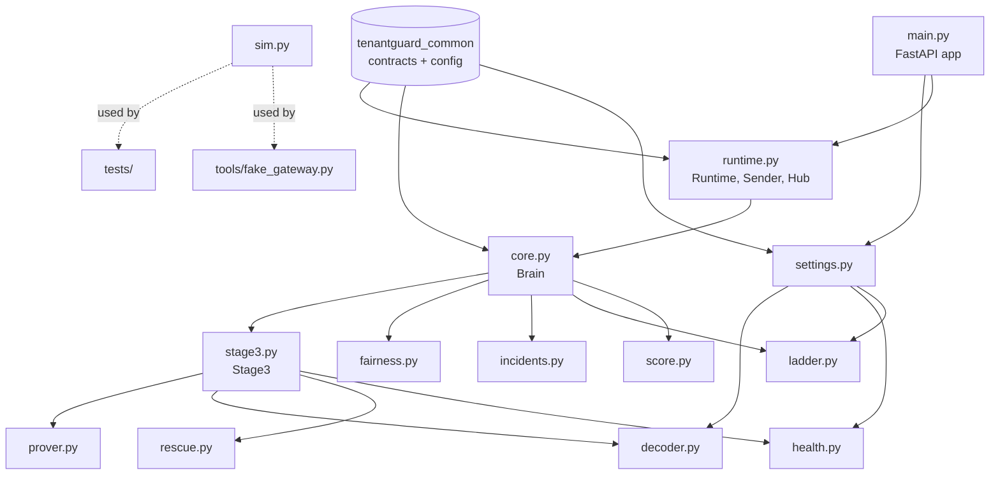
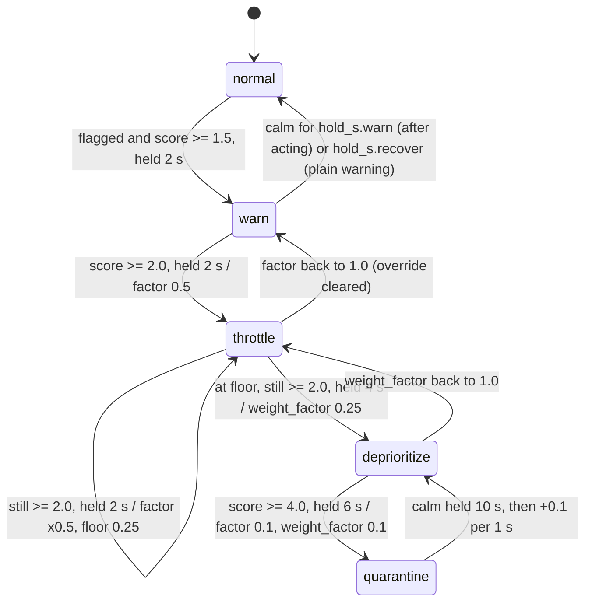
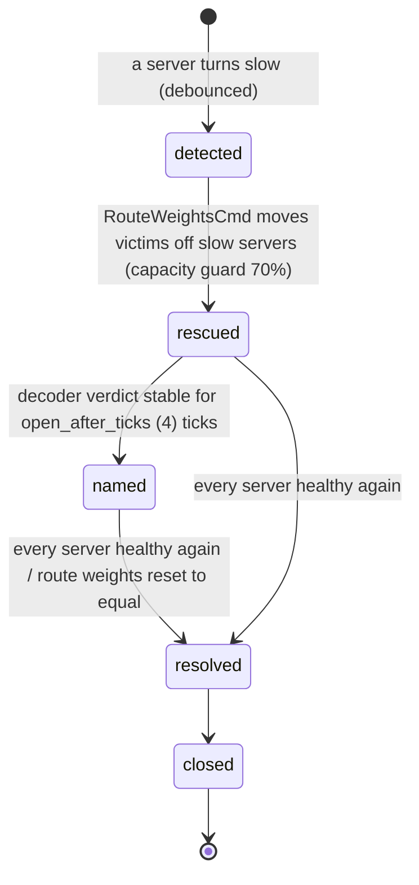

# 11 — Files: `brain/` (the control plane)

The brain is the TenantGuard control plane. It runs on port **8200** and does five things:

- It watches every tenant's usage and latency (gateway telemetry plus worker `/stats`).
- It watches every server's health (peer comparison plus canary probes).
- It decides what to do:
  - **Stage 2:** a noisy-neighbour score and a graduated throttle ladder.
  - **Stage 3:** server health → rescue by re-routing → barcode decoder that names the culprit.
- It sends control commands to the gateway.
- It explains every step as an `IncidentEvent`, and streams live state to the dashboard.

This page documents every file in `brain/` on `master`. Each code file has:
- a short purpose,
- a table of **every** function, method and class (private ones included),
- the key design decisions.

**Status of related work.** The relocation prover's interface is on master (`prover.py`), but only the `NullProver` that never proves. The Docker-backed prover and the verdict stage (task T12, "prover + verdicts + calibration") are **in progress** and not described here as done. Quarantine by relocation (a TODO in `ladder.py`) is also future work. On master, quarantine is a 0.1 limit.

---

## 1. File map

| File | Kind | One line |
|---|---|---|
| `brain/README.md` | doc | How to run, env vars, API, loops, detection and ladder summary |
| `brain/Dockerfile` | build | `python:3.12-slim` image, listens on 8200, health check on `/healthz` |
| `brain/requirements.txt` | build | fastapi, uvicorn, httpx, websockets, pydantic, PyYAML |
| `brain/pytest.ini` | test config | `pythonpath = .`, `testpaths = tests`, `asyncio_mode = auto` |
| `tenantguard_brain/__init__.py` | package | Package docstring only |
| `tenantguard_brain/__main__.py` | entry | `python -m tenantguard_brain` → `main.run()` |
| `tenantguard_brain/settings.py` | config | `BrainSettings` built from `tenantguard.yaml` + env |
| `tenantguard_brain/score.py` | pure logic | Noisy-neighbour score, victim impact, calm baseline |
| `tenantguard_brain/ladder.py` | pure logic | Throttle ladder state machine with holds and hysteresis |
| `tenantguard_brain/incidents.py` | pure logic | Incident book: ids, events, open/closed bookkeeping |
| `tenantguard_brain/fairness.py` | pure logic | Jain fairness index, normalised throughput |
| `tenantguard_brain/health.py` | pure logic | Per-server health from peer comparison (traffic or canary) |
| `tenantguard_brain/rescue.py` | pure logic | Route-around plan with a capacity guard |
| `tenantguard_brain/decoder.py` | pure logic | Barcode decoder: names culprit tenant(s) or a host suspect |
| `tenantguard_brain/prover.py` | interface | Relocation prover interface + `NullProver` |
| `tenantguard_brain/stage3.py` | pure logic | Stage 3 loop: health → rescue → decoder → named |
| `tenantguard_brain/core.py` | pure logic | `Brain`: rolling state → scores → ladder → commands + events + views |
| `tenantguard_brain/runtime.py` | I/O | WS / HTTP loops around `Brain`, serialised control sends, UI hub |
| `tenantguard_brain/main.py` | I/O | FastAPI app: `/ws/events`, `/api/*`, `/healthz`, operator endpoint |
| `tenantguard_brain/sim.py` | dev/test | Toy fleet simulator producing contract-shaped telemetry |
| `tools/fake_gateway.py` | dev tool | Fake gateway + workers on top of `sim.py` |
| `tools/local_stack.py` | dev tool | Starts real workers + gateway (+ brain) locally without Docker |
| `tools/traffic.py` | dev tool | Calm traffic + optional whale through the real gateway |
| `tests/*.py` | tests | 80 test functions (some parametrised) in 9 files |

### 1.1 How the modules depend on each other



Only `runtime.py` and `main.py` do I/O. Everything from `core.py` down is a pure, deterministic state machine. Each module takes values in and returns values out, and time is passed in as `now`. The tests drive the same `Brain` object with a simulated clock (`tests/conftest.py::drive`).

---

## 2. Packaging and entry files

### `brain/Dockerfile`
Builds the brain image with the build context set to the repo root:
- base `python:3.12-slim`;
- installs `common/` (the shared `tenantguard_common` package) and then `requirements.txt`;
- copies `tenantguard.yaml`, `layouts/`, `tenantguard_brain/` and `tools/`;
- runs `python -m tenantguard_brain`.

The health check fetches `http://127.0.0.1:8200/healthz`. `TENANTGUARD_ROOT=/app` points the shared config loader at the copied yaml and layout.

### `brain/requirements.txt`
`fastapi>=0.104`, `uvicorn[standard]>=0.24`, `httpx>=0.25`, `websockets>=11,<13`, `pydantic>=2.5`, `PyYAML>=6`. No numeric or ML libraries: every algorithm in the brain is plain Python.

### `brain/pytest.ini`
`pythonpath = .` (so `tenantguard_brain` imports from `brain/`), `testpaths = tests`, `asyncio_mode = auto` (async tests in `test_runtime.py` run without decorators).

### `brain/README.md`
The operator-facing summary, written for someone running the service. It covers:
- run commands and the environment variables;
- the HTTP/WS API table;
- the list of loops in `runtime.py`;
- the detection formula and the ladder rules;
- Stage 3 (health, rescue, decoder).

### `brain/tenantguard_brain/__init__.py`
Contains only the package docstring ("TenantGuard brain: noisy-neighbour detector, throttle ladder and UI event stream"). No functions.

### `brain/tenantguard_brain/__main__.py`
Two lines that make `python -m tenantguard_brain` work.

| Function / class | Signature | What it does | Called by |
|---|---|---|---|
| (module body) | — | Imports `run` from `main` and calls it | `python -m tenantguard_brain`, Dockerfile `CMD` |

---

## 3. `brain/tenantguard_brain/settings.py`

Turns `tenantguard.yaml` (through `tenantguard_common.config`) and environment variables into one typed `BrainSettings` object. Nothing else in the brain reads yaml or env directly. The `Brain`, `Runtime` and FastAPI app all receive this object, so tests can build it once (`settings.load()`) and reuse it.

| Function / class | Signature | What it does | Called by |
|---|---|---|---|
| `BrainSettings` | `@dataclass` | Every brain tunable. Fields: tick, stats poll, heartbeat period, gateway URL, worker URLs, tenants (`TenantConfig` list), `LadderParams`, raw `noisy` dict, detection window, view windows (5 s tenants / 2 s servers), history (60 s), baseline half-life, default mode, control token, `ttl_max_s`, `min_victim_impact`, health/decoder params, rescue guard and TTL, canary period, bind host/port, CORS origins | Built by `load`; read by `Brain`, `Stage3`, `Runtime`, `create_app` |
| `load` | `load(raw: dict \| None = None) -> BrainSettings` | Reads yaml (or the dict passed in), env overrides (`TENANTGUARD_GATEWAY_URL`, `TENANTGUARD_CORS_ORIGINS`, `TENANTGUARD_CONTROL_TOKEN`, `TENANTGUARD_BRAIN_HOST`, `TENANTGUARD_BRAIN_PORT`) and tenants from the layout. Derives the fleet server list from the tenants' barcodes and builds `LadderParams`, `HealthParams` and `DecoderParams` from their yaml sections | `main.create_app`, `main.run`, `tests/conftest.py::cfg` |

**Key decisions**
- **Heartbeat period** = `gateway.fail_static_after_s / 4` (2 s → 500 ms). That gives four heartbeats inside the gateway's fail-static window, so one lost heartbeat never trips it.
- **Detection window** = `health.probe_window_ticks × tick` (8 × 250 ms = 2 s). The same window is used for victim p95 and server health.
- **Defaults that are overwritten from live data:**
  - `default_cores` (`worker.cpus`) is used only until a worker reports `cpu_limit_cores`.
  - `default_window` (`gateway.limiter.initial_window`) is used only until telemetry reports the limiter window.
- **Rescue route-weight TTL** = `brain.ttl_s.rescue`, falling back to `ttl_s.relocate` (120 s).

---

## 4. `brain/tenantguard_brain/score.py` — the noisy-neighbour score

The Stage 2 detector, with no I/O. It answers two questions for each tenant: "is it taking more than its fair share of *its own servers*?" and "are the tenants that share those servers slower than their calm baseline?". A tenant is **flagged** only when both are true.

### 4.1 The formula

```
score(t)       = usage_ratio(t) × (1 + victim_impact(t))
usage_ratio(t) = max(cpu_share(t), queue_share(t)) / fair_share(t)

cpu_share(t)   = t's CPU ms/s (handler + background) on its servers / CPU capacity of those servers
queue_share(t) = t's mean (queue depth + inflight) / dispatch slots of its servers
fair_share(t)  = Σ_s weight(t)/Σ_active weight on s × cap(s)  /  Σ_s cap(s)       (s over t's servers)
victim_impact  = mean over t's neighbours of max(0, p95 / baseline_p95 − 1), clipped to [0, 3]
flagged(t)     = usage_ratio(t) > 1  AND  victim_impact(t) ≥ min_victim_impact (0.2)
noisy_norm(t)  = min(1, score / brain.noisy.quarantine)        (0..1, for the UI bars)
```

A *neighbour* is any other tenant that shares at least one server with `t`. In the AG(2,3) layout each tenant shares servers with 6 of the other 11 and is disjoint from 5.

| Function / class | Signature | What it does | Called by |
|---|---|---|---|
| `IMPACT_CLIP` | constant `3.0` | Upper clip for victim impact | `victim_impact` |
| `shares` | `shares(values: Mapping[str, float]) -> Dict[str, float]` | Each value's fraction of the (non-negative) total; all 0 when the total is 0 | `Brain.snapshot` (TenantView `cpu_share`) |
| `fair_shares` | `fair_shares(weights, active) -> Dict[str, float]` | `weight / Σ active weights`. An inactive tenant gets the share it *would* have if it became active now, so a first burst is never divided by zero | `compute_scores` (per server) |
| `slowdown` | `slowdown(p95, baseline, floor_ms=0.0) -> Optional[float]` | `max(0, p95 / max(baseline, floor_ms) − 1)`; `None` if either side is unknown. The floor (`health.slow_abs_ms`, 8 ms) stops sub-millisecond jitter on a ~1 ms endpoint reading as a 3× slowdown | `Brain.tick` |
| `victim_impact` | `victim_impact(culprit, slowdowns, neighbours=None) -> (float, List[(str, float)])` | Mean slowdown over the culprit's neighbours that have data, clipped to [0, 3], plus the victims sorted worst first | `compute_scores` |
| `ScoreDetail` | `@dataclass` | Everything the score is built from: `cpu_share`, `queue_share`, `fair_share`, `usage_ratio`, `victim_impact`, `score`, `norm`, `flagged`, `victims` | Built by `compute_scores`; read by `Brain` (ladder signal, evidence text, snapshot, debug) and `Stage3._update_ledger` |
| `ScoreDetail.dominant` | property `-> str` | `"CPU"` or `"queue"`, whichever share is larger (used in the plain-English evidence) | `Brain._evidence` |
| `noisy_score` | `noisy_score(cpu_share, queue_share, fair_share, impact) -> (score, ratio)` | The formula above; `(0, 0)` when the fair share is 0 | `compute_scores` |
| `compute_scores` | `compute_scores(*, weights, servers_of, active, cpu_by_server, cpu_cap, occupancy, slots, slowdowns, neighbours, min_victim_impact, quarantine_threshold) -> Dict[str, ScoreDetail]` | Scores every tenant: capacity-weighted fair share over its own servers, CPU and queue shares against those servers, victim impact over its neighbours, flag rule, `norm` | `Brain.tick` |
| `BaselineTracker` | class | Calm-period, **time-based** EWMA of each tenant's end-to-end p95 | `Brain.__init__` |
| `BaselineTracker.__init__` | `(half_life_s=60.0, warmup=8)` | Stores the half-life and warm-up length | `Brain.__init__` |
| `BaselineTracker.update` | `update(tenant, p95, now) -> None` | `alpha = 1 − 0.5^(dt / half_life)`. For the first `warmup` samples, `alpha ≥ 1/n` (a running mean) so it settles quickly. Ignores `p95 ≤ 0` | `Brain.ingest_frame` |
| `BaselineTracker.get` | `get(tenant) -> Optional[float]` | Current baseline | `Brain.ingest_frame`, `Brain.tick` |
| `BaselineTracker.ready` | `ready(tenant, min_samples=4) -> bool` | True after enough samples to trust it | `Brain.ingest_frame`, `Brain.tick` |

**Key decisions**
- **Barcode-scoped shares.** The fair share is computed only over the tenant's own servers. This was an accepted decision in the plan's decision log: with fleet-wide shares, calm free-tier tenants scored around 1.55× and looked noisy.
- **Over-use alone is never enough.** A heavy tenant whose neighbours are fine (a legitimate burst on idle capacity) is never flagged. `tests/test_score.py::test_legit_burst_with_no_victim_impact_is_not_flagged` covers this.
- **Neighbours, not "everyone else".** Impact is averaged only over tenants that share a server, so an innocent heavy tenant on disjoint servers is not blamed for someone else's victims.
- **Time-based baseline, frozen during trouble.** The baseline forgets at the same rate whatever the frame rate. `core.py` also stops it learning while a tenant is hurt or a neighbour over-uses (`Brain._baseline_frozen`), so a moderate attack cannot slowly become the new "normal". `tests/test_core.py::test_moderate_attack_is_not_absorbed_into_the_baseline` covers this.

---

## 5. `brain/tenantguard_brain/ladder.py` — the throttle ladder

A graduated, self-recovering state machine per tenant, with no I/O. It escalates multiplicatively and recovers additively (AIMD), and uses hold windows and hysteresis so it never flaps. The ladder only decides `level`, `factor` and `weight_factor`. `core.py` turns these into `LimitsCmd`s.

### 5.1 Levels and transitions (values from `tenantguard.yaml` `brain.noisy`)


Any level returns straight to `normal` (factors 1.0/1.0) through `reset` when the mode leaves `tenantguard` or an operator releases the tenant.

| Rule | Condition (all from yaml) |
|---|---|
| A hold is "met" | The history covers the hold time, **≥ 80 %** (`hold_ratio`) of the ticks in the window qualify, and the current tick qualifies too. One noisy dip does not restart the clock. |
| Escalation conditions | The tenant is `flagged` **and** its score is above the rung's threshold (warn 1.5, throttle 2.0, quarantine 4.0) |
| Escalation | warn → throttle: factor 0.5 · each further step ×0.5 down to `throttle_floor` 0.25 · then deprioritize: weight_factor 0.25 · then quarantine: factor 0.1, weight_factor 0.1 |
| Fresh hold | Every escalation restarts all hold clocks, so each further step needs a fresh, full hold |
| Calm | score < `recover_below` (1.0) **or** neighbours clearly unhurt (impact < `hurt_off` = `min_victim_impact` / 2 = 0.1) |
| Recovery | After `hold_s.recover` (10 s) of calm, factor and weight_factor each rise by `recover_step` 0.1 once per `recover_tick_s` (1 s). The level is derived from the factors (`level_for`). |
| Hysteresis | Flagging needs impact ≥ 0.2, calm needs impact < 0.1. Between the two the ladder holds still. |
| TTL on commands | `ttl_s.throttle` 60 s; `ttl_s.quarantine` 120 s |

| Function / class | Signature | What it does | Called by |
|---|---|---|---|
| `LEVELS`, `RANK`, `EPS` | constants | Level order `normal < warn < throttle < deprioritize < quarantine`; a rank for comparisons; float tolerance | Whole module, `core.py` |
| `LadderParams` | `@dataclass` | Thresholds, hold times, AIMD factors, floor, deprioritize/quarantine factors, TTLs, `hold_ratio` | Built by `settings.load` |
| `LadderParams.from_yaml` | `classmethod from_yaml(noisy: dict, ttl: dict \| None = None)` | Reads `brain.noisy` and `brain.ttl_s` with defaults | `settings.load` |
| `LadderParams.level_for` | `level_for(factor, weight_factor) -> str` | The level implied by the factors in force: both at quarantine values → `quarantine`; weight_factor < 1 → `deprioritize`; factor < 1 → `throttle`; else `warn` | `step`, `Brain.adopt_overrides` |
| `LadderParams.ttl_for` | `ttl_for(level) -> float` | 120 s for quarantine, 60 s otherwise | `Brain._commands`, `Brain._action_text`, `Brain.adopt_overrides` |
| `Signal` | `@dataclass(score, flagged, unhurt)` | One tick's input for one tenant | Built by `Brain.tick` |
| `Hold` | `@dataclass` | One condition's recent history `(t, ok)` plus its start time | Fields of `LadderState` |
| `Hold.add` | `add(now, ok, keep_s)` | Appends a sample and drops samples older than `keep_s` | `step` |
| `Hold.held` | `held(hold, now, ratio) -> bool` | The hold rule above | `step` (inner `held`) |
| `Hold.restart` | `restart(now)` | A fresh hold from now, keeping this tick's sample | `_apply` |
| `LadderState` | `@dataclass` | `level`, `factor`, `weight_factor`, `changed_at`, `peak`, four `Hold`s (warn, throttle, quarantine, calm), `last_recover_at` | `Brain.ladders` |
| `LadderState.acting` | property `-> bool` | True while factor or weight_factor is below 1, meaning an override must be in force | `step`, `reset`, `Brain._commands`, `Brain.adopt_overrides`, `Brain._expire_holds`, `Brain.status_sentence` |
| `Transition` | `@dataclass` | One change: `kind` (escalate / step / recover / clear / resolve / reset), previous and new level and factors, and `rule` (why, in plain English) | Returned by `step` / `reset`; read by `Brain._on_transition` |
| `_apply` | `_apply(s, now, kind, level, factor, wf, rule) -> Transition` | Mutates the state, tracks `peak`, restarts holds on escalate/step, and resets `peak` at normal | `step`, `reset` |
| `step` | `step(s: LadderState, sig: Signal, now, p: LadderParams) -> Optional[Transition]` | Advances one tenant by one tick: records the four conditions, then applies the first rule that fires (escalate, tighten, deprioritize, quarantine, recover or resolve) | `Brain.tick` |
| `step.held` (inner) | `held(hd, key) -> bool` | Shorthand for `hd.held(hold[key], now, hold_ratio)` | `step` |
| `reset` | `reset(s, now, rule) -> Optional[Transition]` | Forces normal with 1.0/1.0 and fresh holds. Returns `None` if the tenant is already normal | `Brain.tick` (mode is not `tenantguard`), `Brain.operator` (release) |

**Key decisions**
- **AIMD** (multiplicative decrease, additive increase), as in TCP congestion control: it reacts fast to harm and is cautious coming back.
- **Holds by ratio, not a strict streak.** A strict "every tick above threshold" rule stalled escalation when the score hovered around a threshold. With `hold_ratio` 0.8, one dip does not restart the clock (`tests/test_ladder.py::test_one_dip_does_not_restart_the_hold`). Half-duty flapping still never escalates (`test_half_duty_flapping_never_escalates`).
- **A move is never made on a tick that contradicts it.** `Hold.held` requires the current tick to qualify.
- **Quarantine needs its own threshold.** Reaching the bottom of the ladder is not enough on its own (`test_quarantine_needs_the_quarantine_threshold`).
- **On master, quarantine is a limit** (factor 0.1, weight_factor 0.1). Relocating the tenant to the quarantine worker is marked `TODO(Wave 2)`.

---

## 6. `brain/tenantguard_brain/incidents.py`

Incident bookkeeping, with no I/O. There is at most one open incident per tenant, plus server incidents that are not tied to a tenant. Every incident event is stored in a bounded log that the API and the UI backfill read.

| Function / class | Signature | What it does | Called by |
|---|---|---|---|
| `Incident` | `@dataclass` | `incident_id`, `tenant` (`""` for server incidents), `opened_at`, current `level`, `peak`, `closed_at`, its `events` | Created by `IncidentBook` |
| `IncidentBook` | class | Open incidents per tenant, an index by id, a bounded event log (1000), and the last 200 closed ids | `Brain.__init__` |
| `IncidentBook.__init__` | `(keep_events=1000, keep_closed=200)` | Sets up the stores | `Brain.__init__` |
| `IncidentBook.open_for` | `open_for(tenant, now) -> Incident` | Returns the tenant's open incident, or opens `inc-<ts>-<tenant>-<seq>` | `Brain._on_transition`, `Brain.adopt_overrides`, `Brain.operator`, `Brain._held_tick` |
| `IncidentBook.open_server` | `open_server(now) -> Incident` | Opens a fleet incident `srv-<ts>-<seq>` | `Stage3.tick` |
| `IncidentBook.emit` | `emit(inc, now, stage, *, level=None, prev_level=None, action=None, detail="", confidence=None, report=None) -> IncidentEvent` | Builds a contract `IncidentEvent` (tenant, level, prev_level, action, detail, optional single suspect with confidence, report), appends it to the incident and the log | Every event in `core.py` and `stage3.py` |
| `IncidentBook.close` | `close(inc, now)` | Marks closed, frees the tenant slot, trims old closed incidents from the index | `Brain._on_transition`, `Brain._expire_holds`, `Stage3._close` |
| `IncidentBook.events` | `events(*, incident_id=None, tenant=None, limit=200) -> List[IncidentEvent]` | Filtered tail of the log, oldest first | `GET /api/incidents`, `WS /ws/events` backfill |

**Key decisions**
- **Readable, unique, sortable ids.** They include the opening second and a sequence number.
- **Bounded memory.** The log is a `deque(maxlen=1000)`, and closed incidents drop out of the index after 200.

---

## 7. `brain/tenantguard_brain/fairness.py`

Fleet-level metrics, with no I/O.

| Function / class | Signature | What it does | Called by |
|---|---|---|---|
| `jain` | `jain(values) -> float` | Jain's fairness index `(Σx)² / (n · Σx²)`, in (0, 1]; 1.0 for empty or all-zero input | `Brain.snapshot` (`StateSnapshot.fairness`) |
| `normalized_throughput` | `normalized_throughput(rps, weights) -> dict` | `completed rps / weight` for each active tenant (rps > 0) | `Brain.snapshot` |
| `peer_ratio` | `peer_ratio(server, p95) -> float` | p95 of a server / median p95 of the others with data (1.0 if unknown) | `tests/test_fairness.py` only. The running brain takes its server peer ratio from `health.py`, which also has the canary fallback and debounce |

**Key decision:** fairness is measured on throughput normalised by tier weight. A pro tenant (weight 2) doing twice the work of a free tenant (weight 1) is perfectly fair, and the index is 1.0.

---

## 8. `brain/tenantguard_brain/health.py` — server health

Decides which servers are slow by comparing each server with its peers, never against a fixed number, so a fleet-wide slowdown accuses nobody. It has no I/O.

```
level(s)     = median over the window of the server's latency samples
               traffic source: per tick, the MEDIAN of its tenants' cell p95 (server side)
               canary  source: the brain's own GET /canary round trip (used when traffic is too thin)
peer_ratio   = level(s) / median(level of the other servers, same source)
slow_now(s)  = peer_ratio >= 1.6  AND  level(s) − peer median >= 8 ms
slow(s)      = slow_now for open_after_ticks (4) consecutive ticks; healthy again after 4 not-slow ticks
```
The window is `probe_window_ticks` (8) × 250 ms = 2 s. Canaries keep at least 4 s of samples, because they arrive at about 1 Hz.

| Function / class | Signature | What it does | Called by |
|---|---|---|---|
| `HealthParams` | `@dataclass` | `window_ticks`, `tick_s`, `slow_peer_ratio`, `slow_abs_ms`, `open_after_ticks`, `min_requests` (4), `min_canaries` (2) | `settings.load` |
| `HealthParams.from_yaml` | `classmethod from_yaml(health: dict, tick_s)` | Reads `brain.health` | `settings.load` |
| `HealthParams.window_s` | property | `window_ticks × tick_s` | `HealthTracker._levels` |
| `ServerHealth` | `@dataclass` | Per server: `source`, `level_ms`, `peer_ms`, `peer_ratio`, `slow_now`, `slow`, `streak`, `slow_since`, traffic and canary sample deques | `HealthTracker.servers`; read by `Stage3`, `Brain.snapshot`, `Brain.debug` |
| `HealthTracker` | class | Holds all servers' health | `Stage3.__init__` |
| `HealthTracker.__init__` | `(servers, params)` | One `ServerHealth` per known server | `Stage3.__init__` |
| `HealthTracker._h` | `_h(s) -> ServerHealth` | Gets the entry, creating it for a server seen for the first time | `observe_canary`, `observe` |
| `HealthTracker.observe_canary` | `observe_canary(server, rtt_ms, now)` | Records one canary round trip | `Stage3.on_canary` |
| `HealthTracker._levels` | `_levels(now) -> (traffic, canary)` | Drops old samples and returns per-server median levels for each source. Traffic needs ≥ 4 requests in the window and canary ≥ 2 samples | `observe` |
| `HealthTracker.observe` | `observe(per_server: Dict[str, (p95, count)], now) -> List[(server, now_slow)]` | Feeds one tick, picks each server's source (traffic first, then canary), computes the peer ratio and `slow_now`, applies the debounce, and returns servers whose state flipped | `Stage3.on_frame` |
| `HealthTracker.slow_servers` | `slow_servers() -> List[str]` | Sorted list of servers currently judged slow | `Stage3.tick`, `Stage3.status`, `Stage3._named` |
| `HealthTracker.ratios` | `ratios() -> Dict[str, float]` | server → peer ratio | `Stage3.tick` (decoder input) |

**Key decisions**
- **The median of tenants' p95 per server.** One tenant's own heavy requests (a whale, a batch export) do not make the server look slow. The server is slow only when most of its tenants are slow there.
- **Ratio AND absolute gap.** A ratio alone would flag 2 ms against 1 ms (`tests/test_stage3_pure.py::test_ratio_alone_is_not_enough`).
- **Canary fallback.** After a rescue moves everyone off a server, it has no traffic. The canary still lets it be judged healed or still broken (`test_canary_takes_over_when_traffic_moved_away`).

---

## 9. `brain/tenantguard_brain/rescue.py` — route around slow servers

Builds a `RouteWeightsCmd` plan that moves each victim's traffic off its slow servers onto its healthy ones, without creating the next slow server. It has no I/O.

```
for each tenant with ≥1 slow and ≥1 healthy (and up) server in its barcode, lightest first:
    headroom(s) = max(0, guard × capacity(s) − projected_load(s))      guard = rescue_capacity_guard 0.7
    f           = min(1, Σ headroom / tenant's CPU on its slow servers)    (fraction moved)
    new weight  = slow servers keep (1 − f) of their weight; the moved share goes to healthy
                  servers in proportion to their headroom; weights renormalised to sum 1
tenants whose servers are all slow are "stuck" (nothing to route to; decoder evidence)
```

| Function / class | Signature | What it does | Called by |
|---|---|---|---|
| `MIN_WEIGHT` | constant `0.0` | Defined in the module; not referenced by the current code | — |
| `RescuePlan` | `@dataclass` | `weights` (tenant → server → weight), `moved` (fraction per tenant), `stuck`, `capped` (moved < 1 because of the guard), `projected_util` per server | Returned by `plan_rescue`; held as `Stage3.plan`; shown in `Brain.debug` |
| `plan_rescue` | `plan_rescue(*, barcodes, slow, load, capacity, server_load=None, guard=0.7, current=None, targets=None) -> RescuePlan` | The algorithm above. `targets` restricts destinations to servers known to be up and healthy, so a rescue never routes to an unknown or down server | `Stage3.tick` |

**Key decisions**
- **The capacity guard (70 % CPU) bounds every move.** A rescue must not overload a healthy server. When there is no room the tenant is left alone (`test_no_room_at_all_leaves_the_tenant_alone`).
- **Lightest tenants first.** The guard's headroom then rescues as many tenants as possible.
- **Only the victims are routed.** `Stage3` excludes a named culprit, because moving it would only spread the harm. Proving a culprit belongs to the prover.

---

## 10. `brain/tenantguard_brain/decoder.py` — name the culprit from the barcode

Every tenant runs on 3 servers, its **barcode**. In the AG(2,3) layout any two barcodes share at most one server (`tests/test_stage3_pure.py::test_ag23_any_two_tenants_share_at_most_one_server`). The set of slow servers therefore points at the tenant(s) whose barcodes it covers, even when the culprit's work is invisible to every meter (black-box CPU). The module has no I/O.

```
p_s          = logistic(k × (peer_ratio_s − 1.6))                     k = 8; probability server s is slow
evidence(t)  = 4 × min_{s∈S_t} p_s                  all of its servers slow (original signal)
             + 2 × mean_{s∈S_t} p'_s                share of the still-unexplained slowness it covers
             + 1 × stuck(t)                         every server it can be routed to is slow
             + 2 × ledger(t) × mean_{s∈S_t} p_s     bg-CPU growth, evictions, black-box growth, over-share
host_fault   = 4 × max_s p'_s × (1 − best full-barcode cover of s)
none         = 3 × (1 − max_s p'_s)
confidence   = softmax(evidence / temperature 1.0) over all tenants + host_fault + none
```
**Explain-away loop** (up to `max_culprits` = 2):
1. Accept the top option if it is a tenant and the tenants together hold ≥ `min_confidence` (0.5).
2. Zero `p'` on the accepted tenant's servers.
3. Decode again.

Slow servers still unexplained at the end (`p' ≥ 0.5`) are **host suspects**. When two culprits are named, each one's confidence is recomputed with the *other* explained away, so two equally guilty tenants do not split 50/50. All weights are `DecoderParams` defaults; any of them can be overridden under yaml `brain.decoder`.

| Function / class | Signature | What it does | Called by |
|---|---|---|---|
| `HOST`, `NONE` | constants | Option names `"host_fault"`, `"none"` | `_round`, `decode`, `Stage3._named` |
| `DecoderParams` | `@dataclass` | `slow_peer_ratio`, `k`, `w_min`, `w_mean`, `w_stuck`, `w_ledger`, `w_host`, `w_none`, `temperature`, `min_confidence`, `max_culprits`, `host_p` | `settings.load` |
| `DecoderParams.from_yaml` | `classmethod from_yaml(health: dict, decoder: dict \| None = None)` | Reads known keys from `brain.decoder` (type-cast) and takes `slow_peer_ratio` from `brain.health` | `settings.load` |
| `Named` | `@dataclass` | One culprit: `tenant`, `confidence`, `evidence`, `covers` (its servers that were slow) | Built by `decode` |
| `Decoding` | `@dataclass` | `culprits`, `host_suspects`, `p` (server → p_s), `rounds` (confidence per option per round) | Returned by `decode`; held as `Stage3.decoding` |
| `Decoding.top_confidence` | property | First-round confidences | `Stage3._named`, `Brain.debug` |
| `logistic` | `logistic(x) -> float` | Numerically stable logistic | `p_slow` |
| `p_slow` | `p_slow(ratios, p) -> Dict[str, float]` | p_s for every server | `decode` |
| `softmax` | `softmax(scores, temperature) -> Dict[str, float]` | Stable softmax (subtracts the max) | `decode` |
| `_round` | `_round(barcodes, p0, pr, stuck, ledger, exclude, prm) -> Dict[str, float]` | One round of evidence scores for every not-yet-named tenant plus `host_fault` and `none` | `decode` |
| `decode` | `decode(barcodes, ratios, *, stuck=None, ledger=None, params=None) -> Decoding` | The full explain-away decode described above | `Stage3.tick` |

**Key decisions**
- **"Nobody" and "the host" compete with the tenants.** A single slow server, or two slow servers on one barcode line, blames no tenant (`test_single_slow_server_is_a_host_suspect_and_nobody_is_blamed`, `test_two_slow_servers_on_one_barcode_line_are_not_a_tenant`).
- **Exact naming is tested exhaustively.** Every single culprit, and all 66 culprit pairs, are named exactly (`test_every_single_culprit_is_named`, `test_all_66_culprit_pairs_are_named_exactly`).
- **Ledger hints only break ties where servers are actually slow.** They are multiplied by the mean p_s of the tenant's servers (`test_ledger_hint_breaks_a_tie_only_where_servers_are_slow`).

---

## 11. `brain/tenantguard_brain/prover.py` — proof by relocation (interface)

Defines how a named suspect will be *proved*:
1. Move it to the spare server, sized at `spare_sizing` × its footprint.
2. Wait `prove_settle_s`, then measure for `prove_window_s`.
3. Compute `R = 1 − post_slowdown / pre_slowdown` on its original servers.
4. Confirm when `R ≥ recovery_R` **and** the harm followed it to the spare.

On master only the interface and the `NullProver` exist. The Docker-backed prover is **in progress** (T12).

| Function / class | Signature | What it does | Called by |
|---|---|---|---|
| `ProofRequest` | `@dataclass` | `incident_id`, `tenant`, `servers` (its barcode), `confidence`, `footprint_cpu_ms`, optional `cls` (prove one request class) | Not created on master yet (in progress) |
| `ProofResult` | `@dataclass` | `tenant`, `confirmed`, `recovery_R`, `harm_followed`, `detail`, `readings` | Returned by `prove` |
| `Prover` | `Protocol` | `available: bool`; `async prove(req) -> ProofResult` | Type of `Stage3.prover` |
| `NullProver` | class, `available = False` | Default when there is no Docker host | `Stage3.__init__` |
| `NullProver.prove` | `async prove(req) -> ProofResult` | Never confirms; says "prover not available (needs the Docker host)" | Not called on master (in progress) |

**Key decision:** `Stage3._named` checks `prover.available`. Without a prover the "named" event says plainly: "Not yet proven: relocation needs the Docker host". A suspect is never presented as proven.

---

## 12. `brain/tenantguard_brain/stage3.py` — health → rescue → decoder → named

The Stage 3 loop, with no I/O. It owns the **server incident** (`srv-…`), which has these stages:



Health and decoding **always** run, because they feed `ServerView` and the status sentence. Route changes and incidents happen only in `tenantguard` mode. If the mode changes while an incident is open, the incident is closed and the routes reset.

| Function / class | Signature | What it does | Called by |
|---|---|---|---|
| `LEDGER_WINDOW_S` | constant `3.0` | Window for ledger hints | `_update_ledger` |
| `GROWTH_FLOOR_MS` | constant `20.0` | Growth is measured against `max(baseline, 20 ms/s)` | `Ewma.growth` |
| `CLEAR_TTL_S` | constant `5.0` | Equal weights sent for 5 s when clearing, then nothing | `_close` |
| `Ledger` | `@dataclass` | Per-tenant hints, each 0..1: `bg_growth`, `evict_share`, `blackbox_all` (black-box growth on **all** of its servers), `over_share` (usage_ratio − 1) | Built by `_update_ledger` |
| `Ledger.hint` | `hint(t) -> float` | Maximum of the four hints | `tick` (decoder `ledger=`) |
| `Ledger.why` | `why(t) -> List[str]` | Plain-English reasons for hints above 0.2 | `_named` |
| `Ewma` | class `(alpha=0.1)` | Simple per-key EWMA | `Stage3.__init__` (`bg_base`, `bb_base`) |
| `Ewma.update` | `update(k, x)` | EWMA step | `_update_ledger` |
| `Ewma.growth` | `growth(k, x) -> float` | `clip((x − base) / max(base, 20), 0, 1)` | `_update_ledger` |
| `Stage3` | class | The loop's state: health tracker, barcodes, prover, open server incident, decoding, ledger, rescue plan, route weights sent, naming debounce | `Brain.__init__` |
| `Stage3.__init__` | `(brain, prover=None)` | Builds the `HealthTracker` over the fleet and worker servers; `NullProver` by default | `Brain.__init__` |
| `Stage3.on_frame` | `on_frame(frame, now)` | Per server, the median of its tenants' cell p95 and the request count, passed to `health.observe` | `Brain.ingest_frame` |
| `Stage3.on_canary` | `on_canary(server, rtt_ms, now)` | Passes a canary sample to health | `Brain.ingest_canary` |
| `Stage3._update_ledger` | `_update_ledger(now, slow)` | Computes ledger hints from the last 3 s of worker stat samples. Their EWMA baselines learn only while every server is healthy | `tick` |
| `Stage3.tick` | `tick(now, acting) -> (events, route_cmds)` | Decodes (if any server is slow). If acting: opens or closes the server incident, emits `detected` when new slow servers appear, plans and sends a rescue (on change, renew at TTL/4, or retry after 1 s), emits `rescued`, and emits `named` once the decoding has been stable for 4 ticks | `Brain.tick` |
| `Stage3.status` | `status() -> str` | One sentence for the status line: "<servers> slow (<ratio>x peers): <n> tenants routed around; named <culprits>; host suspect <servers>." (empty when no server incident is open) | `Brain.status_sentence` |
| `Stage3.mark_routes` | `mark_routes(ok, now)` | Records the delivery result of the last `RouteWeightsCmd` | `Runtime._routes_done`, `tests/conftest.py::drive` |
| `Stage3._equal` | `_equal(t) -> Dict[str, float]` | Equal weights again over the servers last routed with | `tick`, `_close` |
| `Stage3._emit` | `_emit(now, stage, **kw) -> IncidentEvent` | Emits on the open server incident | `tick`, `_close` |
| `Stage3._close` | `_close(now, why, cmds) -> List[IncidentEvent]` | Sends equal weights (5 s TTL) if routes were sent, then emits `resolved` and `closed` and resets all state | `tick` |
| `Stage3._srv` | `_srv(s) -> str` | "<server> <ratio>x its peers (<level> ms vs <peer> ms, by traffic/canary)" | `_slow_text`, `_named` |
| `Stage3._slow_text` | `_slow_text(slow) -> str` | Text of the `detected` event | `tick` |
| `Stage3._rescue_text` | `_rescue_text(slow) -> str` | Text of the `rescued` event: who moved where, partial moves, stuck tenants | `tick` |
| `Stage3._named` | `_named(now, d) -> IncidentEvent` | The `named` event: culprits with confidence and reasons (covered servers, cannot route around, ledger hints), host suspects with "No tenant blamed", and whether proof is possible. `report` carries `p_slow`, the confidences and the culprits; `suspects` lists every culprit | `tick` |
| `_diff` | `_diff(a, b) -> float` | Largest per-server weight difference (a change above 0.02 triggers a resend) | `tick` |

**Key decisions**
- **Rescue first, name second, throttle only if harm persists.** Victims are routed around a slow server as soon as health opens it (after the `open_after_ticks` debounce), before any blame. `tests/test_stage3_sim.py::test_rescue_first_then_throttle_only_if_harm_persists` covers this.
- **The culprit is not routed.** Only victims move; the named tenant stays put for the prover.
- **Naming is debounced.** It needs the same culprit/host verdict for 4 ticks in a row, so one noisy tick never names anyone.

---

## 13. `brain/tenantguard_brain/core.py` — the `Brain`

The brain's central state machine, with no I/O:

1. **Ingest:** telemetry frames, worker stats and canaries in.
2. **Score:** rolling windows, then scores.
3. **Act:** ladders, then `LimitsCmd`s, plus Stage 3 route commands.
4. **Report:** incident events, `StateSnapshot`, and operator decisions.

`runtime.py` feeds it and sends what it returns; the tests drive it with a virtual clock.

### 13.1 One tick (`Brain.tick`, every 250 ms)
1. **Windows.** Detection uses the last 2 s of frames. Tenant views use 5 s. CPU uses `max(2 s, 3 × stats_poll)` = 3 s of diffed worker stats.
2. **Inputs.**
   - **Per-tenant victim latency:** count-weighted end-to-end p95 from `QueueStat`. Ticks with `completed == 0` are skipped.
   - **Slowdown vs the calm baseline:** measured with the 8 ms floor.
   - **Occupancy:** queue depth + inflight.
   - **Capacity:** CPU capacity per server, from the workers' `cpu_limit_cores`.
   - **Dispatch slots:** from the gateway limiter window.
3. **Scores.** `compute_scores` over the *active* tenants, those with completions, queue or CPU.
4. **Calm flag.** It is true when there are no open incidents and nobody is flagged at ≥ warn. Baselines learn only then.
5. **Operator holds that have ended** are expired.
6. **Ladders.** If telemetry is fresh and mode is `tenantguard`, each ladder steps (tenants under an operator hold are skipped). If telemetry is fresh but the mode is anything else, every ladder is reset and a 1.0/1.0 clear is sent. If telemetry is stale, everything holds, because there is no evidence either way.
7. **Stage 3.** `Stage3.tick` returns events and route commands.
8. **Commands.** `_commands` decides which `LimitsCmd` to send.

### 13.2 Command rules (`_commands`)
Every `LimitsCmd` carries **both** `factor` and `weight_factor` from ladder state, because the gateway *replaces* the previous command.

| Situation | Sent |
|---|---|
| Acting, and nothing sent yet or the factors changed | New command, TTL 60 s (120 s at quarantine) |
| Acting, last send failed ≥ 1 s ago | Retry |
| Acting, last send still in flight after 3 s | Resend |
| Acting, last send OK and older than TTL/4 | Renewal |
| No longer acting, last sent was not 1.0/1.0 | Explicit clear `factor=1.0, weight_factor=1.0` |
| Clear failed ≥ 1 s ago | Retry the clear |

| Function / class | Signature | What it does | Called by |
|---|---|---|---|
| `ACTING_MODE` | constant `"tenantguard"` | The only mode in which the brain acts | `tick`, `status_sentence` |
| `StatSample` | `@dataclass` | One diffed `/stats` interval: server, seconds covered, CPU per tenant (handler + bg), total CPU, limit cores, bg CPU per tenant, evictions caused per tenant, black-box CPU | Built by `ingest_stats`; read by `_cpu_by_server`, `_server_cpu`, `Stage3._update_ledger` |
| `Sent` | `@dataclass` | Last command per tenant: factors, time, TTL, `ok` (None = in flight) | `_cmd`, `adopt_overrides`, `mark_sent`, `_commands` |
| `OperatorHold` | `@dataclass` | Human decision in force: `decision` (release / extend), `until`, `by`, `case_id`, `suppressed` | `operator`, `tick`, `_held_tick`, `_expire_holds` |
| `TickResult` | `@dataclass` | `commands` (LimitsCmd), `route_cmds` (RouteWeightsCmd), `events` | Returned by `tick` to `Runtime._tick_loop` and `drive` |
| `TenantAgg` | `@dataclass` | Per-tenant aggregates over a window: completed, p95 × completed, rejected (429 + 503), occupancy, ticks | `_tenant_agg` |
| `TenantAgg.p95` | property | Count-weighted p95, or `None` without completions | `tick`, `snapshot` |
| `Brain` | class | The state machine | `Runtime.__init__`, tests |
| `Brain.__init__` | `(cfg: BrainSettings)` | Tenants, weights, barcodes, neighbour lists, frame and stat deques, baseline tracker, one `LadderState` per tenant, incident book, `Stage3`, operator holds; `hurt_off = min_victim_impact / 2` | `Runtime.__init__`, tests |
| `Brain.ingest_frame` | `ingest_frame(frame, now)` | Stores the frame and mode, prunes old state, feeds `Stage3.on_frame`. When calm, updates each tenant's baseline. Skips `completed == 0`, frozen tenants, and outliers above 2 × max(baseline, 8 ms) | `Runtime._telemetry_loop`, `drive` |
| `Brain.ingest_canary` | `ingest_canary(server, rtt_ms, now)` | Passes the sample to Stage 3 health | `Runtime._canary_one`, `drive` |
| `Brain.adopt_overrides` | `adopt_overrides(ov: OverridesView, now) -> (events, clears)` | On start-up, takes over limits a previous brain run left on the gateway: sets the ladder to the level implied by the factors, opens an incident, and marks the command as sent. Limits for unknown tenants are returned as clears | `Runtime._adopt_once` |
| `Brain.cpu_by_server` | `cpu_by_server(now) -> Dict[str, Dict[str, float]]` | server → tenant → CPU ms/s over the CPU window | `Stage3.tick` (rescue load) |
| `Brain.server_capacity` | `server_capacity(now) -> Dict[str, float]` | server → CPU ms/s limit (cores × 1000) | `Stage3.tick` |
| `Brain._baseline_frozen` | `_baseline_frozen(t) -> bool` | True if the tenant is itself hurt (slowdown ≥ 0.2) or any neighbour's `usage_ratio > 1` | `ingest_frame` |
| `Brain.ingest_stats` | `ingest_stats(st: WorkerStats, now)` | Diffs cumulative counters against the previous sample of that worker. No diff is taken on the first sample, a `started_at` change (restart), time going backwards, or CPU going down. Negative per-tenant deltas are clamped to 0 | `Runtime._poll_one`, `drive` |
| `Brain._prune` | `_prune(now)` | Drops frames and samples older than `history_s` (60 s) | `ingest_frame`, `ingest_stats`, `tick` |
| `Brain._frames` | `_frames(now, window) -> List[TelemetryFrame]` | Frames inside the window, oldest first | `tick`, `snapshot` |
| `Brain._span` | `staticmethod _span(frames) -> float` | Seconds covered (Σ tick_ms) | `snapshot` |
| `Brain._tenant_agg` | `_tenant_agg(frames) -> Dict[str, TenantAgg]` | Aggregates `QueueStat`s; p95 only from ticks with completions | `tick`, `snapshot` |
| `Brain._cpu_by_server` | `_cpu_by_server(now, window)` | server → tenant → CPU ms/s from stat samples | `tick`, `cpu_by_server`, `_tenant_cpu` |
| `Brain._tenant_cpu` | `_tenant_cpu(now, window) -> Dict[str, float]` | Tenant CPU ms/s summed over servers | `snapshot` |
| `Brain._server_cpu` | `_server_cpu(now, window) -> Dict[str, (ms_per_s, cores)]` | Total CPU per server and its limit | `server_capacity`, `tick`, `snapshot` |
| `Brain._server_p95` | `_server_p95(frames) -> Dict[str, Optional[float]]` | Count-weighted server-side p95 from cells | `snapshot` |
| `Brain.telemetry_fresh` | `telemetry_fresh(now) -> bool` | Last frame within max(2 s, 8 ticks) | `tick`, `snapshot`, `status_sentence` |
| `Brain.tick` | `tick(now) -> TickResult` | §13.1 | `Runtime._tick_loop`, `drive` |
| `Brain.operator` | `operator(cmd: OperatorCmd, now) -> List[IncidentEvent]` | Applies a human decision (§13.3) | `POST /api/operator` |
| `Brain._restart_holds` | `staticmethod _restart_holds(st, now)` | Empties all hold histories, so the ladder needs fresh, full holds after a human hold | `operator` (resume), `_expire_holds` |
| `Brain._held_tick` | `_held_tick(t, sd, now) -> List[IncidentEvent]` | During a *release* hold, notes once that an escalation was suppressed (with the evidence) | `tick` |
| `Brain._expire_holds` | `_expire_holds(now) -> List[IncidentEvent]` | Ends expired holds, emits "hold ended", and closes the incident if the tenant is normal | `tick` |
| `Brain._evidence` | `_evidence(t) -> str` | Plain-English evidence: "<name> (<id>) uses <cpu>% of the CPU and <queue>% of the dispatch slots of its servers against a fair share of <fair>% (<ratio>x, by CPU/queue). <n> of <m> neighbours are slower than their calm baseline (mean impact +<x>%: worst victims). Noisy score <s>." | `_held_tick`, `_on_transition` |
| `Brain._action_text` | `_action_text(factor, wf, level) -> str` | "LimitsCmd factor=0.50 weight_factor=1.00 ttl=60s", or "… (override cleared)" | `adopt_overrides`, `operator`, `_on_transition` |
| `Brain._on_transition` | `_on_transition(t, tr, now) -> List[IncidentEvent]` | Opens the incident on the first move (`detected`), emits `level_change` with the rule, the factor change and the evidence, emits `resolved` on clear and `closed` when back to normal | `tick` |
| `Brain._commands` | `_commands(now) -> List[LimitsCmd]` | §13.2 | `tick` |
| `Brain._cmd` | `_cmd(t, f, wf, ttl, now) -> LimitsCmd` | Records `Sent` and builds the command with the open incident id | `_commands` |
| `Brain.mark_sent` | `mark_sent(cmd, ok, now)` | Records the delivery result. Ignores results for superseded commands. A successful clear forgets the tenant | `Runtime._limits_done`, `drive` |
| `Brain.snapshot` | `snapshot(now) -> StateSnapshot` | Builds the UI view. `TenantView` (5 s window): p95, rps, rejected rps, CPU share, raw and normalised noisy score, level, factor. `ServerView` (2 s): p95, peer ratio, CPU % of its limit, healthy/slow. Also fleet utilisation, Jain fairness, the status sentence, `brain_ok`, and `noisy_thresholds` from yaml | `Runtime._snapshot_loop`, `GET /api/state`, WS backfill |
| `Brain.status_sentence` | `status_sentence(now, util, fair) -> str` | The one-line headline (waiting / telemetry lost / observing-only mode / server incident / watching / throttled / deprioritised / quarantined / recovered), ending with fairness and fleet CPU | `snapshot` |
| `Brain.debug` | `debug() -> dict` | Scores, ladders, baselines, sent commands, open incidents, server health, decoding, rescue plan | `GET /api/debug` |

### 13.3 Operator decisions (`Brain.operator`, `POST /api/operator`)
A human decision **owns** the tenant until it ends, so the human and the ladder never fight.

| `decision` | Effect |
|---|---|
| `release` | Ladder reset to normal, so a 1.0/1.0 clear is sent. No automatic escalation until `until_s`. If the tenant would escalate during the hold, that is noted **once** in the incident, with the evidence |
| `extend` | Keeps the current level and factors, and the TTL keeps being renewed until `until_s`. Then the ladder resumes, needing fresh holds |
| `resume` | Cancels any hold now; the ladder needs fresh holds |

**Key decisions**
- **Pure core.** The whole decision logic is deterministic and replayable with a virtual clock. This is why scenario tests (whale, host fault, legit burst, moderate attack) run in seconds.
- **Fail-safe on stale input.** Missing telemetry freezes decisions but keeps renewing overrides already in force. Leaving `tenantguard` mode actively clears them.
- **Restart-safe.** Adopting leftover overrides means a brain restart never leaves an unmanaged throttle on the gateway (`tests/test_runtime.py::test_adopt_leftover_overrides`).
- **Every action is explained.** Every `level_change` carries the rule that fired, the factor change and the numeric evidence (`tests/test_core.py::test_every_event_explains_why`).

---

## 14. `brain/tenantguard_brain/runtime.py` — the I/O shell

Everything that touches the network. It runs seven asyncio loops around one `Brain`, serialises control sends per key, and fans events out to dashboard clients.

| Loop | Period | Does |
|---|---|---|
| `_adopt_once` | once, retry every 2 s | `GET /admin/overrides`, then `Brain.adopt_overrides` |
| `_telemetry_loop` | continuous | WS `<gateway>/internal/telemetry`, then `ingest_frame`. Bad frames are skipped; reconnect backoff 0.5 → 5 s |
| `_stats_loop` | `brain.stats_poll_s` (1 s) | `GET <worker>/stats` for every worker in parallel |
| `_canary_loop` | `health.canary_s` (1 s) | `GET <worker>/canary`; the round trip feeds health |
| `_heartbeat_loop` | `fail_static_after_s / 4` (0.5 s) | `POST /control/heartbeat` |
| `_tick_loop` | `brain.tick_ms` (250 ms) | `Brain.tick`, publishes the events, submits the commands |
| `_snapshot_loop` | 0.5 s (2 Hz) | Publishes `StateSnapshot` to UI clients (only if any are connected) |

| Function / class | Signature | What it does | Called by |
|---|---|---|---|
| `Hub` | class | Fan-out to UI WebSocket clients; one bounded queue (256) per client | `Runtime.__init__` |
| `Hub.__init__` | `(max_queue=256)` | — | `Runtime.__init__` |
| `Hub.subscribe` | `subscribe() -> asyncio.Queue` | New client queue | `main.ws_events` |
| `Hub.unsubscribe` | `unsubscribe(q)` | Removes a client | `main.ws_events` |
| `Hub.publish` | `publish(text)` | Puts a message on every queue; a full queue drops its oldest message, so a slow client never stalls the brain | `Runtime._publish`, `_snapshot_loop` |
| `Post`, `Done` | type aliases | Send function and completion callback signatures | `Sender` |
| `Sender` | class | Serialised delivery **per key**: at most one request in flight per key, and the latest unsent command replaces an older one | `Runtime.__init__` |
| `Sender.__init__` | `(post: Post)` | — | `Runtime.__init__` |
| `Sender.submit` | `submit(key, path, model, done)` | Queues (latest wins) and starts the key's task if none is running; holds the task reference | `Runtime.send_limits`, `_tick_loop` (key `"routes"`) |
| `Sender._run` | `async _run(key)` | Drains the key: posts, then calls `done(model, ok)`; removes itself synchronously at the end | `submit` |
| `Sender.close` | `async close()` | Cancels and awaits all running sends | `Runtime.stop` |
| `Runtime` | class | Owns the `Brain`, `Hub`, `Sender`, the `httpx.AsyncClient`, the loop tasks and health counters | `main.create_app` |
| `Runtime.__init__` | `(cfg, brain=None)` | — | `main.create_app`, tests |
| `Runtime.ws_url` | property | Gateway URL turned into `ws(s)://…/internal/telemetry` | `_telemetry_loop` |
| `Runtime.control_headers` | property | `{X-TenantGuard-Control-Token: <token>}` | `_post`, `_adopt_once`, `_heartbeat_loop` |
| `Runtime.start` | `async start()` | Creates the HTTP client (1 s timeouts, 64 connections) and starts the seven loops | `main.create_app.lifespan` |
| `Runtime.stop` | `async stop()` | Cancels the loops, closes the sender and the client | `main.create_app.lifespan` |
| `Runtime._post` | `async _post(path, model) -> bool` | POSTs with the control token; logs and returns False on ≥ 400 or any exception | `Sender` (as `post`) |
| `Runtime._publish` | `_publish(events)` | Logs each incident event and publishes its JSON | `_adopt_once`, `_tick_loop`, `main.operator` |
| `Runtime._limits_done` | `_limits_done(cmd, ok)` | `Brain.mark_sent` plus a counter and a log line | `Sender` callback for limits |
| `Runtime._routes_done` | `_routes_done(cmd, ok)` | `Stage3.mark_routes` plus a counter and a log line | `Sender` callback for routes |
| `Runtime.send_limits` | `send_limits(cmd)` | Submits under key `limits:<tenant>` to `/control/limits` | `_adopt_once`, `_tick_loop` |
| `Runtime._adopt_once` | `async` | See the loop table | `start` |
| `Runtime._telemetry_loop` | `async` | See the loop table | `start` |
| `Runtime._poll_one` | `async _poll_one(server, url)` | One `/stats` poll, then `ingest_stats`; tracks `worker_ok` | `_stats_loop` |
| `Runtime._stats_loop` | `async` | See the loop table | `start` |
| `Runtime._canary_one` | `async _canary_one(server, url)` | Times one `/canary` round trip (< 500 counts) and feeds `ingest_canary` | `_canary_loop` |
| `Runtime._canary_loop` | `async` | See the loop table | `start` |
| `Runtime._heartbeat_loop` | `async` | See the loop table; tracks `gateway_ok` | `start` |
| `Runtime._tick_loop` | `async` | See the loop table; a failing tick is logged and skipped, never fatal | `start` |
| `Runtime._snapshot_loop` | `async` | See the loop table | `start` |
| `Runtime.health` | `health() -> dict` | Mode, telemetry connected, last frame age, gateway OK, overrides adopted, workers OK, heartbeats, commands sent, sends in flight, UI clients | `GET /healthz` |

**Key decisions**
- **One in-flight send per key, latest wins.** A stale command can never overtake a newer one, e.g. a late 0.95 recovery step arriving after the 1.0/1.0 clear. `tests/test_runtime.py::test_sender_one_in_flight_per_key_and_latest_wins` covers this.
- **Nothing in the I/O shell can kill the brain.** Bad frames, failed polls and tick exceptions are logged and skipped.
- **The control token is sent on every `/admin` and `/control` call** (`test_control_token_header_is_sent`).

---

## 15. `brain/tenantguard_brain/main.py` — the HTTP / WebSocket API

| Endpoint | Returns | Notes |
|---|---|---|
| `GET /healthz` | dict | `Runtime.health()` |
| `GET /api/state` | `StateSnapshot` | Current snapshot |
| `GET /api/incidents?incident_id=&tenant=&limit=200` | `List[IncidentEvent]` | Oldest first |
| `POST /api/operator` | `ControlAck` | Human decision (see below) |
| `GET /api/debug` | dict | `Brain.debug()` |
| `WS /ws/events` | text frames | On connect: one `StateSnapshot`, then the last 100 `IncidentEvent`s. After that, a snapshot every 500 ms and every event as it happens. Clients are told apart by the `type` field (`"state"` / `"incident"`) |

**The operator endpoint** `POST /api/operator`, body `OperatorCmd {tenant, decision: release|extend|resume, until_s=120, by, case_id?}`:
1. **Token check:** header `X-TenantGuard-Control-Token` must match `TENANTGUARD_CONTROL_TOKEN`, compared with `hmac.compare_digest`. Otherwise **401**.
2. **Duration check:** `until_s` must be finite and in `(0, gateway.ttl_max_s]` (3600 s when the key is absent). Otherwise **400**.
3. **Tenant check:** an unknown tenant gets **404**. A `decision` outside the three values fails body validation with **422**.
4. Otherwise `Brain.operator(cmd, now)` runs, its events are published to every UI client, and the endpoint returns `ControlAck(ok=True, detail="release K by <who> for 120 s")`.

| Function / class | Signature | What it does | Called by |
|---|---|---|---|
| `create_app` | `create_app(cfg=None, start_loops=True) -> FastAPI` | Builds the `Runtime`, the lifespan (start/stop loops), CORS for the UI origins and all routes. `start_loops=False` lets tests use the API without network loops | `run`, tests (`test_api.py`, `test_operator.py`) |
| `create_app.lifespan` | `async lifespan(app)` | `Runtime.start()` / `Runtime.stop()` | FastAPI |
| `create_app.healthz` | `GET /healthz` | — | HTTP |
| `create_app.state` | `GET /api/state` | — | HTTP, UI |
| `create_app.incidents` | `GET /api/incidents` | — | UI (`ui/src/lib/backend.ts`), lab (`lab/tenantguard_lab/core.py`), narrator (`narrator/tenantguard_narrator/app.py`), demo driver (`tools/demo.py`) |
| `create_app.operator` | `POST /api/operator` | Validation as above, then `Brain.operator` | Handoff bridge (`integrations/handoff/tenantguard_handoff/cases.py`), manual calls |
| `create_app.operator.fail` | `fail(code, detail) -> JSONResponse` | Error `ControlAck` with a status code | `operator` |
| `create_app.debug` | `GET /api/debug` | — | HTTP |
| `create_app.ws_events` | `WS /ws/events` | Subscribes to the hub and runs `pump` and `drain` until either ends, then unsubscribes | UI |
| `ws_events.pump` | `async pump()` | Backfill, then forwards hub messages | `ws_events` |
| `ws_events.drain` | `async drain()` | Reads from the socket only to notice a disconnect | `ws_events` |
| `run` | `run() -> None` | Logging setup (httpx at WARNING so 10 polls/s don't drown the incident log), loads settings, starts uvicorn on `cfg.host:cfg.port` | `__main__.py` |

---

## 16. `brain/tenantguard_brain/sim.py` — toy fleet simulator

Produces the same `TelemetryFrame` and `WorkerStats` the real gateway and workers emit, and honours `LimitsCmd` and route weights. This lets the brain be developed and tested without the gateway, workers or Docker. Latency on a server grows with its CPU utilisation, so a whale hurts exactly its barcode neighbours. The numbers are illustrative; real numbers come from lab runs.

```
latency(u) = 6 ms × (1 + 0.6 × u / (1 − u)),  u = min(0.97, server load seen / capacity)
```

| Function / class | Signature | What it does | Called by |
|---|---|---|---|
| `CALM_RPS`, `CALM_COST_MS`, `BASE_LATENCY_MS` | constants | Calm rps by tier (30 / 22 / 15), 4.5 ms per calm request, 6 ms idle p95 | `Simulator.step`, `canary_ms` |
| `Phase` | `@dataclass` | A scenario phase: name, duration, optional attacker (rps × cost), optional legit `burst` with a multiplier | `whale_scenario`, tests |
| `whale_scenario` | `whale_scenario(attacker="K", calm_s=20, attack_s=40, after_s=60, rps=10.0, cost_ms=90.0) -> List[Phase]` | calm → whale → after | `fake_gateway.new_sim`, tests |
| `Override` | `@dataclass` | factor, weight_factor, expiry | `Simulator.apply_limits`, `_override` |
| `SimWorker` | `@dataclass` | Cumulative counters per simulated server | `Simulator.__init__` |
| `Simulator` | class | The fleet: tenants, phases, overrides, route weights, faults, a seeded RNG | `fake_gateway`, tests |
| `Simulator.__init__` | `(tenants, phases, *, tick_ms=250, server_cores=0.5, quota_mult=None, seed=7, start=0.0, mode="tenantguard")` | — | `fake_gateway.new_sim`, tests |
| `Simulator.apply_route_weights` | `apply_route_weights(weights, ttl_s)` | Stores normalised weights with expiry | `fake_gateway.control_rw`, `drive` |
| `Simulator.set_fault` | `set_fault(server, latency_ms)` | Adds or clears a host fault (extra latency) | `fake_gateway.set_fault/clear_fault`, `test_stage3_sim.py` |
| `Simulator.share` | `share(t) -> Dict[str, float]` | Traffic share per server: route weights (tenantguard mode, unexpired) or equal | `step` |
| `Simulator.canary_ms` | `canary_ms(server) -> float` | Canary round trip: base/2 with jitter, plus the fault | `fake_gateway.canary`, `drive` |
| `Simulator.apply_limits` | `apply_limits(tenant, factor, weight_factor, ttl_s)` | Stores or clears an override | `fake_gateway.control_limits`, `drive` |
| `Simulator._override` | `_override(tenant) -> Override` | Override in force (expired ones are dropped) | `step` |
| `Simulator.phase_at` | `phase_at(t) -> Optional[Phase]` | Phase at a time, or None when the scenario is over | `step`, `fake_gateway` |
| `Simulator.total_s` | property | Scenario length | `fake_gateway.scenario` |
| `Simulator.step` | `step() -> TelemetryFrame` | One tick: demand → cost-quota admission (× factor; none in `off` mode) → server load (deprioritised load counts less for others) → CPU capped at the container limit → latency per cell → `Cell`s and `QueueStat`s → worker counters | `fake_gateway.ticker`, `drive` |
| `step.lat` (inner) | `lat(u) -> float` | The latency model above | `step` |
| `Simulator.worker_stats` | `worker_stats(server) -> WorkerStats` | Cumulative stats for one server | `fake_gateway.stats`, `drive` |

---

## 17. `brain/tools/fake_gateway.py`

A stand-in gateway and set of workers for developing the brain alone:
- streams frames from `Simulator` on `WS /internal/telemetry`;
- serves `/fake/workers/{server}/stats`, `/canary` and `/admin/fault`;
- accepts every `/control/*` call like the real gateway, including the control-token check, validation, and 400s.

`LimitsCmd` and route weights are applied to the simulation, so throttling really changes the next frames. Run: `python tools/fake_gateway.py --port 8000`. `--print-worker-urls` prints the `TENANTGUARD_WORKER_URLS` value for the brain.

| Function / class | Signature | What it does | Called by |
|---|---|---|---|
| `build_app` | `build_app(args) -> FastAPI` | Builds the app and its in-memory override stores | `main` |
| `build_app.lifespan` | `async lifespan(_app)` | Starts and stops `ticker` | FastAPI |
| `build_app.new_sim` | `new_sim(mode) -> Simulator` | New whale scenario run (seed = run number) | `build_app`, `ticker` (with `--loop`), `restart` |
| `build_app.ticker` | `async ticker()` | Steps the sim on wall-clock time every `gateway.tick_ms` and pushes frames to clients (bounded queues, oldest dropped) | `lifespan` |
| `build_app.telemetry` | `WS /internal/telemetry` | Streams frames | Brain `Runtime._telemetry_loop` |
| `build_app.latest` | `GET /internal/telemetry/latest` | Last frame | HTTP |
| `build_app.control_token` | HTTP middleware | 401 on `/admin*` and `/control*` without the right token | FastAPI |
| `build_app.canary` | `GET /fake/workers/{server}/canary` | Sleeps the simulated canary time | Brain `_canary_one` |
| `build_app.set_fault` / `clear_fault` | `POST` / `DELETE /fake/workers/{server}/admin/fault` | Host fault on or off (`FaultReq`) | Manual testing |
| `build_app.stats` | `GET /fake/workers/{server}/stats` | `WorkerStats` | Brain `_poll_one` |
| `build_app.scenario` | `GET /fake/scenario` | Run number, elapsed, phase, total, mode | Manual |
| `build_app.restart` | `POST /fake/scenario/restart` | New run | Manual |
| `build_app.get_control_log` | `GET /fake/control_log?limit=200` | Every control call received | Manual verification |
| `build_app.get_mode` / `set_mode` | `GET` / `POST /admin/mode` | Mode of the sim | UI, manual |
| `build_app.overrides` | `GET /admin/overrides` | `OverridesView` with expiry and fail-static state | Brain `_adopt_once` |
| `build_app.parse` | `async parse(request, model)` | Validates the body; 400 on error | Control routes |
| `build_app.heartbeat` | `POST /control/heartbeat` | Records the heartbeat time | Brain heartbeat loop |
| `build_app.control_limits` | `POST /control/limits` | Validates (factors in (0, 1], ttl > 0, known tenant), applies to the sim, stores or clears | Brain sender |
| `build_app.control_block` | `POST /control/block` | Stored, not simulated | — |
| `build_app.control_rw` | `POST /control/route_weights` | Validates tenants, servers and weights, then applies to the sim | Brain sender (`routes`) |
| `build_app.control_relocate` | `POST /control/relocate` | Stored, not simulated | — |
| `build_app.control_drain` | `POST /control/drain` | Stored, not simulated | — |
| `main` | `main() -> None` | CLI: host, port, attacker, phase lengths, whale rps/cost, attacker quota multiplier (3.0: an over-provisioned plan the gateway alone won't stop), mode, `--loop`, `--print-worker-urls` | `python tools/fake_gateway.py` |

---

## 18. `brain/tools/local_stack.py`

Starts the **real** workers (w0..w8 on `--worker-base + i`), the real gateway and optionally the brain as local processes without Docker. Each writes a log file. Ctrl+C stops everything. Used for end-to-end checks on a laptop.

| Function / class | Signature | What it does | Called by |
|---|---|---|---|
| `wait_http` | `wait_http(url, timeout=30.0) -> bool` | Polls a URL until it answers below 500 | `main` |
| `main` | `main() -> None` | Parses ports and dirs, spawns workers, waits for `/healthz`, spawns the gateway (with `TENANTGUARD_WORKER_URLS`) and the brain (with the gateway URL), prints the env to reuse, and watches the children | `python brain/tools/local_stack.py` |
| `main.spawn` | `spawn(name, cmd, cwd, env)` | Starts a child process with its log file | `main` |
| `main.stop` | `stop(*_)` | Terminates (then kills) all children and exits; also the SIGINT/SIGTERM handler | `main`, signals |

---

## 19. `brain/tools/traffic.py`

Light calm traffic for every tenant through the real gateway, plus an optional whale (`/api/search?n=…` at a set rate and concurrency). Every 5 s it prints per-tenant client-side p95 and status counts. It is kept modest on purpose so it runs on a laptop.

| Function / class | Signature | What it does | Called by |
|---|---|---|---|
| `p95` | `p95(xs) -> float` | Nearest-rank 95th percentile | `main.report` |
| `main` | `async main() -> None` | CLI parsing, `httpx.AsyncClient` with keep-alive, starts the tasks below and waits | `asyncio.run(main())` |
| `main.call` | `async call(tid, path)` | One request with the tenant's API key; records status and latency | `calm`, `whale.one` |
| `main.calm` | `async calm(tid)` | Poisson arrivals: 80 % `/api/light`, 20 % `/api/read` | `main` |
| `main.whale` | `async whale()` | Starts after the calm phase and stops after the attack phase | `main` |
| `main.whale.one` | `async one()` | One whale request under the concurrency semaphore | `whale` |
| `main.report` | `async report()` | 5 s summary line | `main` |

---

## 20. Tests (`brain/tests/`)

80 test functions in 9 files (`test_every_single_culprit_is_named` and `test_single_slow_server_is_a_host_suspect_and_nobody_is_blamed` are parametrised over every tenant and server). The pure modules are tested directly; the scenarios drive `Brain` and `Simulator` in lock-step on a virtual clock.

### `tests/conftest.py`
| Function / class | Signature | What it does | Called by |
|---|---|---|---|
| `T0` | constant | Virtual start time | Tests |
| `cfg` | fixture `-> BrainSettings` | `settings.load()` | Every test that needs settings |
| `drive` | `drive(brain, sim, until, *, apply=True, routes_apply=True, sent_ok=True, log=None) -> (events, commands)` | Lock-step loop: frame every tick; stats and canaries every 4 ticks; `brain.tick`; applies commands and routes to the sim; `mark_sent` / `mark_routes` | Scenario tests |

### `tests/test_api.py`
| Function | What it checks |
|---|---|
| `make_client(cfg)` | Helper: `TestClient` on `create_app(cfg, start_loops=False)` |
| `test_state_and_incidents` | `/api/state` and `/api/incidents` return contract shapes |
| `test_ws_backfills_state_then_incidents` | WS sends a snapshot first, then the incident log |
| `test_cors_allows_ui_origin` | CORS allows the UI origin |

### `tests/test_core.py`
| Function | What it checks |
|---|---|
| `whale_run(cfg, mode, ladder_only, **kw)` | Helper: whale scenario through `drive` |
| `test_quiet_fleet_raises_no_incident` | Calm fleet opens nothing |
| `test_whale_is_detected_throttled_and_recovers` | Whale detected, throttled, recovered |
| `test_every_command_carries_both_factors_and_a_ttl` | Both factors and a TTL on every `LimitsCmd` |
| `test_every_event_explains_why` | Every event has a non-empty `detail` |
| `test_actions_are_renewed_while_needed` | Renewal before the TTL |
| `test_failed_sends_are_retried` | Retry after a failed send |
| `test_no_actions_outside_tenantguard_mode` | No commands in `off` / `industry` |
| `test_leaving_tenantguard_mode_resets_and_clears` | Reset and an explicit clear on mode change |
| `test_ticks_without_completions_are_skipped` (inner `frame`) | `completed == 0` ticks ignored |
| `test_worker_restart_does_not_produce_negative_cpu` (inner `ws`) | `started_at` change handled |
| `test_snapshot_matches_contract` | `StateSnapshot` validates |
| `test_stale_telemetry_holds_and_says_so` | Stale telemetry holds; the status sentence says so |
| `_moderate_attack(cfg, freeze)` | Helper: moderate attack, with or without baseline freeze |
| `test_moderate_attack_is_not_absorbed_into_the_baseline` | Baseline freeze works |

### `tests/test_fairness.py`
`test_jain_bounds`, `test_normalized_throughput_uses_weights_and_skips_idle`, `test_peer_ratio`: the three functions in `fairness.py`.

### `tests/test_ladder.py`
| Function | What it checks |
|---|---|
| `run(st, sig, t0, secs)` | Helper: steps a ladder for N seconds |
| `test_params_from_yaml` | yaml → `LadderParams`, `ttl_for` |
| `test_no_escalation_before_hold` | Hold time respected |
| `test_half_duty_flapping_never_escalates` | 50 % duty never escalates |
| `test_one_dip_does_not_restart_the_hold` | `hold_ratio` tolerance |
| `test_strict_hold_ratio_restarts_on_a_dip` | Ratio 1.0 behaves strictly |
| `test_full_walk_up_the_ladder` | normal → … → quarantine |
| `test_quarantine_needs_the_quarantine_threshold` | Quarantine needs ≥ 4.0 |
| `test_ladder_recovers_after_the_attack_stops` | AIMD recovery back to normal |
| `test_hysteresis_band_holds_still` | Between hurt_on and hurt_off: no move |
| `test_aimd_probe_then_decrease_again` | Relax, then tighten again if harm returns |
| `test_legit_burst_never_leaves_normal` | Not flagged, so never warned |
| `test_plain_warning_clears_without_action` | warn → normal with no command |
| `test_reset` | `reset` semantics |

### `tests/test_operator.py`
| Function | What it checks |
|---|---|
| `throttled_k(cfg, until)` / `k_events(events)` | Helpers: K throttled by a whale; K's events |
| `test_release_clears_and_suppresses_re_escalation` | release → clear, no escalation, one suppression note |
| `test_extend_holds_the_level_and_keeps_renewing` | extend keeps factors and renews |
| `test_resume_cancels_the_hold` | resume returns control to the ladder |
| `make_client(cfg)` | Helper: API client |
| `test_operator_endpoint_validation` | 401 without or with a wrong token, 400 for a bad `until_s`, 404 for an unknown tenant, 422 for an unknown decision, 200 + hold in force on success |

### `tests/test_runtime.py`
| Function | What it checks |
|---|---|
| `test_sender_one_in_flight_per_key_and_latest_wins` (inner `post`) | `Sender` serialisation |
| `test_sender_keys_are_independent` (inner `post`) | Keys don't block each other |
| `test_control_token_header_is_sent` (inner `handler`) | Token header on control calls |
| `test_refused_send_reports_false` | A 4xx → `ok=False` |
| `test_adopt_leftover_overrides` | Adoption sets the ladder; unknown tenants are cleared |
| `test_adopted_override_recovers_when_calm` | An adopted override relaxes by AIMD |
| `test_mode_before_first_frame_is_the_yaml_default` | Snapshot mode = `gateway.default_mode` |

### `tests/test_score.py`
| Function | What it checks |
|---|---|
| `score(...)`, `calm_cpu()` | Helpers |
| `test_shares_and_fair_shares` | Share maths |
| `test_slowdown_and_floor` | 8 ms floor |
| `test_victim_impact_mean_over_neighbours_and_clipped` | Neighbours only, clip at 3 |
| `test_noisy_score_formula` | The formula |
| `test_calm_fleet_nobody_flagged` | No false flags |
| `test_whale_flagged_only_when_neighbours_hurt` | Both conditions needed |
| `test_legit_burst_with_no_victim_impact_is_not_flagged` | Legitimate burst safe |
| `test_queue_occupancy_dimension` | Queue share can flag on its own |
| `test_baseline_ewma_is_time_based` | Half-life independent of frame rate |

### `tests/test_stage3_pure.py`
| Function | What it checks |
|---|---|
| `test_ag23_any_two_tenants_share_at_most_one_server` | Layout property the decoder relies on |
| `feed(h, levels, t0, secs, n)` | Helper: feed health ticks |
| `test_peer_ratio_and_debounce`, `test_ratio_alone_is_not_enough`, `test_one_bad_tick_is_ignored`, `test_fleet_wide_slowdown_accuses_nobody`, `test_canary_takes_over_when_traffic_moved_away` | `health.py` |
| `calm_load(per_tenant)` | Helper: calm load map |
| `test_rescue_moves_every_neighbour_off_the_slow_server`, `test_rescue_respects_the_capacity_guard`, `test_tenant_on_all_slow_servers_is_stuck`, `test_no_room_at_all_leaves_the_tenant_alone`, `test_rescue_only_targets_servers_that_are_up`, `test_no_load_data_splits_evenly` | `rescue.py` |
| `ratios_for(slow, bad)`, `stuck_for(slow)` | Helpers |
| `test_logistic`, `test_every_single_culprit_is_named`, `test_all_66_culprit_pairs_are_named_exactly`, `test_single_slow_server_is_a_host_suspect_and_nobody_is_blamed`, `test_two_slow_servers_on_one_barcode_line_are_not_a_tenant`, `test_nothing_slow_names_nothing`, `test_culprit_plus_unrelated_host_fault`, `test_partial_signal_lowers_confidence`, `test_ledger_hint_breaks_a_tie_only_where_servers_are_slow`, `test_params_from_yaml_override` | `decoder.py` |

### `tests/test_stage3_sim.py`
| Function | What it checks |
|---|---|
| `srv_events(events)`, `host_fault_run(cfg, mode)` | Helpers |
| `test_host_fault_is_rescued_and_named_without_blaming_a_tenant` | Host fault: rescue, then host suspect, no tenant blamed |
| `test_servers_show_slow_in_the_snapshot` | `ServerView.status = slow` |
| `test_whale_is_named_from_its_barcode` | The decoder names the whale |
| `test_no_routing_outside_tenantguard_mode` | No `RouteWeightsCmd` in other modes |
| `test_quiet_fleet_opens_no_server_incident` | No false server incidents |
| `test_rescue_first_then_throttle_only_if_harm_persists` | Order of actions |

---

## 21. Summary of brain-wide design decisions

1. **Pure core, thin I/O shell.** All decisions live in `core.py` and the modules under it, with time passed in. `runtime.py` and `main.py` only move data. This makes every behaviour reproducible in a unit test.
2. **Flag only on over-use AND harm to neighbours.** Legitimate bursts on idle capacity are never punished.
3. **Graduated, reversible, time-limited actions.** The AIMD ladder uses holds and hysteresis. Every override has a TTL and is renewed only while needed. Leaving `tenantguard` mode clears overrides at once.
4. **Rescue before blame.** Victims are routed around slow servers first. The decoder then names a culprit, a host suspect, or nobody. Proof by relocation is the next step (in progress).
5. **Explain everything.** Each incident event carries the rule that fired, the numbers behind it, and the action taken, in plain English.
6. **Humans win.** Operator decisions (`release` / `extend` / `resume`) own a tenant until they expire, and the ladder never fights them.
7. **Safe across failures.** Stale telemetry holds decisions, sends are serialised per tenant (latest wins), and leftover overrides are adopted after a restart.
