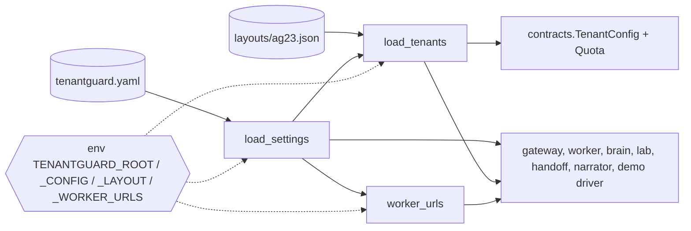

# 11 · Files: `common/` (shared contracts and configuration)

`common/` is the one package every Python service installs (`pip install -e common` locally;
`pip install /app/common` in each Docker image). It holds the message contracts and the loader for
`tenantguard.yaml` and the tenant layout. It has no I/O beyond reading those two files, and no service
redefines anything it contains. The models themselves are documented field by field in
[`04_DATA_MODELS.md`](04_DATA_MODELS.md); this page catalogues the files and every definition in them.

| File | Lines | Role |
|---|---|---|
| `common/pyproject.toml` | 12 | package metadata |
| `common/tenantguard_common/__init__.py` | 0 | package marker (empty) |
| `common/tenantguard_common/config.py` | 42 | load `tenantguard.yaml`, the layout, and worker URLs |
| `common/tenantguard_common/contracts.py` | 539 | every cross-service message model, header and enumeration |

---

### `common/pyproject.toml`
Declares the distribution `tenantguard-common` 0.1.0 (setuptools build, Python ≥ 3.10) with two
runtime dependencies, `pydantic>=2.5` and `PyYAML>=6`, and a single package, `tenantguard_common`.

No functions.

**Key decisions**
- Kept dependency-light (pydantic + PyYAML only) so every service image can install it first, as its
  own cached Docker layer.
- Python 3.10 compatible (the development interpreter), although images run Python 3.12.

---

### `common/tenantguard_common/__init__.py`
Empty package marker. Consumers import the submodules directly
(`from tenantguard_common.contracts import ...`, `from tenantguard_common.config import ...`).

No functions.

---

### `common/tenantguard_common/config.py`
Loads the single configuration file and the tenant layout. `ROOT` is the repository root, used to
resolve both files; it defaults to two levels above this file (so an editable install reads the checkout
it was installed from) and is overridden by env `TENANTGUARD_ROOT` (every Docker image sets
`TENANTGUARD_ROOT=/app`).

| Function / class | Signature | What it does | Called by |
|---|---|---|---|
| `ROOT` (module constant) | `Path` | repository root: env `TENANTGUARD_ROOT`, else `Path(__file__).resolve().parents[2]` | `load_settings`, `load_tenants` |
| `load_settings` | `load_settings() -> Dict[str, Any]` | reads and parses `tenantguard.yaml` (path override env `TENANTGUARD_CONFIG`) with `yaml.safe_load`, UTF-8 | `worker/app/config.py`, `gateway/tenantguard_gateway/app.py` and `__main__.py`, `brain/tenantguard_brain/settings.py`, `lab/tenantguard_lab/settings.py`, `integrations/handoff/tenantguard_handoff/app.py` and `__main__.py`, `narrator/tenantguard_narrator/app.py` and `__main__.py`, `tools/demo.py`, and service tools (`brain/tools/fake_gateway.py`, `gateway/tools/prove*.py`) |
| `load_tenants` | `load_tenants(settings: Dict[str, Any] \| None = None) -> List[TenantConfig]` | reads the layout JSON named by `settings["layout"]` (path override env `TENANTGUARD_LAYOUT`); for each tenant looks up its tier in `settings["tiers"]` and builds a `TenantConfig` with the tier's `weight` and `Quota` filled in. Loads the settings itself when none are given | `worker/app/config.py` (allow-list of tenant ids), gateway (identity, quotas), brain (barcodes, weights, names), lab (personas), handoff (case titles, neighbours), narrator; tools `brain/tools/*.py`, `gateway/tools/prove*.py`, `lab/tools/stub_gateway.py` |
| `worker_urls` | `worker_urls(settings: Dict[str, Any] \| None = None) -> Dict[str, str]` | server name → base URL. Env `TENANTGUARD_WORKER_URLS="w0=http://...,w1=..."` (set by docker-compose to the container names) overrides `settings["workers"]` | gateway (routing), brain (`/stats` and canary polling, server grid), lab, `tools/demo.py` (fault fallback), `lab/tools/stub_gateway.py`, `brain/tools/fake_gateway.py` |

**Key decisions**
- One file for every tunable: services read thresholds, ports and URLs through `load_settings()` instead
  of hard-coding them.
- Environment overrides exist for exactly the things that differ between local development and Docker:
  the root, the config path, the layout path and the worker URLs.
- Tier weight and quota are filled in at load time, so the layout file only states each tenant's tier.
- `load_tenants()` returns the full `TenantConfig`, including the demo API key; only the gateway's
  identity stage needs the key, and the admin API never returns it (`TenantAdminView` has no key).

---

### `common/tenantguard_common/contracts.py`
Every cross-service JSON message, as Pydantic v2 models, plus the shared header names and enumerations.
The module header fixes the units for every field (epoch seconds for `ts`/`*_at`, milliseconds for
`*_ms`, fractions for 0..1 ratios). Sections follow the data flow: tenancy/admin, telemetry, worker
stats, control, brain → UI, fault, lab, handoff cases, billing, narrator.

Module constants and type aliases:

| Name | Signature | What it is | Used by |
|---|---|---|---|
| `Mode` | `Literal["off","industry","tenantguard"]` | gateway protection mode | brain, lab, models below |
| `Tier` | `Literal["enterprise","pro","free"]` | plan tier | tenancy and view models |
| `Level` | `Literal["normal","warn","throttle","deprioritize","quarantine","blocked"]` | throttle-ladder level | brain, handoff, narrator |
| `Stage` | `Literal[...]` (9 values) | incident stage | brain, `IncidentEvent`, `ReportView` |
| `AttackName` | `Literal[...]` (10 values) | lab attack names | lab |
| `Verdict` | `Literal[...]` (5 values) | incident verdict | handoff, narrator |
| `Severity`, `CaseStatus`, `CaseDecision`, `ActionState` | `Literal[...]` | handoff case vocabulary | handoff |
| `WhyCause` | `Literal["none","neighbor","host_fault","own_usage","unknown"]` | "Why was I slow?" cause | billing (in progress) |
| `H_TENANT` | `"X-TenantGuard-Tenant"` | tenant header set by the gateway | gateway, worker, lab |
| `H_CLASS` | `"X-TenantGuard-Class"` | request-class header | gateway, worker |
| `H_REQUEST_ID` | `"X-Request-Id"` | correlation header | gateway, lab |
| `H_CPU_MS` | `"X-TenantGuard-Cpu-Ms"` | handler CPU response header | worker (sets), gateway (debits the cost bucket) |
| `H_CONTROL_TOKEN` | `"X-TenantGuard-Control-Token"` | control/admin auth header | gateway (checks), brain, handoff, lab, `tools/demo.py` (send) |

Models (all subclass `pydantic.BaseModel`; "Called by" = the services that construct or parse them on
`master`):

| Function / class | Signature | What it does | Called by |
|---|---|---|---|
| `Quota` | `class Quota(BaseModel)` | rate / burst / cost / concurrency limits of a plan | `config.load_tenants`, gateway |
| `TenantConfig` | `class TenantConfig(BaseModel)` | one tenant from the layout (includes `api_key`, `sla_p95_ms` default 100) | `config.load_tenants`; gateway `POST /admin/tenants`; brain, lab, handoff, narrator, worker (ids) |
| `TenantAdminView` | `class TenantAdminView(BaseModel)` | admin view of a tenant with override state, no key | gateway `/admin/tenants`; UI |
| `QuotaPatch` | `class QuotaPatch(BaseModel)` | partial quota update | gateway `PATCH /admin/tenants/{id}/quota`; UI |
| `ModeBody` | `class ModeBody(BaseModel)` | mode get/set body | gateway `/admin/mode`; brain, UI, lab, demo driver |
| `Cell` | `class Cell(BaseModel)` | per (tenant, server) tick latency | gateway telemetry → brain |
| `QueueStat` | `class QueueStat(BaseModel)` | per-tenant queue and admission counts per tick | gateway telemetry → brain |
| `LimiterStat` | `class LimiterStat(BaseModel)` | per-worker adaptive window | gateway telemetry → brain |
| `TelemetryFrame` | `class TelemetryFrame(BaseModel)` | one telemetry tick | gateway WS `/internal/telemetry` → brain |
| `TenantUsage` | `class TenantUsage(BaseModel)` | cumulative per-tenant meters on one worker | worker `Meters.to_contract` → brain |
| `ClassCost` | `class ClassCost(BaseModel)` | cumulative per (tenant, class) count and CPU | worker `Meters.snapshot` → brain |
| `WorkerStats` | `class WorkerStats(BaseModel)` | a worker's `/stats` document | worker `Worker.stats`; brain poller |
| `ControlBase` | `class ControlBase(BaseModel)` | shared `incident_id` + `ttl_s` of every override | base of the five override commands |
| `RouteWeightsCmd` | `class RouteWeightsCmd(ControlBase)` | per-tenant routing weights | brain rescue → gateway |
| `RelocateCmd` | `class RelocateCmd(ControlBase)` | move a tenant or class to another worker | brain → gateway |
| `LimitsCmd` | `class LimitsCmd(ControlBase)` | throttle / deprioritise factors (semantics in its docstring) | brain ladder → gateway |
| `DrainCmd` | `class DrainCmd(ControlBase)` | drain or undrain a server | brain → gateway |
| `BlockCmd` | `class BlockCmd(ControlBase)` | block or unblock a tenant | brain, handoff → gateway |
| `ReferenceCostsCmd` | `class ReferenceCostsCmd(BaseModel)` | class → reference CPU table | gateway accepts; no sender on `master` |
| `ChargeCmd` | `class ChargeCmd(BaseModel)` | one-off CPU debit outside the request path, idempotent by `charge_id` | gateway accepts; no sender on `master` |
| `Heartbeat` | `class Heartbeat(BaseModel)` | brain liveness for fail-static | brain (every 500 ms) → gateway |
| `ControlAck` | `class ControlAck(BaseModel)` | result of a control or operator call | gateway, brain |
| `OverridesView` | `class OverridesView(BaseModel)` | active overrides + expiries + heartbeat age | gateway `GET /admin/overrides`; brain, UI |
| `TenantView` | `class TenantView(BaseModel)` | per-tenant live view | brain → UI |
| `ServerView` | `class ServerView(BaseModel)` | per-server live view | brain → UI |
| `ImpactView` | `class ImpactView(BaseModel)` | business impact counters | defined; optional in `StateSnapshot`, not filled on `master` |
| `StateSnapshot` | `class StateSnapshot(BaseModel)` | 2 Hz live state (`type="state"`) | brain WS `/ws/events`, `GET /api/state`; UI, handoff, narrator |
| `Suspect` | `class Suspect(BaseModel)` | named tenant + confidence | brain, inside `IncidentEvent` |
| `IncidentEvent` | `class IncidentEvent(BaseModel)` | one incident stage (`type="incident"`) | brain; UI, handoff, narrator |
| `FaultReq` | `class FaultReq(BaseModel)` | faulty-host simulation request, bounded fields | worker `POST /admin/fault`; brain tools, lab, demo driver |
| `AttackReq` | `class AttackReq(BaseModel)` | start an attack (intensity 0.1..5, duration ≤ 600 s) | lab `POST /lab/attack`; UI, demo driver |
| `AttackStatus` | `class AttackStatus(BaseModel)` | one attack's state | lab |
| `LabStatus` | `class LabStatus(BaseModel)` | running attacks, calm flag, run id | lab `GET /lab/status` |
| `RunReq` | `class RunReq(BaseModel)` | scripted calm → attack → calm run | lab `POST /lab/run` |
| `PhaseP99` | `class PhaseP99(BaseModel)` | p99 per phase | inside `RunResult` |
| `RunResult` | `class RunResult(BaseModel)` | one measured run, written to `lab/results/*.json` | lab; UI scorecard, demo driver |
| `CaseContext` | `class CaseContext(BaseModel)` | verdict, affected tenants, evidence link, summary | handoff |
| `CaseAction` | `class CaseAction(BaseModel)` | one decision request with deadline and state | handoff |
| `CaseHistoryItem` | `class CaseHistoryItem(BaseModel)` | one history line | handoff |
| `CaseView` | `class CaseView(BaseModel)` | a handoff case | handoff `GET /cases`; UI |
| `OperatorCmd` | `class OperatorCmd(BaseModel)` | human release / extend / resume for the ladder | handoff → brain `POST /api/operator` |
| `BillLine` | `class BillLine(BaseModel)` | one bill line | billing service (in progress) |
| `BillView` | `class BillView(BaseModel)` | a tenant's bill | billing service (in progress) |
| `WhyEpisode` | `class WhyEpisode(BaseModel)` | one explained slowdown | billing service (in progress) |
| `WhyView` | `class WhyView(BaseModel)` | anonymised "Why was I slow?" answer | billing service (in progress) |
| `IncidentReport` | `class IncidentReport(BaseModel)` | operator report | narrator |
| `CustomerMessage` | `class CustomerMessage(BaseModel)` | anonymised customer message | narrator |
| `ReportView` | `class ReportView(BaseModel)` | versioned report per incident | narrator `GET /reports`, WS `/ws/reports`; UI |

The models have no methods of their own; validation comes from field types and a few `Field`
constraints (`FaultReq`, `AttackReq`, `RunReq`). `LimitsCmd` deliberately has **no** `Field`
constraints: the gateway checks `0 < factor ≤ 1` by hand so that a bad value returns 400, not 422.

**Key decisions**
- One module is the single source of truth for every JSON message; the UI mirrors it in TypeScript.
- Units are fixed in the module header instead of per service, so `ts` is always epoch seconds and
  `*_ms` always milliseconds.
- Counters in `WorkerStats` are cumulative with a `started_at` restart marker, so a consumer that misses
  a poll loses nothing and can detect restarts.
- Every override inherits a TTL from `ControlBase`: nothing the control plane does is permanent.
- Header names are constants, so the gateway and workers can never disagree on spelling.
- Contract changes go through the coordinator (`docs/PLAN.md` §3); services ask for fields rather than
  adding local models.
