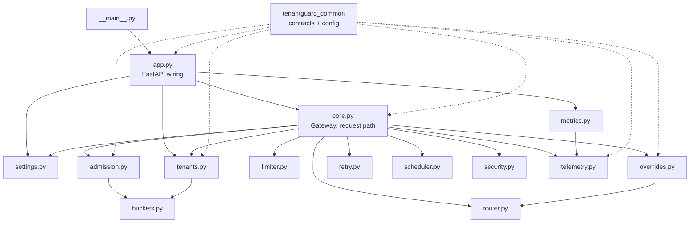

# 11: File catalog: `gateway/`

The gateway is TenantGuard's front door (port 8000). Every tenant request enters here and is identified, checked, admitted against quotas, queued fairly, dispatched under a per-worker concurrency window, routed to one of the tenant's barcode servers, forwarded and measured. The same process serves the admin API (operators), the control API (the brain), the telemetry stream and Prometheus metrics. All state is in memory; there is one gateway.

## Module dependencies inside `tenantguard_gateway`

Pure modules (no I/O; take `now` as an argument): `buckets.py`, `admission.py`, `scheduler.py`, `limiter.py`, `retry.py`, `router.py`, `security.py`, `overrides.py` (clock injectable), `telemetry.py`. I/O lives in `core.py` (upstream HTTP) and `app.py` (HTTP server, WebSocket, ticker).

---

### gateway/tenantguard_gateway/__init__.py
Package marker with a one-line docstring describing the gateway's responsibilities. It contains no code.

| Function / class | Signature | What it does | Called by |
|---|---|---|---|
| (none) | | Docstring only | |

Key decisions:
- The package name `tenantguard_gateway` keeps it importable next to other services' packages in one Python environment.

### gateway/tenantguard_gateway/__main__.py
Command-line entry point: `python -m tenantguard_gateway [--host] [--port]`. It reads the default port from `tenantguard.yaml` (`services.gateway`) and starts uvicorn on the module-level FastAPI app.

| Function / class | Signature | What it does | Called by |
|---|---|---|---|
| `main` | `main() -> None` | Loads settings, parses `--host` (default env `TENANTGUARD_GATEWAY_HOST` or `0.0.0.0`) and `--port` (env `TENANTGUARD_GATEWAY_PORT` or the port in `services.gateway`, else 8000), then runs `uvicorn.run("tenantguard_gateway.app:app", ...)` with warning-level logs | `python -m tenantguard_gateway`; the Dockerfile `CMD` |

Key decisions:
- Binds `0.0.0.0` by default, because the two-laptop setup reaches the gateway over the network.
- The port comes from config or env, never hard-coded.

### gateway/tenantguard_gateway/settings.py
Turns the `gateway` (and `worker`) sections of `tenantguard.yaml`, plus a few deployment-only environment variables, into one typed `GatewaySettings` object. It also defines module constants used by the request path.

| Function / class | Signature | What it does | Called by |
|---|---|---|---|
| `DEFAULT_CLASS_COST_MS` | constant `5.0` | Cost (CPU ms) assumed for a request class that has never been measured; also the DRR base quantum per weight unit | `core.Gateway` (scheduler quantum, `ref_cost`) |
| `CLASS_COST_ALPHA` | constant `0.2` | EWMA smoothing factor for the measured (tenant, class) cost | `core.Gateway.handle` |
| `DEFAULT_UPSTREAM_TIMEOUT_S` | constant `30.0` | Fallback upstream timeout when yaml and env give none | `GatewaySettings` |
| `DEFAULT_QUOTA_MAX` | constant dict | Default upper bounds for quota fields (`rate_rps` 10000, `burst` 20000, `cost_ms_per_s` 100000, `concurrency` 1024) | `GatewaySettings.from_dict` |
| `DEFAULT_CORS` | constant str | Default UI origins (`http://127.0.0.1:5173,http://localhost:5173`) | `GatewaySettings` |
| `GatewaySettings` | `@dataclass` | Holds every gateway tunable: default mode, tick, bounded waits per lane, cost-bucket seconds, express threshold, fail-static window, limiter min/initial/max window, retry budget (ratio, window, min allowed), body limit, batch routes, CORS origins, upstream timeout, TTL maximum, quota maxima, control token | `core.Gateway`, `app.create_app`, tests |
| `GatewaySettings.from_dict` | `@classmethod from_dict(cls, s: dict) -> GatewaySettings` | Reads `gateway.*`, `gateway.limiter.*`, `gateway.retry_budget.*`, `worker.body_limit_bytes` from the parsed yaml with safe defaults. Env `TENANTGUARD_CORS_ORIGINS`, `TENANTGUARD_UPSTREAM_TIMEOUT_S` and `TENANTGUARD_CONTROL_TOKEN` override | `app.create_app` (default app) |

Key decisions:
- Every tunable comes from yaml (project rule).
- Env is used only for deployment values: CORS, token, timeout override.
- Defaults match the yaml, so tests can build settings directly.

### gateway/tenantguard_gateway/buckets.py
The two refilling buckets behind admission. A token bucket limits the request rate. A cost bucket limits CPU milliseconds per second and is debited after the response with the CPU the worker measured. Both are pure: every call takes `now` (a `perf_counter` value).

| Function / class | Signature | What it does | Called by |
|---|---|---|---|
| `TokenBucket` | class | Refills `rate` tokens per second up to `burst`; one request takes one token | `tenants.TenantState` |
| `TokenBucket.__init__` | `(rate, burst, now)` | Starts full (`tokens = burst`) | `TenantState.__init__` |
| `TokenBucket._refill` | `(now)` | Adds `(now - last) * rate` tokens, capped at `burst` | every other method |
| `TokenBucket.configure` | `(rate, burst, now)` | Changes rate and burst (after a PATCH or a brain limit), keeping the current level clamped to the new burst; never mints tokens | `TenantState.configure` |
| `TokenBucket.level` | `(now) -> float` | Current token count after refill | `available`, `retry_after`, `admission.ratelimit_headers` |
| `TokenBucket.available` | `(now) -> bool` | True if at least one token is available | `admission.admit` |
| `TokenBucket.retry_after` | `(now) -> float` | Seconds until one token is available (0 if available) | `admission.admit`, `ratelimit_headers` |
| `TokenBucket.take` | `(now, n=1.0)` | Consumes tokens | `admission.admit` (only when admitted) |
| `CostBucket` | class | CPU-ms budget: refills `rate` ms/s up to `capacity`; admits while the level is ≥ 0 and refuses while negative, so one expensive request can overdraw it and the debt is paid back over time | `tenants.TenantState` |
| `CostBucket.__init__` | `(rate, capacity, now)` | Starts full | `TenantState.__init__` |
| `CostBucket._refill` | `(now)` | Refills up to capacity | every other method |
| `CostBucket.configure` | `(rate, capacity, now)` | Changes rate and capacity, clamping the level | `TenantState.configure` |
| `CostBucket.level` | `(now) -> float` | Current level in ms (may be negative) | `available`, `retry_after`, `ratelimit_headers` |
| `CostBucket.available` | `(now) -> bool` | True while the level is ≥ 0 | `admission.admit` |
| `CostBucket.retry_after` | `(now) -> float` | Seconds until the debt is repaid (`-level / rate`) | `admission.admit`, `ratelimit_headers` |
| `CostBucket.debit` | `(ms, now)` | Subtracts a finite positive CPU amount | `core.Gateway.handle` (after the response, or the class estimate on client disconnect), `Gateway.charge` |

Key decisions:
- The cost bucket is debited with *measured* CPU (`X-TenantGuard-Cpu-Ms`) after the response, not with an estimate before it. This makes it a real resource quota.
- Refused requests never burn tokens (see `admission.admit`).

### gateway/tenantguard_gateway/admission.py
Multi-dimensional admission for one request: an active block, the token bucket, the cost bucket and the concurrency cap are all checked, and a token is consumed only if every check passes. It also builds the standard `RateLimit-Policy` and `RateLimit` response headers.

| Function / class | Signature | What it does | Called by |
|---|---|---|---|
| `Decision` | `@dataclass(ok, reasons, retry_after_s)` | Result of admission: whether admitted, every refusing dimension, and the time until all refusing dimensions pass | `admit`, `core.Gateway.handle`, `Gateway._refuse` |
| `Decision.reason` | property `-> str` | First refusal reason (or empty) | callers wanting one reason |
| `Decision.retry_after_header` | property `-> str` | `Retry-After` value: whole seconds, rounded up, at least 1 for a refusal | `core.Gateway._refuse` |
| `CONCURRENCY_RETRY_S` | constant `1.0` | Advertised wait when only the concurrency cap refuses (the gateway cannot know when an in-flight request finishes) | `admit` |
| `admit` | `admit(tokens, cost, pending, quota, now, block_remaining_s=None) -> Decision` | Collects every failing dimension (`blocked`, `rate`, `cost`, `concurrency`) with the maximum wait across them; if none fail, takes one token and admits | `core.Gateway.handle` |
| `ratelimit_headers` | `ratelimit_headers(tokens, cost, pending, quota, cost_bucket_s, now) -> dict` | Builds `RateLimit-Policy` (one named policy per dimension: `rate` q/w, `cost` q/w with `qu="cpu-ms"`, `concurrency` q) and `RateLimit` (remaining `r` and reset `t` per dimension) | `core.Gateway.handle` |

Key decisions:
- `Retry-After` reflects the slowest refusing dimension, so a client that obeys it is admitted next time.
- The precise value is also returned in the JSON body as `retry_after_ms`.

### gateway/tenantguard_gateway/tenants.py
Tenant identity and per-tenant admission state. API keys are hashed with SHA-256 and the plaintext is dropped. It also computes the request class used by the scheduler and the cost EWMA, scales quotas for brain limits, and validates quota values.

| Function / class | Signature | What it does | Called by |
|---|---|---|---|
| `hash_key` | `hash_key(api_key: str) -> str` | SHA-256 hex digest of the key | `TenantState.__init__`, `Registry.lookup` |
| `body_bucket` | `body_bucket(n: int) -> str` | Size bucket label: `0`, `1k`, `16k`, `256k`, `big` | `request_class` |
| `request_class` | `request_class(method, path, query_keys, body_len) -> str` | `sha1(METHOD\|path\|sorted unique query keys\|body bucket)[:8]`: requests that cost about the same share a class | `core.Gateway.handle` |
| `scale_quota` | `scale_quota(q: Quota, factor) -> Quota` | Applies a brain `LimitsCmd` factor: float fields × factor, int fields `max(1, round(x × factor))` | `core.Gateway.effective_quota` |
| `quota_problems` | `quota_problems(q, maxima=None) -> list[str]` | Every field must be finite, > 0 and ≤ its maximum (`gateway.quota_max`); returns the error messages | `app` routes `add_tenant`, `patch_quota` |
| `TenantState` | class | One tenant's mutable state: config (with the API key blanked), key hash, token bucket, cost bucket, `pending` (admitted, not finished) and `inflight` (forwarded) | `Registry.add` |
| `TenantState.__init__` | `(cfg, cost_bucket_s, now)` | Hashes the key, stores a copy of the config without the key, and creates the buckets from the configured quota | `Registry.add` |
| `TenantState.id` | property `-> str` | Tenant id | everywhere |
| `TenantState.configure` | `(eff: Quota, cost_bucket_s, now)` | Reconfigures both buckets if the effective quota changed (cost capacity = `cost_ms_per_s × cost_bucket_s`) | `core.Gateway.handle`, `app.patch_quota` |
| `Registry` | class | All tenants, indexed by id and by key hash | `core.Gateway.__init__` |
| `Registry.__init__` | `(cost_bucket_s)` | Empty registry | `Gateway.__init__` |
| `Registry.add` | `(cfg, now) -> TenantState` | Adds a tenant; raises `KeyError` on a duplicate id or key | `Gateway.__init__`, `app.add_tenant` |
| `Registry.remove` | `(tenant) -> TenantState \| None` | Removes by id (and its key hash) | `app.delete_tenant` |
| `Registry.lookup` | `(api_key) -> TenantState \| None` | Finds a tenant by hashing the presented key | `core.Gateway.handle` |
| `Registry.get` | `(tenant) -> TenantState \| None` | By id | `core`, `app`, `metrics` |
| `Registry.ids` | `() -> list[str]` | All tenant ids in insertion order | `Gateway.tick`, `metrics.render_metrics` |

Key decisions:
- The plaintext key is never kept in memory after startup.
- The class ignores query *values* on purpose (`/api/read?key=1` and `?key=2` cost the same).

### gateway/tenantguard_gateway/security.py
Input hardening for the data plane (pure functions): the path guard that keeps every forwarded request under `/api/`, and the request-id validator.

| Function / class | Signature | What it does | Called by |
|---|---|---|---|
| `REQUEST_ID_RE` | regex `^[A-Za-z0-9-]{1,64}$` | Allowed shape of `X-Request-Id` | `valid_request_id` |
| `_BAD_RAW` | tuple | Encoded sequences rejected in the raw path: `%2f`, `%5c`, `%00`, `%23`, `%3f` | `safe_api_path` |
| `safe_api_path` | `safe_api_path(raw_path: bytes, decoded: str) -> str \| None` | Returns the RAW path to forward if it provably stays under `/api/`. Otherwise None, and the gateway answers 400. Rejects encoded `/ \ NUL # ?`, backslashes, control characters, `.` or `..` segments, `//`, and anything that does not normalize under `/api/` | `core.Gateway.handle` |
| `valid_request_id` | `valid_request_id(v) -> bool` | True if `v` matches `REQUEST_ID_RE` | `core.Gateway.handle` |

Key decisions:
- The raw (still-encoded) path is forwarded, so the worker decodes exactly what was checked; this closed a traversal to the worker's `/admin/fault`.
- A bad request id is replaced, never rejected.

### gateway/tenantguard_gateway/retry.py
Retry detection and the per-tenant retry budget (pure, `now` passed in). A request is a retry if it repeats an `Idempotency-Key` seen in the window, or if it repeats the fingerprint of a request that *failed* (429, 503 or 5xx). Plain repeat traffic is not a retry.

| Function / class | Signature | What it does | Called by |
|---|---|---|---|
| `MAX_KEYS` | constant 4096 | Per-tenant bound on remembered keys and failures | `_Expiring.put` |
| `fingerprint` | `fingerprint(method, path, query, body) -> str` | SHA-1 over method, path, full query and body | `core.Gateway.handle` |
| `RetryVerdict` | `@dataclass(is_retry, allowed=True, retry_after_s=0.0)` | Result of classifying one request | `RetryBudget.check`, `core.Gateway.handle` |
| `_Expiring` | class | Bounded dict of key → (expiry, value); the oldest entry is evicted first | `TenantRetries` |
| `_Expiring.__init__` | `()` | Empty store | `TenantRetries.__init__` |
| `_Expiring.put` | `(key, exp, value=0.0)` | Inserts or refreshes a key; evicts the oldest past `MAX_KEYS` | `RetryBudget.check`, `RetryBudget.failed` |
| `_Expiring.get` | `(key, now)` | Returns the entry if not expired, deleting expired ones | `RetryBudget.check` |
| `TenantRetries` | class | Per-tenant deques of first-attempt and retry timestamps, plus the idempotency-key and failed-fingerprint stores | `RetryBudget._t` |
| `TenantRetries.__init__` | `()` | Empty | `RetryBudget._t` |
| `TenantRetries._trim` | `(now, window_s)` | Drops timestamps older than the window | `RetryBudget.check` |
| `RetryBudget` | class | Applies "retries ≤ max(min_allowed, ratio × first attempts) in the last `window_s`" | `core.Gateway.__init__` |
| `RetryBudget.__init__` | `(ratio=0.1, window_s=10.0, min_allowed=3)` | Stores the budget parameters | `Gateway.__init__` |
| `RetryBudget._t` | `(tenant) -> TenantRetries` | Gets or creates the tenant's state | `check`, `failed` |
| `RetryBudget.check` | `(tenant, fp, idem_key, now) -> RetryVerdict` | Classifies the request, counts it as a first attempt or a retry, and refuses a retry over budget with a wait = max(the original `Retry-After`, the time until the budget frees) | `core.Gateway.handle` |
| `RetryBudget.failed` | `(tenant, fp, now, retry_after_s=0.0)` | Remembers a failed fingerprint (and its not-before time) for `window_s` | `Gateway.handle`, `Gateway._refuse` |
| `RetryBudget.succeeded` | `(tenant, fp)` | Forgets the fingerprint after a success | `Gateway.handle` |

Key decisions:
- Detection uses the full query and body, not the request class: class-level detection would have marked every calm `/api/light` as a retry.

### gateway/tenantguard_gateway/scheduler.py
Per-tenant queues served by weighted deficit round robin (DRR), or by one global FIFO in `off` mode. Each item costs its class's reference CPU ms; each turn a tenant earns `quantum_ms × weight` of deficit and is served while its head item fits. Pure: no clocks, no I/O.

| Function / class | Signature | What it does | Called by |
|---|---|---|---|
| `Item` | `@dataclass(eq=False)` fields `tenant, cost, cls, payload, seq, state, server, meta` | One queued request; `payload` holds the waiter's future, `server` is chosen at dispatch, `state` is `queued`, `dispatched` or `expired` | `core.Gateway.handle` |
| `_always` | `_always(_) -> True` | Default eligibility predicate | `Scheduler.pop` |
| `Scheduler` | class | Queues, deficits, round-robin cursor, FIFO flag | `core.Gateway.__init__` (one per lane) |
| `Scheduler.__init__` | `(weight_fn, quantum_ms=5.0, fifo=False)` | `weight_fn(tenant)` is read at pop time, so weight changes apply at once | `Gateway.__init__` |
| `Scheduler.push` | `(item)` | Assigns a sequence number, appends to the tenant's queue and activates the tenant | `Gateway.handle` |
| `Scheduler.cancel` | `(item) -> bool` | Marks a queued item expired (lazy removal); False if already dispatched | `Gateway.handle` (timeout or client gone), `Gateway._shed_batch` |
| `Scheduler.depth` | `(tenant) -> int` | Queued items of a tenant | `Gateway.queued`, `metrics.render_metrics` |
| `Scheduler.total` | `() -> int` | Queued items of all tenants | `Gateway.queued`, `Gateway._shed_batch` |
| `Scheduler._head` | `(t) -> Item \| None` | First still-queued item, dropping cancelled ones | `pop`, `_pop_drr` |
| `Scheduler._weight` | `(t) -> float` | Weight, floored at 1e-6 | `_pop_drr` |
| `Scheduler._deactivate` | `(i)` | Removes a tenant from the active ring and fixes the cursor | `pop`, `_pop_drr` |
| `Scheduler._advance` | `()` | Moves the cursor to the next tenant and ends the current turn | `_pop_drr` |
| `Scheduler._take` | `(t) -> Item` | Pops the head and marks it dispatched | `pop`, `_pop_drr` |
| `Scheduler.pop` | `(eligible=_always) -> Item \| None` | Next item to dispatch, considering only tenants whose head is `eligible` (e.g. has a free worker slot). FIFO mode picks the lowest sequence number | `Gateway._pump` |
| `Scheduler._pop_drr` | `(heads, ok) -> Item` | The DRR loop: grants a quantum per turn, serves while the head fits. If every eligible tenant had a turn without being served, it skips the empty rounds in one step | `pop` |

Key decisions:
- The quantum is in cost units (CPU ms), so fairness is about work, not request count. Tests check weights 4/2/1 over 10,000 pops within ±5%.
- An ineligible tenant keeps its deficit and never blocks the others.
- The round skip makes heavy items O(n), with no spinning.

### gateway/tenantguard_gateway/limiter.py
The adaptive per-worker dispatch window (a gradient concurrency limiter). It uses the worker-side *excess* latency (upstream ms minus the request's own CPU ms), so an expensive request does not look like congestion.

| Function / class | Signature | What it does | Called by |
|---|---|---|---|
| `RTT_FLOOR_MS` | constant 1.0 | Smallest sample; below it, differences are timer noise | `observe` |
| `MIN_RTT_DECAY` | constant 0.001 | minRTT drifts up 0.1% per tick, so a permanently slower host is re-baselined | `update` |
| `GRADIENT_MIN` | constant 0.2 | Lowest gradient per tick, which lets a congested worker reach the minimum window | `update` |
| `SMOOTHING` | constant 0.2 | new window = 0.8 × old + 0.2 × target | `update` |
| `GradientLimiter` | class | One per worker | `core.Gateway.__init__` |
| `GradientLimiter.__init__` | `(initial, min_window, max_window)` | Starts at `initial` | `Gateway.__init__` |
| `GradientLimiter.window` | property `-> int` | Rounded current window | `Gateway.window` |
| `GradientLimiter.observe` | `(upstream_ms, cpu_ms)` | Adds one sample of excess latency | `Gateway.handle` (after each response) |
| `GradientLimiter.note_inflight` | `(n)` | Records the peak in-flight count this tick | `Gateway._pump` |
| `GradientLimiter.update` | `() -> int` | Once per tick: median sample, update minRTT, gradient = clamp(minRTT / sample, 0.2..1). If the window is under half used and the gradient is 1, no growth. Otherwise target = old × gradient + sqrt(old), smoothed and clamped to [min, max]. No samples: no change | `Gateway.tick` |

Key decisions:
- The fixed point of `w = w·g + sqrt(w)` is `1/(1-g)^2`: about 4 when latency doubles, about 1.6 at the floor (so min_window applies).
- Active in `industry` and `tenantguard`; fixed in `off`.

### gateway/tenantguard_gateway/router.py
Chooses one server for a request (pure). It applies the brain's relocation, route weights and drains, and never black-holes a tenant.

| Function / class | Signature | What it does | Called by |
|---|---|---|---|
| `candidates` | `candidates(servers, known, weights=None, relocation=None, drained=None) -> list[(server, weight)]` | A relocation target wins outright. Route weights replace the equal default and may include servers outside the barcode. Drained or zero-weight servers are skipped, falling back to the undrained barcode, then to the whole barcode | `core.Gateway._candidates` |
| `choose` | `choose(cands, has_capacity=..., rng=None) -> str \| None` | Weighted random choice among candidates that have a free slot; None if all are full | `Gateway._eligible_in.eligible` |
| `normalize` | `normalize(weights) -> dict` | Scales weights to sum to 1 | `overrides.Overrides.set_route_weights` |

Key decisions:
- Routing considers capacity, so a full worker is skipped rather than queued behind.
- Draining every server of a tenant cannot make it unreachable.

### gateway/tenantguard_gateway/overrides.py
Brain control overrides with TTL auto-revert, plus heartbeat tracking for fail-static. Times are epoch seconds; the clock is injectable for tests.

| Function / class | Signature | What it does | Called by |
|---|---|---|---|
| `Overrides` | class | Holds active `LimitsCmd`, `BlockCmd`, route weights, `RelocateCmd`, `DrainCmd`, expiry per key, and the last heartbeat time | `core.Gateway.__init__` |
| `Overrides.__init__` | `(clock=time.time)` | Empty state | `Gateway.__init__`, tests |
| `Overrides._arm` | `(key, ttl_s)` | Sets `expires[key] = now + ttl` | every setter |
| `Overrides.set_limits` | `(cmd)` | Replaces the tenant's limits and restarts the TTL; factor 1.0 and weight factor 1.0 clear it | `app.control_limits` |
| `Overrides.set_block` | `(cmd)` | Blocks with a TTL; `blocked=false` clears | `app.control_block` |
| `Overrides.set_route_weights` | `(cmd)` | Stores normalized weights per tenant with a TTL | `app.control_route_weights` |
| `Overrides.set_relocate` | `(cmd)` | Relocates a tenant or a tenant/class to a target; `target=None` clears | `app.control_relocate` |
| `Overrides.set_drain` | `(cmd)` | Drains a server; `drained=false` clears | `app.control_drain` |
| `Overrides.heartbeat` | `()` | Records the gateway's own receive time | `app.control_heartbeat` |
| `Overrides._live` | `(key, now) -> bool` | True if not expired | getters |
| `Overrides.sweep` | `(now=None) -> list[str]` | Removes every expired override and keeps a bounded history of reverted keys | `Gateway.tick`, `view` |
| `Overrides.limits_for` | `(tenant, now=None)` | Active `LimitsCmd` or None | `Gateway._limits` |
| `Overrides.block_remaining` | `(tenant, now=None) -> float \| None` | Seconds left on an active block | `Gateway.handle`, `Gateway.admin_view` |
| `Overrides.weights_for` | `(tenant, now=None)` | Active route weights | `Gateway._candidates` |
| `Overrides.relocation_for` | `(tenant, cls=None, now=None)` | Class relocation first, then whole-tenant relocation | `Gateway._candidates`, `Gateway.admin_view` |
| `Overrides.drained` | `(now=None) -> set` | Servers currently drained | `Gateway._candidates` |
| `Overrides.tenant_expiry` | `(tenant) -> float \| None` | Latest expiry among the tenant's overrides | `Gateway.admin_view` |
| `Overrides.heartbeat_age` | `(now=None) -> float \| None` | Seconds since the last heartbeat | `view`, `metrics.render_metrics` |
| `Overrides.fail_static` | `(after_s, now=None) -> bool` | True if no heartbeat has ever arrived or none within `after_s` | `view`, `metrics` |
| `Overrides.view` | `(fail_static_after_s) -> OverridesView` | Sweeps, then returns the contract view for `/admin/overrides` | `app.overrides` |

Key decisions:
- Getters re-check expiry, so a lagging sweep never applies a stale override.
- TTLs keep expiring during fail-static: a dead brain cannot leave a tenant punished.

### gateway/tenantguard_gateway/telemetry.py
Per-tick telemetry (`TelemetryFrame`) and cumulative counters for `/metrics`. Events are recorded by the request path; `frame()` closes a tick.

| Function / class | Signature | What it does | Called by |
|---|---|---|---|
| `LAT_BUCKETS_MS` | tuple | Histogram bounds 1 ms to 10 s | `Telemetry.done`, `metrics` |
| `percentile` | `percentile(xs, p) -> float` | Nearest-rank percentile; 0 for an empty sample | `Telemetry.frame` |
| `_TenantTick` | class (slots) | One tick of one tenant: waits, end-to-end latencies, admitted, rejected, expired, retries | `Telemetry` |
| `_TenantTick.__init__` | `()` | Zeroes the tick | `Telemetry` |
| `_CellTick` | class (slots) | One tick of one (tenant, server): latencies, errors | `Telemetry` |
| `_CellTick.__init__` | `()` | Zeroes the cell | `Telemetry` |
| `Telemetry` | class | Tick state + cumulative counters (requests by status class, rejected by reason, expired, admitted, CPU, retries, charged CPU, missing CPU headers, latency histogram) | `core.Gateway.__init__` |
| `Telemetry.__init__` | `()` | Empty | `Gateway.__init__` |
| `Telemetry.admitted` | `(tenant)` | Counts an admission | `Gateway.handle` |
| `Telemetry.rejected` | `(tenant, reasons)` | Counts a 429 per reason | `Gateway._refuse` |
| `Telemetry.expired` | `(tenant, wait_ms)` | Counts a 503 (timeout or shed) and its wait | `Gateway.handle` |
| `Telemetry.dispatched` | `(tenant, wait_ms)` | Records the queue wait of a dispatched request | `Gateway.handle` |
| `Telemetry.retry` | `(tenant)` | Counts a detected retry | `Gateway.handle` |
| `Telemetry.charged` | `(tenant, cpu_ms)` | Counts brain-charged background CPU | `Gateway.charge` |
| `Telemetry.cpu_missing` | `(tenant, server)` | Counts a response without a usable CPU header | `Gateway.handle` |
| `Telemetry.done` | `(tenant, server, upstream_ms, e2e_ms, status, cpu_ms=0.0)` | Records a completed request: cell latency, errors (≥ 500), end-to-end latency, counters, histogram | `Gateway.handle` |
| `Telemetry.frame` | `(mode, tick_ms, tenants, depth, inflight, limiter, ts=None) -> TelemetryFrame` | Builds cells (count, p50, p95, errors) and per-tenant `QueueStat`s for the tick that ended, then starts a new tick | `Gateway.tick` |

Key decisions:
- A `QueueStat` is emitted for every tenant every tick, even with no traffic, so consumers see zeros, not gaps.
- Percentiles are exact over the tick's samples.

### gateway/tenantguard_gateway/metrics.py
Hand-written Prometheus text exposition (no client library). It renders cumulative counters and current gauges from the `Gateway` object.

| Function / class | Signature | What it does | Called by |
|---|---|---|---|
| `_esc` | `_esc(v) -> str` | Escapes backslash, quote and newline in label values | `_labels` |
| `_labels` | `_labels(**kv) -> str` | Formats `{k="v",...}` | `render_metrics` |
| `render_metrics` | `render_metrics(gw) -> str` | Emits: mode, requests by tenant/server/status class, admitted, rejected by reason, expired, CPU, retries, charged CPU, missing CPU headers, end-to-end latency histogram, queue depth per lane, tenant in-flight, cost-bucket level, throttle factor, worker window/in-flight/minRTT, loop lag, fail-static, heartbeat age | `app` route `GET /metrics` |
| `render_metrics.head` | nested `head(name, kind, help_)` | Writes the `# HELP` / `# TYPE` lines | `render_metrics` |

Key decisions:
- The samples of each metric family are kept contiguous, as the text format requires.

### gateway/tenantguard_gateway/core.py
The gateway engine: identify → path and body checks → classify → retry budget → admit → queue (3 DRR lanes, or FIFO in `off`) → dispatch under the window → route → forward → measure. Dispatch is event-driven: `_pump()` runs whenever work is queued or a slot frees, so there is no dispatcher task.

| Function / class | Signature | What it does | Called by |
|---|---|---|---|
| `HOP_BY_HOP`, `RESP_DROP` | sets | Request and response headers never forwarded | `_client_must_not_send`, `handle` |
| `H_LANE`, `H_SERVER` | constants | Response headers `X-TenantGuard-Lane`, `X-TenantGuard-Server` | `handle` |
| `LANES` | `("express", "interactive", "batch")` | Lane order (served in this order) | `Gateway` |
| `BodyReader` | type alias | `async (limit) -> bytes \| None` | `handle` |
| `CHARGE_IDS_KEPT` | constant 1024 | Idempotency memory for `charge` | `Gateway.charge` |
| `_client_must_not_send` | `(name) -> bool` | True for hop-by-hop headers, `x-api-key`, any `x-tenantguard-*`, `x-admin-token`, `x-request-id` | `handle` |
| `Result` | class | Status, body, headers and optional JSON to return | `handle`, `_refuse`, `app.proxy` |
| `Result.__init__` | `(status, body=b"", headers=None, json=None)` | Stores the fields | same |
| `Gateway` | class | All gateway state: settings, workers, mode, registry, overrides, 3 lane schedulers, a limiter per worker, slots, class-cost EWMA, reference costs, retry budget, charge ids, telemetry, latest frame, loop lag, RNG, pooled httpx client | `app.create_app`, tests |
| `Gateway.__init__` | `(settings, tenants, workers, client=None, rng=None)` | Builds everything; the httpx pool allows 1024 connections | `create_app` |
| `Gateway.controlled` | property | True in `tenantguard` mode (brain commands apply) | many |
| `Gateway.adaptive` | property | True outside `off` (lanes, adaptive window, retry budget) | many |
| `Gateway._limits` | `(tenant)` | Active `LimitsCmd` if controlled | `factors` |
| `Gateway.factors` | `(tenant) -> (factor, weight_factor)` | (1, 1) when no limits apply | `effective_quota`, `_weight`, `admin_view`, `metrics` |
| `Gateway.effective_quota` | `(st) -> Quota` | Configured quota scaled by the factor | `handle`, `admin_view`, `app.patch_quota` |
| `Gateway._weight` | `(tenant) -> float` | Tier weight × weight factor | the schedulers |
| `Gateway.set_mode` | `(mode)` | Switches mode; FIFO in `off`; pumps | `app.set_mode` |
| `Gateway.ref_cost` | `(tenant, cls) -> float` | Brain reference cost (in `tenantguard`) > measured EWMA > 5 ms | `handle`, `lane_for` callers |
| `Gateway.lane_for` | `(path, client_class, cost) -> str` | `batch` for the `batch` header or `batch_routes`; `express` if cost < `express_cost_ms`; else `interactive` (always `interactive` in `off`) | `handle` |
| `Gateway.window` | `(server) -> int` | Adaptive window, or `initial_window` in `off` | `lane_cap`, `limiter_stats`, `_shed_batch` |
| `Gateway.lane_cap` | `(lane, server) -> int` | Slots a lane may use: express the full window; interactive leaves max(1, window/8) of headroom; batch at most half | `_eligible_in`, `_shed_batch` |
| `Gateway.queued` | `(tenant=None) -> int` | Queued count across lanes | `tick`, tests |
| `Gateway._candidates` | `(st, cls)` | Router candidates; overrides only when controlled | `_eligible_in`, `_shed_batch` |
| `Gateway._eligible_in` | `(lane)` | Builds the eligibility predicate for a lane | `_pump` |
| `Gateway._eligible_in.eligible` | nested `(item) -> bool` | Chooses a server with a free slot under the lane cap and stores it on the item | `Scheduler.pop` |
| `Gateway._pump` | `()` | Pops items in lane order while slots are free, reserves a slot, notes in-flight, resolves the waiter's future; then sheds batch | `handle`, `_release`, `set_mode`, `tick`, `app` control routes |
| `Gateway._shed_batch` | `()` | If interactive or express work is waiting and a queued batch item's servers have no interactive headroom, cancels it and resolves it as shed (503) | `_pump` |
| `Gateway._release` | `(item)` | Frees the item's slot once (idempotent) and pumps | `handle` |
| `Gateway.handle` | `async (method, path, query, query_keys, headers, read_body, raw_path=None) -> Result` | The request path. Key → 401. Path guard → 400. `Content-Length` → 413. Capped body read → 413. Class and request id. Retry budget → 429. Admission → 429. Enqueue and wait up to the lane's bounded wait → 503. Forward to the chosen server with trusted headers. Release the slot. Debit the measured CPU (or the class estimate if the client disconnected). Update the limiter, the class EWMA, retry memory and telemetry. Return the response with `RateLimit`, request-id, server and lane headers | `app.proxy` |
| `Gateway._refuse` | `(tenant, fp, rid, dec, rl_headers) -> Result` | Counts the refusal, remembers the failed fingerprint, builds the 429 | `handle` |
| `Gateway.charge` | `(cmd) -> str` | Debits brain-reported background CPU (tenantguard mode only; idempotent by `charge_id`) | `app.control_charge` |
| `Gateway.limiter_stats` | `() -> list[LimiterStat]` | Window and in-flight per worker | `tick`, `metrics` |
| `Gateway.tick` | `() -> TelemetryFrame` | Sweeps overrides, updates every limiter (adaptive modes), pumps, builds the frame | `app.ticker` (every `tick_ms`), `telemetry_latest`, tests |
| `Gateway.admin_view` | `(st) -> TenantAdminView` | The tenant as the admin API shows it (quota, effective quota, factors, blocked, placement, expiry) | `app` admin routes |
| `Gateway.aclose` | `async ()` | Closes the httpx client | `app.lifespan` |
| `_parse_cpu` | `(v) -> float \| None` | Parses `X-TenantGuard-Cpu-Ms`; None if missing, invalid or negative | `handle` |

Key decisions:
- Queueing happens at the gateway, behind small worker windows, so the scheduler (not the worker) decides who goes next.
- Slots are released exactly once, even on cancellation.
- Brain commands apply only in `tenantguard` mode, so `industry` is a clean baseline.

### gateway/tenantguard_gateway/app.py
FastAPI wiring: the `/api/*` proxy, health, telemetry WebSocket, metrics, the admin API and the control API (both behind the control token), and the background ticker. `create_app()` builds everything; the module-level `app` is what uvicorn serves.

| Function / class | Signature | What it does | Called by |
|---|---|---|---|
| `API_METHODS` | list | Methods proxied under `/api/` | `proxy` route |
| `_bad` | `(detail, status=400) -> JSONResponse` | `ControlAck(ok=False)` error response | control routes, validation handler |
| `_ok` | `(detail="") -> ControlAck` | Success acknowledgement | control routes |
| `create_app` | `(gw=None, run_ticker=True) -> FastAPI` | Builds the app around a `Gateway` (from config if not given) | module import (`app = create_app()`), tests |
| `create_app.ticker` | nested `async ()` | Every `tick_ms`: measures loop lag, calls `gw.tick()`, pushes the frame JSON to every WebSocket subscriber, dropping the oldest for slow clients | `lifespan` |
| `create_app.lifespan` | nested `async (_)` | Starts and stops the ticker; closes the gateway client | FastAPI |
| `create_app._validation` | nested `async (request, exc)` | Request validation errors: 400 `ControlAck` on `/control/*`, 422 elsewhere | FastAPI exception handler |
| `create_app.proxy` | route `ANY /api/{path:path}` | Lower-cases headers, provides a capped streaming body reader, calls `gw.handle` with the raw path, returns JSON or raw content | FastAPI |
| `create_app.proxy.read_body` | nested `async (limit) -> bytes \| None` | Reads the request stream; None once over the limit | `Gateway.handle` |
| `create_app.healthz` | route `GET /healthz` | ok, mode, tenant and worker counts | Docker healthcheck, operators |
| `create_app.telemetry_ws` | route `WS /internal/telemetry` | Subscribes the client to frames; sends the latest frame on connect | brain, tests |
| `create_app.telemetry_ws.sender` | nested `async ()` | Sends the queued frames | `telemetry_ws` |
| `create_app.telemetry_ws.watcher` | nested `async ()` | Detects a disconnect even when no frame is due | `telemetry_ws` |
| `create_app.telemetry_latest` | route `GET /internal/telemetry/latest` | Last frame (or a fresh tick) | lab tools, operators |
| `create_app.metrics` | route `GET /metrics` | Prometheus text | scrapers |
| `create_app.require_token` | dependency `(request)` | 401 unless `X-TenantGuard-Control-Token` equals the configured token (`hmac.compare_digest`) | admin and control routers |
| `create_app.list_tenants` | `GET /admin/tenants` | All tenants as `TenantAdminView` (never the API key) | UI, lab |
| `create_app.get_tenant` | `GET /admin/tenants/{tenant}` | One tenant or 404 | UI |
| `create_app.add_tenant` | `POST /admin/tenants` | Validates quota, servers and weight (400), duplicates (409); 201 with the view | admin |
| `create_app.delete_tenant` | `DELETE /admin/tenants/{tenant}` | Removes a tenant or 404 | admin |
| `create_app.patch_quota` | `PATCH /admin/tenants/{tenant}/quota` | Merges the patch, validates bounds (400), reconfigures the buckets at once | UI Tenants page |
| `create_app.get_mode` / `set_mode` | `GET/POST /admin/mode` | Read or switch the mode | UI, lab, demo |
| `create_app.overrides` | `GET /admin/overrides` | `OverridesView` (expiry, heartbeat age, fail-static) | UI, brain, operators |
| `create_app._check_ttl` | nested `(ttl) -> str \| None` | Error unless finite and 0 < ttl ≤ `ttl_max_s` | control routes |
| `create_app._check_tenant` | nested `(t) -> str \| None` | Error for an unknown tenant | control routes |
| `create_app.control_limits` | `POST /control/limits` | Validates tenant, TTL, factor and weight factor in (0, 1]; applies; pumps | brain |
| `create_app.control_block` | `POST /control/block` | Validates; blocks or unblocks | brain, handoff bridge |
| `create_app.control_heartbeat` | `POST /control/heartbeat` | Records the receive time | brain |
| `create_app.control_route_weights` | `POST /control/route_weights` | Validates tenants, servers and finite non-negative weights (at least one positive); applies | brain (rescue) |
| `create_app.control_relocate` | `POST /control/relocate` | Validates the target; applies or clears | brain |
| `create_app.control_drain` | `POST /control/drain` | Validates the server; drains or undrains | brain |
| `create_app.control_charge` | `POST /control/charge` | Validates finite cpu_ms ≥ 0; calls `gw.charge` | brain (reserved) |
| `create_app.control_reference_costs` | `POST /control/reference_costs` | Replaces the reference-cost table (finite, > 0) | brain (reserved) |
| `create_app.get_reference_costs` | `GET /admin/reference_costs` | Pushed table + measured EWMAs | operators |
| `app` | module attribute | `create_app()` | uvicorn |

Key decisions:
- The control API answers bad input with 400 and never crashes.
- The admin and control routers share one constant-time token check.
- Telemetry pushes rather than polls.

---

### gateway/tools/stub_worker.py
A minimal echo worker for gateway development without the real worker: it burns `cpu_ms` of CPU, sleeps `sleep_ms`, and returns the trusted headers it received plus `X-TenantGuard-Cpu-Ms`.

| Function / class | Signature | What it does | Called by |
|---|---|---|---|
| `app` | FastAPI | The stub app | `__main__` block |
| `echo` | route `ANY /api/{path}` `(path, request, response, cpu_ms=0.5, sleep_ms=0.0)` | Busy-loops for the requested thread CPU, optionally sleeps, sets the CPU header, echoes server, path, tenant, class and request id | gateway under test |

Key decisions:
- It measures CPU with `time.thread_time()`, like the real worker, so the cost bucket is exercised realistically.

### gateway/tools/prove.py
End-to-end proof script for the gateway's first version, run against a live gateway and workers. It covers identity, flood vs victim, a few-but-heavy whale, quota PATCH, control limits with TTL, relocation, the telemetry WebSocket and `/metrics`.

| Function / class | Signature | What it does | Called by |
|---|---|---|---|
| `Run` | class | Status counts, 429 reasons, latencies and a sample 429 of one traffic run | `_one`, `open_loop`, `flood` |
| `Run.__init__` | `()` | Empty counters | the functions below |
| `Run.summary` | `() -> dict` | Codes, reasons, p50/p95 of successes | `main`, the `--flood` mode |
| `_one` | `async (c, run, tenant, path)` | One request; records status, latency and the first 429's headers | `open_loop`, `flood` |
| `open_loop` | `async (tenant, rps, seconds, path)` | Fixed-rate traffic (a well-behaved tenant) on its own connection pool | `main` |
| `flood` | `async (tenant, conns, seconds, path)` | Closed-loop traffic as fast as `conns` allow (an abusive tenant) | `--flood` mode |
| `flood_proc` | `async (tenant, conns, seconds) -> dict` | Runs a flood in a separate process, so it cannot slow the measuring process | `main` |
| `gateway_view` | `async (tenants, seconds) -> dict` | Reads the gateway's own per-tick `QueueStat`s from the WebSocket (max p95, max wait, totals) | `main` |
| `show` | `(title, obj)` | Prints a titled JSON block | `main` |
| `main` | `async ()` | Runs the numbered proof steps with the control token | `__main__` block |

Key decisions:
- Each tenant gets its own connection pool, and the flood runs in its own process, so client-side queueing does not pollute the victim's numbers.

### gateway/tools/prove_t7.py
Proof script for the second gateway wave: whale vs light latency with and without the express lane (plus the window time series), a retry storm capped by the budget, and the security checks over a raw socket.

| Function / class | Signature | What it does | Called by |
|---|---|---|---|
| `pct` | `(xs, q) -> float` | Percentile helper | `light`, `whale` |
| `whale_loop` | `async (conns, seconds) -> Counter` | Closed-loop heavy searches from tenant K | `whale` |
| `light` | `async (tenant, rps, seconds) -> dict` | Fixed-rate light requests; codes, lanes, p50/p95/max | `whale`, `storm` |
| `watch` | `async (seconds) -> dict` | Records A's per-tick wait and p95, K's queue depth and w1's window from the telemetry WebSocket | `whale` |
| `whale` | `async (label)` | Pins A and K to one worker with route weights, gives K a large plan, runs the whale while measuring A, then restores everything | `__main__` (`whale LABEL`) |
| `storm` | `async ()` | K repeats the same GET for 6 s ignoring `Retry-After` while A is measured; prints codes, reasons and retry counters | `__main__` (`storm`) |
| `storm.metric` | nested `(text, name) -> list` | Picks metric lines | `storm` |
| `raw_get` | `(path, headers) -> str` | Sends a raw HTTP request over a socket (no client-side path normalization) | `security` |
| `security` | `async ()` | Traversal paths, missing token, an infinite TTL, an out-of-bounds quota, a bad request id | `__main__` (`security`) |

Key decisions:
- The traversal checks use a raw socket, because HTTP client libraries normalize dot segments away and would hide the bug.

---

### gateway/tests/test_buckets.py
Unit tests of the bucket math and admission.

| Function / class | Signature | What it proves | Called by |
|---|---|---|---|
| `Q` | constant `Quota` | Shared test quota (rate 10, burst 5, cost 100 ms/s, concurrency 2) | tests |
| `test_token_bucket_burst_then_refill_rate` | `()` | Burst is consumable at once, refill follows the rate, the level is capped at burst | pytest |
| `test_token_bucket_reconfigure_clamps_level` | `()` | Reconfiguring clamps the level and changes the retry time | pytest |
| `test_cost_bucket_overdraw_and_payback` | `()` | One request can overdraw; refusal lasts exactly debt ÷ rate | pytest |
| `test_admit_consumes_token_only_when_admitted` | `()` | A cost refusal does not burn a token; `Retry-After` is right | pytest |
| `test_admit_reports_max_wait_across_dimensions_and_rounds_up` | `()` | Rate + cost refusal reports the larger wait, rounded up | pytest |
| `test_admit_concurrency_and_block` | `()` | Concurrency cap and block reasons and waits | pytest |
| `test_ratelimit_headers_shape` | `()` | Exact `RateLimit-Policy` and `RateLimit` header strings | pytest |

### gateway/tests/test_scheduler.py
Unit tests of DRR fairness and FIFO mode.

| Function / class | Signature | What it proves | Called by |
|---|---|---|---|
| `run` | `(s, n, refill) -> list` | Helper: pops n items, refilling queues | tests |
| `test_drr_weights_4_2_1_within_5pct` | `(costs)` (2 cases) | Weights 4/2/1 give work shares within ±5% over 10,000 pops, for equal and mixed costs | pytest |
| `test_weight_change_takes_effect` | `()` | A weight factor of 0.25 gives a 4:1 ratio | pytest |
| `test_whale_cannot_starve_others` | `()` | 1000 queued 500 ms whale items do not delay 200 light items | pytest |
| `test_fifo_mode_serves_in_arrival_order_so_whale_blocks` | `()` | `off` mode is a plain FIFO | pytest |
| `test_cancelled_items_are_skipped_and_counted` | `()` | Lazy cancel and depth accounting | pytest |
| `test_ineligible_tenant_is_skipped_without_blocking_others` | `()` | An ineligible tenant never blocks another | pytest |
| `test_mode_switch_keeps_queued_work` | `()` | FIFO → DRR switch keeps queued items | pytest |

### gateway/tests/test_router.py
Routing and request-class tests.

| Function / class | Signature | What it proves | Called by |
|---|---|---|---|
| `KNOWN` | constant | Known servers in tests | tests |
| `test_default_equal_weights_random_spread` | `()` | Equal weights spread about evenly (±6% over 9000 picks) | pytest |
| `test_route_weights_drain_relocate` | `()` | Weights, drain, relocation, and the no-black-hole fallback | pytest |
| `test_choose_respects_capacity` | `()` | Full servers are skipped; None if all full | pytest |
| `test_request_class_is_stable_and_order_insensitive` | `()` | Class hash properties and body buckets | pytest |
| `test_scale_quota_int_rounding` | `()` | Factor scaling with the `max(1, round)` rule | pytest |

### gateway/tests/test_overrides.py
TTL revert and fail-static tests with a fake clock.

| Function / class | Signature | What it proves | Called by |
|---|---|---|---|
| `Clock` | class | Settable fake epoch clock | tests |
| `Clock.__init__` / `__call__` | `()` | Start at 1000.0 / return the time | tests |
| `test_ttl_auto_revert_of_every_kind` | `()` | Limits, block, route weights, relocation and drain all expire and are swept | pytest |
| `test_latest_limits_replaces_and_restarts_ttl_and_1_1_clears` | `()` | Replace semantics and the 1.0/1.0 clear | pytest |
| `test_class_relocation_and_explicit_clear` | `()` | Class relocation; explicit clears | pytest |
| `test_fail_static_uses_receive_time` | `()` | Fail-static before any heartbeat and after the window | pytest |

### gateway/tests/test_limiter_retry.py
Gradient window and retry budget unit tests.

| Function / class | Signature | What it proves | Called by |
|---|---|---|---|
| `feed` | `(lim, upstream_ms, cpu_ms=0, n=10, inflight=64) -> int` | Helper: one tick of samples | tests |
| `test_window_grows_to_max_when_latency_stays_at_baseline` | `()` | Healthy worker → window 64 | pytest |
| `test_window_shrinks_when_worker_side_latency_rises_and_settles_near_gradient_fixed_point` | `()` | Doubling latency settles near 4 | pytest |
| `test_own_cpu_is_not_congestion` | `()` | A 300 ms CPU request with 5 ms excess does not shrink the window | pytest |
| `test_window_clamped_and_never_moves_without_samples` | `()` | No samples → no change; floor = min_window | pytest |
| `test_no_growth_when_window_underused` | `()` | No growth without evidence | pytest |
| `test_min_rtt_decays_upward_to_rebaseline` | `()` | A permanently slower host becomes the baseline | pytest |
| `test_plain_repeats_are_not_retries` | `()` | 100 successful repeats are first attempts | pytest |
| `test_repeat_of_failed_request_is_a_retry_and_budget_caps_it` | `()` | Budget = 10% of first attempts; `Retry-After` honoured | pytest |
| `test_retry_budget_window_expires_and_other_tenants_unaffected` | `()` | Per-tenant, windowed | pytest |
| `test_idempotency_key_repeat_is_a_retry_even_after_success` | `()` | Idempotency keys | pytest |
| `test_fingerprint_includes_query_and_body` | `()` | The fingerprint distinguishes query and body | pytest |

### gateway/tests/test_api.py
API-level tests through the ASGI app with a fake worker fleet.

| Function / class | Signature | What it proves / does | Called by |
|---|---|---|---|
| `TOKEN`, `WORKERS` | constants | Control token header; four fake workers | tests |
| `tenant` | `(tid, servers=..., weight=1.0, **quota) -> TenantConfig` | Test tenant factory | tests |
| `Upstream` | class | Fake worker: records requests, honours `sleep_ms`, `cpu_ms`, `fail` | `make` |
| `Upstream.__init__` / `__call__` | `()` / `async (req)` | Recorder / responder | httpx MockTransport |
| `make` | `(tenants, mode, window, max_wait_ms, tick_ms, ticker, **kw)` | Builds settings, gateway, app, upstream | tests |
| `client` | `(app) -> AsyncClient` | ASGI client with the token | tests |
| `run` | `(coro)` | `asyncio.run` | tests |
| `test_unknown_or_missing_key_is_401_json_and_never_forwarded` | `()` | 401, nothing forwarded | pytest |
| `test_forward_sets_trusted_headers_and_strips_spoofed_ones` | `()` | Trusted headers set; spoofed ones replaced; API key not forwarded | pytest |
| `test_rate_limit_429_with_accurate_retry_after` | `()` | 429 at the right request; `Retry-After` 2 at 0.5 rps; neighbour unaffected | pytest |
| `test_cost_bucket_debited_after_response_then_refuses` | `()` | One 500 ms request leaves a 300 ms debt → 429 with `Retry-After` 3 | pytest |
| `test_concurrency_cap` | `()` | Two of four concurrent requests refused | pytest |
| `test_off_mode_has_no_limits` | `()` | `off` never refuses | pytest |
| `test_quota_patch_changes_behaviour` | `()` | PATCH takes effect; bad values 400; unknown tenant 404 | pytest |
| `test_bounded_wait_expires_with_503_and_is_never_forwarded` | `()` | Expired requests get 503 and never reach a worker; counters right | pytest |
| `test_fair_dispatch_under_contention_victim_not_starved` | `()` | A victim behind 40 whale requests finishes in < 0.5 s | pytest |
| `test_control_validation_400_and_limits_apply_then_ttl_revert` | `()` | Bad control input → 400; limits apply; TTL revert | pytest |
| `test_block_relocate_drain_heartbeat` | `()` | Block, relocation, drain and heartbeat end to end | pytest |
| `test_overrides_ignored_outside_tenantguard_mode` | `()` | Brain commands only in `tenantguard` | pytest |
| `test_admin_add_tenant_and_conflicts` | `()` | 201, 409, 400; key never stored | pytest |
| `test_telemetry_ws_frames_latest_and_metrics` | `()` | WebSocket frames, `/latest`, metric lines | pytest |
| `test_missing_or_garbage_cpu_header_debits_zero_and_is_counted` | `()` | Missing or invalid CPU header → no debit, counted | pytest |

### gateway/tests/test_wave2_api.py
API-level tests of lanes, the adaptive window, the retry budget, `charge` and reference costs.

| Function / class | Signature | What it proves / does | Called by |
|---|---|---|---|
| `LIGHT`, `HEAVY` | constants | Light and heavy request paths | tests |
| `_learn` | `async (c, key, path, n=1)` | Teaches the gateway a class's cost | tests |
| `_whale_vs_light` | `(express_cost_ms)` | Whale fills a 4-slot worker; light latencies measured | two tests |
| `test_express_lane_keeps_light_requests_fast_behind_a_whale` | `()` | Express lane → every light request < 150 ms | pytest |
| `test_without_express_lane_light_requests_wait_behind_the_whale` | `()` | Without it, median > 150 ms | pytest |
| `test_batch_lane_by_header_or_route_with_longer_wait` | `()` | Batch by header and route; worker still gets the class hash | pytest |
| `test_batch_is_shed_first_when_worker_saturates` | `()` | Queued batch shed with 503 `shed` | pytest |
| `test_retry_storm_is_capped_by_budget_and_counted` | `()` | 3 retries allowed, the rest `retry_budget`; counters | pytest |
| `test_idempotency_key_repeat_counts_as_retry` | `()` | Idempotency keys counted | pytest |
| `test_off_mode_has_no_retry_budget_and_fixed_window` | `()` | `off` mode | pytest |
| `test_charge_debits_cost_bucket_idempotently_in_tenantguard_mode_only` | `()` | Charge semantics | pytest |
| `test_reference_costs_override_measured_cost_for_lane_choice` | `()` | Reference costs change the lane in `tenantguard` only | pytest |
| `test_adaptive_window_moves_with_worker_side_latency` | `()` | Windows shrink under worker latency; idle workers unchanged | pytest |

### gateway/tests/test_security.py
The security-review fixes.

| Function / class | Signature | What it proves | Called by |
|---|---|---|---|
| `KEY` | constant | Tenant A's key header | tests |
| `test_traversal_is_rejected_and_never_forwarded` | `(raw)` (9 cases) | Encoded traversal and bad paths → 400/404, nothing forwarded | pytest |
| `test_safe_paths_pass_and_raw_path_is_forwarded` | `()` | Good paths pass; raw path forwarded; admin and tenantguard headers stripped | pytest |
| `test_admin_and_control_need_the_control_token` | `()` | 401 without or with a wrong token; unauthenticated calls change nothing | pytest |
| `test_control_token_from_settings` | `()` | Custom token honoured | pytest |
| `test_ttl_must_be_finite_and_bounded` | `(ttl)` (7 cases) | Infinity, NaN, 0, -1, > max → 400; overrides view still works | pytest |
| `test_ttl_at_max_is_accepted` | `()` | 3600 accepted | pytest |
| `test_quota_patch_bounds` | `(patch)` (6 cases) | Infinite, huge, zero values → 400 | pytest |
| `test_new_tenant_quota_bounds` | `()` | POST bounds | pytest |
| `test_no_key_is_401_before_reading_a_huge_body` | `()` | A 4 MB body is never read on 401 | pytest |
| `test_content_length_over_limit_is_413_without_forwarding` | `()` | `Content-Length` check | pytest |
| `test_chunked_body_over_limit_is_413` | `()` | Capped streaming read | pytest |
| `test_request_id_validated_and_forwarded_once` | `()` | Bad id replaced; forwarded and returned exactly once | pytest |
| `test_cpu_debited_from_class_estimate_when_client_disconnects` | `()` | Disconnect mid-flight debits the class estimate; slots, in-flight and pending back to 0 | pytest |

---

### gateway/Dockerfile
Builds the gateway image from the repository root: Python 3.12-slim; installs `common` and `requirements.txt`; copies `tenantguard.yaml`, `layouts/` and the package; exposes 8000; healthcheck on `/healthz`; runs `python -m tenantguard_gateway --host 0.0.0.0 --port 8000`.

| Function / class | Signature | What it does | Called by |
|---|---|---|---|
| (none) | | Container build recipe | `docker compose build gateway` |

Key decisions:
- The build context is the repo root, so the shared `common` package and config are baked in.

### gateway/requirements.txt, gateway/requirements-dev.txt, gateway/pytest.ini
Runtime dependencies pinned to the versions tested (`fastapi==0.104.1`, `uvicorn[standard]==0.24.0`, `httpx==0.25.2`, `pydantic>=2.5`, `PyYAML>=6`). The dev file adds `pytest==7.4.3`. `pytest.ini` puts the package on the path and points at `tests/`.

| Function / class | Signature | What it does | Called by |
|---|---|---|---|
| (none) | | Configuration files | pip, pytest |

### gateway/README.md
Operator documentation: how to run, the request path, modes, the full API table, control semantics and the module layout.

| Function / class | Signature | What it does | Called by |
|---|---|---|---|
| (none) | | Documentation | readers |
