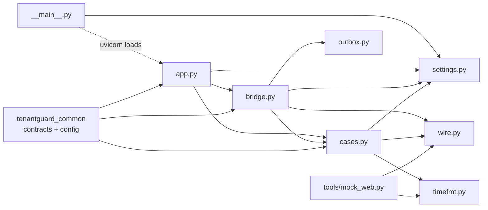
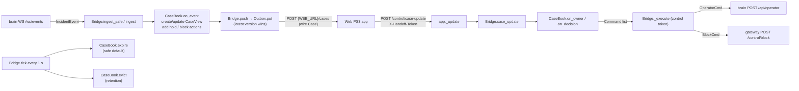

# 11: File catalog: `integrations/handoff/` (the Web PS3 handoff bridge)

The handoff bridge connects TenantGuard to the Web PS3 "Digital Handoff" app, the convergence partner. Every brain incident becomes a *case* in the partner app, with an owner, pending decisions and deadlines. When the on-call engineer acknowledges a case or approves, extends, releases, rejects or resolves an action, the bridge turns that into a TTL-bound control command for the brain or the gateway. It is a FastAPI service on port 8400.

## Module dependencies

## Incident → case → decision → control

---

### integrations/handoff/tenantguard_handoff/__init__.py
Package marker. Its docstring states the package's purpose: incidents become cases, and owners and decisions flow back.

| Function / class | Signature | What it does | Called by |
|---|---|---|---|
| (none) | | Contains only the package docstring | |

Key decisions:
- No side effects on import: the FastAPI app is built in `app.py`.

### integrations/handoff/tenantguard_handoff/__main__.py
Command-line entry point (`python -m tenantguard_handoff`). It reads the port from `tenantguard.yaml` (`services.handoff`) and starts uvicorn on `0.0.0.0`.

| Function / class | Signature | What it does | Called by |
|---|---|---|---|
| `main` | `main() -> None` | Loads settings (`HandoffSettings.from_dict(load_settings())`). Parses `--host` (default env `HANDOFF_HOST` or `0.0.0.0`) and `--port` (default env `HANDOFF_PORT` or the yaml port). Runs `uvicorn.run("tenantguard_handoff.app:app", ...)` with log level `warning`. | `python -m tenantguard_handoff`; the Dockerfile `CMD` |

Key decisions:
- Binds `0.0.0.0` by default, because the two-laptop setup reaches the bridge over the network.
- The port comes from yaml, so it is never hard-coded twice.

### integrations/handoff/tenantguard_handoff/app.py
FastAPI wiring. It builds the `Bridge` (unless one is injected for tests), runs its background tasks in the app lifespan, and exposes the read API (cases, health) plus the inbound partner endpoint, which is **fail-closed** behind `HANDOFF_PARTNER_TOKEN`.

| Function / class | Signature | What it does | Called by |
|---|---|---|---|
| `PARTNER_TOKEN_HEADER` | re-exported from `wire` (`"X-Handoff-Token"`) | Header the partner must send on updates | `_update` |
| `create_app` | `create_app(bridge: Optional[Bridge] = None, start: bool = True) -> FastAPI` | Builds the app. Without a bridge it loads yaml + layout and creates one. Reads `HANDOFF_PARTNER_TOKEN` once. Adds CORS for the UI origins. Registers the routes below. | module level (`app = create_app()`); tests |
| `create_app.lifespan` | `async lifespan(_: FastAPI)` | Async context manager: on startup calls `bridge.start()` if `start`; on shutdown always awaits `bridge.stop()` | FastAPI lifespan |
| `create_app.healthz` | `async healthz()` → `GET /healthz` | Returns `bridge.health()`: brain connection, mode, counters, outbox stats | monitoring, Docker healthcheck |
| `create_app.list_cases` | `async list_cases()` → `GET /cases` | All cases as `CaseView`, newest first (`created_at` descending) | UI, `prove_handoff.py` |
| `create_app.get_case` | `async get_case(case_id: str)` → `GET /cases/{case_id}` | One `CaseView`, or 404 JSON `unknown case` | `prove_handoff.py` (the UI reads the list only) |
| `create_app.get_case_wire` | `async get_case_wire(case_id: str)` → `GET /cases/{case_id}/wire` | Exactly the partner payload (`CaseBook.to_wire(...).model_dump()`), or 404 | debugging, tests |
| `create_app._update` | `async _update(request: Request)` → `POST /control/case-update` and `POST /cases/update` | Inbound owner/decision update. 503 if no partner token is configured. 401 if the `X-Handoff-Token` header is wrong (compared with `hmac.compare_digest`). 400 if the body is not JSON, or on a validation/`ValueError`. Otherwise delegates to `bridge.case_update(body)` and maps `DecisionError` to its status (404/409). | the partner app; `mock_web.py`; tests |
| `app` | module attribute | The app instance uvicorn serves | `__main__.main` |

Key decisions:
- **Fail closed:** an update can make the bridge send control commands with *its* control token, so with no partner token configured every update is refused (503) instead of being accepted unauthenticated.
- Two paths, one handler: the partner contract names `/control/case-update`; `/cases/update` is an alias.
- Constant-time token comparison.

### integrations/handoff/tenantguard_handoff/bridge.py
All I/O around the pure `CaseBook`. It follows the brain's WebSocket, isolates and counts bad messages, pushes cases through the `Outbox`, executes control commands, runs a 1-second tick for deadlines and retention, and persists the incident → case-id map.

| Function / class | Signature | What it does | Called by |
|---|---|---|---|
| `RECONNECT_START_S`, `RECONNECT_MAX_S`, `STABLE_CONNECTION_S` | constants 0.5, 10.0, 10.0 | Brain reconnect backoff bounds, and how long a connection must live before the backoff resets | `next_backoff`, `_consume_brain` |
| `Bridge` | class | Owns settings, `CaseBook`, `Outbox`, the control HTTP client, health counters and background tasks | `app.create_app`, tests |
| `Bridge.__init__` | `(settings, tenants, control_client=None, web_client=None)` | Loads persisted ids, builds the `CaseBook` (continuing `next_seq` and the id map), the `Outbox` (with `book.mark_delivered` as the delivery callback) and an `httpx.AsyncClient` for control calls. Initialises the counters. | `create_app`, tests (`make`) |
| `Bridge._load_ids` | `_load_ids() -> dict` | Reads `state_path` JSON; returns `{}` if missing or corrupt | `__init__` |
| `Bridge._save_ids` | `_save_ids() -> None` | Atomically writes `book.id_state()` (temp file + `os.replace`); logs on failure, never raises | `ingest` (new case id), `tick` (after eviction) |
| `Bridge.start` | `start(brain_ws: bool = True) -> None` | Starts the outbox, the `_ticker` task and (optionally) the `_consume_brain` task | `create_app.lifespan`, tests |
| `Bridge.stop` | `async stop() -> None` | Cancels and awaits all tasks, stops the outbox, closes the control client | `create_app.lifespan`, tests |
| `Bridge.push` | `push(case_id: str) -> None` | Queues the current wire version of a case in the outbox (`version`, `to_wire().model_dump()`) | `ingest`, `tick`, `case_update` |
| `Bridge.ingest_safe` | `ingest_safe(raw) -> Optional[str]` | Parses one raw WS frame and calls `ingest`. **Any** exception (bad JSON, a crash while applying) is caught, counted in `bad_messages` / `last_bad` and logged, so one poison message cannot kill the stream. | `_consume_brain`, tests |
| `Bridge.ingest` | `ingest(msg: dict, now=None) -> Optional[str]` | `type == "state"` records `mode`; `type == "incident"` validates an `IncidentEvent`, applies it with `book.on_event`, persists ids when a new case id was assigned, and pushes the case. Invalid messages are logged and ignored. | `ingest_safe`, tests |
| `Bridge._consume_brain` | `async _consume_brain() -> None` | Loop: connect to `{brain}/ws/events`, feed every frame to `ingest_safe`. On disconnect or error, mark disconnected, count a reconnect, sleep `next_backoff(...)`. Only cancellation ends it. | `start` |
| `Bridge._ticker` | `async _ticker() -> None` | Every 1 s calls `tick(time.time())` | `start` |
| `Bridge.tick` | `tick(now: float) -> None` | Expires overdue pending actions (`book.expire`) and pushes those cases. Evicts retained-too-long closed cases (`book.evict`), tells the outbox to forget them, and persists ids when something was evicted. | `_ticker`, tests |
| `Bridge.case_update` | `async case_update(body: dict) -> dict` | Parses a partner update (`wire.parse_case_update`). An owner update goes to `book.on_owner`. A decision goes to `book.on_decision`, then every returned `Command` is executed in order. Pushes the case; returns a summary including each command's result. | `app._update` |
| `Bridge._execute` | `async _execute(case_id: str, cmd: Command) -> dict` | POSTs the command body to the brain or gateway with `X-TenantGuard-Control-Token`, then writes the outcome to the case history: "TenantGuard applied …" (2xx), "Best-effort: brain not ready" (brain 404), or "Could not apply …". Never raises on network errors. | `case_update` |
| `Bridge.health` | `health() -> dict` | Brain connection, mode, events seen, bad messages + last one, reconnects, case count, outbox stats/pending/last error, `web_url` | `app.healthz` |
| `next_backoff` | `next_backoff(backoff: float, connected_at: Optional[float], now: float) -> float` | Returns `RECONNECT_START_S` if the last connection lived at least `STABLE_CONNECTION_S`; otherwise doubles the backoff up to `RECONNECT_MAX_S` | `_consume_brain`, tests |

Key decisions:
- **Per-message isolation:** a poison message is skipped and counted; the stream stays up.
- The **backoff resets only after a stable connection**, so a stream that connects and immediately fails cannot become a reconnect storm.
- Every control outcome is written into the case history, so the partner sees whether a decision took effect.
- Case ids are persisted, so a restart never reuses an `INC-NNNN` at the partner.

### integrations/handoff/tenantguard_handoff/cases.py
The case book: pure logic, with no I/O and `now` passed in. It maps brain events to cases and their pending actions, maps partner decisions to control commands, applies deadlines (TenantGuard's safe default) and retention, and converts the internal `CaseView` to the partner's strict wire format.

| Function / class | Signature | What it does | Called by |
|---|---|---|---|
| `SEVERITY`, `SEV_RANK` | dicts | Level → severity (`warn`→low, `throttle`/`deprioritize`→medium, `quarantine`/`blocked`→high) and severity order | `on_event` |
| `VERDICTS` | set | The partner's five verdict names, from `wire.Verdict` | `on_event` |
| `HOLD_LEVELS`, `HOLD_RANK` | tuple, dict | Levels at which a hold action makes sense, with their order | `_on_level`, `_escalated` |
| `STAGE_TEXT` | dict | Human label per incident stage for history lines | `on_event` |
| `_first_sentence` | `_first_sentence(text: str, limit: int = 120) -> str` | First clause of a brain detail (after any `"label: "` prefix, before `"; "` / `". "`), cut to `limit` | `on_event` (server-incident title) |
| `Command` | dataclass `(target, path, body)` | A control call to make: `target` is `"brain"` (`/api/operator`) or `"gateway"` (`/control/...`), and `body` is a contract model | `on_decision`, `_resolve`, `Bridge._execute` |
| `_Case` | dataclass | Internal state per case: the `CaseView`, version counter, action kinds (`hold`/`block`), current level, whether the bridge applied a block, seen-event keys, `closed_at`, and the count of history items dropped from memory | `CaseBook` |
| `DecisionError` | `Exception` subclass | Carries an HTTP `status` (404/409) and `detail` for a refused update | `on_owner`, `on_decision`; caught in `app._update` |
| `DecisionError.__init__` | `(status: int, detail: str)` | Stores status and detail | raised as above |
| `CaseBook` | class | Holds all cases, the incident → case-id map (ordered, capped), the retired-incident set and the next sequence number | `Bridge`, tests |
| `CaseBook.__init__` | `(settings, tenants, next_seq=1, id_map=None)` | Indexes tenants by id; restores the sequence and id map | `Bridge.__init__`, tests |
| `CaseBook._name` | `_name(tenant) -> str` | `"Name (ID)"` for a known tenant, else the raw id or `"unknown tenant"` | many methods |
| `CaseBook.neighbours` | `neighbours(tenant) -> List[str]` | Tenants sharing at least one server with the tenant (its barcode neighbours: the potential victims) | `on_event`, `_on_named` |
| `CaseBook._history` | `_history(c, now, text) -> None` | Appends a `CaseHistoryItem` (epoch + IST display); keeps at most `history_keep` items in memory and counts what it drops | everywhere a change is recorded |
| `CaseBook._touch` | `_touch(c, now) -> None` | Recomputes status (`waiting_for_decision` if any action is pending, else `in_progress`, unless resolved/closed), bumps `updated_at` and the version | after every change |
| `CaseBook._new_action` | `_new_action(c, kind, text, deadline) -> CaseAction` | Adds action `A<n>` with deadline (epoch + IST) and records its kind | `_on_level`, `_on_named` |
| `CaseBook._pending` | `_pending(c, kind) -> Optional[CaseAction]` | The pending action of a kind, if any | `_on_level`, `_on_named` |
| `CaseBook._active_hold` | `_active_hold(c) -> Optional[CaseAction]` | A hold that is pending or already extended (in force) | `_on_level` |
| `CaseBook._escalated` | static `_escalated(prev, level) -> bool` | True when entering a hold level or moving to a higher one; renewals and recovery steps are not escalations | `_on_level` |
| `CaseBook._cap_id_map` | `_cap_id_map() -> None` | Drops the oldest id-map entries of non-live cases until the map fits `id_map_max`; live cases keep their ids | `on_event`, `evict` |
| `CaseBook.get` | `get(case_id) -> Optional[CaseView]` | The view of a case, or `None` | `app`, tests |
| `CaseBook.version` | `version(case_id) -> int` | Current version (for latest-wins delivery) | `Bridge.push` |
| `CaseBook.on_event` | `on_event(ev: IncidentEvent, now) -> Optional[str]` | Ignores retired incidents and replayed events (key `(stage, ts, level)`). Creates the case on first sight: id `INC-NNNN`, title (tenant or server incident), severity, default verdict `over_plan`, affected neighbours, evidence link `{ui_url}/case/<incident_id>`. Adds a history line and updates the summary and verdict. Handles `named` and level changes; sets resolved/closed status and the eviction clock. Returns the case id if anything changed. | `Bridge.ingest`, tests |
| `CaseBook._on_level` | `_on_level(c, level, prev, name, now) -> None` | At a hold level: refreshes a pending hold's text and deadline (TTL from `brain.ttl_s`), or adds a new hold **only on escalation** when no hold is active. Entering quarantine adds a block-approval action. Back below hold levels: the pending hold expires. | `on_event` |
| `CaseBook._on_named` | `_on_named(c, ev, now) -> None` | For a `named` event whose top suspect reaches `confidence_to_name`: the case adopts the culprit (title, affected), severity becomes high, and a TTL-bound block-approval action is offered once | `on_event` |
| `CaseBook._expire_all` | `_expire_all(c, now, why) -> None` | Expires all pending actions with a history note | `on_event` (resolved/closed) |
| `CaseBook.evict` | `evict(now) -> List[str]` | Removes cases closed for at least `retention_s`; their incidents become retired (capped at `id_map_max`) so a backfill cannot resurrect them | `Bridge.tick`, tests |
| `CaseBook.expire` | `expire(now) -> List[str]` | Pending actions past their deadline become `expired` with a "safe default applied (timers auto-undo)" note | `Bridge.tick`, tests |
| `CaseBook.on_owner` | `on_owner(upd: CaseUpdateOwner, now) -> str` | 404 for an unknown case. Sets the owner and owner-since time (converted from the partner's IST string). Notes a handover from the previous owner. | `Bridge.case_update` |
| `CaseBook.on_decision` | `on_decision(upd: CaseUpdateDecision, now) -> Tuple[str, List[Command]]` | `resolve` goes to `_resolve`. Otherwise: 404 for an unknown case/action; 409 if the decision is not allowed in the action's state (allowed table per kind/state). **Hold:** approve/extend → `OperatorCmd extend` for `min(extend_s, ttl_max_s)`; release → `OperatorCmd release`; reject → nothing. **Block:** approve/extend → `BlockCmd` with `ttl_s = min(block_s, ttl_max_s)`; release → `BlockCmd blocked=false`; reject → nothing. Records who decided and when. | `Bridge.case_update`, tests |
| `CaseBook._resolve` | `_resolve(c, upd, now) -> List[Command]` | Undoes only what the bridge applied (an unblock if a block is in force; `OperatorCmd resume` if a hold was extended). Marks open actions resolved and the case resolved. | `on_decision` |
| `CaseBook.note` | `note(case_id, now, text) -> None` | Adds a history line (control-call outcomes) and touches the case | `Bridge._execute` |
| `CaseBook.mark_delivered` | `mark_delivered(case_id, version, at) -> None` | Sets `delivered_at` when the delivered version is the current one | the `Outbox` delivery callback |
| `CaseBook.to_wire` | `to_wire(case_id) -> wire.Case` | Builds the strict partner payload: affected filtered to known tenant ids, only pending actions with IST deadlines, and the last `history_wire_max` history items plus an `"N earlier events"` marker when items are hidden | `Bridge.push`, `app.get_case_wire` |
| `CaseBook.id_state` | `id_state() -> dict` | `{"next_seq", "by_incident"}` for persistence | `Bridge._save_ids` |

Key decisions:
- The bridge **never sends raw `LimitsCmd`**: the brain owns the throttle ladder. Humans act through `OperatorCmd`, so humans and automation never fight.
- **No duplicate decision requests:** the brain re-emits the current level on renewals, recovery steps and operator echoes. These only refresh a pending hold; a new request appears only when the tenant escalates.
- **Bounded memory:** history per case, history on the wire, retention of closed cases, and the id map are all capped.
- **Safe default:** an undecided action expires and TenantGuard's timers undo themselves; a missed click never leaves anything applied.

### integrations/handoff/tenantguard_handoff/outbox.py
Delivery of cases to the partner app. Latest version wins per case; delivery retries with exponential backoff and jitter; `put()` is synchronous and O(1), so a slow or dead partner can only cause stale versions to be skipped. It never blocks the bridge.

| Function / class | Signature | What it does | Called by |
|---|---|---|---|
| `BACKOFF_START_S`, `BACKOFF_MAX_S` | constants 0.5, 8.0 | Retry backoff bounds | `Outbox.__init__` |
| `Outbox` | class | Holds the pending map (case → `(version, body)`), last delivered version per case, stats, last error and its worker task | `Bridge` |
| `Outbox.__init__` | `(web_url, client=None, timeout_s=3.0, on_delivered=None, backoff_start_s=…, backoff_max_s=…)` | Target `{web_url}/cases`; an HTTP client; the delivery callback | `Bridge.__init__` |
| `Outbox.put` | `put(case_id, version, body) -> None` | Ignores versions already delivered. Replaces a waiting older version (counted as `superseded`). Wakes the worker. | `Bridge.push` |
| `Outbox.forget` | `forget(case_id) -> None` | For an evicted case, drops its delivery record unless a final version is still pending (it is delivered first) | `Bridge.tick` |
| `Outbox.start` | `start() -> None` | Starts `_run` once | `Bridge.start` |
| `Outbox.stop` | `async stop() -> None` | Cancels the worker and closes the HTTP client | `Bridge.stop` |
| `Outbox._run` | `async _run() -> None` | Loop: wait until something is pending, send the oldest. On success, clear it (if not superseded meanwhile), record the version and call `on_delivered`. On failure, move the case to the back (others get a turn) and sleep with jittered exponential backoff. | `start` |
| `Outbox._send` | `async _send(body) -> bool` | POSTs the case. 2xx → success. Network error or 5xx/408/429 → retry. Any other 4xx → logged and treated as done, because resending the same body cannot succeed. Updates stats and `last_error`. | `_run` |

Key decisions:
- Latest-wins rather than a queue: the partner only needs the newest state of each case.
- A permanent rejection is dropped instead of retried forever.

### integrations/handoff/tenantguard_handoff/settings.py
Bridge configuration from `tenantguard.yaml` (`handoff`, `brain.ttl_s`, `brain.confidence_to_prove`, `gateway.ttl_max_s`, `services`) plus deployment env vars.

| Function / class | Signature | What it does | Called by |
|---|---|---|---|
| `HandoffSettings` | dataclass | URLs (partner, brain, gateway, UI), control token, id-state path, port, decision window, block and extend durations, push timeout, TTL bounds, naming confidence, retention, wire/in-memory history caps, id-map cap, CORS origins, all with defaults | everywhere |
| `HandoffSettings.from_dict` | classmethod `from_dict(s: Dict[str, Any]) -> HandoffSettings` | Reads yaml sections with env overrides: `WEB_URL`, `TENANTGUARD_BRAIN_URL`, `TENANTGUARD_GATEWAY_URL`, `TENANTGUARD_UI_URL`, `TENANTGUARD_CONTROL_TOKEN`, `HANDOFF_STATE_PATH`, `TENANTGUARD_CORS_ORIGINS` | `__main__.main`, `app.create_app` |

Key decisions:
- Every cap is read from yaml `handoff` (`retention_s`, `history_wire_max`, `history_keep`, `id_map_max`); the dataclass defaults (3600, 50, 500, 2000) apply only when a key is missing.

### integrations/handoff/tenantguard_handoff/timefmt.py
The only place the bridge converts between epoch seconds and the partner's `"HH:MM:SS"` IST strings (UTC+05:30, no daylight saving).

| Function / class | Signature | What it does | Called by |
|---|---|---|---|
| `IST` | `timezone(+5:30)` | The fixed IST zone | both functions |
| `ist` | `ist(ts: float) -> str` | Epoch → `"HH:MM:SS"` IST | `cases.py`, `mock_web.py` |
| `from_ist` | `from_ist(hhmmss: str, ref=None) -> float` | `"HH:MM:SS"` IST → epoch on the day closest to `ref`, so a time just after midnight maps to the next day | `CaseBook.on_owner` |

Key decisions:
- Display strings exist only at the partner edge; everything inside TenantGuard uses epoch floats.

### integrations/handoff/tenantguard_handoff/wire.py
The partner's agreed wire format (from `docs/convergence/`), kept only in the bridge because it is an external API. All models are strict (unknown fields rejected).

| Function / class | Signature | What it does | Called by |
|---|---|---|---|
| `PARTNER_TOKEN_HEADER` | constant `"X-Handoff-Token"` | The header carrying `HANDOFF_PARTNER_TOKEN` on partner updates; defined here (a protocol detail) so tools can import it without building the app | `app._update`, `tools/mock_web.partner_headers` |
| `HHMMSS`, `CASE_ID` | regex strings | Validate `"HH:MM:SS"` and `INC-NNNN` | model fields |
| `TenantId`, `TENANT_IDS` | `Literal["A".."L"]`, set | Tenant ids the partner accepts | `CaseContext`, `CaseBook.to_wire` |
| `Verdict`, `Severity`, `CaseStatus`, `Decision` | `Literal` types | Allowed values agreed with the partner | models, `cases.VERDICTS` |
| `_Strict` | `BaseModel` with `extra="forbid"` | Base class that rejects unknown fields | all wire models |
| `CaseContext` | model | `verdict`, `affected`, `evidence_link`, `summary` | `Case` |
| `PendingAction` | model | `action_id`, `text`, `deadline` (HH:MM:SS) | `Case` |
| `HistoryItem` | model | `time` (HH:MM:SS), `event` | `Case` |
| `Case` | model | Full case sent to `POST {WEB_URL}/cases` | `CaseBook.to_wire`, `mock_web.receive`, tests |
| `CaseUpdateOwner` | model | Owner update: `case_id`, `type="owner"`, `owner` (1–80 chars), `time` | `parse_case_update` |
| `CaseUpdateDecision` | model | Decision: `case_id`, `type="decision"`, `action_id` (1–16), `decision`, `by` (1–80) | `parse_case_update` |
| `CaseUpdate` | `Union[...]` | Either update | type hint |
| `parse_case_update` | `parse_case_update(body: dict) -> CaseUpdate` | Raises `ValueError` if the body is not an object. `type == "owner"` → owner model, else decision model. Raises a validation error on anything invalid. | `Bridge.case_update`, tests |

Key decisions:
- Strict models with field patterns, so a malformed partner message is a 400, never a half-applied update.

### integrations/handoff/tools/mock_web.py
A stand-in for the partner app, used for demos without the Web team. It receives and validates cases, prints one line per version, and offers CLI commands to send owner/decision updates and to simulate an outage.

| Function / class | Signature | What it does | Called by |
|---|---|---|---|
| `HANDOFF_URL`, `MOCK_URL` | env-derived constants | Bridge URL for updates (default `:8400`); this mock's URL (default `:8500`) | `main` |
| `partner_headers` | `partner_headers() -> Dict[str, str]` | Returns `{X-Handoff-Token: $HANDOFF_PARTNER_TOKEN}`; exits with a clear message if the variable is not set | `main` (`owner`, `decide`); `prove_handoff.update` / `main`; tests |
| `make_app` | `make_app()` | Builds the mock FastAPI app with in-memory `cases` and a `down` switch | `main` (`serve`) |
| `make_app.receive` | `async receive(request)` → `POST /cases` | 503 if "down"; validates the body as a strict `wire.Case` (422 if invalid); stores it; prints `NEW`/`UPD`, severity, status, pending deadlines and the last history line | the bridge's outbox |
| `make_app.list_cases` | `async list_cases()` → `GET /cases` | All received cases | `prove_handoff.py` |
| `make_app.down` | `async down()` → `POST /admin/down` | Makes `POST /cases` answer 503 | `main down` |
| `make_app.up` | `async up()` → `POST /admin/up` | Recovers from the simulated outage | `main up` |
| `make_app.health` | `async health()` → `GET /healthz` | Down flag, received count, number of cases | operators |
| `main` | `main() -> None` | CLI: `serve [--host --port]`, `owner <case> <name>` (sends the current IST time), `decide <case> <action> <decision> <by>`, `down`, `up`; updates go to `{HANDOFF_URL}/control/case-update` with the partner token header | command line |

Key decisions:
- It validates exactly the agreed wire format, so a contract mismatch shows up immediately in demos.
- The `owner` and `decide` commands send `X-Handoff-Token` from `HANDOFF_PARTNER_TOKEN`, exactly as the real partner app must, and refuse to send anything if it is unset (the bridge is fail-closed: 503 without a configured token, 401 with a wrong one).

### integrations/handoff/tools/prove_handoff.py
An end-to-end proof script against a running fake gateway, brain, bridge and mock web app. It waits for a case with a pending action, acknowledges it, approves/extends/releases/resolves, checks a bogus case id, and prints what the gateway received and the final case at both ends.

| Function / class | Signature | What it does | Called by |
|---|---|---|---|
| `HANDOFF`, `WEB`, `FAKE_GW` | env-derived constants | Bridge, mock web and fake gateway URLs | functions below |
| `show` | `show(title, obj)` | Prints a titled section (JSON pretty-printed) | `main` |
| `wait_for` | `wait_for(pred, timeout_s, every=1.0)` | Polls `pred()` until truthy or timeout; returns the value or `None` | `main` |
| `case_with_pending` | `case_with_pending()` | The first bridge case with a pending action | `main` |
| `update` | `update(body)` | POSTs a partner update to the bridge with the partner token header; returns status + JSON | `main` |
| `main` | `main()` | Checks the partner token first (fails fast), then runs the proof sequence (steps 1–9) and prints each result | command line |
| `main.block_pending` | closure `block_pending()` | The pending "blocking" action of the chosen case, if any | `wait_for` inside `main` |

Key decisions:
- It reuses `mock_web.partner_headers`, so both tools behave like the real partner: updates carry `X-Handoff-Token`.

### integrations/handoff/tests/test_bridge_api.py
API and I/O tests using fake partner and control endpoints (`httpx.MockTransport`).

| Function / class | Signature | What it does / proves | Called by |
|---|---|---|---|
| `Web` | class `(mode="up", delay_s=0.0)` | Fake partner: records cases (validated against the strict wire model); can be `down` (503) or `unreachable` | tests |
| `Web.__init__` / `Web.__call__` | | Set mode/delay / handle one request | `MockTransport` |
| `Control` | class `(brain_status=200)` | Fake brain + gateway control endpoints; records requests; `/api/operator` answers `brain_status` | tests |
| `Control.__init__` / `Control.__call__` | | Set status / handle one request | `MockTransport` |
| `make` | `make(tmp_path, web, control, **kw)` | Builds a `Bridge` with test URLs, token `tok`, a temp id file and fast outbox backoff | tests |
| `incident` | `incident(stage, ts, level=None, tenant="K", iid=..., detail="d")` | Builds an `IncidentEvent` dict | tests |
| `settle` | `async settle(b, timeout=2.0)` | Waits until the outbox has nothing pending | tests |
| `test_events_become_cases_pushed_to_web_latest_version_wins` | | Two quick events produce one POST (stale version superseded); the case is waiting for a decision; `delivered_at` is set; a garbage message is ignored | pytest |
| `test_web_app_down_never_blocks_and_delivers_when_back` | | 50 events ingested in under 0.5 s with the partner unreachable; nothing delivered while down; only the latest version (with all 50 history lines) delivered after recovery | pytest |
| `test_case_update_api_owner_decision_404_400_and_control_token` | | With the partner token: owner recorded (IST preserved); block approval sends `BlockCmd` (TTL 300) to the gateway with the control token; hold extend hits `/api/operator` (404 → "best-effort" note); a repeated approval → 409; unknown case → 404; bad decision or bad JSON → 400; wire endpoint valid | pytest |
| `test_partner_token_when_configured` | | Missing header → 401; correct header → 200 | pytest |
| `test_case_ids_survive_a_restart` | | Case numbering continues after a restart, and the same incident keeps its case id | pytest |

### integrations/handoff/tests/test_t20_fixes.py
Tests for the T20 review fixes: fail-closed auth, no duplicate decision requests, bounded memory and payloads, per-message isolation and stable-connection backoff.

| Function / class | Signature | What it does / proves | Called by |
|---|---|---|---|
| `book` | `book(**kw) -> CaseBook` | A `CaseBook` with custom settings and the real layout | tests |
| `ev` | `ev(stage, ts, level=None, prev=None, iid=..., tenant="K", detail="d")` | Builds an `IncidentEvent` | tests |
| `holds`, `blocks` | `(b, cid="INC-0001")` | The case's hold / block actions | tests |
| `decide` | `decide(b, action_id, decision, now)` | Applies a decision by "Rahul" | tests |
| `_post_update`, `_post_update.go` | `(app, headers=None)` | POSTs an owner update to both inbound paths | tests |
| `test_no_partner_token_configured_rejects_every_update` (3 header variants) | | No token configured → both paths 503; no control call made; owner unchanged | pytest |
| `test_wrong_token_401_right_token_200` | | Wrong token → 401 on both paths; right token → 200 | pytest |
| `test_approved_hold_is_not_requested_again_by_echoes_or_recovery_steps` | | After approval, operator echoes and same-level steps add no new hold; nothing pending | pytest |
| `test_rejected_requests_are_not_re_asked_on_renewals_but_escalation_asks_again` | | Rejected hold/block are not re-asked on renewals or de-escalation; a real escalation asks again | pytest |
| `test_pending_hold_is_refreshed_not_duplicated` | | A renewal moves the pending hold's deadline instead of adding one | pytest |
| `test_wire_history_capped_with_earlier_events_marker` | | Memory keeps 80, the wire carries 50 + "70 earlier events", still valid wire | pytest |
| `test_closed_cases_evicted_after_retention_and_never_resurrected` | | Eviction exactly at retention; a backfilled old event does not bring the case back | pytest |
| `test_id_map_is_capped_but_live_cases_keep_their_ids` | | Id map and retired set ≤ cap; the live case keeps its id; the sequence continues | pytest |
| `test_bridge_tick_evicts_forgets_delivery_and_persists` | | `tick` evicts, forgets the delivery record and persists `next_seq` | pytest |
| `test_poison_message_is_skipped_and_counted` (+ inner `on_event`) | | Bad JSON and a crashing event are skipped and counted; the next good message creates the case | pytest |
| `test_stream_survives_poison_and_backoff_only_resets_after_a_stable_connection` (+ inner `FakeWS`, `fake_connect`, `fake_sleep`) | | Frames after a poison frame are still applied; short-lived connections keep doubling the backoff (1, 2, 4, 8 s) | pytest |
| `test_next_backoff` | | Backoff doubles until the cap and resets after a stable connection | pytest |

### integrations/handoff/tests/test_t23_tools.py
Tests for the partner tools' token handling and the yaml-driven caps (T23).

| Function / class | Signature | What it does / proves | Called by |
|---|---|---|---|
| `Capture` | class (callable) | Records `httpx.post` calls (url, json, headers) and returns a 200 stand-in | tests |
| `test_partner_headers_require_the_token` | | Unset `HANDOFF_PARTNER_TOKEN` → exit with a clear message; set → `{X-Handoff-Token: value}` | pytest |
| `test_mock_web_decide_and_owner_send_the_token` | | `decide` and `owner` both POST to `/control/case-update` with the token header | pytest |
| `test_mock_web_without_token_fails_before_sending` | | Without the token nothing is sent | pytest |
| `test_prove_handoff_update_sends_the_token` | | The proof script's updates carry the header | pytest |
| `test_tool_headers_are_accepted_by_the_real_bridge` | | The tool's headers get 200 from the real bridge app; the same body without them gets 401 | pytest |
| `test_history_keep_and_id_map_max_from_yaml` | | `history_keep` / `id_map_max` come from yaml, with defaults 500 / 2000 | pytest |

### integrations/handoff/tests/test_wire_cases.py
Wire-format round trips against the agreed samples, and the pure event → case and decision → command mappings.

| Function / class | Signature | What it does / proves | Called by |
|---|---|---|---|
| `book`, `ev`, `_quarantined`, `D` | helpers | Build a book, an event, a quarantined case, and a decision update | tests |
| `test_sample_cases_round_trip` (×5 files) | | Every `docs/convergence/cases/*.json` parses and re-serialises unchanged | pytest |
| `test_sample_case_updates_round_trip_and_cover_all_decisions` | | All update examples round-trip and cover owner + all five decisions | pytest |
| `test_bad_updates_rejected` (×4) | | Unknown decision, bad time, bad id or an extra field → validation error | pytest |
| `test_ist_round_trip_and_midnight_wrap` | | IST conversion is exact; just after midnight maps to the next day | pytest |
| `test_detected_creates_case_with_neighbours_and_evidence_link` | | First event creates `INC-0001` with K's 9 neighbours and the evidence link | pytest |
| `test_level_changes_create_pending_actions_with_ttl_deadlines` | | Throttle → hold with the throttle TTL; quarantine → high severity, re-armed hold and a block request | pytest |
| `test_replayed_events_are_ignored_and_recovery_closes_actions` | | Replays add nothing; recovery expires the hold; resolved/closed statuses | pytest |
| `test_verdict_from_brain_and_second_incident_gets_next_id` | | A verdict is adopted; the next incident gets `INC-0002` | pytest |
| `test_deadline_expiry_applies_safe_default` | | Expiry happens exactly after the deadline, with a "safe default" note | pytest |
| `test_to_wire_is_strict_partner_format` | | Wire payload is valid; only pending actions are listed; no internal fields leak | pytest |
| `test_hold_extend_and_release_map_to_operator_cmd` | | Extend/release → `OperatorCmd`; an invalid next decision → 409 | pytest |
| `test_block_approve_is_ttl_bound_and_release_unblocks` | | Block TTL capped at `ttl_max_s`; release sends an unblock | pytest |
| `test_reject_sends_nothing_and_resolve_clears_bridge_controls` | | Reject sends nothing; resolve unblocks and resolves | pytest |
| `test_unknown_case_or_action_is_404_and_owner_is_recorded` | | 404s for unknown case/action; owner handover recorded | pytest |
| `test_server_incident_names_culprit_and_offers_a_ttl_bound_block` | | A server incident adopts a culprit only at or above the confidence threshold and offers a TTL-bound block | pytest |

### integrations/handoff/Dockerfile
Builds the bridge image from the repository root: installs `common`, the requirements, the yaml and layout, the package and `tools/`. `HANDOFF_STATE_PATH=/data/handoff-state.json` (a compose volume), port 8400, a Python-based `/healthz` healthcheck, and `CMD python -m tenantguard_handoff --host 0.0.0.0 --port 8400`.

| Function / class | Signature | What it does | Called by |
|---|---|---|---|
| (no functions) | | Image recipe | `docker compose` (profile `handoff`) |

Key decisions:
- Build context is the repository root, so the image can install the shared `common` package.
- The id state lives on a volume and survives container restarts.

### integrations/handoff/requirements.txt
Pinned runtime dependencies: `fastapi==0.104.1`, `uvicorn[standard]==0.24.0`, `httpx==0.25.2`, `websockets>=12`, `pydantic>=2.5`, `PyYAML>=6`.

| Function / class | Signature | What it does | Called by |
|---|---|---|---|
| (no functions) | | Dependency list | `pip install -r` |

### integrations/handoff/pytest.ini
Sets `pythonpath = .` (so tests import `tenantguard_handoff`) and `testpaths = tests`.

| Function / class | Signature | What it does | Called by |
|---|---|---|---|
| (no functions) | | Test configuration | `python -m pytest` |

### integrations/handoff/README.md
Operator documentation: how to run the bridge and the mock, all env vars (including the required `HANDOFF_PARTNER_TOKEN`), the two formats, the incident → case and decision → control tables, delivery behaviour, the API, and the memory limits.

| Function / class | Signature | What it does | Called by |
|---|---|---|---|
| (no functions) | | Documentation | readers |
