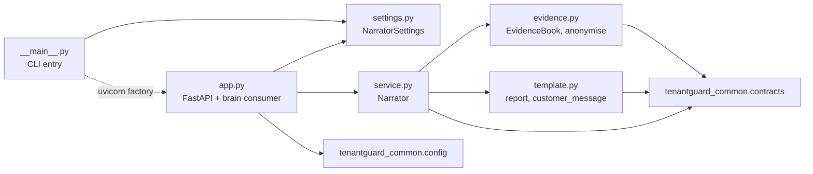
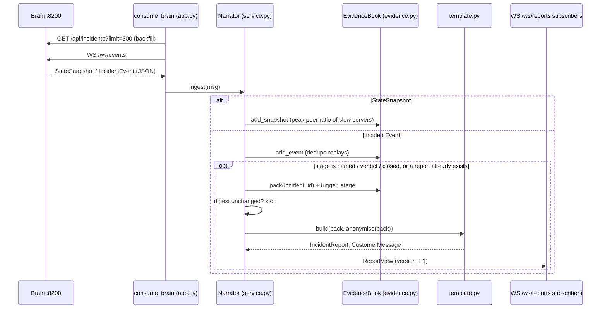

# 11: File catalog: `narrator/`

The narrator (port 8700) turns every brain incident into a plain-English **incident report** for the operator and an **anonymised customer message** for affected tenants. It is a read-only consumer of the brain: it never sends a control command and never makes a decision. Reports are deterministic: they are built only from an *evidence pack* assembled from the brain's own events, and republished (with a higher version number) whenever that evidence changes.

## Module dependencies

## Data flow: brain event → report → WebSocket

---

### `narrator/tenantguard_narrator/__init__.py`
Package marker. Its docstring states what the package does: evidence pack → deterministic incident report + anonymised customer message. It contains no code.

| Function / class | Signature | What it does | Called by |
|---|---|---|---|
| (none) | n/a | Module docstring only | n/a |

**Key decisions**
- No re-exports: callers import the module they need (`service`, `app`, `template`, `evidence`), which keeps import costs and dependencies explicit.

---

### `narrator/tenantguard_narrator/__main__.py`
Command-line entry point: `python -m tenantguard_narrator [--host] [--port]`. It reads the port from `tenantguard.yaml` (`services.narrator`) and starts uvicorn with the application factory.

| Function / class | Signature | What it does | Called by |
|---|---|---|---|
| `main` | `main() -> None` | Loads settings with `load_settings()`, builds `NarratorSettings`, parses `--host` (env `NARRATOR_HOST`, default `0.0.0.0`) and `--port` (env `NARRATOR_PORT`, default from yaml, 8700), then runs `uvicorn.run("tenantguard_narrator.app:app_factory", factory=True, ...)` | `python -m tenantguard_narrator`; the Dockerfile `CMD` |

**Key decisions**
- Binds `0.0.0.0` by default, because the narrator runs in Docker on the host laptop and is reached from the other laptop.
- Uses uvicorn's factory mode, so importing `app.py` never builds an application or reads configuration as a side effect.

---

### `narrator/tenantguard_narrator/settings.py`
Turns the raw `tenantguard.yaml` dict plus environment variables into a typed `NarratorSettings` dataclass: the brain URL, the narrator's own port, how many reports to keep, and the CORS origins allowed for the UI.

| Function / class | Signature | What it does | Called by |
|---|---|---|---|
| `NarratorSettings` | dataclass: `brain_url: str = "http://127.0.0.1:8200"`, `port: int = 8700`, `max_reports: int = 200`, `cors_origins: List[str]` | Typed settings with safe defaults, so tests can construct it directly | `app.create_app`, `__main__.main`, tests (`NarratorSettings()`) |
| `NarratorSettings.from_dict` | `from_dict(cls, s: Dict[str, Any]) -> NarratorSettings` (classmethod) | `brain_url` from env `TENANTGUARD_BRAIN_URL`, else yaml `services.brain`. `port` from the URL in yaml `services.narrator`. `max_reports` from yaml `narrator.max_reports` (200). `cors_origins` from env `TENANTGUARD_CORS_ORIGINS` (comma list; default `http://127.0.0.1:5173,http://localhost:5173`) | `app.create_app`, `__main__.main` |

**Key decisions**
- Every peer URL comes from env or yaml (never a hard-coded address), as required for the two-laptop deployment.
- Missing yaml sections fall back to defaults (`or {}`), so a partial config never crashes start-up.

---

### `narrator/tenantguard_narrator/evidence.py`
The pure (no I/O) evidence layer. `EvidenceBook` stores every incident's events and, for open incidents, the peak peer ratio of slow servers seen in brain state snapshots. `pack()` assembles everything a report may say into one JSON-ready dict; `anonymise()` reduces it to what an affected customer may learn.

| Function / class | Signature | What it does | Called by |
|---|---|---|---|
| `IST` | module constant | Fixed UTC+05:30 timezone for display times | `hhmmss` |
| `TRIGGERS` | `("named", "verdict", "closed")` | Stages that make an incident worth a report | `EvidenceBook.trigger_stage`, `service.Narrator.ingest` |
| `SERVER_RE` | regex `\b(w\d+\|spare\|quarantine)\b` | Finds server ids in the brain's detail text | `EvidenceBook.pack` |
| `TTL_RE` | regex `ttl=(\d+(?:\.\d+)?)s` | Extracts the TTL from action strings such as `RouteWeightsCmd 9 tenants ttl=5s` | `EvidenceBook.pack` |
| `hhmmss` | `hhmmss(ts: float) -> str` | Epoch seconds → `HH:MM:SS` in IST | `EvidenceBook.pack`; tests |
| `_Incident` | dataclass: `incident_id`, `events: List[IncidentEvent]`, `seen: set`, `slow: Dict[str, float]`, `closed: bool` | Per-incident store: ordered events, dedupe keys, peak peer ratio per slow server, closed flag | `EvidenceBook` |
| `EvidenceBook` | class | Holds all incidents (bounded) plus the tenant layout | `service.Narrator.__init__` |
| `EvidenceBook.__init__` | `__init__(self, tenants: Iterable[TenantConfig], keep: int = 200)` | Indexes tenants by id; empty incident map; `keep` bounds how many incidents are remembered | `Narrator.__init__` |
| `EvidenceBook.add_event` | `add_event(self, ev: IncidentEvent) -> bool` | Creates the incident if new, evicting the oldest beyond `keep`. Dedupes by `(stage, ts, level, detail[:40])`, so a WS reconnect backfill or the `/api/incidents` replay is ignored. Appends and re-sorts by `ts`; marks closed on `closed`. Returns `True` only for a new event | `Narrator.ingest` |
| `EvidenceBook.add_snapshot` | `add_snapshot(self, snap: StateSnapshot) -> None` | Takes servers whose status is `slow` and, for every open incident, keeps the maximum peer ratio seen (rounded to 2 decimals) | `Narrator.ingest` |
| `EvidenceBook._name` | `_name(self, t: Optional[str]) -> Optional[str]` | Tenant id → display name from the layout, or `None` | `pack` |
| `EvidenceBook.neighbours` | `neighbours(self, t: Optional[str]) -> List[str]` | Sorted ids of every tenant sharing at least one server with `t` (its barcode neighbours, the potential victims) | `pack` |
| `EvidenceBook.pack` | `pack(self, incident_id: str) -> Optional[dict]` | Builds the evidence pack; see the field list below | `Narrator.refresh`; tests |
| `EvidenceBook.trigger_stage` | `trigger_stage(self, incident_id: str) -> Optional[str]` | The latest stage in `TRIGGERS` this incident has reached, or `None` | `Narrator.refresh` |
| `_ORDER` | list | Severity order: `normal < warn < throttle < deprioritize < quarantine < blocked` | `_peak` |
| `_peak` | `_peak(levels: List[str]) -> Optional[str]` | The most severe level reached | `pack` |
| `anonymise` | `anonymise(pack: dict) -> dict` | Customer-safe subset: `incident_id`, `opened`, `last_event`, `duration_s`, `closed`, a generic `cause`, a `rescued` flag, generic `actions`, a `resolved` flag. No tenant, no server and no copied brain text | `Narrator.refresh`; tests |

The evidence pack produced by `pack()` contains:
- `incident_id` and `kind` (`server` for `srv-*` incidents, else `tenant`);
- `tenant`, the culprit: the latest event that carries a tenant, else the strongest suspect. Also its `tenant_name` and `tier`;
- `opened`, `last_event` (IST), `duration_s` and `closed`;
- `stages`: time, stage, level and detail of each event;
- `suspects`: tenant, name and `confidence_pct` (highest confidence seen), strongest first;
- `slow_servers`, for server incidents only: snapshot peaks plus servers named in the `detected` stage;
- `actions`: time, action and parsed `ttl_s`;
- `peak_level`, `affected` (the culprit's neighbours) and `verdict`.

**Key decisions**
- **Pure and deterministic:** no clock and no I/O, so the same events always give the same pack, which also makes it easy to test.
- **Slow servers count only for server incidents, and only from the `detected` list plus snapshots.** Found in the live run: the `rescued` text also names the *healthy* servers victims were moved to, and harvesting every server id wrongly listed all nine servers as slow.
- **The anonymised pack copies no free text from the brain**, so a culprit's name or a server id can never leak into a customer message through a detail string.
- **Memory is bounded** (`keep` incidents, oldest evicted first).

---

### `narrator/tenantguard_narrator/template.py`
Turns an evidence pack into the operator `IncidentReport` and an anonymised pack into the `CustomerMessage`. Every sentence is assembled from pack fields, so the report says nothing the brain did not report.

| Function / class | Signature | What it does | Called by |
|---|---|---|---|
| `STAGE_WORDS` | dict | Stage id → readable label (`rescued` → `Victims rescued`, ...) | `report` |
| `_who` | `_who(p: dict) -> str` | `"Name (id)"` if the culprit's name is known; else the id; else `"no single tenant"` | `report` |
| `_short` | `_short(text: str, limit: int = 160) -> str` | Trims text to `limit` characters with `...` | `report` |
| `report` | `report(p: dict) -> IncidentReport` | Builds the six report fields; see the list below | `build` |
| `customer_message` | `customer_message(anon: dict) -> CustomerMessage` | 3–4 sentences: when (IST; "from ... to ..." once closed), the generic cause, what was done ("moved to healthy servers", "limited automatically", else "contained automatically"), "Your data was never affected", and either "back to normal" or "still monitoring" | `build`; tests |
| `build` | `build(pack: dict, anon: dict) -> Tuple[IncidentReport, CustomerMessage]` | Convenience pair of `report(pack)` and `customer_message(anon)` | `Narrator.refresh`; tests |

The report fields built by `report()`:
- **headline:** for a server incident, "Servers ... slowed down; X named as the cause" or "...; no tenant blamed". For a tenant incident, "X used more than its fair share (peak level: ...)". Once closed, "; closed after N s" is added.
- **timeline:** one line per stage: time, label, level (for level changes) and a shortened detail.
- **cause:** an optional verdict prefix, then one of three cases. For a server incident with a suspect, the culprit was named with N% confidence from the pattern of slow servers. For a tenant incident, it is the usage-share wording. Otherwise, "a host fault is likely".
- **evidence_points:** slow servers with their peer ratio. For server incidents, the suspects with confidence; for tenant incidents, the brain's own `detected` detail. Then the affected tenants.
- **action_taken:** the timed actions, or "No control action was needed".
- **operator_recommendation:** chosen by state: closed / server culprit / tenant culprit / host.

**Key decisions**
- **Server and tenant incidents are worded differently.** Found in the live run: a throttle-ladder incident must never claim to be "named from the pattern of slow servers"; its evidence is the usage-share detector's measurement.
- The customer message is built only from the anonymised pack, so it cannot name any tenant or server.
- The recommendation never proposes anything irreversible; a block is always "TTL-bound" and only "if the slowdown persists after the rescue".

---

### `narrator/tenantguard_narrator/service.py`
The orchestrator. `Narrator` accepts raw brain messages, keeps the evidence book, decides when to (re)publish a report, numbers versions, bounds the report store and fans each new `ReportView` out to WebSocket subscribers.

| Function / class | Signature | What it does | Called by |
|---|---|---|---|
| `_digest` | `_digest(pack: dict) -> str` | SHA-1 of the pack serialised with sorted keys: a stable fingerprint of the evidence | `Narrator.refresh` |
| `Narrator` | class | The report service | `app.create_app`; tests |
| `Narrator.__init__` | `__init__(self, tenants: Iterable[TenantConfig], max_reports: int = 200, clock: Callable[[], float] = time.time)` | Creates the `EvidenceBook` (bounded to `max_reports`), the report and digest maps, the subscriber set and counters (`events`, `reports_published`). `clock` is injectable for tests | `create_app`; tests |
| `Narrator.ingest` | `ingest(self, msg: dict) -> Optional[str]` | One brain message. A `state` message feeds `add_snapshot`. An `incident` message is validated as `IncidentEvent` and stored; if new, and either its stage is a trigger or the incident already has a report, `refresh` runs. Anything else, or invalid data, is ignored with a log line. Never raises. Returns the incident id if a report was (re)published | `consume_brain` (app.py); tests |
| `Narrator.refresh` | `refresh(self, incident_id: str) -> Optional[str]` | Builds the pack and trigger stage. If the pack digest is unchanged, it does nothing. Otherwise it builds the report and customer message and publishes a `ReportView` with `version = previous + 1`, the original `created_at`, a new `updated_at`, and the pack itself as `evidence` | `ingest` |
| `Narrator._publish` | `_publish(self, view: ReportView) -> None` | Stores the view; evicts the least recently updated report (and its digest) beyond `max_reports`; increments `reports_published`; puts the JSON on every subscriber queue, dropping that subscriber's oldest message if its queue is full | `refresh` |
| `Narrator.listing` | `listing(self) -> List[ReportView]` | All reports, newest `updated_at` first | `app` routes `/reports` and `/ws/reports` |

**Key decisions**
- **Republish only on changed evidence (digest).** A replayed or irrelevant event never bumps the version, so every consumer sees one version per real change.
- **Once an incident has a report, every later event refreshes it** (for example `resolved` → `closed`), so the report tracks the incident to its end.
- **A slow WebSocket client cannot block the service:** its bounded queue drops its own oldest message.
- **Malformed input never crashes the service:** validation errors are logged and the message is skipped.

---

### `narrator/tenantguard_narrator/app.py`
FastAPI wiring. It runs the background consumer that follows the brain, and serves the report API and the `/ws/reports` push stream. CORS allows only GET from the configured UI origins.

| Function / class | Signature | What it does | Called by |
|---|---|---|---|
| `log` | logger `tenantguard.narrator` | Logging for brain connectivity and bad messages | module functions |
| `consume_brain` | `async consume_brain(n: Narrator, brain_url: str, state: dict) -> None` | Loops forever. It backfills from `GET {brain}/api/incidents?limit=500`, then follows `WS {brain}/ws/events`, calling `n.ingest` for every JSON message and skipping non-JSON. It sets `state["brain_connected"]` while the socket is open. On any failure it logs and reconnects with exponential backoff (0.5 s doubling to 10 s); it only re-raises cancellation | `create_app.lifespan` |
| `create_app` | `create_app(narrator: Optional[Narrator] = None, settings: Optional[NarratorSettings] = None, follow_brain: bool = True) -> FastAPI` | Builds settings and a `Narrator` (from the yaml and the layout unless injected), the app with CORS, and all routes below. `follow_brain=False` lets tests run without a brain | `app_factory`; tests |
| `lifespan` (closure) | `async lifespan(_: FastAPI)` | Starts the `consume_brain` task on start-up (if `follow_brain`); cancels it and waits on shutdown | FastAPI lifespan |
| `healthz` (route) | `GET /healthz` → dict | `ok`, `brain_connected`, `reports` (count) and the service counters (`events`, `reports_published`) | Docker `HEALTHCHECK`, operators; tests |
| `reports` (route) | `GET /reports?limit=50` → `List[ReportView]` | The newest reports, with `limit` clamped to 1..500 | operators; the UI Playwright API spec (`ui/e2e/api.spec.ts`, shape check); tests |
| `report` (route) | `GET /reports/{incident_id}` → `ReportView` | One report; 404 JSON `{"detail": "no report for ..."}` if none | operators; tests (no UI page reads reports on this branch) |
| `ws_reports` (route) | `WS /ws/reports` | Registers a bounded queue (64) as a subscriber, then runs `sender` and `watcher` until either ends; always unregisters and cancels both | UI; tests |
| `sender` (closure in `ws_reports`) | `async sender()` | Sends the latest 50 reports oldest-first (backfill), then every new message from the queue | `ws_reports` |
| `watcher` (closure in `ws_reports`) | `async watcher()` | Reads from the socket until a disconnect frame, which is how a silent client's departure is noticed | `ws_reports` |
| `app_factory` | `app_factory() -> FastAPI` | Configures INFO logging and returns `create_app()` | uvicorn factory (`__main__.main`) |

**Key decisions**
- **Backfill and then stream:** a narrator started after an incident still produces its report. The evidence book's dedupe makes the overlap between the backfill and the WS replay harmless.
- **The brain being down is normal, not fatal:** the consumer retries forever with capped backoff, and `/healthz` reports `brain_connected`.
- **Read-only API:** only GET routes and a push WebSocket. The narrator exposes no control surface, so it needs no control token.
- **A separate sender and watcher** per socket, so a disconnect is detected even when no report is due.

---

### `narrator/tests/test_narrator.py`
Unit and API tests (9 tests), run with `python -m pytest` in `narrator/`. They feed realistic brain events (texts taken from a live run) into the real `Narrator`, `EvidenceBook`, templates and FastAPI app; no network.

| Function / class | Signature | What it does | Called by |
|---|---|---|---|
| `TENANTS`, `NAMES`, `T0`, `SID` | constants | The real layout, the id → name map, a fixed epoch and a server incident id | tests |
| `ev` | `ev(stage, dt, detail="", **kw) -> dict` | Builds an `incident` message at `T0 + dt` (`iid=` overrides the incident id) | tests |
| `snap` | `snap(slow) -> dict` | Builds a `state` message whose given servers are `slow` with the given peer ratios | `server_incident` |
| `DETECTED`, `RESCUED`, `NAMED` | strings | Brain detail texts copied from the live run (`RESCUED` deliberately names healthy rescue targets w0, w2, w4, w5) | tests |
| `server_incident` | `server_incident(n, close=False) -> None` | Feeds detected → snapshot → rescued → named (and optionally resolved → closed) for K | tests |
| `pack_of` | `pack_of(close=False) -> (dict, dict)` | Runs `server_incident` and returns the pack and its anonymised form | tests |
| `test_evidence_pack_contents` | test | The pack has kind `server`, culprit K (KaamKaro), stages in order, suspect K at 100%, slow servers **only** w1/w3/w8 with snapshot peaks (not the rescue targets), the action with `ttl_s=5.0`, affected A–I | pytest |
| `test_template_report_says_the_right_things` | test | Exact headline for a closed server incident, a timeline line with time and detail, a cause with 100% confidence, a peer-ratio evidence point, the action text, the "No action needed" recommendation, and no tenant or server that is absent from the evidence | pytest |
| `test_customer_message_is_anonymised` | test | Neither the anonymised pack nor the message contains any tenant name, `(K)`, `tenant K` or a server id; the message says "another tenant", "moved to healthy servers" and "back to normal" | pytest |
| `test_tenant_ladder_incident_template` | test | A throttle-ladder incident: exact headline with peak level and duration, `ttl_s=60.0` parsed, version 1, trigger `closed`; the cause uses the usage-share wording (never "pattern of slow servers"); no slow servers; the brain's detected detail is in the evidence | pytest |
| `test_replayed_events_do_not_republish` | test | Feeding the same events twice (reconnect backfill) does not change the version | pytest |
| `test_api_and_ws` | test | The WS pushes version 1 when K is named; `/reports` lists it; `/reports/{id}` returns it with trigger `named`; an unknown id → 404; `/healthz` counts 1 report and 1 publish | pytest |
| `test_versions_increase_only_when_the_evidence_changes` | test | named (v1) → resolved (v2) → closed (v3); `created_at <= updated_at`; the headline gains "closed after 151 s" | pytest |
| `test_report_store_is_bounded` | test | With `max_reports=2`, four incidents leave only two reports | pytest |
| `test_bad_messages_are_ignored` | test | Malformed incident, non-dict and invalid state messages return `None` and create no report | pytest |

**Key decisions**
- Test data reuses the brain's real wording, so the live-run regressions (wrong slow servers, wrong ladder cause) stay covered.
- Anonymisation was checked by mutation: copying brain text into the anonymised pack, naming the culprit there, or naming the culprit or a server in the message each makes a test fail.

---

### `narrator/Dockerfile`
Builds the narrator image from the repository root (so it can install `common/`): Python 3.12 slim, installs `common` and `requirements.txt`, copies `tenantguard.yaml`, `layouts/` and the package, exposes 8700, and runs `python -m tenantguard_narrator --host 0.0.0.0 --port 8700`.

| Function / class | Signature | What it does | Called by |
|---|---|---|---|
| `HEALTHCHECK` | every 10 s, timeout 3 s, 3 retries | `GET http://127.0.0.1:8700/healthz` must return 200 | Docker |
| `CMD` | `python -m tenantguard_narrator --host 0.0.0.0 --port 8700` | Starts the service | Docker / compose service `narrator` (profile `narrator`) |

**Key decisions**
- `TENANTGUARD_ROOT=/app`, so the shared config loader finds `tenantguard.yaml` and the layout inside the image.
- In compose, the brain URL is injected (`TENANTGUARD_BRAIN_URL=http://brain:8200`); no other secret or setting is needed.

---

### `narrator/requirements.txt`
Runtime dependencies: `fastapi`, `uvicorn[standard]`, `httpx` (brain backfill), `websockets` (brain stream), `pydantic`, `PyYAML`. These are the same shared packages as the other Python services, so no separate environment is needed.

| Function / class | Signature | What it does | Called by |
|---|---|---|---|
| (dependency list) | n/a | Pins minimum versions | `pip install -r`, Dockerfile |

**Key decisions**
- No dependency beyond the platform's common stack; `tenantguard_common` is installed separately from `common/`.

---

### `narrator/pytest.ini`
Test configuration: `pythonpath = . ../common` and `testpaths = tests`.

| Function / class | Signature | What it does | Called by |
|---|---|---|---|
| `pythonpath` | `. ../common` | Imports the package and the repository's own contracts, so tests always use this checkout's contract version | pytest |
| `testpaths` | `tests` | Where tests are collected | pytest |

**Key decisions**
- Putting `../common` on the path means the tests validate against the contracts in the same checkout, even if a different copy of the shared package is installed globally.

---

### `narrator/README.md`
Human documentation: purpose, the flow diagram, how to run and test, configuration (`narrator.max_reports`, `TENANTGUARD_BRAIN_URL`, `TENANTGUARD_CORS_ORIGINS`), the four processing steps (evidence pack, incident report, customer message, versions), the API table and the `ReportView` fields.

| Function / class | Signature | What it does | Called by |
|---|---|---|---|
| (documentation) | n/a | Describes the service for operators and developers | readers |

---

### `narrator/.gitignore`
Ignores `data/` (local runtime data).

| Function / class | Signature | What it does | Called by |
|---|---|---|---|
| `data/` | pattern | Keeps local data out of version control | git |
