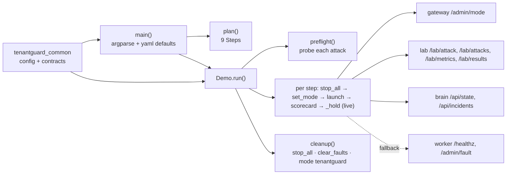

# 11: File catalog: `tools/` (the demo driver)

`tools/demo.py` runs the 4-minute TenantGuard demo with one command, using only the services' HTTP APIs. It sets the gateway mode, starts lab attacks, prints a one-line narration and live numbers each step, and shows the scorecard. Before the show it preflights which attacks the lab can run. On any exit it stops every attack, clears injected faults and puts the gateway back in `tenantguard` mode.

---

### tools/demo.py
The demo driver. `plan()` defines the steps as data, and `Demo` executes them. Every HTTP call goes through `Demo.call`, so `--dry-run` can print instead of send. Defaults come from env or `tenantguard.yaml` (`services`, `workers`); the control-token header name comes from the shared contracts.

| Function / class | Signature | What it does | Called by |
|---|---|---|---|
| `PROBE` | constant `"__probe__"` | A tenant/server id no lab knows. A probe with it makes a shipped attack fail validation (4xx) and an unshipped one answer 501, so nothing starts. | `Demo.probe`; tests |
| `FAULT` | constant `{"latency_ms": 150.0, "cpu_burn_pct": 30.0}` | The fault injected directly on a worker when the lab cannot run `faulty_server` | `Demo.inject_fault` |
| `Attack` | dataclass `(attack, tenant=None, server=None, intensity=1.0, fallback=None)` | One lab attack in a step, with an optional fallback attack name | `plan`, `Demo` |
| `Attack.body` | `body(duration_s, attack=None) -> dict` | The `POST /lab/attack` JSON (attack or override name, intensity, duration, tenant/server when set) | `Demo.launch` |
| `Step` | dataclass `(key, title, seconds, narration, mode=None, attacks=[], attacker=None, watch_incidents=False, scorecard=False)` | One demo step | `plan`, `Demo.run` |
| `plan` | `plan(attacker="K", bomb="blackbox_bomb", faulty="w4", spiker="J") -> List[Step]` | The 9 steps: calm 15 s; OFF + flood 30 s; industry + flood 15 s; industry + bomb 30 s (whale fallback); tenantguard + bomb 75 s (incidents printed); faulty server 20 s; honest spike 20 s; scorecard 25 s; close 10 s | `main`; tests |
| `Demo` | class | Holds the target URLs, tokens, worker URLs, HTTP client, injectable `sleep`/`clock`/`out`, and run state (started attack ids, injected faults, attack availability, fault URLs, skipped steps, seen incidents) | `main`; tests |
| `Demo.__init__` | `(gateway, brain, lab, token, client=None, sleep=time.sleep, clock=time.monotonic, out=print, tick_s=5.0, dry_run=False, wait_enter=None, workers=None, admin_token="dev")` | Stores configuration and empties the state | `main`; tests (`make`) |
| `Demo.call` | `call(method, url, **kw) -> Optional[Response]` | In dry run, prints the call and returns `None`. Otherwise sends it; a transport error is printed and returns `None` (never raises). | every HTTP call |
| `Demo.set_mode` | `set_mode(mode) -> None` | `POST /admin/mode` with the control token; prints non-200 answers | `run`, `cleanup` |
| `Demo.probe` | `probe(attack) -> bool` | Asks once (cached) whether the lab can run an attack, via a `PROBE` request. 501 means no; anything else (or unknown) means yes. If a lab wrongly starts the probe, it is stopped at once. | `preflight` |
| `Demo.worker_reachable` | `worker_reachable(server) -> Optional[str]` | The worker URL if it answers `/healthz` from here (never in dry run) | `preflight` |
| `Demo.preflight` | `preflight(steps) -> None` | For each step attack: available → fine. Fallback available → noted. `faulty_server` with a reachable worker → direct fault injection noted. Otherwise the step is marked skipped with a `[NOT AVAILABLE]` banner. | `run` |
| `Demo.launch` | `launch(a: Attack, seconds) -> None` | Starts an attack: uses the worker fault for an unavailable `faulty_server`, the fallback when the preflight said so, or a retry with the fallback on a late 501. Records the attack id; a failure is printed and the step continues. | `run` |
| `Demo.inject_fault` | `inject_fault(server, seconds) -> None` | `POST {worker}/admin/fault` with `FAULT` and `duration_s` (TTL-bound) and the admin token; records the worker for cleanup | `launch` |
| `Demo.stop_all` | `stop_all() -> bool` | `DELETE /lab/attacks` (twice if needed). If that fails, deletes each of our attack ids one by one. Loudly prints any left running (they end at their own duration). | `run` (each step), `cleanup` |
| `Demo.clear_faults` | `clear_faults() -> None` | `DELETE {worker}/admin/fault` for each injected fault; prints those left (they auto-clear) | `cleanup` |
| `Demo.live` | `live(step) -> None` | One line of numbers from the brain (mode, fairness, utilization %, worst victim p95, attacker level × factor) and the lab (calm-traffic victim p95 max, attacker ok/s and 429/s), plus the status sentence; incidents when the step watches them | `_hold` |
| `Demo.incidents` | `incidents() -> None` | Prints each new brain incident event (stage + detail) once | `live` |
| `Demo.scorecard` | `scorecard() -> None` | Table of victim p99 during the attack per scenario × mode (latest result each), or a note that no measured runs exist yet | `run` (scorecard step) |
| `Demo.run` | `run(steps) -> None` | Header, start calm traffic, stop stray attacks, preflight, total time. For each step: skip if unavailable; optional Enter; narrate; stop the previous attacks; set the mode; launch attacks; scorecard; hold. `cleanup()` always runs in `finally`. | `main`; tests |
| `Demo.cleanup` | `cleanup() -> None` | Runs `stop_all`, `clear_faults` and `set_mode("tenantguard")`, each retried once if a Ctrl-C interrupts it, so a second Ctrl-C cannot skip the rest | `run` |
| `Demo._hold` | `_hold(st) -> None` | Waits the step's duration in `tick_s` slices, printing live numbers after each slice (nothing in dry run) | `run` |
| `main` | `main(argv=None) -> int` | CLI options: `--dry-run`, `--step`, `--only KEY` (calm + one step), `--attacker`, `--bomb`, `--faulty-server`, `--spiker`, `--tick`, `--speed`. Builds `Demo` with URLs from env or yaml `services`, workers from `worker_urls()`, tokens from env. Returns 130 on Ctrl-C, else 0. | command line |

Key decisions:
- **HTTP only**, so the same driver works against a local stack or the Docker host.
- **Preflight instead of failing mid-show:** unavailable steps are announced up front and skipped, and the total time is reported without them.
- **Robust cleanup:** retries, per-id stops, loud leftovers, and immunity to a second Ctrl-C.
- **No hard-coded host address:** defaults come from `tenantguard.yaml` (a test checks the old IP is absent).
- The fault fallback is TTL-bound (`duration_s`), so even a crashed driver cannot leave a worker faulty.

### tools/tests/test_demo.py
Sequencing tests against a fake HTTP backend (`httpx.MockTransport`) and a fake clock, so the whole 240-second show runs instantly.

| Function / class | Signature | What it does / proves | Called by |
|---|---|---|---|
| `Fake` | class `(unavailable=(), attack_status=200, results=None)` | Records requests; serves mode changes, attacks (501 for unavailable ones, 404 for the probe tenant), brain state, lab metrics, incidents and results | tests |
| `Fake.__init__` / `Fake.__call__` | | Set behaviour / answer one request | `MockTransport` |
| `Fake.seq` | `seq()` | The call sequence as `("mode", m)`, `("attack", name, duration)`, `("stop",)`, ignoring probes | tests |
| `Clock` | class | Fake monotonic clock | tests |
| `Clock.__init__` / `Clock.__call__` / `Clock.sleep` | | Start at 0 / read / advance | `Demo` |
| `make` | `make(fake, **kw)` | A `Demo` wired to the fake, the clock and a line collector | tests |
| `test_full_sequence_modes_attacks_durations_and_cleanup` | | Exact modes and attacks with durations; each attack is preceded by a stop and a mode change; cleanup at the end; total simulated time equals the script; token header sent | pytest |
| `test_attack_is_preceded_by_stop_and_mode_in_each_step` | | Stop → mode off → flood ordering | pytest |
| `test_unshipped_attack_falls_back_to_whale` | | An unavailable black-box bomb runs as whale, with a note | pytest |
| `test_failed_attack_does_not_abort_the_demo` | | A 500 on attacks is reported and the timing is unchanged | pytest |
| `test_cleanup_runs_when_interrupted` (+ inner `boom`) | | A Ctrl-C mid-show still stops attacks and restores the mode | pytest |
| `test_dry_run_sends_nothing_and_prints_every_call` | | No request is sent and no time passes; calls are printed | pytest |
| `test_live_readout_shows_numbers_and_each_incident_once` | | Live line contents (fairness, utilization, worst victim, attacker level, client p95 excluding the attacker, ok/429 rates, status sentence); each incident printed once | pytest |
| `test_scorecard_table_uses_latest_run_per_scenario_and_mode` | | The newest result per scenario × mode is used; missing cells show "-" | pytest |
| `test_main_only_and_speed_in_dry_run` | | `--only` and `--speed` work; targets come from yaml `services`; the old hard-coded IP is gone; a bad `--only` exits | pytest |

### tools/tests/test_demo_t20.py
Tests for the T20 fixes: preflight banners, the faulty-server fallback, and robust cleanup.

| Function / class | Signature | What it does / proves | Called by |
|---|---|---|---|
| `Net` | class `(Fake)` `(up=(), lab_delete_status=200, per_id_status=200, probe_starts=False, **kw)` | Adds fake workers (only `up` ones answer), configurable lab delete statuses, and a lab that wrongly starts probes | tests |
| `Net.__init__` / `Net.__call__` | | Set behaviour / answer one request | `MockTransport` |
| `WORKERS` | `{"w4": "http://w4:8100"}` | Worker map for the fallback | tests |
| `steps` | `steps(*keys)` | Subset of `plan()` by key | tests |
| `test_preflight_skips_unavailable_steps_with_a_banner_and_starts_nothing` | | Unavailable steps get banners and are skipped; no such attack is started; time excludes them; each attack is probed exactly once | pytest |
| `test_faulty_server_falls_back_to_worker_fault_when_reachable_and_cleanup_clears_it` | | Reachable w4 gets one TTL-bound fault with the admin token, cleared once at cleanup | pytest |
| `test_lab_that_starts_a_probe_gets_it_stopped_immediately` | | A started probe is deleted right away | pytest |
| `test_stop_all_retries_then_stops_our_attacks_one_by_one` | | Two bulk deletes, then per-id deletes | pytest |
| `test_stop_all_failure_is_loud_and_keeps_the_ids` | | Failures are printed and the ids kept | pytest |
| `test_second_ctrl_c_during_cleanup_does_not_skip_the_rest` (+ inner `flaky_stop`) | | An interrupted stop is retried and the mode is still restored | pytest |
| `test_control_token_header_comes_from_contracts` | | The header constant is the shared contract's | pytest |

### tools/pytest.ini
Sets `testpaths = tests`. The tests add `tools/` to `sys.path` themselves to import `demo`.

| Function / class | Signature | What it does | Called by |
|---|---|---|---|
| (no functions) | | Test configuration | `python -m pytest tools` |

### tools/README.md
Usage of the demo driver: the commands, targets and tokens, the preflight and fallback rules, cleanup behaviour, the step table, the live readout, and the options.

| Function / class | Signature | What it does | Called by |
|---|---|---|---|
| (no functions) | | Documentation | readers |
