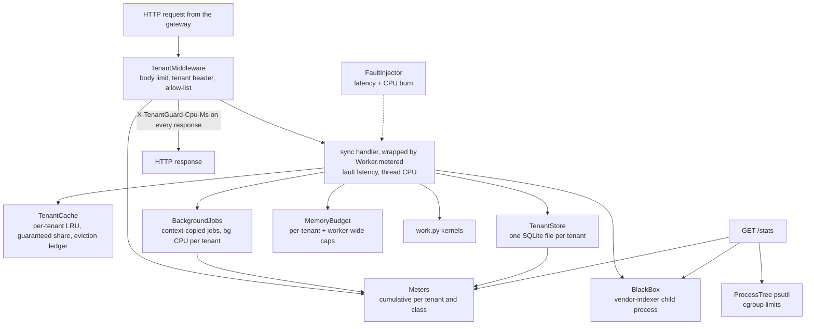
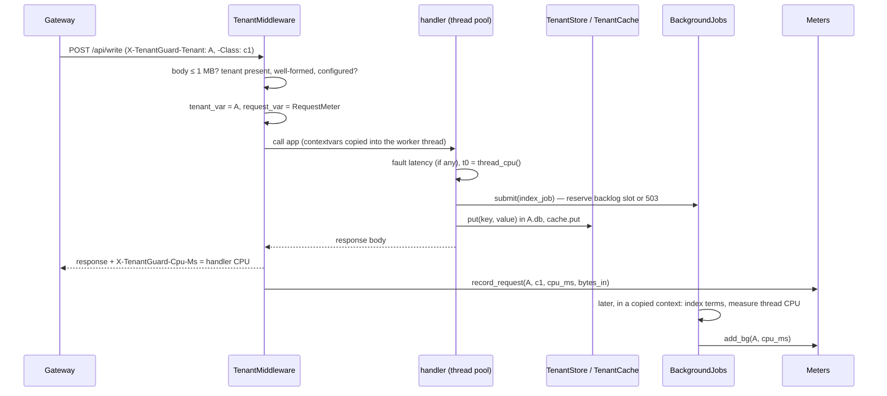

# 11 · Files: `worker/` (the shared multi-tenant application)

`worker/` is the "SaaS app" every tenant shares. The same image runs as w0..w8, `spare` and
`quarantine`. Each worker:
- serves light and heavy per-tenant work;
- measures every tenant's handler CPU, background CPU, database time and memory exactly;
- keeps tenant data isolated (one SQLite file per tenant, a tenant-namespaced cache);
- hosts a black-box "vendor indexer" whose CPU no tenant meter can see;
- can simulate a faulty host.

It listens on 8100 inside Docker and on 8100..8110 locally.

| File | Lines | Role |
|---|---|---|
| `worker/app/__init__.py` | 1 | package marker |
| `worker/app/__main__.py` | 38 | command line: `python -m app --port N` |
| `worker/app/main.py` | 413 | FastAPI app, `Worker` state, `TenantMiddleware`, every endpoint |
| `worker/app/config.py` | 96 | `WorkerConfig` from `tenantguard.yaml worker:` + env |
| `worker/app/tenancy.py` | 43 | tenant and request context variables |
| `worker/app/meter.py` | 73 | cumulative per-tenant and per-class meters |
| `worker/app/store.py` | 159 | per-tenant SQLite repository |
| `worker/app/cache.py` | 91 | shared cache, namespaced per tenant |
| `worker/app/jobs.py` | 101 | background jobs charged to the tenant that caused them |
| `worker/app/memory.py` | 64 | per-tenant and worker-wide memory budget |
| `worker/app/malloc.py` | 111 | allocator tuning and trimming, so freed memory goes back to the OS |
| `worker/app/blackbox.py` | 195 | the "vendor indexer" child process |
| `worker/app/fault.py` | 66 | simulated faulty host |
| `worker/app/stats.py` | 80 | process-tree CPU/memory and cgroup limits |
| `worker/app/cpuclock.py` | 50 | precise per-thread CPU clock |
| `worker/app/work.py` | 44 | pure-CPU work kernels |
| `worker/tools/noisy_demo.py` | 125 | measures the noisy-neighbour effect on real workers |
| `worker/tools/calibrate.py` | 192 | measures every endpoint's cost → `calibration.json` |
| `worker/tools/memrepro.py` | 87 | reproduces the allocator memory retention without the web stack |
| `worker/tests/*.py` | 799 | 54 tests (see the end of this page) |
| `worker/Dockerfile`, `requirements.txt`, `pytest.ini`, `compose.dev.yml`, `.gitignore`, `README.md`, `calibration.json` | | build, run and data files |

---

## Request lifecycle

---

### `worker/app/__init__.py`
One-line docstring package marker for `app`.

No functions.

---

### `worker/app/__main__.py`
The command-line entry point, `python -m app` (run from `worker/`; the Docker image runs
`python -m app --host 0.0.0.0 --port 8100`). It turns CLI options into the environment the app reads,
then starts uvicorn without an access log.

| Function / class | Signature | What it does | Called by |
|---|---|---|---|
| `main` | `main() -> None` | parses `--port` (8100), `--host` (`0.0.0.0`), `--server` (→ env `SERVER_NAME`), `--data-dir` (→ env `WORKER_DATA_DIR`), `--log-level` (`warning`) and `--pin-cores`. With `--pin-cores 2,3` it sets the process CPU affinity to those cores, inherited by the black-box child, and sets `CPU_LIMIT_CORES` to their count: a local stand-in for a container CPU limit. Then `uvicorn.run(create_app(), ...)` | `python -m app`; the Dockerfile `CMD` |

**Key decisions**
- The app is imported only after the environment is set, so `load_config()` sees the CLI values.
- `--pin-cores` exists because, without Docker, a separate black-box process would simply run on
  another core and never compete with tenants; pinning recreates the shared CPU limit.

---

### `worker/app/main.py`
Builds the FastAPI application. `Worker` holds all per-process state (one instance per app, so tests
stay independent). `TenantMiddleware` is a pure-ASGI middleware that enforces the body limit and
tenant identity, sets the CPU header and records meters. `create_app` registers every endpoint as a
**synchronous** handler, so `time.thread_time()` measures exactly that request's CPU.

Module constants: `SEARCH_MAX_N = 2_000_000`, `INDEX_MAX_ROUNDS = 20_000`, `INGEST_MAX_DOCS = 10_000`
(upper bounds of request parameters).

| Function / class | Signature | What it does | Called by |
|---|---|---|---|
| `Worker` | `class Worker` | owns the config, `Meters`, `TenantStore`, `TenantCache`, `MemoryBudget`, `BackgroundJobs`, `FaultInjector`, `BlackBox` and `ProcessTree` | `create_app` |
| `Worker.__init__` | `__init__(self, cfg: WorkerConfig) -> None` | first applies the allocator settings (`malloc.tune`) and starts the `malloc.Trimmer`; then builds every component (`Meters` with the per-tenant class cap); the allow-list `known_tenants` = configured ids; the memory budget gets the worker-wide cap `mem_limit_mb() − mem_baseline_mb`; finally deletes and re-seeds every tenant database | `create_app` |
| `Worker.metered` | `metered(self, fn) -> Callable` | decorator for sync handlers: applies the injected fault latency (sleep, not CPU), then adds the handler thread's CPU (`cpuclock.thread_cpu`) to the request's `RequestMeter.cpu_ms` | every `/api/*` and `/canary*` handler in `create_app` |
| `Worker.metered.wrapper` | `wrapper(*args, **kwargs) -> Any` | the wrapped handler call (runs in the thread pool) | FastAPI |
| `Worker.cpu_limit_cores` | `cpu_limit_cores(self) -> float` | env `CPU_LIMIT_CORES`, else cgroup `cpu.max`, else `worker.cpus` | `Worker.stats` |
| `Worker.mem_limit_mb` | `mem_limit_mb(self) -> float` | cgroup `memory.max`, else `worker.mem_limit_mb` | the worker-wide memory budget |
| `Worker.stats` | `stats(self) -> WorkerStats` | snapshots the meters; one `TenantUsage` per configured or seen tenant (with cache counters and the current memory gauge); `ClassCost` rows; process-tree CPU and RSS; black-box CPU; active fault | `GET /stats` |
| `Worker.memory_report` | `memory_report(self) -> dict` | where the memory is: process-tree RSS, memory limit, cgroup `{current, anon, file}`, allocator `{heap, mmapped, in_use, free, trimmable, tuned}`, trims done, per-tenant held MB, cache MB | `GET /admin/memory`, `POST /admin/memory/trim` |
| `Worker.close` | `close(self) -> None` | stops the trimmer, clears any fault, stops the black box, cancels queued background jobs and waits up to 5 s for running ones, then closes the databases | app lifespan shutdown |
| `_error` | `_error(status, error, detail, tenant=None) -> JSONResponse` | the structured error body `{error, tenant, detail}` | middleware rejections, exception handlers |
| `TenantMiddleware` | `class TenantMiddleware` | pure ASGI, so it runs in the same task as the endpoint and context variables flow into the thread pool | installed by `create_app` |
| `TenantMiddleware.__init__` | `__init__(self, app: ASGIApp, worker: Worker) -> None` | stores the wrapped app and the `Worker` | Starlette middleware stack |
| `TenantMiddleware.__call__` | `async __call__(self, scope, receive, send) -> None` | (1) non-HTTP passes through; (2) a non-numeric `Content-Length` → 400, over `body_limit_bytes` → 413; the body is buffered up to the limit, also without a `Content-Length` (413); (3) on `/api/*`: missing tenant → 400 `missing_tenant`, malformed → 400 `bad_tenant`, not exactly a configured id → 400 `unknown_tenant`; (4) sets `tenant_var` and `request_var`, replays the buffered body to the app; (5) an unhandled exception before the response started → 500 `internal_error` JSON, still with the CPU header; (6) always resets the context and records the request in `Meters` | every HTTP request |
| `…__call__.send_with_cpu` | `async send_with_cpu(message) -> None` | adds `X-TenantGuard-Cpu-Ms` (`%.3f`) to the response start | every response, including rejections |
| `…__call__.reject` | `async reject(status, error, detail) -> None` | sends an `_error` response through `send_with_cpu` | the checks above |
| `…__call__.replay` | `async replay() -> Message` | returns the buffered body once, then defers to the real `receive` | the app |
| `…__call__.send_tracked` | `async send_tracked(message) -> None` | notes that the response started (so a late error is re-raised, not answered twice) | the app |
| `WriteReq` | `class WriteReq(BaseModel)` | `/api/write` body: `key` (optional, 1..128 chars), `value`, `index_rounds` (0..20 000, default 200: the background-indexing cost knob) | `write` |
| `IngestReq` | `class IngestReq(BaseModel)` | `/api/ingest` body: `docs` (1..10 000, default 10) | `ingest` |
| `create_app` | `create_app(cfg: Optional[WorkerConfig] = None) -> FastAPI` | builds `Worker`, the app (no docs UI), exception handlers, routes, `TenantMiddleware`, then CORS outermost (so preflights never need a tenant; exposes the CPU header) | `__main__.main`, tests, `__getattr__` |
| `create_app.lifespan` | `async lifespan(_) -> AsyncIterator[None]` | on shutdown calls `Worker.close` | FastAPI |
| `create_app.http_error` | `async http_error(request, exc: HTTPException) -> JSONResponse` | maps `HTTPException` (with a dict detail) to `{error, tenant, detail}` | FastAPI |
| `create_app.validation_error` | `async validation_error(request, exc) -> JSONResponse` | 422 `invalid_request` in the same shape | FastAPI |
| `light` | `GET /api/light` → `light() -> dict` | ~0.4 ms of CPU (`work.light`): the victim SLO probe | gateway / lab |
| `read` | `GET /api/read?key=` → `read(key) -> dict` | cache first; on a miss reads the tenant's database and fills the cache; unknown key → 404 `not_found`; returns `source` = `cache` or `db` | gateway / lab |
| `search` | `GET /api/search?n=&q=` → `search(n=20000, q="tenantguard") -> dict` | CPU-heavy, cost linear in `n` (1..2 000 000): scores `n` synthetic documents, returns the top 10 | gateway / lab (whale) |
| `index_job` | `index_job(key, value, rounds) -> None` | background job: `work.index_terms`, then `TenantStore.add_terms` | submitted by `write` |
| `write` | `POST /api/write` → `write(req: WriteReq) -> dict` | reserves a background slot first (503 `bg_backlog` → nothing written), then writes the row and the cache entry | gateway / lab |
| `ingest` | `POST /api/ingest` → `ingest(req) -> dict` (202) | hands `docs` to the black box; returns `{accepted, dropped, queued}`; the handler itself stays below 1 ms | gateway / lab (black-box bomb) |
| `memory` | `GET /api/memory?mb=&hold_ms=` → `memory(mb, hold_ms=500) -> dict` | allocates and holds `mb` MB for `hold_ms`; over the tenant budget → 507 `tenant_memory_budget`, over the worker-wide cap → 507 `worker_memory` | gateway / lab (memory attack) |
| `export` | `GET /api/export?rows=&chunk=&pause_ms=` → `export(rows=1000, chunk=100, pause_ms=20) -> dict` | batch CSV export with a pause per chunk (a slow sink); rejects with 422 `request_too_slow` when `ceil(rows/chunk) × pause_ms` exceeds `worker.max_request_s`; returns row count, bytes and SHA-256 | gateway / lab (hog) |
| `canary_probe` | `canary_probe(kind: str) -> dict` | `cpu` → `work.light`; `db` → `TenantStore.canary_probe`; `cache` → put + get under the reserved `_canary` tenant; other → 404; returns elapsed ms | `canary`, `canary_kind` |
| `canary` | `GET /canary` → `canary() -> dict` | runs the cpu, cache and db probes; not attributed to any tenant; sees injected fault latency | brain health probing |
| `canary_kind` | `GET /canary/{kind}` → `canary_kind(kind) -> dict` | one probe | brain, tests |
| `healthz` | `GET /healthz` → `healthz() -> dict` | liveness plus background backlog (total and per tenant) and black-box status | Docker `HEALTHCHECK`, `tools/calibrate.py` |
| `stats` | `GET /stats` → `stats() -> WorkerStats` | `Worker.stats` | brain poller (1 Hz), tools |
| `check_admin` | `check_admin(token) -> None` | `X-Admin-Token` must equal `TENANTGUARD_ADMIN_TOKEN` (default `dev`), else 401 | the fault and memory admin routes |
| `memory_report` | `GET /admin/memory` → `memory_report(x_admin_token) -> dict` | `Worker.memory_report`. A large allocator `free_mb` with `trimmable_mb` 0 means memory is held inside the process | operators, coordinator diagnostics |
| `memory_trim` | `POST /admin/memory/trim` → `memory_trim(x_admin_token) -> dict` | runs `malloc_trim(0)` now and returns the report with the RSS before | operators, tests |
| `set_fault` | `POST /admin/fault` → `set_fault(req: FaultReq, x_admin_token) -> dict` | starts a fault (logged as a warning) | lab `faulty_server`, demo driver fallback, tests |
| `get_fault` | `GET /admin/fault` → `get_fault(x_admin_token) -> dict` | current fault | tools, tests |
| `clear_fault` | `DELETE /admin/fault` → `clear_fault(x_admin_token) -> dict` | clears it | lab, demo cleanup, tests |
| `__getattr__` | `__getattr__(name: str) -> Any` | module-level lazy attribute: `app` is built on first access, so `uvicorn app.main:app` works but importing the module has no side effects | uvicorn import string |

**Key decisions**
- Synchronous handlers on a thread pool, measured with a per-thread CPU clock: the CPU header is the
  request's own CPU, not wall time and not other threads' work.
- A pure-ASGI middleware instead of `BaseHTTPMiddleware`, so the tenant context set before the call is
  the one the handler thread sees.
- The tenant is checked against an exact allow-list. Without it, on a case-insensitive filesystem
  tenant `a` opened `A.db` (found in review, fixed, and covered by a test).
- Every limit fails per tenant with a structured error: 413 body, 507 memory, 503 backlog, 422 slow
  export. One tenant cannot exhaust the worker for everyone else.
- The CPU header is present on every response, including rejections and 500s, so the gateway's cost
  accounting never sees a missing value.
- Memory is observable and recoverable at runtime (`/admin/memory`, `/admin/memory/trim`), so a worker near its
  container limit can be diagnosed without restarting it.

---

### `worker/app/config.py`
Builds the worker's settings from `tenantguard.yaml worker:` (through `load_settings`), with code
defaults for any key the file lacks, plus environment overrides for deployment.

| Function / class | Signature | What it does | Called by |
|---|---|---|---|
| `_DEFAULTS` (constant) | `dict` | fallback values for every `worker:` key (identical to the file on `master`) | `load_config` |
| `WorkerConfig` | `@dataclass class WorkerConfig` | `server`, `data_dir`, `cpus`, `mem_limit_mb`, `body_limit_bytes`, `tenant_mem_budget_mb`, `cache_mb`, `cache_guaranteed_share`, `bg_threads`, `seed_rows`, `blackbox_cpu_ms_per_doc`, `blackbox_queue_max`, `max_request_s`, `bg_pending_per_tenant`, `bg_pending_total`, `mem_baseline_mb`, `memory_trim_s`, `max_classes_per_tenant`, `admin_token`, `cors_origins`, `cpu_limit_env`, `tenants` (configured ids) | `Worker`, `create_app` |
| `_default_data_dir` | `_default_data_dir(server: str) -> Path` | `./data/<server>` for local runs | `load_config` |
| `load_config` | `load_config(settings=None, **overrides) -> WorkerConfig` | merges file and defaults; `SERVER_NAME` (default `w0`); `WORKER_DATA_DIR` (Docker: `/data`); `TENANTGUARD_ADMIN_TOKEN` (default `dev`); `TENANTGUARD_UI_ORIGINS` (CORS, comma list, default `http://127.0.0.1:5173`); `CPU_LIMIT_CORES`; tenant ids from `load_tenants()`. Keyword overrides replace any field (used by tests) | `create_app`, tests |

**Key decisions**
- Every number comes from the shared file; the defaults only keep the worker runnable while a key is
  being added.
- The tenant allow-list is the layout, so the worker never trusts an unknown id.

---

### `worker/app/tenancy.py`
The request context. The tenant is taken only from `X-TenantGuard-Tenant` and stored in a
`ContextVar`, the single source of the tenant for the repository, cache, memory budget and background
jobs.

| Function / class | Signature | What it does | Called by |
|---|---|---|---|
| `TENANT_RE` (constant) | `re.Pattern` | `^[A-Za-z0-9][A-Za-z0-9_-]{0,31}$`: no path characters, no leading `_` (reserved for `_canary`) | `valid_tenant`, `TenantStore.path_for` |
| `NO_CLASS` (constant) | `"none"` | class used when `X-TenantGuard-Class` is absent | `TenantMiddleware` |
| `tenant_var` | `ContextVar[Optional[str]]` | current tenant | middleware (sets); store, cache, memory, jobs (read) |
| `RequestMeter` | `@dataclass class RequestMeter` | `tenant`, `cls`, `cpu_ms`, `bytes_in` of one request | middleware creates it; `Worker.metered` adds CPU |
| `request_var` | `ContextVar[Optional[RequestMeter]]` | the current request's meter | middleware, `Worker.metered`, `BackgroundJobs._run` (clears it) |
| `NoTenantError` | `class NoTenantError(RuntimeError)` | tenant-scoped code ran without a tenant | raised by `current_tenant` |
| `current_tenant` | `current_tenant() -> str` | the tenant, or `NoTenantError` (fail closed) | `TenantStore`, `TenantCache`, `MemoryBudget`, `BackgroundJobs` |
| `valid_tenant` | `valid_tenant(t: Optional[str]) -> bool` | non-empty and matches `TENANT_RE` | `TenantMiddleware` |

**Key decisions**
- Isolation by construction: tenant-scoped APIs have no tenant parameter at all, so a handler cannot
  pass the wrong one.

---

### `worker/app/meter.py`
Cumulative meters, thread-safe behind one lock.

| Function / class | Signature | What it does | Called by |
|---|---|---|---|
| `Usage` | `@dataclass class Usage` | `requests`, `handler_cpu_ms`, `bg_cpu_ms`, `db_ms`, `bytes_in`, `bg_jobs` | `Meters`, `Worker.stats` |
| `OTHER_CLASS` (constant) | `"other"` | class that collects a tenant's requests beyond its class cap | `record_request` |
| `Meters` | `class Meters` | per-tenant `Usage` and per (tenant, class) `[count, cpu_ms]` | `Worker` |
| `Meters.__init__` | `__init__(self, max_classes_per_tenant=256) -> None` | empty tables, the lock, distinct-class counts per tenant and the cap (`worker.max_classes_per_tenant`) | `Worker.__init__` |
| `Meters.record_request` | `record_request(self, tenant, cls, cpu_ms, bytes_in) -> None` | one finished request: count, handler CPU, bytes, class count and CPU; a class beyond the tenant's cap is counted under `other`, so totals stay exact while the table stays bounded | `TenantMiddleware.__call__` |
| `Meters.add_db` | `add_db(self, tenant, ms) -> None` | adds database wall time | `TenantStore._tx` |
| `Meters.add_bg` | `add_bg(self, tenant, cpu_ms) -> None` | adds background CPU and counts the job | `BackgroundJobs._run` |
| `Meters.tenants` | `tenants(self) -> List[str]` | tenants seen so far | available to callers; not used by the app on `master` |
| `Meters.snapshot` | `snapshot(self) -> Tuple[Dict[str, Usage], List[ClassCost]]` | consistent copies under the lock | `Worker.stats` |
| `Meters.to_contract` | `@staticmethod to_contract(tenant, u, **extra) -> TenantUsage` | `Usage` → contract row (rounded to 0.001 ms) with extra fields (cache counters, memory gauge) | `Worker.stats` |

**Key decisions**
- Counters only grow; consumers diff them. A missed poll loses nothing.
- The class table is bounded per tenant: the gateway's class hash includes query keys, so a client inventing keys
  could otherwise grow it forever.

---

### `worker/app/store.py`
The tenant repository: one SQLite file per tenant (`{data_dir}/{tenant}.db`), re-seeded at start. Every
public method takes the tenant from `tenant_var` only. Schema and seed rules are in
[`04_DATA_MODELS.md` §14](04_DATA_MODELS.md#14-worker-storage).

| Function / class | Signature | What it does | Called by |
|---|---|---|---|
| `UnknownTenantError` | `class UnknownTenantError(LookupError)` | id not in the allow-list | `path_for` |
| `StoreClosedError` | `class StoreClosedError(RuntimeError)` | use after `close()` | `_db` |
| `_SCHEMA` (constant) | `str` | `items`, `terms` and index `terms_term` | `_Db.__init__` |
| `seed_value` | `seed_value(tenant, key, size=512) -> str` | deterministic value starting with the owner (`"<tenant>|<key>|..."`), so any leak is detectable | `_seed`, tests |
| `_Db` | `class _Db` | one connection (`check_same_thread=False`, autocommit, WAL, `synchronous=NORMAL`) and its lock | `_db` |
| `_Db.__init__` | `__init__(self, path: Path) -> None` | opens the file (WAL, `synchronous=NORMAL`, a 1 MB page cache `cache_size=-1024`, WAL truncated to ≤ 4 MB after checkpoints `journal_size_limit`) and applies the schema | `TenantStore._db` |
| `TenantStore` | `class TenantStore` | the repository | `Worker` |
| `TenantStore.__init__` | `__init__(self, data_dir, meters, seed_rows=1000, allowed=None) -> None` | creates the directory; `allowed` = exact tenant allow-list (`None` only in unit tests) | `Worker.__init__` |
| `TenantStore.path_for` | `path_for(self, tenant) -> Path` | validates the id (regex, allow-list; `_canary` reserved) and returns the file path | `reset_and_seed`, `_db` |
| `TenantStore.reset_and_seed` | `reset_and_seed(self, tenants) -> None` | deletes each tenant's `.db`, `-wal`, `-shm` (and `_canary`), recreates and seeds them | `Worker.__init__` |
| `TenantStore._seed` | `_seed(self, tenant, db) -> None` | inserts `seed_rows` rows in one transaction | `_db` (new, empty file) |
| `TenantStore.close` | `close(self) -> None` | marks the store closed and closes every connection under its own lock | `Worker.close` |
| `TenantStore._db` | `_db(self, tenant) -> _Db` | returns (or opens and seeds) the tenant's connection; raises `StoreClosedError` after close | `_tx` |
| `TenantStore._tx` | `@contextmanager _tx(self, tenant=None) -> Iterator[Connection]` | locks the tenant's connection; adds the wall time to `db_ms` (except `_canary`) | every query method |
| `TenantStore.get` | `get(self, key) -> Optional[str]` | one value | `read` |
| `TenantStore.put` | `put(self, key, value) -> None` | insert or replace | `write` |
| `TenantStore.add_terms` | `add_terms(self, key, terms) -> None` | replaces the key's indexed terms in one transaction | `index_job` |
| `TenantStore.find_term` | `find_term(self, term) -> List[str]` | keys containing a term (up to 100) | tests (proves the background job wrote into the right tenant's file) |
| `TenantStore.page` | `page(self, after, limit) -> List[Tuple[str, str]]` | the next page of rows in key order | `export` |
| `TenantStore.count` | `count(self) -> int` | row count | tests |
| `TenantStore.canary_probe` | `canary_probe(self) -> int` | writes and counts in `_canary.db` (unattributed) | `canary_probe` |

**Key decisions**
- A file per tenant instead of shared tables with row filters: isolation needs no query discipline, and
  one tenant's write lock never blocks another.
- Deterministic re-seeding at start makes every run and test reproducible.
- Database time is metered per tenant as wall time, so contention on a tenant's own file is visible.

---

### `worker/app/cache.py`
A shared LRU cache, namespaced per tenant, with a guaranteed share and an eviction ledger.

| Function / class | Signature | What it does | Called by |
|---|---|---|---|
| `TenantCache` | `class TenantCache` | per-tenant `OrderedDict` of `key → (value, size, tick)` | `Worker` |
| `TenantCache.__init__` | `__init__(self, capacity_bytes, guaranteed_share) -> None` | capacity and guaranteed bytes per tenant (`capacity × share`), counters, ledger | `Worker.__init__` |
| `TenantCache._size` | `@staticmethod _size(key, value) -> int` | `len(key) + len(value) + 64` | `put` |
| `TenantCache.get` | `get(self, key) -> Optional[str]` | hit (refreshes recency) or miss, counted per tenant | `read`, `canary_probe` |
| `TenantCache.put` | `put(self, key, value) -> None` | inserts or replaces; evicts while over capacity; values larger than the whole cache are not cached | `read`, `write`, `canary_probe` |
| `TenantCache._evict_one` | `_evict_one(self, evictor) -> None` | removes the least recently used entry among tenants above their guaranteed share (else among all); when the victim is another tenant, counts `caused`/`suffered` and adds the bytes to `ledger[(evictor, victim)]` | `put` |
| `TenantCache.total_bytes` | `total_bytes(self) -> int` | bytes cached for all tenants | worker-wide memory cap |
| `TenantCache.tenant_bytes` | `tenant_bytes(self, tenant) -> int` | one tenant's cached bytes | `MemoryBudget` |
| `TenantCache.counters` | `counters(self, tenant) -> Dict[str, int]` | hits, misses, evictions caused and suffered | `Worker.stats` |

**Key decisions**
- A tenant inside its guaranteed share is never evicted by someone else: a cache flood hurts only the
  flooder.
- The eviction ledger turns cache harm into evidence the control plane can read per tenant.

---

### `worker/app/jobs.py`
Background jobs charged to the tenant that caused them. `submit` copies the caller's context variables
into the job, runs it on a thread pool and measures the job's own thread CPU as that tenant's
`bg_cpu_ms`. The backlog is capped per tenant and in total.

| Function / class | Signature | What it does | Called by |
|---|---|---|---|
| `BgBacklog` | `class BgBacklog(Exception)` | the tenant's or the worker's backlog is full | `submit` → `write` answers 503 |
| `BackgroundJobs` | `class BackgroundJobs` | pool, per-tenant pending counts, running count, condition variable | `Worker` |
| `BackgroundJobs.__init__` | `__init__(self, meters, threads, per_tenant_max=200, total_max=1000) -> None` | `ThreadPoolExecutor(threads)` and caps | `Worker.__init__` |
| `BackgroundJobs.submit` | `submit(self, fn, *args) -> Future` | requires a tenant; reserves a slot or raises `BgBacklog`; runs `fn` in a **copy** of the current context; a job cancelled before it ran releases its slot | `write` |
| `BackgroundJobs._done` | `_done(self, tenant) -> None` | releases a slot and wakes waiters | `_run`, cancel callback, submit failure |
| `BackgroundJobs._run` | `_run(self, fn, *args) -> Any` | inside the copied context: clears `request_var` (the request is over), measures thread CPU around `fn`, adds it to `bg_cpu_ms`, logs failures | the pool |
| `BackgroundJobs.pending` | `@property pending(self) -> int` | jobs queued or running | `healthz` |
| `BackgroundJobs.pending_by_tenant` | `pending_by_tenant(self) -> Dict[str, int]` | non-zero backlogs | `healthz` |
| `BackgroundJobs.drain` | `drain(self, timeout=10.0) -> bool` | waits until nothing is pending | tests |
| `BackgroundJobs.shutdown` | `shutdown(self, timeout=5.0) -> bool` | cancels queued jobs and waits (bounded) for running ones, so storage can close safely | `Worker.close` |

**Key decisions**
- Work moved off the request path is still charged to the tenant that caused it, through the copied
  context; background CPU is reported separately from the handler CPU header.
- A full backlog fails the write (503) before anything is written.

---

### `worker/app/memory.py`
Memory budget: per tenant (held allocations + the tenant's cache bytes) and for the whole worker.

| Function / class | Signature | What it does | Called by |
|---|---|---|---|
| `MB`, `PAGE` (constants) | `1024*1024`, `4096` | units | `hold`, `Worker` |
| `OverBudget` | `class OverBudget(Exception)` | `kind` = `tenant_memory_budget` or `worker_memory` | `hold` → `memory` answers 507 |
| `OverBudget.__init__` | `__init__(self, kind, who, used_mb, asked_mb, budget_mb) -> None` | message with the numbers | `hold` |
| `MemoryBudget` | `class MemoryBudget` | per-tenant held bytes behind a lock | `Worker` |
| `MemoryBudget.__init__` | `__init__(self, budget_mb, cache_bytes, cache_total=..., worker_budget_mb=...) -> None` | tenant budget; callbacks for tenant cache bytes, total cache bytes, and the worker-wide budget | `Worker.__init__` |
| `MemoryBudget.used_mb` | `used_mb(self, tenant) -> float` | held + cached, in MB | `Worker.stats` (the `mem_mb` gauge) |
| `MemoryBudget.hold` | `hold(self, mb, hold_s) -> dict` | checks the tenant budget, then the worker-wide budget, then allocates an anonymous `mmap`, touches one byte per page (so RSS really grows), holds it and closes it, so the memory always goes back to the OS | `memory` |

**Key decisions**
- Two limits: a tenant cannot exceed its own budget, and all tenants together cannot push the process
  past its container limit (which would get the whole worker killed).

---

### `worker/app/blackbox.py`
The "vendor indexer": a separate process whose CPU no tenant meter can see. Handlers only enqueue a doc
count. The child burns a fixed CPU amount per doc, and its CPU (read with `psutil` on the child) is
reported only as `WorkerStats.blackbox_cpu_ms`. Inside a container it shares the CPU limit with the
worker, so heavy ingest slows every co-located tenant while every tenant meter stays near zero: the
hidden-cost attack a rate limiter cannot see.

| Function / class | Signature | What it does | Called by |
|---|---|---|---|
| `_CTX` (constant) | `multiprocessing.get_context("spawn")` | same start method on Windows and Linux; no fork with threads | `BlackBox` |
| `_indexer_main` | `_indexer_main(q, processed, cpu_ms_per_doc, parent_pid) -> None` | child loop: takes a doc count from the queue; for each doc burns `cpu_ms_per_doc` of its own thread CPU and increments `processed`; exits on `None` or when the parent process no longer exists | child process |
| `_kill` | `_kill(proc) -> None` | kills, ignoring "already exited" (Windows reports access denied) | `close`, `kill_child` |
| `BlackBox` | `class BlackBox` | `MONITOR_S = 0.25`, `BACKOFF_S = (0.25, 1.0, 4.0)`, `QUICK_DEATH_S = 5.0` | `Worker` |
| `BlackBox.__init__` | `__init__(self, cpu_ms_per_doc, queue_max) -> None` | state, a first queue, and the monitor thread (which spawns the child, so no request ever pays the start-up cost) | `Worker.__init__` |
| `BlackBox._new_queue` | `_new_queue(self) -> None` | fresh queue and shared `processed` counter | `__init__`, `_watch` after a death |
| `BlackBox._spawn` | `_spawn(self) -> None` | starts the child and gives it the parent's CPU affinity | `_watch` |
| `BlackBox._watch` | `_watch(self) -> None` | monitor loop: samples the child's CPU every 0.25 s; if the child died, retires it and restarts it, with back-off after quick consecutive deaths | monitor thread |
| `BlackBox._retire_locked` | `_retire_locked(self) -> None` | adds the dead child's CPU and processed count to the totals; closes its queue | `_watch`, `close` |
| `BlackBox._sample_locked` | `_sample_locked(self) -> None` | reads user + system CPU of the child | `_watch`, `cpu_ms`, `close`, `kill_child` |
| `BlackBox.close` | `close(self) -> None` | stops the monitor, asks the child to exit, kills it if needed | `Worker.close` |
| `BlackBox.submit` | `submit(self, docs) -> dict` | accepts up to `queue_max − pending` docs, drops and counts the rest | `ingest` |
| `BlackBox.cpu_ms` | `cpu_ms(self) -> float` | cumulative black-box CPU (dead children + current) | `Worker.stats` |
| `BlackBox.kill_child` | `kill_child(self) -> None` | hard-kills the child (test and chaos hook) | tests |
| `BlackBox.status` | `status(self) -> dict` | running, pid, queued, accepted, processed, dropped, restarts, cost per doc | `healthz` |

**Key decisions**
- A real separate process, not a thread: its CPU is invisible to per-thread meters by construction and
  visible only in the process tree.
- Bounded queue and automatic restart: a misbehaving vendor component degrades, it does not grow
  without limit or disappear.

---

### `worker/app/fault.py`
A simulated faulty host: added latency on every `/api/*` and `/canary*` handler, plus unattributed CPU
burn. `FaultReq` comes from the contracts.

| Function / class | Signature | What it does | Called by |
|---|---|---|---|
| `FaultInjector` | `class FaultInjector` | `PERIOD_S = 0.02` | `Worker` |
| `FaultInjector.__init__` | `__init__(self) -> None` | no fault | `Worker.__init__` |
| `FaultInjector.set` | `set(self, req: FaultReq) -> dict` | replaces any fault; starts the burn thread when `cpu_burn_pct > 0`; records `since` and `until` | `set_fault` |
| `FaultInjector.clear` | `clear(self) -> None` | removes the fault and joins the burn thread | `clear_fault`, `set`, `current` (expiry), `Worker.close` |
| `FaultInjector.current` | `current(self) -> Optional[dict]` | the active fault, auto-clearing it after `duration_s` | `apply_latency`, `Worker.stats`, `get_fault` |
| `FaultInjector.apply_latency` | `apply_latency(self) -> None` | sleeps `latency_ms` (wall time, not CPU) | `Worker.metered` |
| `FaultInjector._burn` | `_burn(self, duty, stop) -> None` | busy for `duty × 20 ms`, idle for the rest, until stopped or expired | burn thread |

**Key decisions**
- The latency is a sleep, so it never shows up as tenant CPU; the burn is unattributed CPU, so the
  brain sees a slow host whose tenants are not over-using: a host fault, not a tenant.
- Canaries are delayed too, which is how the brain's health check notices the host.

---

### `worker/app/stats.py`
Process-tree CPU and memory through `psutil`, and the container limits from cgroup v2.

| Function / class | Signature | What it does | Called by |
|---|---|---|---|
| `CGROUP_CPU_MAX`, `CGROUP_MEM_MAX`, `CGROUP_MEM_CURRENT`, `CGROUP_MEM_STAT` (constants) | `Path` | `/sys/fs/cgroup/cpu.max`, `memory.max`, `memory.current`, `memory.stat` | the functions below |
| `ProcessTree` | `class ProcessTree` | this process and its children | `Worker` |
| `ProcessTree.__init__` | `__init__(self) -> None` | `started_at` = process create time | `Worker.__init__` |
| `ProcessTree._tree` | `_tree(self)` | self + recursive children (ignoring races) | `cpu_total_ms`, `rss_mb` |
| `ProcessTree.cpu_total_ms` | `cpu_total_ms(self) -> float` | user + system of the tree, plus CPU of already reaped children | `Worker.stats` |
| `ProcessTree.rss_mb` | `rss_mb(self) -> float` | summed RSS | `Worker.stats` |
| `cgroup_memory` | `cgroup_memory() -> Optional[dict]` | the container's memory in MB: `current`, and `anon` vs `file` (page cache) from `memory.stat`; `None` outside a cgroup v2 container | `Worker.memory_report` |
| `cgroup_mem_limit_mb` | `cgroup_mem_limit_mb() -> Optional[float]` | `memory.max` in MB; `None` if unlimited or absent | `Worker.mem_limit_mb` |
| `cgroup_cpu_limit` | `cgroup_cpu_limit() -> Optional[float]` | `quota / period` cores from `cpu.max`; `None` if `max` or absent. Read on every call, so it follows `docker update --cpus` live | `Worker.cpu_limit_cores` |

**Key decisions**
- The reported CPU limit comes from the container itself, so the spare (1.0 CPU) and quarantine
  (0.25 CPU) workers report their real limits without extra configuration.

---

### `worker/app/malloc.py`
Makes memory freed by request threads go back to the operating system. With default glibc settings it did not:
after the first large free, glibc raises its mmap threshold (up to 32 MB), so later large buffers come from
per-thread arenas (up to 8 × cores of them), and freed arena memory stays in the process; `malloc_trim` cannot
release it. Under the lab's memory attack (24 MB holds, up to 32 at once) the three workers in K's barcode
ratcheted towards their 256 MiB container limit and stalled. Measured with the worker app on Linux (4 tenants ×
16 MB holds + 24 heavy searches): **+111.5 MB** kept before the fix, **+0.6 MB** after. Everything here is a no-op
off glibc.

| Function / class | Signature | What it does | Called by |
|---|---|---|---|
| `M_MMAP_THRESHOLD`, `M_ARENA_MAX`, `MMAP_THRESHOLD_BYTES`, `ARENA_MAX` (constants) | | `mallopt` option ids and the values: 128 KB threshold, 2 arenas | `tune` |
| `_MallInfo2` | `class _MallInfo2(ctypes.Structure)` | glibc `struct mallinfo2` (10 `size_t` fields) | `info` |
| `_libc` | `_libc()` | `libc.so.6` on Linux, else `None` (also `None` on non-glibc libcs) | module import (`_LIBC`) |
| `tune` | `tune() -> bool` | once per process: pins the mmap threshold (large buffers always come from mmap and return on free) and caps the arenas; True if glibc accepted both | `Worker.__init__` |
| `trim` | `trim() -> bool` | `malloc_trim(0)`: return free heap pages to the OS; True if some were released | `Trimmer.run` |
| `info` | `info() -> Optional[dict]` | allocator totals in MB from `mallinfo2` (glibc ≥ 2.33): heap, mmapped, in use, free, trimmable, and whether `tune` succeeded | `Worker.memory_report` |
| `Trimmer` | `class Trimmer` | daemon thread that trims every `interval_s` | `Worker` |
| `Trimmer.__init__` | `__init__(self, interval_s) -> None` | starts the thread when `interval_s > 0` on glibc (`worker.memory_trim_s`, 30 s) | `Worker.__init__` |
| `Trimmer._loop` | `_loop(self) -> None` | waits `interval_s`, then `run`, until closed | trimmer thread |
| `Trimmer.run` | `run(self) -> bool` | one trim; counts it | `_loop`, `POST /admin/memory/trim` |
| `Trimmer.close` | `close(self) -> None` | stops and joins the thread | `Worker.close` |

**Key decisions**
- The settings are applied in code (`mallopt`) so they hold however the worker is started (CLI, uvicorn import
  string, tests). The image also sets `MALLOC_ARENA_MAX=2` and `MALLOC_MMAP_THRESHOLD_=131072`, which covers the
  black-box child process and allocations made before `tune` runs.
- Root cause first: a periodic trim alone would not have helped. With the defaults, the retained memory sat in
  arenas that `malloc_trim` cannot shrink (measured: +480 MB before and after a trim in the standalone repro).

---

### `worker/app/cpuclock.py`
Per-thread CPU in seconds. On Linux (Docker) it is `time.thread_time()` (nanosecond resolution). On
Windows `time.thread_time()` only advances in 15.625 ms scheduler ticks, so a 1 ms handler would read 0
or 15.6 ms; there it uses `QueryThreadCycleTime` (exact cycles charged to the thread) divided by a
cycles-per-second rate calibrated once at import.

| Function / class | Signature | What it does | Called by |
|---|---|---|---|
| `_windows_clock` | `_windows_clock()` | binds `QueryThreadCycleTime`; calibrates the cycle rate over 5 × 20 ms busy loops (taking the second-highest, since pre-emption only lowers a sample); returns the clock | module import on Windows |
| `_windows_clock.cycles` | `cycles() -> int` | cycles charged to the current thread | `thread_cpu`, calibration |
| `_windows_clock.thread_cpu` | `thread_cpu() -> float` | cycles ÷ rate | Windows `thread_cpu` |
| `thread_cpu` (module attribute) | `() -> float` | the platform's precise per-thread CPU clock (falls back to `time.thread_time` if the Windows binding fails) | `Worker.metered`, `BackgroundJobs._run`, `_indexer_main`, tests |

**Key decisions**
- Exact numbers on the development laptop as well as in Docker, so local measurements and tests mean
  the same thing.

---

### `worker/app/work.py`
Pure-Python CPU kernels. They hold the interpreter lock and the container CPU, so a heavy tenant
really slows every other tenant on the same worker, as on a shared host.

| Function / class | Signature | What it does | Called by |
|---|---|---|---|
| `WORD_RE` (constant) | `re.Pattern` | `[a-z0-9]+` | `index_terms` |
| `light` | `light() -> int` | about 0.4 ms in Docker: a small arithmetic loop standing in for parse/validate/render | `/api/light`, canary cpu probe |
| `search` | `search(n, q, k=10) -> List[Tuple[int, int]]` | hashes `q`, scores `n` synthetic documents with integer mixing, keeps the top `k` in a heap; linear in `n` | `/api/search` |
| `index_terms` | `index_terms(text, rounds) -> List[str]` | lower-case words (up to 64 distinct), then `rounds` hashing passes, the cost knob | `index_job` |

---

### `worker/tools/noisy_demo.py`
Proves the noisy-neighbour effect on running workers: tenant A probes `/api/light` on a victim worker
and a control worker every 20 ms, while tenant K attacks only the victim during the attack phase with
`--attack search` (visible CPU) or `--attack ingest` (black-box CPU). It prints p50/p95/p99 per phase,
the attacker's handler CPU, and the victim's `/stats` deltas (black-box CPU, tenants' CPU, K's CPU). Uses
`httpx`, so it runs on a development machine, not inside the worker image.

| Function / class | Signature | What it does | Called by |
|---|---|---|---|
| `pct` | `pct(xs, p) -> float` | nearest-rank percentile | `main` |
| `main` | `main() -> None` | options `--victim`, `--control`, `--attack`, `--n`, `--docs`, `--attackers`, `--attack-gap-ms`, `--probe-gap-ms`, `--phases` (default `baseline:8,attack:12,after:6`), `--out`; runs the threads; prints and optionally writes the result JSON | command line |
| `main.probe` | `probe(which, url) -> None` | probe thread: A's `/api/light` latency per phase | `main` |
| `main.attack` | `attack() -> None` | attacker thread, active only in the attack phase | `main` |
| `main.victim_stats` | `victim_stats() -> dict` | victim `/stats` summary: total, black-box, tenants' and K's CPU | `main` |

---

### `worker/tools/calibrate.py`
Measures every endpoint at default parameters: sequential, one request at a time, keep-alive, as tenant
A. It writes `worker/calibration.json`, which the lab uses to size calm traffic. Standard library only,
and shipped in the worker image so it can run inside a real 0.5-CPU container:
`docker compose exec -T w1 python tools/calibrate.py --where docker --out - > cal.tmp && mv cal.tmp worker/calibration.json`.

| Function / class | Signature | What it does | Called by |
|---|---|---|---|
| `TENANT_HEADER`, `CPU_HEADER`, `TENANT`, `PLAN` (constants) | | header names, tenant `A`, and the plan of 9 measurements (light, cold read, warm read, search, write, ingest, memory 1 MB, export, canary) with sample counts | `run` |
| `pct` | `pct(xs, p) -> float` | nearest-rank percentile | `run` |
| `Client` | `class Client` | one keep-alive `http.client` connection | `run`, `wait_healthy` |
| `Client.__init__` | `__init__(self, url) -> None` | connection with a 60 s timeout | `run`, `wait_healthy` |
| `Client.call` | `call(self, method, path, query=None, body=None, tenant=TENANT) -> (status, json, cpu_ms, latency_ms)` | one request; reads the CPU header; measures latency | `run`, `stats`, `wait_idle` |
| `Client.stats` | `stats(self) -> dict` | `GET /stats` | `run` |
| `Client.wait_idle` | `wait_idle(self, timeout=120) -> None` | waits until background jobs and the black-box queue are empty, so deferred CPU is attributed to the right batch | `run` |
| `tenant_row` | `tenant_row(stats) -> dict` | tenant A's `TenantUsage` row | `run` |
| `wait_healthy` | `wait_healthy(url, wait_s) -> None` | waits up to `--wait-s` (90 s) for `/healthz` ok with the black box running; otherwise exits non-zero with **nothing** on stdout (so a redirect cannot truncate a good file) | `main` |
| `run` | `run(url, where, scale) -> dict` | for each plan item: wait idle, `/stats` before, n calls, wait idle, `/stats` after; records handler CPU mean/p95, latency mean/p50/p95, background, black-box and process CPU per request, and `capacity_rps_at_limit = cpu_limit_cores × 1000 ÷ process_cpu_ms` | `main` |
| `main` | `main() -> None` | options `--url` (default the container itself, `http://127.0.0.1:8100`), `--where`, `--scale`, `--wait-s`, `--out` (`-` = stdout); progress goes to stderr | command line |

The measured numbers on `master` are listed in
[`04_DATA_MODELS.md` §15](04_DATA_MODELS.md#15-measured-endpoint-costs).

---

### `worker/tools/memrepro.py`
A standalone (stdlib-only, Linux) reproduction of the allocator retention, without the web stack. It runs the
worker's real `work.search` and `/api/memory`-shaped holds on a thread pool, then prints RSS: baseline, after the
load, and after `malloc_trim(0)`. It ships in the worker image, so it can run inside a real container. Compare by
switching `--mode` or the `MALLOC_*` environment variables.

| Function / class | Signature | What it does | Called by |
|---|---|---|---|
| `PAGE` (constant) | `4096` | page size used to touch buffers | `hold` |
| `rss_mb` | `rss_mb() -> float` | `VmRSS` from `/proc/self/status` | `main` |
| `trim` | `trim() -> bool` | `malloc_trim(0)` through ctypes | `main` |
| `hold` | `hold(mb, mode, hold_s) -> int` | allocate `mb` as a `bytearray` (the old behaviour) or an anonymous `mmap`, touch every page, hold, free | `main` (thread pool) |
| `main` | `main() -> None` | options `--threads` (16), `--rounds` (6), `--hold-mb` (30), `--searches` (40), `--n` (200 000), `--mode` (`bytearray`/`mmap`); runs the load and prints one result line | command line |

Measured on Linux (glibc 2.39), 16 threads × 6 rounds × 30 MB:

| Variant | RSS kept after the load | After `malloc_trim` |
|---|---|---|
| default glibc, `bytearray` holds | +480.5 MB | +480.5 MB |
| `MALLOC_ARENA_MAX=2` | +210.4 MB | +0.3 MB |
| `MALLOC_MMAP_THRESHOLD_=131072` | +0.7 MB | +0.7 MB |
| both | +0.3 MB | +0.3 MB |
| `mmap` holds | +0.4 MB | +0.4 MB |
| heavy searches only (120 × n = 200 000) | +0.2 MB | +0.2 MB |

Inside a 256 MiB container keep the load below the limit, e.g. `--threads 6 --rounds 4 --hold-mb 24`.

---

### Build and data files

| File | Purpose |
|---|---|
| `worker/Dockerfile` | `python:3.12-slim`; build context = repository root; installs `common/` first, then `requirements.txt`; copies `tenantguard.yaml`, `layouts/`, `worker/app` and `worker/tools`; `ENV TENANTGUARD_ROOT=/app`, `WORKER_DATA_DIR=/data`, `MALLOC_ARENA_MAX=2`, `MALLOC_MMAP_THRESHOLD_=131072`; `HEALTHCHECK` on `/healthz` every 10 s; `CMD python -m app --host 0.0.0.0 --port 8100` |
| `worker/requirements.txt` | `fastapi==0.104.1`, `uvicorn==0.24.0`, `psutil>=5.9` |
| `worker/pytest.ini` | `testpaths = tests` |
| `worker/compose.dev.yml` | overlay that publishes w0..w2 on host ports 18100..18102 for the tools |
| `worker/.gitignore` | ignores `data/` (local tenant databases) |
| `worker/README.md` | how to run, the API table, design notes |
| `worker/calibration.json` | measured endpoint costs (Docker host, 0.5 CPU) |

---

### Tests (`worker/tests/`, 54 tests)

`conftest.py` provides `hdr(tenant, cls=None)` (request headers), `make_client` (a `TestClient` over a
fresh app per test with its own data directory and optional config overrides), `client` (50 seed rows)
and `worker` (the client's `Worker`).

| File | Tests | What they prove |
|---|---|---|
| `test_isolation.py` | `test_tenant_b_cannot_read_tenant_a_written_key`, `test_same_key_resolves_to_each_tenants_own_row_db_and_cache`, `test_one_sqlite_file_per_tenant`, `test_repository_takes_tenant_only_from_context`, `test_case_variant_of_a_tenant_cannot_reach_its_data`, `test_unknown_tenant_rejected_and_creates_no_file`, `test_store_refuses_unknown_tenant_even_in_context`, `test_bad_tenant_ids_rejected` (5 ids), `test_missing_tenant_is_400_with_cpu_header`, `test_cache_eviction_respects_guaranteed_share`, `test_flooder_evicting_others_is_ledgered`, `test_tenant_var_is_clean_after_request` | data isolation in the database and the cache; the exact allow-list; the fail-closed repository; the cache guaranteed share and eviction ledger |
| `test_metering.py` | `test_background_job_charged_to_the_writing_tenant`, `test_concurrent_bg_jobs_split_by_tenant`, `test_meters_add_up`, `test_cpu_header_tracks_real_work`, `test_thread_cpu_clock_is_fine_grained`, `test_class_defaults_to_none`, `test_cpu_limit_from_env` | background CPU goes to the right tenant; the sum of CPU headers equals `handler_cpu_ms`; class sums equal request counts; attributed CPU ≤ process CPU; the clock is sub-tick |
| `test_limits_fault.py` | `test_fault_adds_latency_and_clears`, `test_fault_latency_is_not_charged_as_cpu`, `test_fault_cpu_burn_shows_in_process_cpu_not_tenants`, `test_fault_duration_auto_clears`, `test_fault_requires_admin_token`, `test_body_limit_413`, `test_body_limit_without_content_length`, `test_memory_within_budget_then_507`, `test_memory_budget_is_per_tenant_and_gauged`, `test_endpoints_smoke`, `test_cors_preflight` | fault injection and its auth; body and memory limits; every endpoint; CORS |
| `test_memory_return.py` | `test_rss_returns_near_baseline_after_heavy_load`, `test_memory_hold_is_released_immediately`, `test_class_meter_is_bounded_per_tenant`, `test_admin_memory_endpoints`, `test_allocator_tuning_platform_behaviour`, `test_sqlite_page_cache_and_wal_are_bounded`, `test_trimmer_thread_runs` (Linux only) | after 4 tenants × 4 × 16 MB concurrent holds and 24 heavy searches, RSS comes back to within 20 MB of baseline; a hold is released at once; the class cap folds into `other` without losing counts and applies per tenant; the admin memory endpoints and their token; tuning on glibc, no-ops elsewhere; the bounded SQLite cache and WAL; the trimmer thread |
| `test_review_fixes.py` | `test_export_rejected_when_estimate_exceeds_max_request_s`, `test_bg_backlog_caps_per_tenant_and_total`, `test_worker_wide_memory_cap`, `test_unhandled_error_is_500_json_with_cpu_header`, `test_close_waits_for_running_jobs_and_store_rejects_after` | the review findings: bounded export, backlog caps (a 503 writes nothing), worker-wide memory cap, 500 with the CPU header, safe shutdown |
| `test_blackbox.py` | `test_blackbox_cpu_never_in_tenant_meters`, `test_queue_is_bounded_and_drops_are_counted`, `test_child_is_restarted_after_it_dies`, `test_ingest_endpoint_reports_drops`, `test_fault_req_comes_from_contracts`, `test_config_reads_yaml_worker_keys` | black-box CPU appears only in `blackbox_cpu_ms` and the process tree; queue bound; restart with cumulative CPU; config wiring |
| `test_calibrate.py` | `test_calibrate_cli_writes_json_to_stdout`, `test_calibrate_fails_cleanly_when_worker_is_down` | runs the real calibration CLI against an in-process worker; a down worker gives a non-zero exit and empty stdout |

Helpers inside the test files: `wait_for` and the `bb` fixture (`test_blackbox.py`), `usage`
(`test_metering.py`), `light_ms` (`test_limits_fault.py`), `live_worker` (`test_calibrate.py`).

Each core behaviour was also checked by deliberately breaking it (mutation checks), which made the
matching tests fail:
- the old `bytearray` holds without allocator tuning, on Linux: RSS stayed 96.9 MB above baseline, with 98 MB of
  allocator "free" memory and 0 MB trimmable (the RSS test failed);
- an un-namespaced cache;
- background CPU charged to the wrong tenant;
- no fault latency;
- zero CPU recorded in the meter.

**Key decisions**
- Tests drive a real app through HTTP (`TestClient`), not the internals, except where a behaviour
  cannot be reached that way (restart of a killed child, closed store).
- Waits poll with a deadline instead of sleeping a fixed time; the suite passed 10 consecutive full
  runs after this change.
- The suite runs on Windows (development) and on Linux (54 passed under Python 3.12 / glibc 2.39). The memory test
  is meaningful only on Linux, which is what the containers run.
