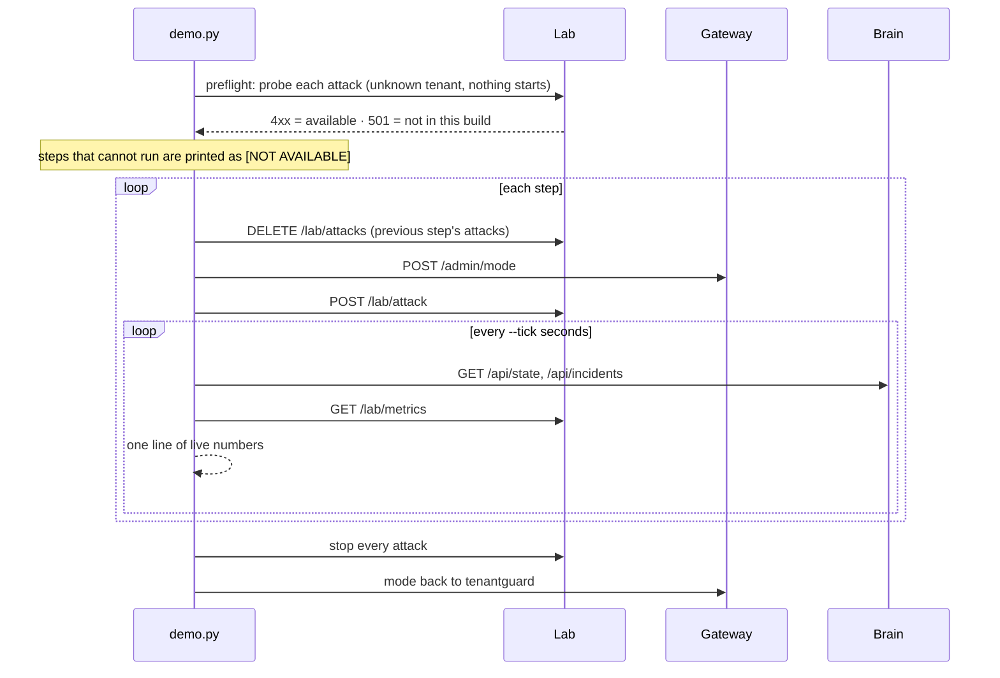

[← TenantGuard](../README.md)

# Demo driver

**The whole demo in one command: it switches modes, launches attacks in the lab, prints live numbers from the brain and the lab at every tick, and cleans up after itself, even on Ctrl-C.**

 

## At a glance

| Role | Port | Entry point | Talks to |
|---|---|---|---|
| Presenter's script: timed or step-by-step demo with live narration | none (a client) | `python tools/demo.py` | Gateway (`POST /admin/mode`), lab (calm, attacks, metrics, results), brain (`/api/state`, `/api/incidents`), a replica's `/admin/fault` (fallback only) |

## How it works



- **Preflight:** before the show, the driver asks the lab which attacks it can run without starting any: it probes with an unknown tenant, so an available attack answers 4xx and one not in this build answers 501.
- **Fallbacks:** the black-box bomb falls back to `whale`. `faulty_server` falls back to a direct `POST /admin/fault` on the replica named in `TENANTGUARD_WORKER_URLS`, only if that replica answers `/healthz` from here.
- **Skipped steps:** a step whose attack is not available and has no working fallback is printed as `[NOT AVAILABLE]` up front and skipped during the show. In this build the lab ships `flood`, `whale`, `hog`, `memory` and `retry_storm`, so steps 4 and 5 run with `whale`, step 6 runs only with a reachable replica, and step 7 is skipped.
- **Live line:** every `--tick` seconds, from the brain: mode, fairness, utilization, worst victim p95, attacker level and factor, and the status sentence; from the lab: client-side victim p95 (calm traffic only), attacker ok/s and 429/s.
- **Each step** stops the previous attacks before starting its own. A failed attack is reported and the demo goes on.
- **Cleanup** (normal exit, error or Ctrl-C): stop every attack (retry, then one by one; anything left is printed), clear injected faults, set the mode back to `tenantguard`. A second Ctrl-C during cleanup is ignored.

**The steps** (durations in seconds; `--speed 0.5` halves them for rehearsal):

| # | Step | s | Mode | Attack |
|---|---|---|---|---|
| 1 | Calm | 15 | tenantguard | none (calm traffic) |
| 2 | OFF + flood | 30 | off | `flood` K |
| 3 | Industry + same flood | 15 | industry | `flood` K, refused with 429s |
| 4 | Industry + heavy attack | 30 | industry | `blackbox_bomb` K, else `whale` K |
| 5 | TenantGuard + same attack | 75 | tenantguard | same as step 4; incident stages printed as they happen |
| 6 | Faulty server | 20 | tenantguard | `faulty_server` on `--faulty-server` (fallback: direct fault) |
| 7 | Honest spike | 20 | tenantguard | `honest_spike` J |
| 8 | Scorecard | 25 | | table from `/lab/results` (latest run per scenario × mode) |
| 9 | Close | 10 | | |

## Configuration

| Env var / option | Default | Meaning |
|---|---|---|
| `TENANTGUARD_GATEWAY_URL` | `services.gateway` (`http://127.0.0.1:8000`) | Gateway |
| `TENANTGUARD_BRAIN_URL` | `services.brain` (`http://127.0.0.1:8200`) | Brain |
| `TENANTGUARD_LAB_URL` | `services.lab` (`http://127.0.0.1:8300`) | Lab |
| `TENANTGUARD_CONTROL_TOKEN` | `dev` | Sent on `/admin/mode` |
| `TENANTGUARD_WORKER_URLS` | empty | `name=url` pairs for the faulty-server fallback (replicas start on demand, so there is no fixed list) |
| `TENANTGUARD_ADMIN_TOKEN` | `dev` | Sent on a replica's `/admin/fault` |
| `--dry-run` | off | Print the plan and every HTTP call; send nothing |
| `--step` | off | Wait for Enter before each step |
| `--only <step>` | all | Run calm plus one step |
| `--attacker` / `--spiker` | `K` / `J` | Tenants for the attack and the honest spike |
| `--bomb` | `blackbox_bomb` | `blackbox_bomb` or `whale` |
| `--faulty-server` | `w4` | Replica for step 6 |
| `--tick` / `--speed` | 5 / 1.0 | Seconds between live lines; duration multiplier |

## Run it

```
python tools/demo.py --dry-run            # the plan and every HTTP call it would make; sends nothing
python tools/demo.py                      # timed run against the target
python tools/demo.py --step               # Enter before each step (the presenter sets the pace)
python tools/demo.py --only tenantguard   # calm + one step
python tools/demo.py --speed 0.5          # every step at half length (rehearsal)
```

The driver needs a running system. To start one on this machine without Docker: `python brain/tools/local_stack.py` from the repo root, then point the driver at it (`TENANTGUARD_GATEWAY_URL=http://127.0.0.1:8030`, `TENANTGUARD_BRAIN_URL=http://127.0.0.1:8230`, `TENANTGUARD_LAB_URL=http://127.0.0.1:8330`).

## Test it

```
cd tools
PYTHONPATH=<repo>/common python -m pytest       # 16 passed (step sequencing against mocked HTTP)
```

## Files

```
tools/
  demo.py               the demo driver: plan, preflight, steps, live line, cleanup
  tests/test_demo.py      sequence, whale fallback, dry run, live line, scorecard table
  tests/test_demo_t20.py  preflight skips, faulty-server fallback, stop retries, Ctrl-C cleanup
```

## Related docs

- [v2 architecture](../docs/v2/02_ARCHITECTURE.md)
- [As built](../docs/v2/09_AS_BUILT.md)
