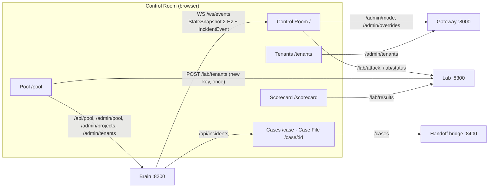

[← TenantGuard](../README.md)

# Control Room UI

**One screen that shows who is using the pool, who is slowed, what the brain did about it, and why.**

   

## At a glance

| Role | Port | Entry point | Talks to |
|---|---|---|---|
| Operator dashboard and admin screen | 5173 (binds 0.0.0.0) | `npm run dev` (`src/main.tsx`) | brain (WS + REST), gateway admin API, lab, handoff bridge |

Stack: React 18, Vite 5, TypeScript 5, Tailwind 3, Recharts 2, React Router 6.

## How it works



- **Live state** arrives over the brain's WebSocket. It reconnects with backoff (0.5 s to 8 s); the timeline is backfilled from `GET /api/incidents` on load.
- **Every admin call** (gateway and brain `/admin/*`) sends `X-TenantGuard-Control-Token: $VITE_CONTROL_TOKEN`. It must equal the services' `TENANTGUARD_CONTROL_TOKEN`.
- **Contracts:** `src/types.ts` mirrors `common/tenantguard_common/contracts.py`. The services must allow CORS from the UI origin.
- **Optional services** (lab, handoff bridge): when one is down, its panel says "not reachable" and the rest keeps working.

## Pages

| Page | What it shows |
|---|---|
| **Control Room** `/` | Status sentence; ₹ impact panel; Jain fairness and pool-CPU gauges; OFF / Industry / TenantGuard toggle; a tile per tenant (p95, rps, rejected/s, level, quota factor, project); p95 per tenant over 60 s (log scale); stacked CPU share; noisy-score bars; incident timeline; replica grid; attack launcher |
| **Pool** `/pool` | The admin screen: guaranteed floors and allocation now (lent cores striped, measured use as a line); a project table (tier, weight, floor, cap, warm replicas, demand, used, base + lent, replicas, tenants); forms to resize the pool, create / edit / delete projects and add / remove tenants |
| **Tenants** `/tenants` | Read-only: project and tier, replicas in the tenant's rendezvous order (and its pin during a split test), live p95 and level, tier quota against the effective quota, override expiry, revenue |
| **Cases** `/case` | Every case, newest first, with its handoff case id and owner when the bridge answers |
| **Case File** `/case/:incident_id` | The case story, suspects with confidence, verdict, last action and override TTL, the report, hash-split rounds, the project's live replicas, the full event log |
| **Scorecard** `/scorecard` | `RunResult`s from the lab, grouped by scenario × mode |

### Control Room details

- **Tiles** stay in two rows on wide screens whatever the tenant count (three rows above 16 tenants). Clicking a tile outlines its project on the replica grid.
- **Replica grid:** one row per project with tier, allocation (base + lent cores), floor marker and state. Each replica shows its status, CPU against its cap, memory and `LOAN` when borrowed. Starting and draining replicas are hatched; split-test pins are named. The panel scrolls when there are more projects than fit.
- **Flow view** (Tiles / Flow toggle, or `?view=flow`): dots travel tenant → gateway → the ready replicas of that tenant's project. Refused requests die at the gateway as red crosses; a split test draws pin lines; lent capacity is named in the hint line.

### Pool page details

- A new project whose floor is above the free cores is refused before it is sent; the brain still has the last word and its 422 text is shown as it is.
- A new tenant's **API key is shown once** (only its SHA-256 is stored). The page hands it to the lab at once (`POST /lab/tenants`), so the tenant gets calm traffic and appears in the attack launcher.
- **Deleting:** × next to a tenant removes it and stops its lab traffic. A project's **Delete** works once it has no tenants, and asks for confirmation. The pool cannot be deleted, only resized: it is the capacity of the machine.

### Three kinds of case

| Kind | Id | Steps |
|---|---|---|
| Tenant (the ladder) | `inc-…` | Detected → Rescued → Named → Proving → Verdict → Resolved → Explained |
| Hash split of one project (hidden CPU) | `srv-…` | Hidden CPU → Split rounds → Verdict → Closed |
| Host-wide slowdown (nobody blamed) | `srv-…` | Slowdown → No blame → Recovered |

### ₹ impact panel

Computed in the browser since the page opened (reset button under "innocents"), integrated per snapshot (dt capped at 2 s):

| Figure | Rule |
|---|---|
| Threatened tenant | shares a project with a flagged tenant (level ≥ warn), or its project has a slow replica whose p95 would breach the SLO; culprits never count |
| SLO breach avoided | seconds a threatened tenant stayed within SLO (`p95 < VITE_P95_WARN_MS`) in TenantGuard mode |
| SLO breach suffered | seconds any tenant was over SLO, in any mode |
| Revenue protected | Σ avoided seconds × that tenant's `monthly_revenue_rs` ÷ 30 days |
| Innocents penalised | tenants acted on (level ≥ throttle or factor < 1) that were never noisy and no incident names; must stay 0 |

### Design rules

- Colour means status only: green / amber / red, grey = idle, plus one accent (sky) for interactive, selected and lent things.
- Every number has a unit.
- Laid out for a 1920×1080 projector on one screen; also checked at 1366×768.

## API

The UI serves no API. It calls these:

| Service | Calls | Used for |
|---|---|---|
| Brain | `WS /ws/events`, `GET /api/incidents[?incident_id=]` | live state, timeline, Case File |
| Brain | `GET /api/pool`, `PUT /admin/pool`, `POST / PATCH / DELETE /admin/projects`, `POST /admin/projects/{id}/tenants`, `DELETE /admin/tenants/{id}` | Pool page |
| Gateway | `GET / POST /admin/mode`, `GET /admin/tenants`, `GET /admin/overrides` | mode toggle, Tenants page, limits / pins / blocks and their expiry, snapshot age |
| Lab | `GET /lab/status`, `POST /lab/attack`, `DELETE /lab/attack/{id}`, `POST /lab/tenants`, `DELETE /lab/tenants/{id}`, `GET /lab/results` | attack launcher, new tenants' traffic, Scorecard |
| Handoff bridge | `GET /cases` | Cases column, Case File handoff panel |

## Configuration

Set in `ui/.env` (copy `.env.example`) or the environment.

| Variable | Default | Meaning |
|---|---|---|
| `VITE_BRAIN_URL` | `http://127.0.0.1:8200` | brain REST + WebSocket |
| `VITE_GATEWAY_URL` | `http://127.0.0.1:8000` | gateway admin API |
| `VITE_LAB_URL` | `http://127.0.0.1:8300` | traffic lab |
| `VITE_HANDOFF_URL` | `http://127.0.0.1:8400` | handoff bridge |
| `VITE_CONTROL_TOKEN` | `dev` | sent as `X-TenantGuard-Control-Token` on admin calls |
| `VITE_MOCK` | `0` | `1` = run the in-browser simulation, no backend |
| `VITE_P95_WARN_MS` / `VITE_P95_BAD_MS` | `150` / `400` | amber / red p95 thresholds |
| `VITE_NOISY_WARN` / `_THROTTLE` / `_QUARANTINE` | `1.5` / `2` / `4` | fallback noisy-bar marks (the brain's `noisy_thresholds` win) |

URL switches: `?mock=1` / `?mock=0` override `VITE_MOCK`; `?view=flow` opens the flow view.

## Run it

```bash
# the whole system on one laptop, no Docker (brain, gateway, replicas, lab, handoff, narrator, UI on :5180)
python brain/tools/local_stack.py

# the UI alone
cd ui
npm install
cp .env.example .env      # point the URLs at your stack
npm run dev               # real backends
npm run dev:mock          # in-browser simulation, no backend
```

### Mock stack

- `src/mock/sim.ts` simulates the v2 platform and emits contract-shaped messages: floors first, then idle CPU lent by tier weight; replicas that start, drain and borrow; a tenant reaches only its own project's replicas; the ladder judges a tenant against its project peers.
- `src/mock/mockBackend.ts` runs it in the browser (`VITE_MOCK=1`).
- `scripts/mock-ws-server.mjs` (`npm run mock-ws`) serves the same simulation over real HTTP + WS with CORS and the token check (brain :18200, gateway :18000, lab :18300), to exercise the real network code. Needs Node ≥ 23.6.

## Test it

```bash
npm test           # vitest: 82 tests in 12 files
npm run lint       # eslint, zero warnings
npm run build      # tsc -b + vite build
npm run e2e        # Playwright on the mock stack (starts it itself)
```

Against a running stack (it writes: mode, an attack, a project and a tenant, and restores or removes them):

```bash
E2E_UI_URL=http://127.0.0.1:5180 E2E_GATEWAY_URL=http://127.0.0.1:8030 E2E_BRAIN_URL=http://127.0.0.1:8230 \
E2E_LAB_URL=http://127.0.0.1:8330 E2E_HANDOFF_URL=http://127.0.0.1:8430 E2E_NARRATOR_URL=http://127.0.0.1:8730 \
E2E_ALLOW_WRITES=1 npm run e2e
```

| Spec | Tests | Covers |
|---|---|---|
| `e2e/api.spec.ts` | 12 | gateway auth (401 without key or token), measured-CPU header, admin tenants in one project each; brain state shape, pool invariants, admin token, incidents; lab, handoff and narrator shapes (skipped when unreachable) |
| `e2e/ui.spec.ts` | 10 | tiles + replica grid + status sentence; tile → project outline; mode round-trip; launcher offers exactly the five attacks; attack start → Stop; Pool page create / refuse / add tenant / key to the lab / delete from the page; timeline → Case File; Scorecard; flow view; Cases handoff column |
| `e2e/layout.spec.ts` | 3 × 2 sizes | no overlapping panels, a stable status bar, every flagged tile says why (1366×768 and 1920×1080) |
| `e2e/live.spec.ts` | 1 (`E2E_LIVE=1`) | calm → whale on K → incident within 60 s → stop → recovery within 90 s |

The suite runs headless on the system Edge (`channel: "msedge"`), one worker: 28 tests by default. Every UI test fails on an uncaught page error or a console error (`e2e/fixtures.ts`); only failed loads to an optional service known to be down are tolerated. Writes are skipped while the lab reports a scenario run in progress.

## Files

```
ui/
├─ src/
│  ├─ pages/          ControlRoom, Pool, Tenants, Cases, CaseFile, Scorecard
│  ├─ components/     tiles, replica grid, flow view, charts, gauges, timeline, launcher, status bar
│  ├─ lib/            pure logic with unit tests: case folding, impact, admin forms, flow, store, status
│  ├─ mock/           in-browser simulation of the v2 platform
│  ├─ types.ts        mirror of the shared contracts
│  └─ config.ts       env + URL switches
├─ e2e/               Playwright specs and fixtures
└─ scripts/           mock HTTP/WS server, screenshot, load generator, sim smoke test
```

## Related docs

- [v2 index](../docs/v2/00_INDEX.md) · [Architecture](../docs/v2/02_ARCHITECTURE.md) · [Diagrams](../docs/v2/06_DIAGRAMS.md) · [As built](../docs/v2/09_AS_BUILT.md)
