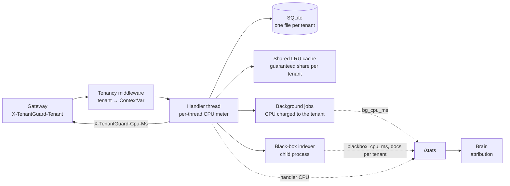

[← TenantGuard](../README.md)

# Worker

**The shared multi-tenant SaaS app that every replica runs, with a CPU meter on every request and a black box no meter can see.**

  

## At a glance

| Role | Port | Entry point | Talks to |
|---|---|---|---|
| The application tenants pay for: per-tenant data and cache, background jobs, a black-box "vendor indexer", per-tenant CPU metering, fault injection | 8100 in the container (process replicas: from `TENANTGUARD_PROCESS_BASE_PORT`) | `python -m app` | Called by the gateway; polled by the brain (`/stats`) |

The brain starts one replica per project need, with the project's tenants in `TENANTGUARD_TENANTS`. As a container it carries the labels `tg.stack`, `tg.project`, `tg.replica`, `tg.borrowed` and its own `NanoCpus`, `CpuShares` and memory limit.

## How it works



- **Tenancy** (`tenancy.py`): a pure-ASGI middleware puts the tenant in a `ContextVar`; it flows into the sync handler's thread and into background jobs.
- **Data** (`store.py`): one SQLite file per tenant, re-seeded at start; the repository has no tenant parameter.
- **Cache** (`cache.py`): a shared LRU keyed by (tenant, key), with a guaranteed share per tenant and an eviction ledger.
- **Metering** (`meter.py`, `cpuclock.py`): per-thread CPU. Linux uses `time.thread_time()`; Windows uses `QueryThreadCycleTime`, because `GetThreadTimes` only moves in 15.6 ms steps.
- **Background jobs** (`jobs.py`): run in a copied context; their thread CPU is charged to that tenant as `bg_cpu_ms`.
- **Black box** (`blackbox.py`): a child process fed by a bounded queue (drops counted) and restarted with backoff. Its CPU is reported only as `blackbox_cpu_ms`, with the documents accepted per tenant, so the brain can split it. It shares the container's CPU limit, so heavy ingest slows every tenant on the replica while every tenant meter stays near zero.
- **Memory** (`malloc.py`, `memory.py`): large buffers go back to the OS. The mmap threshold is pinned to 128 KB, arenas are capped at 2, `/api/memory` holds use `mmap`, memory is trimmed every 30 s, and each SQLite connection is bounded. Reported when the fix was made (task T28; no results file is committed): +111 MB kept after one load burst before the fix, +0.6 MB after.

**Why it matters:** measured in a 0.5-CPU container (`calibration.json`, 200 sequential requests per endpoint):

| Endpoint | Handler CPU (mean) | Whole-process CPU per request |
|---|---|---|
| `GET /api/light` | 0.40 ms | 0.95 ms |
| `GET /api/search` | 3.83 ms | 4.67 ms |
| `POST /api/write` | 0.19 ms | 3.1 ms |
| **`POST /api/ingest`** | **0.07 ms** | **23.5 ms** |

An `ingest` call looks cheaper than `light` to anything that meters the request, yet costs the replica about 25× more CPU. The brain's attribution and hash split exist to find that gap.

## API

All `/api/*` calls need `X-TenantGuard-Tenant` (missing or malformed → 400; a tenant this replica does not serve → 400 `unknown_tenant`). Every response carries `X-TenantGuard-Cpu-Ms` (handler thread CPU). Errors are `{error, tenant, detail}`.

| Method | Path | Auth | What it does |
|---|---|---|---|
| GET | `/api/light` | tenant | Cheap request; the victim SLO probe |
| GET | `/api/read?key=k0001` | tenant | Tenant cache → tenant SQLite; 404 if absent |
| GET | `/api/search?n=20000&q=` | tenant | CPU-heavy, linear in `n` (≤ 2,000,000) |
| POST | `/api/write` `{key?, value, index_rounds=200}` | tenant | DB write + background indexing charged to the tenant; 503 `bg_backlog` past `worker.bg_pending` |
| POST | `/api/ingest` `{docs=10}` | tenant | 202; hands documents to the black box (`worker.blackbox.cpu_ms_per_doc` each) |
| GET | `/api/memory?mb=&hold_ms=500` | tenant | Allocate and hold; 507 past the tenant or worker memory budget |
| GET | `/api/export?rows=1000&chunk=100&pause_ms=20` | tenant | Slow batch CSV export; 422 if longer than `worker.max_request_s` |
| GET | `/canary`, `/canary/{cpu,cache,db}` | – | Unattributed probes |
| GET | `/healthz` | – | Liveness, background backlog per tenant, black-box queue / drops / restarts |
| GET | `/stats` | – | `WorkerStats`: cumulative per-tenant and process counters (the brain's input) |
| POST · GET · DELETE | `/admin/fault` `{latency_ms, cpu_burn_pct, duration_s?}` | admin | Faulty-host simulation |
| GET · POST | `/admin/memory`, `/admin/memory/trim` | admin | Where the memory is; on-demand trim |

"tenant" = `X-TenantGuard-Tenant`; "admin" = `X-Admin-Token`. Bodies above `worker.body_limit_bytes` (1 MB) → 413; an unhandled error → 500 JSON, still with the CPU header.

## Configuration

| Env var / yaml key | Default | Meaning |
|---|---|---|
| `TENANTGUARD_TENANTS` | every seed tenant | Comma list of the tenants this replica serves (set by the brain per project) |
| `SERVER_NAME` | `w0` | Replica id (the brain sets it, e.g. `tg-media-1`) |
| `WORKER_DATA_DIR` | `./data/<server>` (`/data` in Docker) | Per-tenant SQLite files |
| `CPU_LIMIT_CORES` | cgroup `cpu.max`, else `worker.cpus` | CPU limit used for utilisation |
| `TENANTGUARD_ADMIN_TOKEN` | `dev` | `/admin/*` token |
| `TENANTGUARD_UI_ORIGINS` | `http://127.0.0.1:5173` | CORS origins |
| `worker.cpus` / `worker.mem_limit_mb` | 0.5 / 256 | Defaults when no limit is given |
| `worker.tenant_mem_budget_mb` / `worker.cache_mb` | 32 / 8 | Per-tenant memory budget; shared cache size |
| `worker.bg_threads` / `worker.bg_pending` | 4 / 200 per tenant, 1000 total | Background job pool and backlog caps |
| `worker.blackbox` | 2.0 ms per doc, queue 5000 | Black-box cost and queue |
| `worker.memory_trim_s` / `worker.max_request_s` | 30 / 30 | Trim period; longest allowed request |

## Run it

```
pip install -e common && pip install -r worker/requirements.txt
cd worker && SERVER_NAME=tg-health-1 TENANTGUARD_TENANTS=A,D python -m app --port 8101
```

In the full system the brain starts replicas itself: Docker containers from the `tenantguard-worker` image, or local processes with `TENANTGUARD_BACKEND=process`. To run everything locally: `python brain/tools/local_stack.py`.

Build the image: `docker compose --profile image build worker`.

## Test it

```
cd worker && PYTHONPATH=<repo>/common python -m pytest
```

55 passed, 1 skipped.

## Files

```
app/
  main.py      FastAPI app, endpoints, body limit, error handling
  tenancy.py   tenant middleware (ContextVar)
  store.py     one SQLite file per tenant
  cache.py     shared LRU with a guaranteed share per tenant
  jobs.py      background jobs charged to their tenant
  blackbox.py  the "vendor indexer" child process
  meter.py · cpuclock.py   per-request and per-thread CPU
  stats.py     WorkerStats for the brain
  fault.py     faulty-host simulation
  malloc.py · memory.py    memory return and inspection
  work.py      the CPU work behind each endpoint
  config.py    tenantguard.yaml + env
tools/
  calibrate.py   writes calibration.json (cost of each endpoint)
  noisy_demo.py  measures the noisy-neighbour effect
  memrepro.py    reproduces the allocator retention
calibration.json  measured endpoint costs (0.5-CPU container)
```

## Related docs

[Architecture](../docs/v2/02_ARCHITECTURE.md) · [Data and config](../docs/v2/05_DATA_AND_CONFIG.md) · [As built](../docs/v2/09_AS_BUILT.md)
